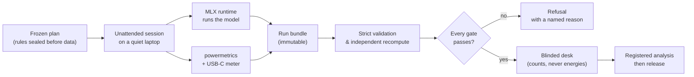

# JouleWise

<p align="center">
  <picture>
    <source media="(prefers-color-scheme: dark)" srcset="docs/assets/readme/hero-dark.svg">
    
  </picture>
</p>

<p align="center">
  <b>A pre-registered, blinded instrument for measuring the energy of local LLM inference,<br>
  one that reports what it can resolve, refuses what it cannot, and traces every number to raw evidence.</b>
</p>

<p align="center">
  
  
  
  
  <a href="LICENSE"></a>
</p>

---

## Why this exists

Every token a language model writes costs energy, and a laptop already carries the sensors to measure it.
The hard part is honesty. A software power sampler reports *averages* over records about a tenth of a second
long, clocks drift, the operating system wakes up at inconvenient moments, and a warm chip draws different
power from a cold one. It is easy to produce a confident number that the instrument cannot actually support.

JouleWise treats those limits as part of the result. Each reported energy comes with how far timing alone could
have moved it, the smallest difference the setup can tell apart from nothing, and a written reason whenever it
declines to report at all.

<table>
<tr>
<td width="33%" valign="top">

### ⚡ Measure
Run open models locally on Apple Silicon. Record processor power from `powermetrics` and whole-machine input
power from a USB-C meter between the wall adapter and the laptop. Split energy into **prefill** (reading the
prompt) and **decode** (writing the answer).

</td>
<td width="33%" valign="top">

### 🛑 Refuse
Every check is a gate. A session whose clock fit, thermal state, battery state or background load falls
outside its registered limits is **refused with a named reason**, and kept and disclosed rather than
quietly dropped.

</td>
<td width="33%" valign="top">

### 🔗 Trace
Each run is an immutable **bundle** (config, events, raw power trace, outputs, summary). Strict validation
re-derives every summary from the raw records, and an independent recompute checks the core arithmetic.

</td>
</tr>
</table>

## Research lines

| | Question | Where it stands |
|---|---|---|
| **Phase energy** | How finely can a laptop's own power counters divide inference energy between prefill and decode? | Primary block and a nine-session replication collected blind and released; written up in [Paper 1](docs/paper/paper1/paper1.md) |
| **BYTES** | Does decode energy per token follow the bytes a model reads per token, its resident size, or its decode time? Lines fixed on dense models are committed before held-out models, including mixture-of-experts, are unblinded. | Registered; the held-out unblinding is pending |
| **The energy tripwire** | *An agent can edit its own logs; it cannot edit the joules it drew from the wall.* Does sabotage by an LLM agent leave an energy signature beyond what its own log explains? | Protocol v4 on SHADE-Arena task pairs: registration and calibration in progress, no outcome opened. Overview: [the energy tripwire](docs/research/energy-tripwire.html) |

## How a measurement works



1. **Plan first.** What is measured, which checks remove a session and how the numbers are analysed are frozen
   and reviewed before any data exist.
2. **Collect unattended.** A launchd job arms a session on the measurement laptop, waits for thermal and idle
   conditions, and runs a fixed list of model requests between opening and closing calibrations.
3. **Check blind.** A desk program decides whether each session counts by reading only counts and check
   results. Nobody looks at a measured energy until the registered analysis is written and reviewed.
4. **Release.** Results are opened in the registered order, with deviations logged publicly.

## What it has found so far

From [Paper 1](docs/paper/paper1/paper1.md), on an M3 Max with MLX and `powermetrics` processor rails, from one
session per model. These are gross energy per request with intervals, and are instrument results (L1): phase
attribution was not checked by an independent instrument.

| Model (4-bit) | Decode, 512 tokens | Prefill, 2,048 tokens |
|---|---:|---:|
| Qwen3-1.7B | 51.21 J [48.92, 53.49] | 26.25 J [23.32, 29.19] |
| Qwen3-8B | 198.36 J [195.23, 201.49] | 128.28 J [125.19, 131.38] |

Both registered contrasts came out *direction supported* (the larger model used more phase energy), and both
replicated: each of the three replication contrast sessions gave the primary session's outcome word and sign.
The paper, its figures and the exact registered wording are the authority; this table only points to them.

## How the work is run

The study is run by a pipeline of AI agents under human direction. Builders write code. Separate reviewers
execute it and attack it with mutants. A research lead rules on design questions in a public decision log. A
resident "magistrate" on the measurement laptop arms sessions and reports by email. The controls that keep
agents from changing what is measured, or how, are part of the method, and Paper 1 describes where they held
and where they failed.

## Quick start (mock target, no hardware needed)

```bash
pip install -e .

# Produce a complete run bundle from the deterministic mock target
python3 -m joulewise run configs/examples/mock_local.json --runs-dir runs

# Structurally verify a bundle, then re-derive its summary from the recorded trace
python3 -m joulewise validate-bundle runs/example-mock-local
python3 -m joulewise reduce runs/example-mock-local

# Render a static HTML run browser (needs: pip install -e '.[analysis]')
python3 -m joulewise report runs --output report
```

A run bundle (`runs/<run_id>/`) holds the normalized `config.json`, `metadata.json`, the `events.jsonl`
lifecycle/phase/token log, the raw `power_trace.csv`, model outputs, per-component logs and the reduced
`summary_metrics.json`. The summary is written last, so its presence marks a complete bundle.

Bundles are immutable evidence: re-running a config into the same `--runs-dir` fails with a run-ID collision
by design. Move the old bundle aside, change `run_id`, or use a fresh directory.

<details>
<summary><b>Config and schema verbs</b></summary>

```bash
python3 -m joulewise validate-config configs/examples/mock_local.json
python3 -m joulewise print-config-schema
python3 -m joulewise print-output-schema
```

</details>

## Current State

Live state, the work queue and the next step are in [`RUN_STATE.md`](RUN_STATE.md). Its generated state-kernel
region is the current work-selection view, built from
[`docs/process/state_kernel.json`](docs/process/state_kernel.json). [`CANONICAL.md`](CANONICAL.md) names the one
current tool or document for each job.

**Voided historical corpora.** The energy values from the July 2026 Qwen2.5-1.5B corpus and the nine-bundle
exploratory follow-on (OLMoE-1B-7B, Qwen3-4B, Qwen3.5-122B-A10B) are **voided permanently for claim use**.
Their power traces and workload events were joined through a defective pre-repair time anchor (D-078). The
bundles stay strict-valid as stored evidence for audit, but those energies are not under re-adjudication and
must not be quoted. Where JouleWise reports energy, the headline basis is gross measured energy inside the named
boundary. Idle-subtracted energy is a within-device secondary view only.

## Verify

```bash
python3 scripts/shard_tests.py --workers 8 --split
```

This runs the whole suite in parallel shards; set the worker count to your core count. Running
`python3 -m unittest discover -s tests` sequentially takes hours. CI runs the same tests, split into parallel
jobs, for every change that touches a file other than documentation. This page pins no pass count, because the
command's output is the current result.

## Release

The ordered publication path, including private-corpus, network, Node/Lakebed and credential boundaries, is in
[`docs/publication_release_checklist.md`](docs/publication_release_checklist.md). Its clean-clone gate is
`python3 scripts/release_check.py --dry-run`, which performs real temporary-directory builds and never deploys.

## Find your way around

| If you want… | Start here |
|---|---|
| The paper | [`docs/paper/paper1/paper1.md`](docs/paper/paper1/paper1.md) |
| The project at a glance (advisor view) | [`PROJECT_STATUS.md`](PROJECT_STATUS.md) |
| What is happening right now | [`RUN_STATE.md`](RUN_STATE.md) |
| The current tool for a job | [`CANONICAL.md`](CANONICAL.md) |
| Measurement terms, defined once | [`docs/glossary_measurement_terms.md`](docs/glossary_measurement_terms.md) |
| Design decisions and why | [`docs/decision_log.md`](docs/decision_log.md) |
| Research agenda | [`docs/research/AGENDA.md`](docs/research/AGENDA.md) |
| Running a step as an agent | [`docs/agent_playbook.md`](docs/agent_playbook.md): Mission M0 owns intake and close-out and routes the selected [`docs/process/state_kernel.json`](docs/process/state_kernel.json) task to its authority, acceptance criteria, plan and phase checklist |

The work queue is [`TASK_QUEUE.md`](TASK_QUEUE.md), generated from the state kernel. Risks live in
[`docs/risk_register.md`](docs/risk_register.md) and cross-review sessions in
[`docs/council_log.md`](docs/council_log.md). Under D-136, `docs/site/DRIFT.md` is a retained reference only: if Ed
chooses the manual workflow dispatch, Ed deploys the resulting snapshot.

## Licence

[MIT](LICENSE) © 2026 Ed R.
