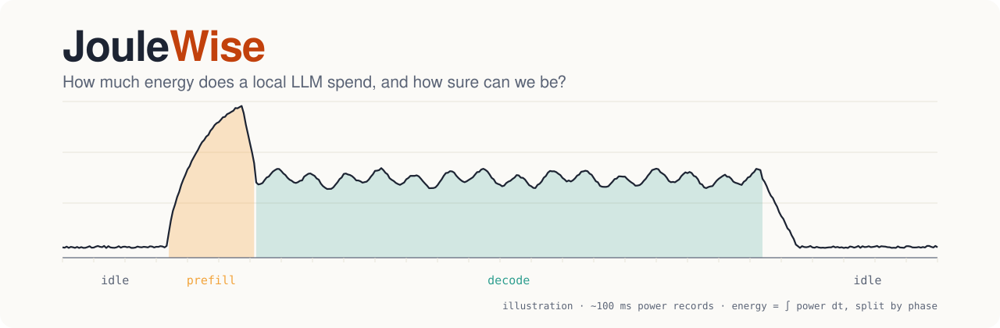
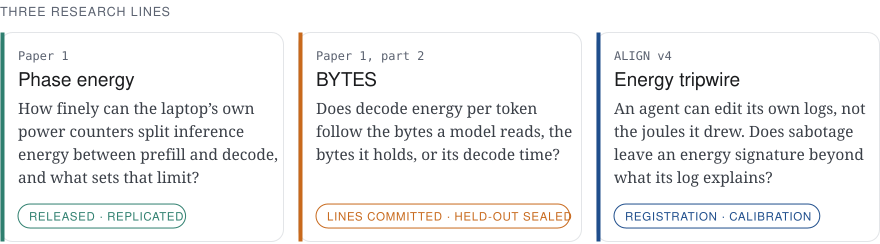
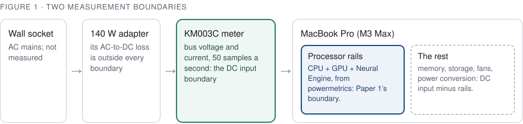
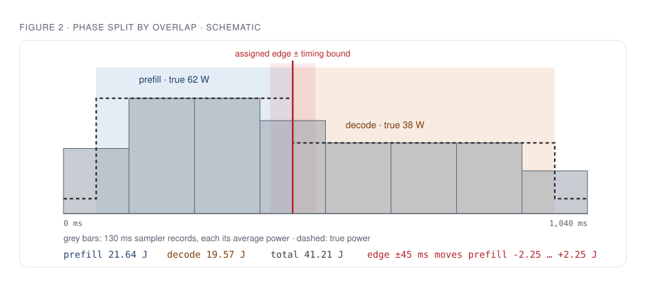
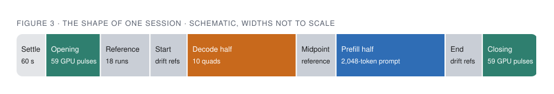
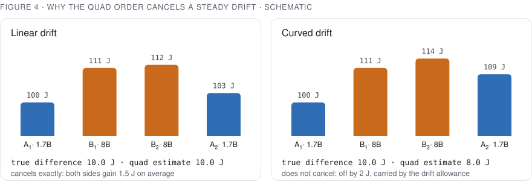
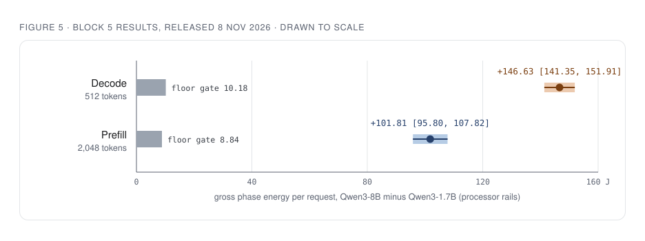
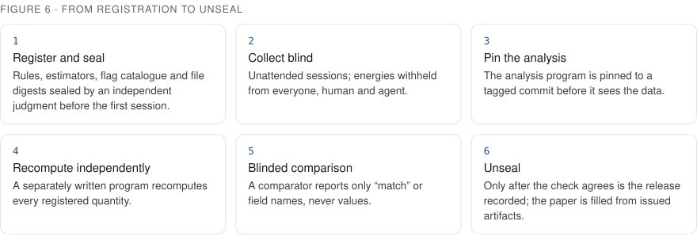
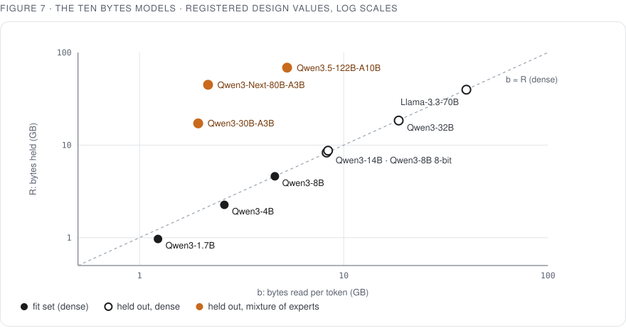

# JouleWise

<picture>
  <source media="(prefers-color-scheme: dark)" srcset="docs/assets/readme/hero-dark.svg">
  
</picture>

<picture>
  <source media="(prefers-color-scheme: dark)" srcset="docs/assets/readme/lines-dark.svg">
  
</picture>

## The question

A language model answers a request in two phases. In **prefill** it reads the whole prompt at once, which is mostly
arithmetic over many tokens. In **decode** it writes the answer one token at a time, and each token is a full pass
over the weights, which is mostly memory traffic. The two phases cost energy for different reasons, so their energies
answer different questions, from the price of a long prompt to the price of a long answer.

A laptop already carries power sensors: macOS's `powermetrics` reports the chip's power with no extra hardware. But
it reports *averages over records* of about a tenth of a second, and those records don't line up with the instant
prefill ends and decode begins. So JouleWise treats the instrument's limits as results. Every phase energy carries an
interval, an **attribution floor** (how far timing alone could move it), a **detection floor** (the largest difference the instrument produces when nothing differs, and so the smallest the registered analysis will call resolved in one session) and a **dominance ratio** (the factor by which timing uncertainty enlarges that floor).

<picture>
  <source media="(prefers-color-scheme: dark)" srcset="docs/assets/readme/fig1-boundaries-dark.svg">
  
</picture>

Paper 1 measures on the **processor rails** and never calls that wall or system energy. The meter between charger and
laptop is a descriptive cross-check there and a primary boundary for BYTES.

## Splitting a record between phases

Each power record contributes its average power times its overlap with a phase. Records wholly inside a phase count in
full, and a record that straddles the edge counts in proportion. The result is an *assigned* phase energy, not a
bound on the physical one. Moving the edge within the session's timing bound moves energy between the phases, and the
largest such movement is printed as the **attribution floor**.

<picture>
  <source media="(prefers-color-scheme: dark)" srcset="docs/assets/readme/fig2-phase-split-dark.svg">
  
</picture>

Phase edges and power records sit on one timeline only after calibration. Before the first run of every session and
after the last, the GPU is driven through 59 commanded one-second pulses, and how far the sampler sees those edges
from where they were commanded sets the session's timing bound.

<picture>
  <source media="(prefers-color-scheme: dark)" srcset="docs/assets/readme/fig3-session-dark.svg">
  
</picture>

## Comparing two models: the quad

Models are compared in **quads** ordered 1.7B, 8B, 8B, 1.7B, each giving one difference
d = (B₁ + B₂)/2 − (A₁ + A₂)/2. The fixed order cancels a steady drift exactly. A curved drift doesn't cancel, which
is why each session also carries reference requests and a drift allowance.

<picture>
  <source media="(prefers-color-scheme: dark)" srcset="docs/assets/readme/fig4-quad-dark.svg">
  
</picture>

## What it found

<picture>
  <source media="(prefers-color-scheme: dark)" srcset="docs/assets/readme/fig5-results-dark.svg">
  
</picture>

Both contrasts are **direction supported** and reach claim level L2 under the registered gate: each estimate exceeds its floor gate (146.63 J against 10.18 J for decode, 101.81 J against 8.84 J for prefill). All four published detection floors are set by the clock-anchor timing bound, not by run-to-run repeatability. The registered test for the stronger statement, that timing attribution dominates the detection floor, was not met (three of the twelve dominance ratios are below 2), so the paper makes no statement about which source limits these measurements. That an 8B model uses more energy than a 1.7B one is not news, and the paper does not present it
as news: the contrast is a known-direction test of the instrument. **The registered replication (Block 6, nine further sessions) gave the same outcome word and sign in each of its three contrast sessions.** "Replicated" is the registered word for that agreement; it is not a new test and carries no new interval.

| Gross energy per request, processor rails | Decode, 512 tokens | Prefill, 2,048 tokens |
|---|---:|---:|
| Qwen3-1.7B (4-bit) | 51.21 J [48.92, 53.49] | 26.25 J [23.32, 29.19] |
| Qwen3-8B (4-bit) | 198.36 J [195.23, 201.49] | 128.28 J [125.19, 131.38] |

One session per model, instrument results (L1); phase attribution was not checked by an independent instrument. The two models were measured in separate sessions in a fixed order, so the rows are not differenced into a comparison; the contrasts above come from their own interleaved session. The
paper, [`docs/paper/paper1/paper1.md`](docs/paper/paper1/paper1.md), is the authority for every number here.

## Blinding, release and an independent recomputation

<picture>
  <source media="(prefers-color-scheme: dark)" srcset="docs/assets/readme/fig6-pipeline-dark.svg">
  
</picture>

The counting rules, exclusions, estimators and the fixed outcome sentences were registered and sealed before the first session armed. Later errata, blind rulings and analysis-code changes are dated and disclosed in the paper (Section 5.5).
Energies stayed hidden until a recorded release, and the paper was drafted blind with a placeholder for every number.

## Part 2, BYTES: what drives decode energy per token?

Each decode pass reads the weights it uses. Energy per pass might follow the **bytes read per token**, the **resident
size**, or the **decode time**. On dense models the first two are nearly equal; mixture-of-experts models read far
fewer bytes than they hold, which is what lets the study tell the hypotheses apart. The rival lines were fitted on
three dense models and committed on 12 November 2026, before any held-out model's energy was unblinded. The seven held-out models remain sealed. One held-out model's timing had been read before the commitment; the paper discloses it.

<picture>
  <source media="(prefers-color-scheme: dark)" srcset="docs/assets/readme/fig7-bytes-dark.svg">
  
</picture>

## Next: the energy tripwire

*An agent can edit its own logs. It cannot edit the joules it drew.* The same instrument, extended with
the whole-machine meter and thermal gating, asks whether an LLM agent doing covert work in
[SHADE-Arena](https://arxiv.org/abs/2506.15740) leaves an energy signature beyond what its own log explains. Protocol
v4 is in registration and calibration; no outcome has been opened. Overview:
[`docs/research/energy-tripwire.html`](docs/research/energy-tripwire.html).

## How the research is run

The study is run by AI agents under human direction, and Paper 1 reports that as part of the method, including the
failures its controls did and did not catch. A lead session on an analysis laptop plans and builds. A headless **magistrate** on the measurement Mac does one step at a time and exits before any capture: a live AI agent process on that machine is a registered hazard that refuses the arm. A research-lead model rules on design and paper text in a public decision log. Since 27 October 2026, code that can compute, select or exclude a published number is reviewed by two sessions from different model families that execute and mutate it, and separately written code recomputes the core arithmetic. Ed sets the research direction, the methodological requirements and the process policy, and is the escalation point for changes to what is measured or claimed.

**What this does not claim.** All measurements come from one laptop, one operating-system build per session, one
inference framework and one sampler. The decode workload uses one fixed prompt and the prefill workload one prompt
length. The replication is across sessions and days on the same machine, not across machines. Nothing here is a statement about other prompts, models, machines or boundaries.

## Quick start (mock target, no hardware needed)

```bash
pip install -e .

# Produce a complete run bundle from the deterministic mock target
python3 -m joulewise run configs/examples/mock_local.json --runs-dir runs

# Structurally verify a bundle, then re-derive its summary from the recorded trace
python3 -m joulewise validate-bundle runs/example-mock-local
python3 -m joulewise reduce runs/example-mock-local

# Render a static HTML run browser (needs: pip install -e '.[analysis]')
python3 -m joulewise report runs --output report
```

A run bundle (`runs/<run_id>/`) holds the normalized `config.json`, `metadata.json`, the `events.jsonl`
lifecycle/phase/token log, the raw `power_trace.csv`, model outputs, per-component logs and the reduced
`summary_metrics.json`. The summary is written last, so its presence marks a complete bundle.

Bundles are immutable evidence: re-running a config into the same `--runs-dir` fails with a run-ID collision
by design. Move the old bundle aside, change `run_id`, or use a fresh directory.

<details>
<summary><b>Config and schema verbs</b></summary>

```bash
python3 -m joulewise validate-config configs/examples/mock_local.json
python3 -m joulewise print-config-schema
python3 -m joulewise print-output-schema
```

</details>

## Current State

Live state, the work queue and the next step are in [`RUN_STATE.md`](RUN_STATE.md). Its generated state-kernel
region is the current work-selection view, built from
[`docs/process/state_kernel.json`](docs/process/state_kernel.json). [`CANONICAL.md`](CANONICAL.md) names the one
current tool or document for each job.

**Voided historical corpora.** The energy values from the July 2026 Qwen2.5-1.5B corpus and the nine-bundle
exploratory follow-on (OLMoE-1B-7B, Qwen3-4B, Qwen3.5-122B-A10B) are **voided permanently for claim use**.
Their power traces and workload events were joined through a defective pre-repair time anchor (D-078). The
bundles stay strict-valid as stored evidence for audit, but those energies are not under re-adjudication and
must not be quoted. Where JouleWise reports energy, the headline basis is gross measured energy inside the named
boundary. Idle-subtracted energy is a within-device secondary view only.

## Verify

```bash
python3 scripts/shard_tests.py --workers 8 --split
```

This runs the whole suite in parallel shards; set the worker count to your core count. Running
`python3 -m unittest discover -s tests` sequentially takes hours. CI runs the same tests, split into parallel
jobs, for every change that touches a file other than documentation. This page pins no pass count, because the
command's output is the current result.

## Release

The ordered publication path, including private-corpus, network, Node/Lakebed and credential boundaries, is in
[`docs/publication_release_checklist.md`](docs/publication_release_checklist.md). Its clean-clone gate is
`python3 scripts/release_check.py --dry-run`, which performs real temporary-directory builds and never deploys.

## Find your way around

| If you want… | Start here |
|---|---|
| The paper | [`docs/paper/paper1/paper1.md`](docs/paper/paper1/paper1.md) |
| The project at a glance (advisor view) | [`PROJECT_STATUS.md`](PROJECT_STATUS.md) |
| What is happening right now | [`RUN_STATE.md`](RUN_STATE.md) |
| The current tool for a job | [`CANONICAL.md`](CANONICAL.md) |
| Measurement terms, defined once | [`docs/glossary_measurement_terms.md`](docs/glossary_measurement_terms.md) |
| Design decisions and why | [`docs/decision_log.md`](docs/decision_log.md) |
| Research agenda | [`docs/research/AGENDA.md`](docs/research/AGENDA.md) |
| Running a step as an agent | [`docs/agent_playbook.md`](docs/agent_playbook.md): Mission M0 owns intake and close-out and routes the selected [`docs/process/state_kernel.json`](docs/process/state_kernel.json) task to its authority, acceptance criteria, plan and phase checklist |

The work queue is [`TASK_QUEUE.md`](TASK_QUEUE.md), generated from the state kernel. Risks live in
[`docs/risk_register.md`](docs/risk_register.md) and cross-review sessions in
[`docs/council_log.md`](docs/council_log.md). Under D-136, `docs/site/DRIFT.md` is a retained reference only: if Ed
chooses the manual workflow dispatch, Ed deploys the resulting snapshot.

## Licence

[MIT](LICENSE) © 2026 Ed R.
