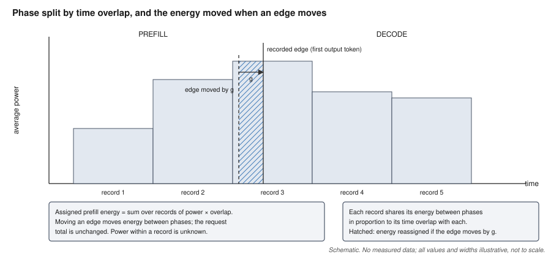
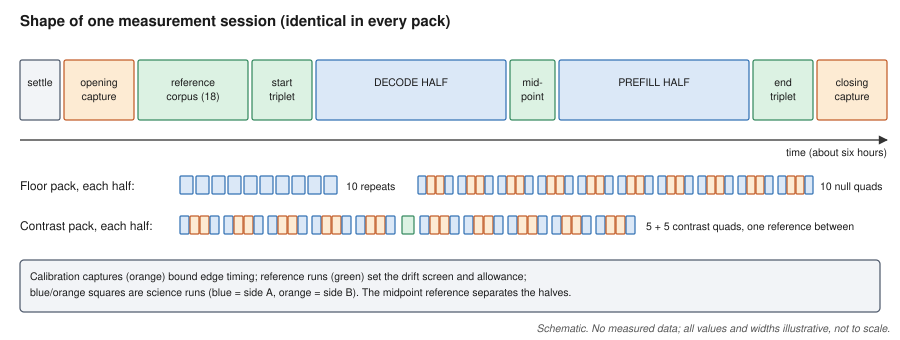
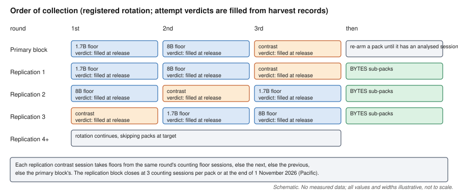
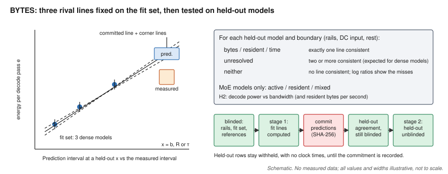
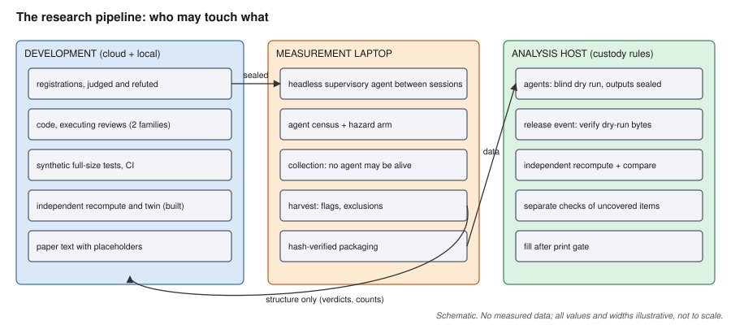
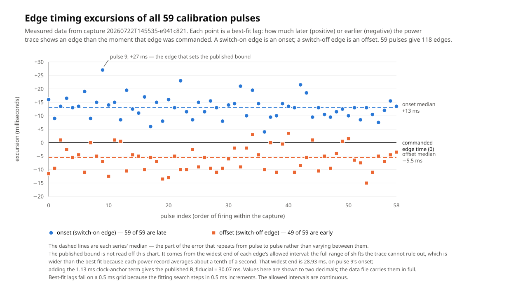

<!--
PAPER 1 — FULL DRAFT WITH PLACEHOLDERS (written 2026-10-27, before any block-5, block-6 or BYTES
result was released or seen by the author).

How to read this file:
- Every measured energy, floor, ratio, outcome word, count derived from collected data, and BYTES
  result is a placeholder {{FILL: <id> | <what it is>}}. Ids are listed in fill_index.md with the
  artifact and field that supply each one.
- Where the text must depend on an outcome, it is written in labelled branches:
  **[BRANCH <id>.<n> — <condition>]** ... **[END BRANCH <id>]**. On fill, keep exactly one branch of
  each group (the one the issued artifact selects) and delete the others. Never choose a branch by
  reading a number; the branch is selected by the artifact's outcome field named in fill_index.md.
- Synthetic worked examples are labelled "synthetic" and are not results.
- Shorter alternative sections for the contingency tiers B-E are in variants/.
- This text changes no registered analysis. If wording here and a registration differ, the
  registration governs and this text is corrected.
-->

# What a Laptop's Power Counters Can Resolve: A Pre-registered, Blinded Measurement of LLM Inference Energy on Apple Silicon

## Abstract

Language-model inference has two phases: *prefill*, in which the model reads the prompt and computes the first
output token, and *decode*, in which it writes the remaining tokens. We ask how finely a laptop's own power
sensors can divide inference energy between these phases, and we answer with a method whose limits are part of
its output. On one Apple M3 Max laptop running the MLX framework, the operating system's power sampler reports
the average power of the processor package (CPU, GPU and neural engine) over records of roughly a tenth of a
second. We assign each record's energy to a phase in proportion to its time overlap with the phase, and we carry
every source of timing uncertainty into the result: a calibration with commanded GPU pulses before and after
each measurement session, a fitted clock mapping, and a drift screen built from repeated reference requests.
From these we derive four quantities: the reported phase energy with an interval, the *attribution floor* (how
far timing alone can move one request's assigned energy), the *detection floor* (the largest difference the
instrument produces when nothing differs), and the *dominance ratio* (how much timing uncertainty enlarges the
detection floor). We then report a pre-registered, blinded experiment on Qwen3-1.7B and Qwen3-8B (4-bit), with
a 512-token decode workload and a 2,048-token prefill workload, two primary model contrasts with Holm
correction, and an independent recomputation of the core arithmetic from raw power records with recorded
collection-time judgments as inputs. A registered replication, nine further sessions on later days, was collected and analysed blind and released after the primary block. <!-- FACT H01: RL-5; R2P P3; LEAN-COVERAGE-AUDIT.md §§2-4; paper-audit C-11; RL-147 §8; RUN_STATE item 312. -->
On M3 Max / MLX / powermetrics SoC rails, from one session per model, the reported gross energy per request was 51.21 J [48.92, 53.49] for Qwen3-1.7B decode, 26.25 J [23.32, 29.19] for its 2,048-token prefill, 198.36 J [195.23, 201.49] for Qwen3-8B decode and 128.28 J [125.19, 131.38] for its 2,048-token prefill, each an instrument result (L1) whose phase attribution was not checked by an independent instrument. Timing movement did not at least double every detection floor (dominance branch B). The decode and 2,048-token prefill contrasts were both *direction supported*, in the registered direction (the 8B model used more phase energy than the 1.7B model), with 6 of 10 and 5 of 10 planned quads kept in one session. Both contrasts replicated under the registered definition: each of the three replication contrast sessions gave the primary session's outcome word and sign. In a second part, BYTES, we test whether decode energy per
token on the same laptop follows the bytes the model reads per token, its resident size in memory, or its
decode time: the registration requires three straight lines fixed on three dense models to be committed before
seven held-out models, including three mixture-of-experts models, are unblinded.
<!-- FACT H02: RL-5 item 5; paper-audit §4.2 (BYTES commitment is a requirement, not a completed step). -->
{{FILL: P1-ABS-PART2 | one sentence: the H1 verdict
words for the held-out models at the processor-rail and DC-input boundaries (P1-BY-H1-WORDS-*), the
active-or-resident answer (P1-BY-AR-*), and the primary energy-per-bandwidth coefficient with its interval
(P1-BY-H2-*), in the registered wording only}} Phase attribution is reported without a measured instrument
phase-accounting check. The study was run by a pipeline of AI agents under human
direction; we describe the controls that kept the agents from changing what was measured or how, and where
those controls failed.

## 1. Introduction

### 1.1 The question

A large language model (LLM) generates text one *token* at a time; a token is a short piece of text such as a
word, part of a word or a digit. Serving one request has two phases. In **prefill** the model processes the whole
prompt and computes the first output token. In **decode** it produces each later token with one *forward pass*
through the network, reading its weights and the stored keys and values of earlier tokens (the *KV cache*) from
memory. The two phases load the hardware differently: prefill is dominated by arithmetic over many prompt
tokens at once, decode by memory traffic for one token at a time. Their energies therefore answer different
questions, from the cost of long prompts to the cost of long answers.

Measuring phase energy on a laptop is attractive because the sensors are already there. macOS exposes the
processor's power through its `powermetrics` sampler, with no external meter and no special hardware. But a
software sampler reports *averages over records*, not instantaneous power, and its records do not line up with
the phase boundary. A record that begins in prefill and ends in decode reports one average for both. Any split
of that record between the phases is an allocation, and the allocation moves when the boundary moves. The
question this paper asks is therefore not only "how much energy does each phase use?" but first "how finely can
these sensors divide energy between phases at all, and what limits that?"

### 1.2 Approach

We treat the instrument's limits as results. Every reported phase energy carries:

- an interval that combines run-to-run scatter with three recorded bounds: how far the phase edges could sit
  from where they were placed, a (zero, for these traces) interpolation bound, and an allowance for drift over
  the measurement session (Section 4.3);
- an **attribution floor**: the largest amount by which phase-edge timing alone could move the energy assigned
  to one request's phase (Section 4.4);
- a **detection floor**: the largest energy difference the instrument produces between runs that do the same
  thing, and hence the smallest difference the registered analysis will call resolved in one session (Section 4.5);
- a **dominance ratio**: the factor by which allowing each value to move within its timing uncertainty
  enlarges the detection floor. A ratio of at least 2 means that timing movement at least doubles that floor. The statement that
  timing attribution dominates the detection floor is licensed only when every registered ratio is at least 2
  (Section 4.6).

The registrations fixed the counting and exclusion rules, estimators and specified fixed sentences before the
data they govern. Dated errata, interpretations and analysis-code changes are disclosed in Section 5.5.
The draft's additional branch prose was written before release, at commit `a1a5029fb`, after primary collection;
the blind draft is tagged `paper1/blind-draft-2026-10-27`. Everything changed after the primary release was changed by seats that could know the primary block's result. On 10 and 11 November 2026, statements of fact about the method and several branch glosses were corrected (`CORRECTIONS-2026-11-10.md`). On 11 November 2026, the sections were reordered with their text unchanged and the contingent subtitle was removed (`OUTLINE-MAP-2026-11-11.md`), Section 8 was rewritten from the project record, and the primary-block placeholders that the re-derivation table covers were filled from it, with the result sentences the fill required (`REDERIVATION.md`). Energies stayed hidden until a recorded release;
the independent recomputation uses recorded collection-time judgments as inputs (Section 5).
<!-- FACT H03: R2P P3/P5/P7; RL-1/RL-5; LEAN-COVERAGE-AUDIT.md §4. -->

### 1.3 Contributions

1. **A phase-attribution method with explicit limits** for interval-average software power records: an overlap
   rule, timing bounds derived from in-session GPU-pulse calibration and a fitted clock mapping, a detection
   floor with timing-widened corners, an attribution floor, a dominance ratio, a drift allowance from
   reference requests with a labelled scaled sensitivity line, and a whole-machine cross-check at the laptop's
   power input (Sections 3 and 4; Appendix D).
2. **A pre-registered, blinded measurement with a registered replication**: reported phase energies for two models, two
   primary model contrasts under a multiplicity correction and a claims ladder that caps what each result may
   say, and a replication in further sessions whose agreement word was defined before replication collection (Sections 5
   and 6). The replication's results are reported beside the primary block's (Section 6.8). <!-- FACT H04: paper-audit C-10/C-11; RL-5 item 5; RL-147 §8; RUN_STATE item 312. -->
3. **BYTES, a pre-registered test of what drives decode energy per token** on the same laptop, requiring rival
   lines to be committed before held-out models are unblinded and using mixture-of-experts models to separate
   bytes read from bytes held (Section 7).
4. **An account of research run by AI agents** under human direction, with the integrity controls that
   constrained them and the failures those controls did and did not catch (Section 8).

### 1.4 What this paper does not claim

All measurements come from one laptop, one operating-system build per session, one inference framework and
one sampler. The phase split rests on the sampler's own timing; no independent instrument checked where energy
falls within a record or at a phase edge (Appendix C, Phase attribution). The decode workload uses one fixed prompt, and the prefill workload
one prompt length. The whole-machine meter measures power entering the laptop after its adapter, not at the
wall. Section 9 lists these and the other limitations in full.

## 2. Background and related work

### 2.1 Software power counters: gain and time

Running Average Power Limit (RAPL) is an energy counter exposed by Intel and AMD processors. Khan et al. and Jay
et al. study the *gain* of such counters: how accurately a software counter reports the magnitude of energy
use against an external wall meter [4] [5]. Khan et al. align lag, model the relationship between RAPL and wall
power, account for temporal correlation and inspect update granularity, sampler overhead, jitter, overflow and
timestamps [4]. Jay et al. find that the disagreement between software meters and wall power changes with load,
and they decline component-level claims that their reference meter cannot test [5]. Agreement of whole-request
totals with a wall meter does not by itself validate how a software trace divides those totals between phases.

The *time* axis is closer to our problem. Hähnel et al. show that RAPL's update interval limits how short a code
path can receive a defensible energy attribution, and they align the start and end of the measured path to the
counter's own update boundaries [19]. Dauner et al. show, across RAPL and the NVIDIA Management Library
counter, that update behaviour and requested sampling frequency can materially change an energy reading [15].
Our method fits GPU pulse edges in the power record and carries the resulting timing allowance into every phase
energy; whether that allowance transfers from pulses to inference is untested (Section 9).

### 2.2 Energy of LLM inference

TokenPowerBench reports prefill and decode energy and groups measurements by context length [6]; its
published method does not specify the boundary events, alignment rule, repetition protocol or validation needed
to reconstruct a phase-attribution error budget. Ruf and Detyniecki isolate prefill by generating one token and
infer decode by subtraction [12]. *The Illusion of Power Capping in LLM Decode* is phase-aware, repeats
configurations and cross-checks sampled-power integrals against the GPU's hardware energy counter [13]; our
setting has no such counter, and our narrower contribution is to carry registered phase-edge perturbations into
the calculation that decides whether a phase contrast may be reported. ML.ENERGY and Intelligence per Watt map
energy across deployed configurations [7] [14], and Benazir and Lin characterise inference on Apple silicon
without energy measurement [10]. These works answer system-selection questions; we ask whether one named
software-counter boundary can support a phase claim at all, and then how decode energy scales across models on
that boundary.

### 2.3 Memory traffic and decode

Decode on a single request is commonly described as memory-bandwidth-bound: each forward pass must read every
weight it uses, while the arithmetic per byte read is small [23] [24]. That picture predicts that decode energy
per token should follow the bytes read per token. A mixture-of-experts (MoE) model, which uses only a few of its
expert weight blocks for each token, reads far fewer bytes per token than it holds in memory, so MoE models can
separate "bytes read" from "bytes resident". Part 2 turns this picture into three rival, pre-registered lines
and tests them on held-out models (Section 7).

### 2.4 Benchmark discipline, metrology and pre-registration

JouleSort established that an energy benchmark needs a fixed workload, a comparison metric and explicit rules
for running the workload and measuring energy, and it named synchronization between meter readings and the run
as a source of error [3]. SPECpower and MLPerf Power require load-specific analyzer uncertainty, fixed ranges,
minimum measurement intervals, invalid-sample accounting, clock synchronization and controlled battery
behaviour [1] [2] [11]. We carry their reject-on-missing-evidence discipline to a consumer software counter:
missing timing evidence refuses a phase claim instead of disappearing into an average.

Georges, Buytaert and Eeckhout make repetition, warm-up, independence and uncertainty part of performance
evaluation [20]; Mytkowicz et al. show that harmless-looking experimental choices can create systematic bias
[21]. Paired minimum-detectable-effect methods let observed variability raise, but not lower, a threshold fixed
before results are seen [16]; we borrow that prospective discipline but treat timing movement over the
registered edge domain as a deterministic allocation sensitivity, never combined with random noise as if
independent. Pre-registration, the public fixing of hypotheses and analyses before outcomes are observed, separates confirmatory
from exploratory results [25]. Blind analysis, in which the analysts cannot see the quantity of interest until
the analysis is fixed, protects against tuning toward an expected answer [22]; Part 2 hides energies behind secret multiplicative factors,
adapting that literature's hidden-offset method, and both parts withhold energies until a recorded release.

### 2.5 Split inference

Split, or disaggregated, inference runs prefill and decode on different devices. Prior work reports whole-run
or GPU-only energy for such deployments [17] [9] [8], and SplitZip makes no energy claim [18]. A phase-resolved
energy measurement with named boundaries is a prerequisite for evaluating such designs, which are outside this
paper's scope.

## 3. The instrument and its two boundaries

### 3.1 The machine, the sampler and the measurement boundary

All measurements use one Apple M3 Max laptop (model identifier Mac15,9, 128 GB of unified memory) on its 140 W
mains adapter, dedicated to this work, with displays asleep and no other user workload. Models run in Apple's
MLX framework on the GPU. The operating-system build is recorded with every session
({{FILL: P1-ID-OS | operating-system build(s) of the primary-block sessions and of each replication session, from the identity pins and per-session records}}).

The power sampler is macOS `powermetrics`, asked for one record every 100 ms. Each **power record** states the
average power of three on-chip rails, the CPU cores, the GPU and the neural engine (ANE), over the record's own
time span, its **support**. The sampler never samples faster than requested, and in practice records arrive
somewhat more slowly ({{FILL: P1-M-RECORD-WIDTH | median record width and its range in the pre-collection probe sessions, from the registration's instrument description}}). Within a record the power is known
only as that average.

The **measurement boundary** of Part 1 is therefore the *processor package rails*: CPU plus GPU plus ANE as the
sampler reports them; its label, printed with every table of rail energies and with each result, is
M3 Max / MLX / powermetrics SoC rails. It excludes memory chips, storage, fans, power conversion and the display. We never call
this quantity "wall power" or "system energy". A second, wider boundary, the power entering the laptop at its
USB-C input, is measured by an independent meter and used as a cross-check in Part 1 and as a primary boundary in
Part 2 (Section 3.2).

### 3.2 The whole-machine boundary

An inline USB-C power meter (POWER-Z KM003C) sits in the cable between the 140 W adapter and the laptop and reports
bus voltage and current 50 times a second. It measures the **DC input**: what enters the laptop after the
adapter. The adapter's AC-to-DC conversion loss is not measured, so this is not wall energy. When the laptop
draws more than the adapter supplies, the battery helps; the meter cannot see that energy, so in Part 2 it is
added from the laptop's own battery current and voltage readings (Section 7.3). The meter's clock is mapped to
the laptop's monotonic clock by a fitted envelope, and its sample timing contributes its own edge term.

In Part 1 the meter is a **descriptive cross-check** that never enters a claim: for each run, the rail energy
above the run's idle baseline (ΔE_rail), the machine energy above the same baseline (ΔE_machine) and their ratio
ρ = ΔE_rail / ΔE_machine. A run is physically plausible when 0 < ρ ≤ 1 and ΔE_machine − ΔE_rail ≥ 0, since the
rails are part of the machine. Implausible runs are listed, never removed. The replication block additionally
prints whole-machine energy per phase, gross, with the rails' share per phase. In Part 2 the DC input, and the
**rest** (DC input minus rails, which includes memory, conversion losses, storage and fans), are primary
boundaries.

### 3.3 The known-bytes stream test

Whether the GPU rail includes the energy of the memory controller decides how the rails-versus-rest split of
memory energy should be read. A registered **known-bytes stream test**, a GPU workload streaming a known number of
bytes, was scheduled after pass-1 collection and before stage-1 unblinding, from its own non-claim checkout.

**[BRANCH 6.6.1 — the test ran and the rail responded as registered]** {{FILL: P1-BY-KB | outcome of the known-bytes stream test with its record}} The rail and rest boundaries are read as registered.
**[END BRANCH 6.6.1]**

**[BRANCH 6.6.2 — the test ran and a boundary did not respond as registered]** {{FILL: P1-BY-KB | outcome}} That
outcome is printed beside every claim line of the boundary concerned. **[END BRANCH 6.6.2]**

**[BRANCH 6.6.3 — the test did not run]** The test did not run in its slot; the split of memory energy between rails
and rest is reported as not measured, and every rails and rest statement carries that caveat. **[END BRANCH 6.6.3]**

### 3.4 Whole-machine cross-check

Table S1 gives, for each analysed session and model, the rails' share ρ = ΔE_rail / ΔE_machine over the model's member runs: its median, range and interquartile range, and the within-model spread (max ρ − min ρ) ÷ median ρ. No member run fell outside the hard plausibility band, so none is listed; every spread is at most 0.2 and is described, as registered, as "consistent". No session was clean (0 clean sessions): no clean session, no central band. A session is clean, for this cross-check, when it carries no session-level meter flag and none of its members carries the meter's battery-activity flag; the central band is set only from the first clean session.

| Session | Model | Member runs | Median ρ | Range | Interquartile range | Spread | Outside hard band | Word |
| --- | --- | --- | --- | --- | --- | --- | --- | --- |
| 1.7B floor | Qwen3-1.7B | 98 | 0.3779 | [0.3509, 0.3839] | [0.3574, 0.3798] | 0.0873 | 0 | consistent |
| 1.7B floor | Qwen2.5-1.5B (reference) | 25 | 0.3895 | [0.3798, 0.3977] | [0.3858, 0.3920] | 0.0459 | 0 | consistent |
| 8B floor | Qwen3-8B | 98 | 0.3660 | [0.3254, 0.3831] | [0.3471, 0.3812] | 0.1575 | 0 | consistent |
| 8B floor | Qwen2.5-1.5B (reference) | 24 | 0.3913 | [0.3819, 0.4000] | [0.3856, 0.3928] | 0.0461 | 0 | consistent |
| Contrast | Qwen3-1.7B | 38 | 0.3606 | [0.3532, 0.3828] | [0.3554, 0.3787] | 0.0823 | 0 | consistent |
| Contrast | Qwen3-8B | 38 | 0.3649 | [0.3268, 0.3842] | [0.3473, 0.3828] | 0.1575 | 0 | consistent |
| Contrast | Qwen2.5-1.5B (reference) | 27 | 0.3912 | [0.3797, 0.3978] | [0.3859, 0.3932] | 0.0463 | 0 | consistent |

*Table S1. Rails' share ρ of request energy on the whole-machine boundary, per analysed session and model, primary block (descriptive; Section 3.2). ρ and its spread print as issued, at four decimals.*

The boundary of this
cross-check is the DC input at the laptop's USB-C port plus the battery term; the adapter's AC-to-DC loss is not
included (Appendix C, Whole-machine boundary). It is never a claim number and removed nothing.

## 4. Phase attribution with explicit limits

This section defines every quantity the results print. Numbers in it are design constants or labelled
synthetic examples; none is a measurement.

### 4.1 A run and its phases (examples in Appendix D.1)

A **run** is one inference request executed in its own process. Its steps are: an idle baseline, in which the
sampler records the quiet machine for a fixed number of records (576, about 75 s); **idle admission**, a set of
tests that the baseline was quiet; one untimed warm-up generation of the same request, so that the measured
request does not pay first-call costs; the **measured request**; and clean-up. One continuous sampler process,
the **sampler stream**, runs from the start of the baseline to the end of the measured request. Between runs a
**cooldown** waits until a short power reading is at most twice the previous run's baseline power with the
operating system's thermal state nominal, or until 300 s have passed.

The runtime stamps each phase edge. Prefill ends, and decode begins, at the first streamed output token. Decode
ends with the last output token.

**Phase energy by overlap.** Each power record contributes its average power multiplied by the length of the
overlap between its support and the phase. Records wholly inside the phase count in full, a record that
straddles an edge counts in proportion to its overlap, and records outside count zero. No idle power is
subtracted: the energy is **gross**.

*Figure 1. Schematic, no measured data. Five power records (grey); record 3 straddles the prefill-to-decode edge. Each
record's energy is shared between the phases in proportion to its time overlap with each. Moving the edge by a
timing bound g reassigns a slice of one record's energy (hatched) from one phase to the other; the request total
does not change. Values and widths are illustrative and not to scale.*

This rule, which we call the **held-average reconstruction**, assumes power is constant within each record. It
yields an *assigned* phase energy. It does not bound the physical energy of the phase under arbitrary power
variation inside a record; a record that straddles an edge could, physically, have spent all or none of its
energy on either side.

**Minimum record support.** A phase needs at least three records with positive overlap or the reduction refuses
it. Three allows a phase to cross two boundary records and contain one whole middle record. This is a fixed
cutoff, not a proof of adequate precision. The 42-token prefill of the decode workload lasts a few tens of
milliseconds, shorter than one record, and is registered in advance as not resolvable; it is never reported.

### 4.2 Where the edges are: calibration, clock mapping and the timing bound (details in Appendix D.2)

Power records are stamped by the sampler; phase edges are stamped by the program that runs the model. To give
each phase its records, the two time bases must be laid on one timeline. Three bounds limit how well this is
done.

**The fiducial bound b (calibration with commanded pulses).** Before the first run of each session and after
the last, a **calibration capture** drives the GPU through 59 commanded one-second matrix-multiplication pulses
on a fixed schedule of varied gaps, chosen so that pulse edges do not repeatedly align with the sampler's
cadence.

The two captures form a **bracket**. A pre-registered
**calibration acceptance**, derived from earlier captures, refuses a session whose opening capture exceeds a
screen or whose two captures differ by more than an allowed drift
({{FILL: P1-M-ACCEPT | the registered acceptance constants for each block: pre-capture screen, bracket screen and drift limit, from the acceptance files named in the registrations}}). The session's **operative
timing bound** is

  b = max(opening, closing) + max(|closing − opening|, s_bracket),

where s_bracket is a fixed minimum allowance for movement between the two captures, taken from the acceptance.

**The clock bounds m and s.** Each run's sampler records carry whole-second wall-clock labels; the run's own
events are stamped on both the wall clock and the machine's monotonic clock (a counter that is never corrected to
civil time). A rate-aware fit retains every straight-line mapping between the clocks consistent with the
bracketed readings and the record labels. Its spread gives the run's **effective clock bound** m. The change in
wall-minus-monotonic time over the run's sampler stream is s. Automatic network time correction is disabled
during collection, and a clock step is a physical hazard that refuses the affected data (Section 5.3).

**The edge bound g and the first-kind timing bound.** Each phase edge is uncertain by up to g = b + s, and the
whole trace may shift by up to ±m. A run's **first-kind timing bound** is the largest change in its assigned
phase energy over every independent displacement of the two edges within ±g and every common shift of the trace
within ±m.

The pulse calibration measures how the sampler places the edges of long, square GPU work. Inference has a
different sequence of work at the prefill-to-decode transition. Applying the pulse-derived bound to inference
edges is an assumption that this study did not test (Section 9).

### 4.3 Reported phase energy and its interval (example in Appendix D.3)

A **reported cell** is one energy per model and phase, from that model's runs of one workload in one session:
10 **absolute repeats** (single runs) and 10 **null quads**. A **quad** is four consecutive runs in the order A,
B, B, A; in a null quad A and B are the same model and workload, so any difference between the sides comes only
from the instrument and the machine. A **unit** is what the statistics treat as one independent draw: one repeat
or one whole quad. The repeats and the quads are the two **strata**. Removing any run of a quad removes the whole
quad, so its drift cancellation is never broken. A cell needs at least five kept units in each stratum.

For a cell with n_r kept repeats (energies r) and n_b kept quads (quad means q):

1. **Mean.** m = 0.2 × mean(r) + 0.8 × mean(q). The weights are fixed by design, because 10 of the 50 runs are
   repeats and 40 are quad members; with all units kept this equals the plain mean of the 50 runs.
2. **Variance.** V = 0.04 × s_r² / n_r + 0.64 × s_q² / n_b, with sample standard deviations (divisor n − 1).
3. **Half-width.** h = t(0.975, min(n_r, n_b) − 1) × √V, using the smaller stratum's degrees of freedom.
4. **Recorded bounds.** B is the sum of three stratified averages (0.2 × repeat mean + 0.8 × quad-member mean) of
   per-run bounds: the first-kind timing bound (Section 4.2); an interpolation bound, which is identically zero
   for these interval-support records; and half the session's drift allowance (Section 4.7).
5. **Interval.** [m − h − B, m + h + B], not clamped at zero.
6. **Per-token value.** For decode, m divided by the 512 runtime-observed output tokens ("decode-phase energy per
   output token; 512 output tokens, 511 of them generated in the decode phase"); for prefill, m divided by the
   2,048 prompt tokens.

The interval covers run-to-run and quad-to-quad variation inside one session over the kept units, plus the
recorded bounds. It does not cover variation between sessions or days, nor any bias from which units were
removed. Treating consecutive units as independent is a modelling assumption, since they share slow drifts
(Appendix C, Single window).

### 4.4 The attribution floor

The first-kind timing bound enters each interval only through its average over the cell's runs. But every run of
a session is reduced under the same operative timing bound: if the sampler's edges sit late, they sit late in
every run, so this part of the uncertainty does not shrink when runs are averaged. We therefore print beside
each cell its **attribution floor**: the largest first-kind bound over the cell's kept runs, with the run that
attains it. It is printed and not added to the interval. Each cell carries the registered fixed sentence (Appendix C, Attribution floor): *"Phase-edge timing
alone could move the energy assigned to this phase of a single request by up to X J. The average of that bound
over the kept members [runs] is already inside the interval, as part of B; X itself is not added. The bound says
how far the assigned energy moves when power is taken as constant within each sampler record; it is not a bound
on the physical energy of the phase."*

### 4.5 The detection floor (example in Appendix D.4)

The **detection floor** of a model and phase is the largest difference the registered estimator allows between
runs that do the same thing; hence the smallest difference that this analysis will call resolved in that session. It has two forms.

- **Absolute form**, from the kept repeats v₁ … v_n: deviations are vᵢ − mean(v); the prediction term is
  t × s × √(1 + 1/n), with s the sample standard deviation of the deviations and t the two-sided 95% Student-t
  value at n − 1 degrees of freedom.
- **Comparative form**, from the kept null-quad differences d = (B₁ + B₂ − A₁ − A₂)/2: deviations are the d
  themselves, not re-centred; the prediction term is |mean(d)| + t × s × √(1 + 1/n).

In both, the **point floor** is max(largest |deviation|, prediction): the first term keeps the largest
displacement already observed, the second is, under an independent-normal model, a two-sided 95% prediction
amount for one further value. It is not a deterministic bound on future errors.

**Corner widening.** Each value may lie anywhere within ± its timing half-width wᵢ. For the absolute form, wᵢ is
the largest distance of the run's phase energy from its unshifted value over the timing movements of Section
4.2. For the comparative form, each phase edge is treated as shared by the quad's four runs and moved by one
common amount within ±b, and each run's remaining local clock uncertainty is added. The **corner-widened floor**
is the largest point floor over every corner of the box of values (2ⁿ corners, enumerated exactly; the program
refuses above 16 units rather than approximate). The point floor is a convex function of the values, so its
maximum over the box lies at a corner. The **operative floor** is max(point floor, corner-widened floor).

**Small-sample guard.** For fewer than ten kept units the operative floor is multiplied by
g(n) = √(9/(n − 1)) (for example 1.0607 at n = 9 and 1.5 at n = 5); the factor is undefined below five, which is
why each stratum needs five kept units.

A **model contrast** (Section 4.8) is judged against a **floor gate**. Each form first adds the floor session's
whole gross drift allowance to its guarded operative floor, giving `drift_widened_guarded_floor_j`.
For each model and phase, `floor_abs_j` and `floor_cmp_j` are those two drift-widened values, and the cell's
`floor_gate_j` is their maximum; the contrast uses the larger gate of its two sides. The allowance is added
after the guard, once per form. It does not enter the point or corner-widened diagnostics, the dominance ratios,
or the attribution floor. Each floor is disclosed with the guarded operative value, the allowance and its source,
and the resulting published floor. The contrast's decision interval separately carries the contrast session's
allowance (Section 4.7). The blind ruling of 12 October corrected the analysis plan's contrary description
without changing the code (Section 5.5). A detection floor is *attribution-limited* (class `attribution_limited`
under D-078) when its published value is set by the clock-anchor timing bound.
<!-- FACT H05: RUN_STATE item 33(b); l9-rulings/RULING.md:117-136 (J5); detection_floor.py:1534-1536,1818-1838. -->

### 4.6 The dominance ratio (example in Appendix D.5)

For each model, phase and floor form we print

  R = (corner-widened floor, unguarded) ÷ (point floor, unguarded).

R ≥ 2 (equality passes) means that letting each value move within its timing box at least doubles the floor.
A threshold merely above 1
would let any positive timing width decide the answer, so the registered threshold is a doubling.

For the comparative form we also print R_cm, a sensitivity replay in which each quad's energy allowance, derived from shared edge movements, is applied with *one* sign across all quads, and each quad's own local
uncertainty with its own sign, over every sign combination. R_cm retains one shared sign for scalar energy
allowances; it does not replay one physical time shift in every quad, and passing it licenses no claim of
robustness to a common physical timing error.

Two models, two phases and two forms give eight R values and four R_cm values. They share runs and are
correlated; "independent" in the registered name of R refers to the independent-corner box, not to statistical
independence. **Branch A** holds when every one of the twelve is at least 2, and licenses the sentence that timing
attribution dominates the detection floor. Otherwise **branch B** reports each
ratio that failed. A zero denominator refuses; no infinity is ever printed. Every ratio is printed with its
numerator, denominator and n, and labelled "point diagnostic; no interval".

The attribution floor of Section 4.4, the detection-floor class `attribution_limited` under D-078, and the
dominance branch are separate quantities. A floor-class label alone does not select the dominance branch.
<!-- FACT H06: paper-audit C-2/F-10; RL-4(viii); D-078 and D-165. -->

### 4.7 Drift: reference requests and the drift screen (bound and sensitivity line in Appendix D.6)

The instrument may read differently at the end of a session than at its start. Each session runs a fixed
**reference workload** (Qwen2.5-1.5B, a 1,024-token prompt, 256 output tokens) at fixed places: a **corpus** of
18 reference runs at the start, then a **start triplet** of three, one **midpoint reference** between the decode
and prefill halves, and an **end triplet** of three. The reference energies are never science measurements.

**Drift screen.** The session passes when the absolute difference between the end-triplet and start-triplet
means is at most the bound, on gross energies and again on idle-subtracted energies. A session that fails is excluded. A session with too few clean corpus runs or too few surviving references has an **undefined** screen (Appendix D.6): it has no drift allowance, and it cannot count.

**Drift allowance.** A = max(bound, spread), where the spread is the largest minus the smallest of the start
mean, the midpoint energy and the end mean. Each run carries ½A into its cell's B, so a contrast, which differs
two sides, carries it once. A lost midpoint reference leaves the allowance on the start and end references only,
which cannot see an excursion that reverted before the end; this is disclosed with a fixed sentence.

### 4.8 Model contrasts, outcome words and the claims ladder (descriptive estimates in Appendix D.7)

A **contrast** compares two models on the same workload in **contrast quads** ordered 1.7B, 8B, 8B, 1.7B. Each
kept quad k gives d_k = (B₁ + B₂)/2 − (A₁ + A₂)/2, with B the 8B side. Over n kept quads (at least five of ten):

1. d̄ = mean(d_k); se = s_d / √n.
2. **Metrology interval**: d̄ ± t* × se, with t* the 0.975 Student-t value at n − 1 degrees of freedom rounded to
   three places. No extra error term is added for phase energies, because each run's random error is already in
   s_d.
3. **Deterministic bound D**: for each recorded bound kind, a quad's bound is the A-side mean of its two runs'
   bounds plus the B-side mean; D sums, over kinds, the mean over kept quads. The **decision interval** is the
   metrology interval widened by D on both sides. Errors common to every run (a timing bias, a drift) are carried
   by D and the attribution floor, never by the statistical interval.
4. **Test**: t = d̄ / se, two-sided. The two primary contrasts (decode and prefill) form one family corrected by
   Holm's method at α = 0.05 [26]; a contrast that cannot be estimated keeps the family size at two.
5. **Floor gate** (Section 4.5).

A **leave-one-quad-out** check recomputes the contrast without each kept quad in turn. If dropping some quad
changes the sign, the floor status, the Holm decision or the outcome, the contrast is *verdict-influential*. If it
moves d̄ by more than a quarter of the floor gate, that is reported.

The outcome is one of four registered words, decided in this order of precedence:

- **not estimable**: a required input is missing or invalid, which includes fewer than five kept quads;
- **not resolvable**: there is no floor, or a required error term is unknown, or |d̄| does not exceed the floor gate, or the decision interval contains zero while the metrology interval does not. A session with an undefined drift screen (Section 4.7) has no allowance, so no deterministic bound D and no decision interval, and its contrast falls here;
- **unresolved**: the metrology interval contains zero, or Holm's correction does not reject;
- **direction supported**: otherwise; the direction is the sign of d̄.

**The claims ladder** caps how strong a sentence may be. **L1** (instrument result): on this exact stack and
boundary, this quantity was observed, with its interval. **L2** (comparative result): one condition differed
from another within one boundary, with intervals reported, interleaved order and the effect above the detection
floor. A contrast reaches L2 only when its outcome is *direction supported*, its direction is the registered one
(8B uses more phase energy than 1.7B), it is not verdict-influential under leave-one-quad-out, and it remained
confirmatory (no replacement or extra run was added after the fact). Otherwise it is reported in L1 wording.
Higher levels (a model checked on held-out cells, replication on other machines) are out of reach in Part 1.
The two floor packs' reported cells, collected in separate sessions in a fixed order, are printed side by side
at L1 and are never differenced into a comparison.

## 5. Registered design, blinding, release and recomputation

### 5.1 Models, workloads and stack

Part 1 uses two models from the same family, Qwen3-1.7B and Qwen3-8B, both quantized to 4 bits (each weight
stored in 4 bits with a scale and offset per group of weights) and published as MLX checkpoints. Model files,
tokenizer, runtime packages, kernel library, sampler and output policy are pinned by hash for every run
(Qwen3-1.7B-4bit at revision 3b1b1768f8f8…, artifact SHA-256 e1a4505d32a9…, and Qwen3-8B-4bit at revision 545dc4251c05…, artifact SHA-256 3e0fb77e7ce1…; mlx 0.31.2, mlx-lm 0.31.3, mlx-metal 0.31.2, numpy 2.5.1, safetensors 0.8.0, tokenizers 0.22.2, transformers 5.12.1, under Python 3.13.1; chat-template SHA-256 87a2728cb8dc… for both models; the prefill prompt built under tokenizer SHA-256 aeb13307a71a…; from the identity pins (`configs/campaigns/v5_claim_25g83/identity_pins.json`, bound by the seal record), the floor packs' decode prompt manifests and the prefill prompt pin). Two workloads are registered:

- **Decode workload.** One fixed prompt of 42 tokens, rendered through the model family's chat template with
  its "thinking" mode off. Generation is greedy (the most probable token each time) and forced to exactly 512
  output tokens by suppressing the end-of-sequence token. Its decode phase is reported. Its 42-token prefill is
  registered as not resolvable and never printed.
- **Prefill workload.** One fixed prompt of exactly 2,048 tokens, with 512 output tokens. Its prefill phase is
  reported. The length was chosen in a pre-collection probe as the shortest of 512, 1,024, 2,048 and 4,096 tokens
  at which every probe run of the smaller model overlapped at least five sampler records
  (the selection record `configs/campaigns/d117_floor_qwen3-1p7b_v5/prefill_pin/selection.json`, SHA-256 c694c4884ff7…, one record shared by the three packs).

The four **target cells** are decode and 2,048-token prefill for each model. The results support no statement
about other prompts, other prompt lengths, other models, other machines or another measurement boundary.

### 5.2 Packs and the shape of a session

A **pack** is a frozen, hash-pinned plan for one measurement session. Three packs are registered:

- the **1.7B floor pack** measures Qwen3-1.7B's reported cells and detection floors;
- the **8B floor pack** does the same for Qwen3-8B;
- the **contrast pack** measures the two contrasts, decode and prefill, in contrast quads.

A **session** is one armed span (armed: allowed to start, Section 5.3) on the measurement laptop: one unattended collection of a whole pack, of roughly six hours. Its runs are its **member runs**. No other workload is permitted, and a live AI agent process is treated as a hazard (Sections 5.3 and 8.3). Its shape is fixed (Figure 2): a fixed 60 s idle wait (registered as the settle; it is a duration, not a test of the machine's state); the opening
calibration capture; the 18-run reference corpus; the start triplet; the decode half; the midpoint reference;
the prefill half; the end triplet; and the closing calibration capture. In each floor pack each half holds 10
absolute repeats followed by 10 null quads (50 runs); in the contrast pack each half holds 10 contrast quads (40
runs), with one diagnostic reference run in the middle that enters neither the drift screen nor the allowance.
Quad order in the contrast pack is fixed, 1.7B, 8B, 8B, 1.7B, and not randomized: a linear drift cancels inside
each quad, a curved drift does not.

*Figure 2. Schematic, no measured data. One session, left to right: settle, opening calibration capture,
reference corpus, start triplet, decode half, midpoint reference, prefill half, end triplet, closing capture.
The floor packs fill each half with 10 repeats and 10 null quads; the contrast pack with 10 contrast quads around
one diagnostic reference. Widths are not to scale.*

### 5.3 The primary block

A **block** is a registered set of sessions. The primary block (registered internally as measurement block 5) collected one analysed session of each pack.
Its registration, analysis plan, flag catalog and an inventory of the SHA-256 digest of every code and
configuration file a session reads were committed together and sealed by an independent judgment before the
first session armed. There were two seals: prospective Erratum 1 required a second seal; Errata 2 and 3 later
governed only the attempts to which they applied. Every session ran from a separate checkout at its governing
sealed commit and applicable pins. The seal and erratum history is part of the change disclosure (Section 5.5).
<!-- FACT H07: SEAL_RECORD.md (docs/process_traces/2026-10-07-block5-seal/), Erratum 1 and Addenda 3-4; RL-5 item 2. -->

**What refuses, and what is only recorded.** A session is *armed*, that is allowed to start, only after direct
measurements show none of the registered physical hazards: a clock step or drift beyond budget, running on battery
or charging, thermal pressure, an outside process drawing power, too little free disk, a sampler that is not
sampling, and an AI agent process alive on the machine (an agent process draws {{FILL: P1-AUTO-AGENTPOWER | range of processor power drawn by an idle AI agent process, from the replication registration's hazard definition}} while nominally idle).
During the session a monitor measures the same hazards. Only a directly measured physical hazard refuses
collection or removes data. Every other condition is written as a **flag**, a recorded code beside the data, and
a registered catalog gives each code exactly one effect: exclude the run, exclude the session, or disclose only.
Battery assist (the battery helping the adapter at peak load) is disclosed, not excluded, because excluding it
would select runs by load; each affected cell also prints a labelled line without the assisted units. Removals
by three load-correlated codes (two thermal-pressure codes and outside-process overlap with a request) are
likewise accompanied by a labelled line computed as if those codes had not applied.

**Attempts.** An *attempt* is one try at a session. An attempt that a physical hazard stopped, or that the drift
screen or another session-level rule excluded, is kept, listed and never analysed; the pack is re-armed. Re-arming
may depend only on structure (verdicts, flag counts, unit counts), never on an energy. The attempt history of every
pack is printed with the results (Section 6.1).

### 5.4 The replication block

A single session says how much a number moves from run to run within about six hours, and nothing about whether it holds on another day. The replication block (registered internally as block 6) was designed, registered and collected before any primary-block number was seen, so that it would be collected whatever the primary block showed. Which program prints its numbers, and how agreement with a second computation is shown, were fixed later, by dated entries made after the primary release and labelled as decided after primary-block outcomes were known (Sections 5.5 and 5.7). No entry changes the registered arithmetic. Its rules are:

- **Same experiment.** The same three packs and session shape, with no change inside a run: same models,
  workloads, prompts, token counts, idle baseline, cooldown rule and stage order. The four estimator source files
  are byte-identical to the primary block's.
- **What counts.** A session **counts** when no physical hazard stopped it and it carries no session-excluding
  condition. Those conditions are physical (a power-path change or clock step during calibration, an operative
  timing bound above a pre-set stop line, a stop for sampler loss, disk, heat, deadline or agent pauses); a
  number that would be undefined (missing calibration, too few clean references, fewer than five kept units in a
  target stratum, no science runs); wrong data (model files, runtime stack or number-bearing code differing from
  the registered ones); the drift screen; and structural failure of the collection code. Twenty-five of the
  primary block's 32 session-removing codes became flags only.
- **How many, and when it closes.** The target is 3 counting sessions per pack and the minimum 2. Sessions run in
  rotating rounds (floor packs and contrast pack in the orders 1.7B, 8B, contrast; then 8B, contrast, 1.7B; then
  contrast, 1.7B, 8B), so that slow changes of the machine spread over all packs and each pack's start time moves
  through the day. The block **closes** when every pack has 3 counting sessions or at the end of 1 November 2026,
  Pacific time, whichever is first; a pack with fewer than 3 is printed as **short**.
- **Floor pairing.** Each contrast session is judged against floors from a 1.7B and an 8B floor session: the same
  round's counting session if it exists, otherwise the next counting one, otherwise the previous one, and failing
  all of these the primary block's, labelled "floor from the primary block". Pairing depends only on which sessions
  count, never on an energy.
- **Estimators.** The primary block's four estimators, applied to each counting session separately; nothing is
  pooled across sessions.
- **The one new estimator**, a **between-session summary**: for each printed quantity, each session's value
  (the primary block's analysed session and every counting replication session), their mean and their sample
  standard deviation. No pooled interval, no test, and no claim rests on it.
- **The replication word.** A contrast is **replicated** when every counting replication session gives the same
  outcome word as the primary block's analysed session *and* the same sign of d̄; otherwise it is **not
  replicated**, and each session's word and sign are printed. If the primary contrast is not estimable, the word is
  not used. This definition was fixed before replication collection and is a description of agreement, not a new test.
- **The flagged-inclusive line.** Beside every registered result, a labelled line adds back the non-counting
  sessions that ran the registered experiment and can be computed, ignoring session-level exclusions. It never
  replaces the registered value and shows what the session-level rules cost.

Figure 3 shows the order of sessions in the collection period.

Collection closed on 21 October 2026 with three counting sessions per pack, nine in total. The replication's
results were released on 13 November 2026 (Section 5.6) and are reported in Section 6.8.
<!-- FACT H08: paper-audit §4.2 (replication close), C-11; RL-6(e), DLE-10; RL-147 §8; RUN_STATE item 312. -->

*Figure 3. Schematic of the registered ordering, with no outcomes. Rows are the primary block and the rounds of the replication block;
cells are the attempts of each pack in the registered rotation, with BYTES sessions interleaved between rounds
(Section 7.2). Which attempts counted is filled from the harvest records
({{FILL: P1-LEDGER | per-attempt verdicts (counting or not, with cause family) for every primary, replication and BYTES attempt, from the harvest verdicts and attempt histories}}).*

### 5.5 Pre-registration and changes after registration

Each registration fixes, before its first session, which data count, the estimators, specified fixed sentences
for the outcomes, and the sizing. The primary block's files were sealed by recording their SHA-256 digests in a
seal record. At arm, the identity check refuses an OS-build or machine-model mismatch. An executed-code difference
is detected at harvest as `code.executed_differs_from_sealed` and excludes the session; changed seal documents
cause a harvest fault. The replication block's
registration passed an independent judgment and was committed before its first round began; the BYTES
registration likewise before its first session.

Errors found after registration were handled in three ways, each recorded with its date and reason. A
**prospective erratum** changes a rule before any data it governs exist. A **registered deviation** records where
the executed procedure departed from the text. A **disclosed repair** corrects analysis code found, after release,
to differ from the registered arithmetic; the repair restores the registered arithmetic and is reported with the
result. Keeping the registered estimator definitions did not mean that the analysis program or its reporting
rules stayed unchanged after collection. The primary block's history includes:

- two seals and three prospective errata, with attempt-specific applicability;
- the blind L9 rulings J1-J8, their erratum and roster ruling, and the later L9 addendum; in particular J5
  corrected the plan's statement about the floor session's drift allowance;
- D-188's result-equivalent analysis engineering, D-189's non-stopping claim-side-bound non-issuance, and
  D-190's handling of registered nulls in the disclosures;
- analysis versions r1 through r4 and DLE-0 through DLE-5: replacement of the Results cold gate by recompute
  agreement (0), verification of the pre-release dry-run outputs at release (1), the later-block production-path
  change and its coverage conditions (2), r3's disclosure-key correction and blind post-collection D5b
  reason-mapping correction plus the documented engineering and comparison changes (3), r4's campaign-log
  member-parse correction in the floor binder (4), and the comparator's floor-leaf coverage correction (5);
- the later reporting entries DLE-6 through DLE-10: the pre-print reader gate, placement, the phase-attribution
  limitation, fixed-sentence reporting, and printing the primary block while replication remains sealed.

The D5b correction followed a permitted structural read of floor-resolution status and reason words; it was not
a prospective change made before collection. These are changes to implementation, interpretation or reporting,
and cannot be hidden by saying that the estimators were unchanged.
<!-- FACT H09: R2P P6/P7/P8; RL-5 items 1-2; SEAL_RECORD.md; l9-rulings/RULING.md J5;
L9-RULING-ADDENDUM.md; decision_log.md D-188-D-190; docs/analysis/b5/DEVIATION-LOG.md DLE-0-DLE-10. -->
({{FILL: P1-DEV-LIST | dated list of every erratum, deviation, interpretation and disclosed repair with applicability and blind status: primary-block SEAL_RECORD.md (two seals, three prospective errata), L9 rulings and addenda including the 2026-10-12 J5 floor-drift correction, docs/analysis/b5/DEVIATION-LOG.md DLE-0 through DLE-10, docs/decision_log.md D-188 through D-190, replication §17 and BYTES addenda}}).

### 5.6 Blinding and release

The rule for each block, from its first session until its release, is that no person or AI agent reads a measured energy, power, phase duration, floor, ratio, contrast, outcome word or calibration value. Two recorded departures are stated below and in Section 8.2. For the replication block, which is not released, this is the rule in force, not a completed record. The collection and analysis programs wrote
these into restricted files listed in a custody map; everything released during collection was **structure**
only: verdicts, whether a session counted, flag counts by code, kept-unit counts, hazard measurements, and timing
that is not a phase duration. A unit removed by a restricted code was reported only as "removed (restricted
code)".

Before the primary release, GAMMA floor-resolution status and reason words were read under a structural ruling;
the D5b reason-mapping correction was ruled after that read. This was a disclosed exception to the restriction
on reading analysis status, not a reading of measured values (Section 5.5).
<!-- FACT H10: R2P Decision 10(i), P8; DEVIATION-LOG.md:228-236,252-278; paper-audit C-9. -->

Before the primary release, the analysis programs ran end to end over the real archives in a **blind dry run**:
numerical outputs stayed in custody and only structure (exit codes, schema checks, refusal codes) was exposed.
A **release event** tied the digests of the sealed documents and final harvest records together. Under DLE-1,
the primary numbers designated for printing are the dry run's L9 outputs, produced before the event and verified
byte for byte at release, rather than outputs of a new post-event L9 run. Any unregistered analysis is labelled
exploratory. The replication stayed blinded until its own release, which required its closure and the prior primary release, because reading replication values first would have unblinded the same quantities. BYTES has a stronger, two-stage blinding
with hidden multiplicative offsets (Section 7.3).
<!-- FACT H11: R2P P2; DEVIATION-LOG.md:71-128 (DLE-1); paper-audit C-5/C-11; RL-147 §8; RUN_STATE item 312. -->

The primary block was released on 8 November 2026 at 11:17 PST, after its release check agreed; its record ties the sealed documents' digests to the three analysed sessions' harvest records and to the released output (`c06ee7c8…`). The record of that event was written into the seal record on 13 November 2026. The replication block was released on 13 November 2026 at 18:54:56 PST, when its release record was merged into `main` (`66469ccf4`). The record ties the registration (`7243a2bc…`), the flag catalog (`b5bce6c6…`), the custody manifest (`b2901d51…`), the nine sessions' harvest digests and the outputs of the blind dry run that print here (restricted `92e67c38…`, public `c2b5c409…`). {{FILL: P1-RELEASE-BYTES | dates of the BYTES stage-1 commitment and stage-2 release, with the digests each record ties; no sentence about BYTES is printed until its events exist (RL-147 §4 item 4)}}

### 5.7 Independent recomputation

The primary block's **independent recomputation** checks core arithmetic from raw power records using separate
code written to the registered definitions. Recorded selection, clock-anchor inputs, pulse-calibration fits,
hazard flags, clean reference membership and the drift-screen decision remain inputs. Reapplying exclusions to
stored flags is not an independent detection of the hazards that produced those flags.

Seven disclosure families are not fully recomputed: monitor cost and probe census; arm/host and anchor summaries;
battery phase/subject summaries and discharged energies; stage battery temperatures; full reference/corpus
history and the complete drift screen; all-attempt history, yield and G10 derivation; and selection and full
eligibility adjudication. Other computed items, including the load-correlated sensitivity line, lack a numerical
comparison. A separate reader check against named sources is required before uncovered quantities can be
printed; recompute agreement alone does not establish them.

For Block 5 the bars were **fixed blind before release**, by the lead's ruling adopted in DLE-0, and are specified
per family in `configs/analysis/b5/recompute_bars.json`. Joule, watt and ordinary ratio families use
max(10⁻⁶ absolute, 10⁻⁶ × |L9 value|); p values and the rail/machine ratio ρ use 10⁻⁶ absolute only; the operative
timing bound uses 10⁻⁶ relative only. Counts and integer-nanosecond window edges are exact; legacy wall-placed
meter edges use 10⁻⁶ s absolute. Where a family specifies printed decimals, half a unit of that precision also
enters the maximum. Block 6's separate S-13 rule is 1 mJ for run phase energies and half a last printed digit
for printed quantities; it is not Block 5's bar set. The observed differences and comparison coverage must be printed beside the applicable bars (for the replication block the largest difference was not retained; Section 6.7), never used to choose them. Part 2 uses an independent **twin** (Section 7.3).
<!-- FACT H12: R2P P1/P3; RUN_STATE item 83 ruling 1; recompute_bars.json; DEVIATION-LOG.md DLE-0/DLE-6;
LEAN-COVERAGE-AUDIT.md §§2-4. No agreement or completion verdict is asserted here. -->

**Replication block.** A different program prints the replication block's numbers. The printing program, here the *first program*, is the lean recomputation; it loads the primary block's recomputation functions, pinned by digest. The *second side* is a harvest twin, a contrast-engine twin, a checker for counting, floor pairing and the between-session arithmetic, and a reducer cross-check. Exclusions are re-derived from the stored flags under the replication catalog, which, as in the primary block, is not an independent detection of the hazards. The heavy registered pipeline was not run as an audit for this block.

The comparison is made over the second side's keys only. A quantity that only the first program prints is not compared and not counted: it is recorded as *first-program-only*, with a count per class beside the compared, passed, failed and unmatched counts, and it does not change the verdict. A key that only the second side holds, with a value, fails. A row where both sides hold no value passes and is counted separately as *null on both sides*; that is agreement that a quantity is absent, not agreement on a number. Agreement is therefore stated over compared rows only, with those two counts beside it, and the rows agreeing on a value are the compared rows minus the null-on-both-sides rows. A class with no compared row carries no verdict. An excluded reference or corpus run of the drift screen (Section 4.7) is read but is not a compared run, and its trace flags do not stop the comparison; a reference or corpus run that is not excluded stays a compared run, and a missing trace on it stops the comparison. A pinned input or a pinned session that is not supplied refuses the run by name.

The second side has limits that are fixed by design. The cell and floor estimators of the two floor packs, and the dominance ratios copied from their output, have one producer in this block and print with the label *single-source*; the same pinned functions agreed with the registered analysis on the primary block in every compared family (Table S8). The labelled lines that rerun the estimators on another unit set, the scaled-allowance and single-step lines, the per-phase whole-machine line, and a contrast's ratio, per-token, t and cross-session fields print as *not independently recomputed*. For a session whose drift screen is undefined, the second side compares neither the screen row nor any contrast field, and requires only that the outcome word is not resolvable or not estimable. For a contrast with two to four kept quads it compares the count, the mean difference, its spread and the bounds; it does not compare p or the Holm-adjusted p, and requires that both are 1.0 and the word is not estimable. The Holm value of that session's other contrast is computed on both sides with p = 1.0 for the short one. Two inputs are shared and not independent: the engine twin is given the first program's floor gate, and the block check takes primary-block inclusion and the floor-binding defect mark from the first program.

The bars, the counts and the agreement are given per family for the primary block in Table S8 and per class for the replication block in Table S9 (Section 6.7), with the quantities not covered and their separate reader checks.

## 6. Results I, instrument validation: phase energy, floors and contrasts

<!-- Primary-block values below were filled on 2026-11-11 (RL-24 seat 12) from
docs/analysis/b5/rederivation.tsv at 0b8763f0a, the RL-43 print authority, and in a second fill the same day
(RL-52, RL-55) from the extended ledger at 766f8d4bb, with every Block 5 value rounded once from its row by
RL-52's print-precision rule; docs/paper/paper1/fill_check_b5.py checks each one. Tables S1 to S8 are the
registered disclosure tables. Remaining placeholders are pending (see docs/run_reports/2026-11-11-p1-seat12.md
and docs/run_reports/2026-11-11-p1-b5-fill2.md). Fill only from the issued artifacts named in fill_index.md,
after the release event of the block concerned. Keep one branch of each group. -->

Every phase energy in this section rests on sampler timing; phase attribution was not checked by an independent
measuring instrument (Section 9). Every number is conditional on sessions that passed the registered
physical-hazard checks at arm and kept at least five of ten units per stratum after the registered exclusions;
the kept units of each cell are printed beside it (Appendix C: Phase attribution, Conditionality).

### 6.1 What was collected

**Attempts.** The 1.7B floor pack (session name ALPHA) took 1 attempt under the second seal: attempt 1, verdict COLLECTED, cause none; 123 of 125 planned runs succeeded. The 8B floor pack (BETA) took 6 attempts: attempt 1, COLLECTED, cause NEG8, 117 of 125 runs; attempt 2, COLLECTED, cause CALIBRATION+NEG8+cell.below_minimum, 43 of 125; attempt 3, NO_COLLECTION, cause CALIBRATION+NEG8+ROSTER+cell.below_minimum, 0 of 125; attempt 4, COLLECTED, cause CALIBRATION, 120 of 125; attempt 5, COLLECTED, cause CALIBRATION, 119 of 125; and attempt 6, COLLECTED, cause none, the analysed attempt, in which 122 of 125 planned runs succeeded. The contrast pack (GAMMA) took 1 attempt: attempt 1, COLLECTED, cause none; of its 107 planned runs, all 107 bundles were present and raw-valid and 103 succeeded. Listed separately, as inputs to no number: the 3 first-seal attempts of the 1.7B floor pack, made before the second seal, were attempt 1 (COLLECTED, cause NEG8+cell.below_minimum, 114 of 119 runs), attempt 2 (NULL, cause hazard:contention, run counts none) and attempt 3 (COLLECTED, cause NEG8, 115 of 119 runs). Verdicts and cause families are the collection record's and were not re-derived; the run counts of attempts that were not analysed are from the registered disclosure record; not independently recomputed. A count of runs is of runs that succeeded. Under the registered rules only the analysed attempt of each pack enters any number; the earlier attempts of the 8B floor pack are listed with the registered cause that made each not claim-usable.

The analysed sessions were v5-b5-alpha-a1-20261009T2312Z (9 October 2026), v5-b5-beta-a6-20261011T2011Z (11 October 2026) and v5-b5-gamma-a1-20261012T0420Z (12 October 2026), dated in UTC.
Table 1 lists, for each target cell, the kept units and the removed units with the catalog family of the codes
that removed them and their positions in the session, so that a reader can see whether removals clustered.

| Cell | Kept repeats n_r | Kept quads n_b | Removed units (family, position) |
|---|---|---|---|
| 1.7B decode | 10 | 8 | quad (MEMBER_VALIDITY, PHYSICS_IN_SPAN; positions 26–29); quad (MEMBER_VALIDITY, PHYSICS_IN_SPAN; positions 38–41) |
| 1.7B prefill (2,048) | 9 | 8 | repeat (PHYSICS_IN_SPAN; position 57); quad (PHYSICS_IN_SPAN; positions 84–87); quad (PHYSICS_IN_SPAN; positions 96–99) |
| 8B decode | 7 | 7 | repeat (PHYSICS_IN_SPAN; position 2); repeat (PHYSICS_IN_SPAN; position 5); repeat (PHYSICS_IN_SPAN; position 9); quad (MEMBER_VALIDITY, PHYSICS_IN_SPAN; positions 10–13); quad (MEMBER_VALIDITY; positions 22–25); quad (PHYSICS_IN_SPAN; positions 46–49) |
| 8B prefill (2,048) | 9 | 6 | repeat (MEMBER_VALIDITY, PHYSICS_IN_SPAN; position 50); quad (PHYSICS_IN_SPAN; positions 68–71); quad (PHYSICS_IN_SPAN; positions 84–87); quad (PHYSICS_IN_SPAN; positions 88–91); quad (PHYSICS_IN_SPAN; positions 92–95) |
| Contrast, decode | — | 6 | quad (PHYSICS_IN_SPAN; positions 0–3); quad (PHYSICS_IN_SPAN; positions 16–19); quad (MEMBER_VALIDITY; positions 20–23); quad (MEMBER_VALIDITY, PHYSICS_IN_SPAN; positions 32–35) |
| Contrast, prefill (2,048) | — | 5 | quad (MEMBER_VALIDITY, PHYSICS_IN_SPAN; positions 40–43); quad (PHYSICS_IN_SPAN; positions 52–55); quad (PHYSICS_IN_SPAN; positions 60–63); quad (MEMBER_VALIDITY, PHYSICS_IN_SPAN; positions 72–75); quad (PHYSICS_IN_SPAN; positions 76–79) |

*Table 1. Kept and removed units per target cell in the primary block. Each removed unit is given with its stratum, the catalog families of the codes that removed it, and its positions in the session's sequence of target runs, counted from zero as the disclosure record numbers them; Table S2 names each unit, its stage and its codes.*

| Cell | Removed unit | Stage | Codes |
| --- | --- | --- | --- |
| 1.7B decode | d117-df-cmp-abba-ph-decode-qwen3-1p7b-b05 | 02_phase_decode_abba_blocks_01_05 | member.admission_aborted, member.span_unknown, member.strict_validation_failed, member.target_phase_precheck_failed |
| 1.7B decode | d117-df-cmp-abba-ph-decode-qwen3-1p7b-b08 | 03_phase_decode_abba_blocks_06_10 | member.admission_aborted, member.span_unknown, member.strict_validation_failed, member.target_phase_precheck_failed |
| 1.7B prefill (2,048) | d117fq31p7-df-ph-prefill-p2048-abs-r08 | 04_phase_prefill_p2048_absolute | contention.request_overlap |
| 1.7B prefill (2,048) | d117-df-cmp-abba-ph-prefill-p2048-qwen3-1p7b-b07 | 06_phase_prefill_p2048_abba_blocks_06_10 | contention.request_overlap |
| 1.7B prefill (2,048) | d117-df-cmp-abba-ph-prefill-p2048-qwen3-1p7b-b10 | 06_phase_prefill_p2048_abba_blocks_06_10 | contention.request_overlap |
| 8B decode | d117fq38-df-ph-decode-abs-r03 | 01_phase_decode_absolute | contention.request_overlap |
| 8B decode | d117fq38-df-ph-decode-abs-r06 | 01_phase_decode_absolute | contention.request_overlap |
| 8B decode | d117fq38-df-ph-decode-abs-r10 | 01_phase_decode_absolute | contention.request_overlap |
| 8B decode | d117-df-cmp-abba-ph-decode-qwen3-8b-b01 | 02_phase_decode_abba_blocks_01_05 | member.admission_aborted, member.span_unknown, member.strict_validation_failed, member.target_phase_precheck_failed |
| 8B decode | d117-df-cmp-abba-ph-decode-qwen3-8b-b04 | 02_phase_decode_abba_blocks_01_05 | member.anchor_not_bounded, member.target_phase_precheck_failed |
| 8B decode | d117-df-cmp-abba-ph-decode-qwen3-8b-b10 | 03_phase_decode_abba_blocks_06_10 | contention.request_overlap |
| 8B prefill (2,048) | d117fq38-df-ph-prefill-p2048-abs-r01 | 04_phase_prefill_p2048_absolute | member.admission_aborted, member.span_unknown, member.target_phase_precheck_failed |
| 8B prefill (2,048) | d117-df-cmp-abba-ph-prefill-p2048-qwen3-8b-b03 | 05_phase_prefill_p2048_abba_blocks_01_05 | contention.request_overlap |
| 8B prefill (2,048) | d117-df-cmp-abba-ph-prefill-p2048-qwen3-8b-b07 | 06_phase_prefill_p2048_abba_blocks_06_10 | contention.request_overlap |
| 8B prefill (2,048) | d117-df-cmp-abba-ph-prefill-p2048-qwen3-8b-b08 | 06_phase_prefill_p2048_abba_blocks_06_10 | contention.request_overlap |
| 8B prefill (2,048) | d117-df-cmp-abba-ph-prefill-p2048-qwen3-8b-b09 | 06_phase_prefill_p2048_abba_blocks_06_10 | contention.request_overlap |
| Contrast, decode | d117-decode-contrast-b01 | gamma-science-01-decode-contrast-blocks-01-05 | contention.request_overlap; triggered by decode:b01-b1 (contention.request_overlap) |
| Contrast, decode | d117-decode-contrast-b05 | gamma-science-01-decode-contrast-blocks-01-05 | contention.request_overlap; triggered by decode:b05-b1 (contention.request_overlap) |
| Contrast, decode | d117-decode-contrast-b06 | gamma-science-02-decode-contrast-blocks-06-10 | member.anchor_not_bounded, member.target_phase_precheck_failed, member.whole_window_member_failure; triggered by decode:b06-b2 (member.anchor_not_bounded, member.target_phase_precheck_failed, member.whole_window_member_failure) |
| Contrast, decode | d117-decode-contrast-b09 | gamma-science-02-decode-contrast-blocks-06-10 | member.admission_aborted, member.span_unknown, member.strict_validation_failed, member.target_phase_precheck_failed; triggered by decode:b09-b2 (member.admission_aborted, member.span_unknown, member.strict_validation_failed, member.target_phase_precheck_failed) |
| Contrast, prefill (2,048) | d117-prefill-p2048-contrast-b01 | gamma-science-03-prefill-p2048-contrast-blocks-01-05 | member.admission_aborted, member.span_unknown, member.target_phase_precheck_failed; triggered by prefill:b01-b1 (member.admission_aborted, member.span_unknown, member.target_phase_precheck_failed) and prefill:b01-a2 (member.admission_aborted, member.span_unknown, member.target_phase_precheck_failed) |
| Contrast, prefill (2,048) | d117-prefill-p2048-contrast-b04 | gamma-science-03-prefill-p2048-contrast-blocks-01-05 | contention.request_overlap; triggered by prefill:b04-a1 (contention.request_overlap) |
| Contrast, prefill (2,048) | d117-prefill-p2048-contrast-b06 | gamma-science-04-prefill-p2048-contrast-blocks-06-10 | contention.request_overlap; triggered by prefill:b06-b2 (contention.request_overlap) |
| Contrast, prefill (2,048) | d117-prefill-p2048-contrast-b09 | gamma-science-04-prefill-p2048-contrast-blocks-06-10 | contention.request_overlap, member.admission_aborted, member.span_unknown, member.target_phase_precheck_failed; triggered by prefill:b09-b1 (contention.request_overlap) and prefill:b09-a2 (member.admission_aborted, member.span_unknown, member.target_phase_precheck_failed) |
| Contrast, prefill (2,048) | d117-prefill-p2048-contrast-b10 | gamma-science-04-prefill-p2048-contrast-blocks-06-10 | contention.request_overlap; triggered by prefill:b10-b1 (contention.request_overlap) |

*Table S2. Removed units and quads of the primary block, with the stage they ran in and the registered codes that removed them, from the analysed sessions' exclusion records. For a contrast quad, the member or members that triggered the removal are named with their own codes; a removed member removes its whole quad.*

<!-- B5 FILL (seat 12): RL-4 (v). Ledger rows 11-14, 181-183, 223-231, 236-237, 432-433. -->
The registered exclusion rules removed 9 of the 20 planned contrast quads, keeping 6 of 10 for decode and 5 of
10 for 2,048-token prefill; the prefill contrast therefore rests on the registered minimum of 5 quads. A
removed member removes its whole quad, so every removal takes both models' runs alike, but the members that
triggered removal were not balanced: 8 of the 11 were on the 8B side and 3 on the 1.7B side, and all 4 decode
removals were triggered by an 8B member. Contention (an outside process above 0.05 CPU-s/s in a 10 s interval
overlapping the request) fired on 5 triggering members on the 8B side and 1 on the 1.7B side, an aborted idle
admission on 2 and 2, and an unbounded clock anchor on 1, on the 8B side. *Exploratory, derived after release:*
one reading is exposure, since an 8B request runs longer (about 3.3 times as long in decode and 4.3 times in
prefill, from the independent recomputation only), so a background process at a fixed rate overlaps 8B requests
more often. This reading is not established.

<!-- BRANCH 5.1.a not selected (seat 12, 2026-11-11): every pack has one analysed, claim-usable attempt
(ledger rows 509-512, from configs/analysis/b5/analysed_windows.json). The branch is deleted. -->

**Hazards.** At arm every registered hazard probe of each analysed session returned a reading and passed (Table S3); 0, 0 and 0 `arm_unmeasured` flags were written in the 1.7B floor, 8B floor and contrast sessions, so no hazard is named as unread. In the sessions, outside-process overlap with a request (`contention.request_overlap`) was flagged on 4, 14 and 10 members, and an unknown span (`member.span_unknown`) on 2, 3 and 4. Battery assist: 0, 0 and 0 members carried `battery.assist`; 0, 0 and 0 carried `battery.assist_outside_request`; 0, 0 and 0 `battery.capture_pair_assist`; 0, 0 and 0 `battery.smc_unavailable`; and 2, 2 and 2 calibration captures carried `calibration.capture_battery_assist`, 0, 0 and 0 `calibration.capture_battery_pair_assist`. Table S4 gives the battery-temperature rise of every stage; no stage was flagged `thermal.stage_battery_rise` or `thermal.battery_temperature_unmeasured`. Arm readings and verdicts and the stage harvest flags are the collection record's and were not re-derived; the counts are arithmetic over stored flags, not a new detection of the hazards.

| Arm probe | 1.7B floor session | 8B floor session | Contrast session |
| --- | --- | --- | --- |
| battery, instant: amperage / instant amperage (mA) | 0 / 0; PASS | 0 / 0; PASS | 0 / 0; PASS |
| battery, final: amperage / instant amperage (mA) | 0 / 0; PASS | 0 / 0; PASS | 0 / 0; PASS |
| clock, instant | PASS | PASS | PASS |
| clock, dwell and go | PASS | PASS | PASS |
| contention, dwell: `cpu_s_per_s` / `host_busy_cpu_s_per_s` / `tree_cpu_s_per_s` / `unattributed_cpu_s_per_s` | 0.00999 / 0.05427 / 0.00133 / 0.01632; PASS | 0.00633 / 0.05427 / 0.00100 / 0.01298; PASS | 0.00866 / 0.04561 / 0.00100 / 0.01665; PASS |
| disk, instant: free bytes | 219819450368; PASS | 150356848640; PASS | 138152624128; PASS |
| instrument, probe | PASS | PASS | PASS |
| thermal, instant | PASS | PASS | PASS |
| thermal, final | PASS | PASS | PASS |

*Table S3. Hazard measurements at arm, with each probe's verdict, from the arm collection record; not re-derived. Contention readings are in CPU-seconds per second.*

| Session | Stage | Rise (K) | Last three plateau | Unmeasured | Flagged (harvest / producer) |
| --- | --- | --- | --- | --- | --- |
| 1.7B floor | neg8_bound | 0.06 | yes | no | no / no |
| 1.7B floor | start_reference | 0.01 | yes | no | no / no |
| 1.7B floor | 01_phase_decode_absolute | −0.09 | yes | no | no / no |
| 1.7B floor | 02_phase_decode_abba_blocks_01_05 | −0.04 | yes | no | no / no |
| 1.7B floor | 03_phase_decode_abba_blocks_06_10 | −0.02 | yes | no | no / no |
| 1.7B floor | midpoint_reference | n/a | no | no | no / no |
| 1.7B floor | 04_phase_prefill_p2048_absolute | 0.04 | yes | no | no / no |
| 1.7B floor | 05_phase_prefill_p2048_abba_blocks_01_05 | 0.01 | yes | no | no / no |
| 1.7B floor | 06_phase_prefill_p2048_abba_blocks_06_10 | −0.02 | yes | no | no / no |
| 1.7B floor | end_reference | −0.02 | yes | no | no / no |
| 8B floor | neg8_bound | 0.03 | yes | no | no / no |
| 8B floor | start_reference | 0.01 | yes | no | no / no |
| 8B floor | 01_phase_decode_absolute | 0.02 | yes | no | no / no |
| 8B floor | 02_phase_decode_abba_blocks_01_05 | 0.03 | yes | no | no / no |
| 8B floor | 03_phase_decode_abba_blocks_06_10 | 0.01 | yes | no | no / no |
| 8B floor | midpoint_reference | n/a | no | no | no / no |
| 8B floor | 04_phase_prefill_p2048_absolute | 0.07 | yes | no | no / no |
| 8B floor | 05_phase_prefill_p2048_abba_blocks_01_05 | 0.13 | yes | no | no / no |
| 8B floor | 06_phase_prefill_p2048_abba_blocks_06_10 | −0.03 | yes | no | no / no |
| 8B floor | end_reference | −0.03 | yes | no | no / no |
| Contrast | neg8_bound_corpus | 0.14 | yes | no | no / no |
| Contrast | start_references | 0.02 | yes | no | no / no |
| Contrast | gamma-science-01-decode-contrast-blocks-01-05 | −0.05 | yes | no | no / no |
| Contrast | decode_midpoint_reference | n/a | no | no | no / no |
| Contrast | gamma-science-02-decode-contrast-blocks-06-10 | 0.03 | yes | no | no / no |
| Contrast | midpoint_reference | n/a | no | no | no / no |
| Contrast | gamma-science-03-prefill-p2048-contrast-blocks-01-05 | 0.10 | yes | no | no / no |
| Contrast | prefill_midpoint_reference | n/a | no | no | no / no |
| Contrast | gamma-science-04-prefill-p2048-contrast-blocks-06-10 | 0.02 | yes | no | no / no |
| Contrast | end_references | −0.02 | yes | no | no / no |

*Table S4. Battery-thermistor rise across each stage of each analysed session (last reading minus first), whether the last three readings plateau, and the stage flags. n/a: fewer than two readable readings, so no rise is defined; this is distinct from "unmeasured", which means no readable reading. The harvest flags are the collection record's; not re-derived. A flag changes no number and removes nothing.*

### 6.2 Reported phase energies

| Model | Phase | Mean energy (J) | Interval (J) | Per token (J/token) | Attribution floor (J) |
|---|---|---|---|---|---|
| Qwen3-1.7B | decode | 51.21 | [48.92, 53.49] | 0.1000 | 2.13 |
| Qwen3-1.7B | prefill (2,048) | 26.25 | [23.32, 29.19] | 0.01282 | 2.73 |
| Qwen3-8B | decode | 198.36 | [195.23, 201.49] | 0.3874 | 2.86 |
| Qwen3-8B | prefill (2,048) | 128.28 | [125.19, 131.38] | 0.06264 | 2.85 |

*Table 2. Reported gross phase energy per request, M3 Max / MLX / powermetrics SoC rails (CPU + GPU + ANE as reported by
`powermetrics`), primary block, one session per model; the kept units of each cell are in Table 1. Interval = m ± (h + B) (Section 4.3). Means are rounded to nearest, interval ends outward and floors up, so a printed interval can be one last digit wider at each end than the printed terms give. The attribution-floor column is the X of the attribution-floor sentence (Appendix C,
Attribution floor), which applies to each row; the floor is printed beside the cell and is not added to the
interval. Decode per-token values divide by the 512 runtime-observed output tokens, 511 of them generated in the
decode phase. The two models were measured in separate sessions in a fixed order, and the 42-token prefill of the
decode workload is not reported (Appendix C: Separate windows, Short prefill). Phase attribution is reported
without a measured instrument phase-accounting check.*

Table S5 gives each interval's components: h, and the average first-kind timing bound, interpolation bound and drift term that make up B.
<!-- RL-52 (5), second fill: the exploratory B-share sentence (P1-B5-B-SHARE) is dropped; it was an unregistered derived value with no ledger row. -->

| Model | Phase | h (J) | B (J) | First-kind timing bound (J) | Interpolation bound (J) | Drift term (J) | Attribution floor attained by | Smallest first-kind bound (J) |
| --- | --- | --- | --- | --- | --- | --- | --- | --- |
| Qwen3-1.7B | decode | 0.0980 | 2.18 | 1.69 | 0.00 | 0.486 | d117fq31p7-df-ph-decode-abs-r06 | 1.15 |
| Qwen3-1.7B | prefill (2,048) | 0.132 | 2.79 | 2.31 | 0.00 | 0.486 | d117fq31p7-df-ph-prefill-p2048-abs-r01 | 1.99 |
| Qwen3-8B | decode | 0.153 | 2.97 | 2.39 | 0.00 | 0.581 | d117fq38-df-cmp-abba-ph-decode-b02-b1 | 2.06 |
| Qwen3-8B | prefill (2,048) | 0.102 | 2.99 | 2.41 | 0.00 | 0.581 | d117fq38-df-cmp-abba-ph-prefill-p2048-b02-b1 | 1.73 |

*Table S5. Components of the intervals of Table 2, M3 Max / MLX / powermetrics SoC rails: the half-width h, and B with its three stratified averages (Section 4.3), each an operand of a sum and rounded to nearest separately, so the averages can differ from B in the last digit; the kept run that attains the cell's attribution floor (Section 4.4), and the smallest first-kind bound over the cell's kept runs, rounded up. Phase attribution is reported without a measured instrument phase-accounting check.*

Labelled lines printed beside each cell, none of which replaces it:

- *Without battery-assisted units:* no kept run of any cell was battery-assisted (0 and 0 assisted runs among the repeats and the quads of 1.7B decode, 0 and 0 of 1.7B prefill, 0 and 0 of 8B decode, 0 and 0 of 8B prefill, from the collection record's battery-assist flags; not re-derived), so no unit was removed (0, 0, 0 and 0) and each line equals its cell: 51.21 J [48.92, 53.49] (n_r = 10, n_b = 8) for 1.7B decode, 26.25 J [23.32, 29.19] (n_r = 9, n_b = 8) for 1.7B prefill, 198.36 J [195.23, 201.49] (n_r = 7, n_b = 7) for 8B decode and 128.28 J [125.19, 131.38] (n_r = 9, n_b = 6) for 8B prefill. Phase attribution is reported without a measured instrument phase-accounting check.
- *Load-correlated exclusions not applied:* 1.7B decode: no such removal (0 lines). 1.7B prefill, with 1 repeat and 2 quads restored: 26.30 J [23.41, 29.19] (n_r = 10, n_b = 10). 8B decode: the registered pipeline refused this line (refused, `whole_window_verdict_provenance_invalid`); the independent recomputation's value, recompute only; not compared, with 3 repeats and 1 quad restored, is 198.70 J [195.25, 202.14] (n_r = 10, n_b = 8). 8B prefill, with 0 repeats and 4 quads restored: 128.28 J [125.18, 131.38] (n_r = 9, n_b = 10). Phase attribution is reported without a measured instrument phase-accounting check.

<!-- BRANCH 5.2.a not selected (seat 12, 2026-11-11): all four target cells were computed (ledger rows
133, 142, 151 and 160). The branch is deleted. -->

### 6.3 Detection floors

| Model | Phase | Absolute floor (J) | Comparative floor (J) | Floor gate (J) | Drift allowance included (J) | n (abs / cmp) |
|---|---|---|---|---|---|---|
| Qwen3-1.7B | decode | 5.77 | 2.97 | 5.77 | 0.973 | 10 / 8 |
| Qwen3-1.7B | prefill (2,048) | 8.22 | 3.41 | 8.22 | 0.973 | 9 / 8 |
| Qwen3-8B | decode | 10.18 | 3.80 | 10.18 | 1.17 | 7 / 7 |
| Qwen3-8B | prefill (2,048) | 8.84 | 4.39 | 8.84 | 1.17 | 9 / 6 |

*Table 3. Detection floors, primary block, M3 Max / MLX / powermetrics SoC rails (Section 4.5). Each absolute and comparative value includes its small-sample guard where n < 10, followed by the floor session's whole gross drift allowance; the floor-gate column is the larger of those drift-widened values (Section 4.5). The allowance is each floor session's own drift allowance from its reference requests (Section 4.7, Table S6), and the guarded value of each form is the tabulated value less that allowance. A floor is a property of this machine, stack, boundary and session; it does not rank hardware or validate absolute scale. Floors are rounded up. Phase attribution is reported without a measured instrument phase-accounting check.*

All four published floors of Table 3, which are the floor gates of the two contrasts' sides (Section 4.5), are attribution-limited: each one's issued floor class is `attribution_limited`, with floor source `E_clock_anchor_shift_bound_j`, the clock-anchor timing bound. Their repeatability-only floors are the point floors that Table 4 gives as denominators, before the small-sample guard and the drift allowance. For the absolute forms, which set all four published floors, these are 0.591, 0.945, 0.827 and 0.771 J; with the guard they lie between 0.59 and 1.01 J.
<!-- FACT H14: RL-5 item 1; l9-rulings/RULING.md J5(b),(e); detection_floor.py:1818-1838. -->

In plain terms: the clock-anchor timing bound, not run-to-run repeatability, sets each of the four published floors, and each is several times its repeatability-only value. "Attribution-limited" here is the name of a floor class (Section 4.5) and describes how these four numbers were formed. It is not the registered dominance statement, which Section 6.4 tests separately and does not make.
<!-- Interpretive text (research lead, 2026-11-12), not a registered sentence. Authority: analysis plan §6;
RL-4(viii); docs/analysis/b5/RESULTS.md "not licensed" list (the D-078 floor class must not be written as the
D-165 subtitle). No ledger value is added. -->

### 6.4 Does timing movement at least double every floor?

| Model | Phase | R, absolute (corner ÷ point, J), n | R, comparative (corner ÷ point, J), n | R_cm, comparative (numerator ÷ denominator, J), n |
|---|---|---|---|---|
| Qwen3-1.7B | decode | 8.1073 (4.79 ÷ 0.591), n = 10 | 2.2381 (1.76 ÷ 0.785), n = 8 | 1.7046 (1.34 ÷ 0.785), n = 8 |
| Qwen3-1.7B | prefill (2,048) | 7.2288 (6.83 ÷ 0.945), n = 9 | 2.6320 (2.14 ÷ 0.814), n = 8 | 1.99975 (1.62854 ÷ 0.81437), n = 8 |
| Qwen3-8B | decode | 8.9029 (7.36 ÷ 0.827), n = 7 | 2.2109 (2.15 ÷ 0.972), n = 7 | 1.7616 (1.71 ÷ 0.972), n = 7 |
| Qwen3-8B | prefill (2,048) | 9.3794 (7.23 ÷ 0.771), n = 9 | 4.2317 (2.40 ÷ 0.568), n = 6 | 2.7704 (1.57 ÷ 0.568), n = 6 |

*Table 4. Dominance ratios, primary block, M3 Max / MLX / powermetrics SoC rails, each over the kept units, with its numerator, denominator (J) and n. Point diagnostic; no interval. Each ratio is computed from the unrounded terms; the terms print to nearest, and the 1.7B prefill R_cm terms at the ledger's precision, because rounded they would divide to a value above the threshold while the ratio is below it. "Independent" in the registered name refers to the independent-corner box, not to statistical independence; the twelve values share runs and are correlated. An absolute R_cm is not defined by the registered replay. Phase attribution is reported without a measured instrument phase-accounting check.*

<!-- BRANCH 5.4.B selected (seat 12, 2026-11-11). From the table: comparative R_cm in ledger rows 276-278
are below the threshold of row 275, so at least one of the twelve ratios is below 2. From the registered
rule (analysis plan §6): branch A needs every one of the eight R and every required R_cm at least 2; a
failed required R_cm sends the block to branch B whatever the eight R are. RL-2 and RL-4 (viii) agree.
Branch 5.4.A is deleted. Second fill (2026-11-11): the eight R (rows 540-593, all at least 2) and the five-decimal
R_cm of row 1846 (RL-55) confirm it: three of the four R_cm fail, every R passes. -->

Timing movement did not at least double every detection floor. All eight independent-corner ratios R are at least 2. Three of the four shared-sign replays are not: R_cm = 1.7046 for 1.7B decode (1.34 ÷ 0.785 J, n = 8), R_cm = 1.99975 for 1.7B prefill (1.62854 ÷ 0.81437 J, n = 8) and R_cm = 1.7616 for 8B decode (1.71 ÷ 0.972 J, n = 7). The registered condition for stating that timing attribution dominates the detection floor is therefore not met, and no contingent subtitle is printed. Where a ratio is at least 2, it is reported as that component's diagnostic only. This is a different question from the floor class of Section 6.3: the class says which term sets each published floor, and the dominance branch requires every one of the twelve ratios to reach 2.

Sections 6.3 and 6.4 do not conflict. The four published floors are set by the clock-anchor timing bound, and a reader should use them as printed. The registered statement that timing attribution dominates the detection floor needed all twelve ratios to reach 2 and is not made; its opposite is not made either. The outcome does not rest on the near-threshold value: the 1.7B prefill replay falls just short of 2, and the 1.7B decode and 8B decode replays are short of it by a wider margin. Each ratio is a point diagnostic with no interval, so a value just below the threshold is reported as below it and is not read as a near-pass.
<!-- Interpretive text (research lead, 2026-11-12), not a registered sentence. Authority: analysis plan §6
(branch B reports each failed component with null framing; R >= 2, equality passes); RL-4(viii). No ledger
value is added. -->

<!-- BRANCH 5.4.R not selected (second fill, 2026-11-11): from the table, all twelve ratio statuses (ledger rows 807-862) are complete; from the registered rule (analysis plan §6, "A zero denominator refuses"), all twelve denominators (rows 805-860) are positive and every input is present. No ratio was refused. The branch and P1-B5-DOM-REFUSED are deleted. -->

### 6.5 The two model contrasts

| Contrast (8B − 1.7B) | Quads kept of planned | d̄ (J) | Metrology interval (J) | Decision interval (J) | Floor gate (J) | Holm-adjusted p | Outcome | Claim level |
|---|---|---|---|---|---|---|---|---|
| decode | 6 of 10 | 146.63 | [146.44, 146.82] | [141.35, 151.91] | 10.18 | 1.2 × 10⁻¹⁵ | direction supported | L2 |
| prefill (2,048) | 5 of 10 | 101.81 | [101.44, 102.18] | [95.80, 107.82] | 8.84 | 1.7 × 10⁻¹¹ | direction supported | L2 |

*Table 5. Primary contrasts, Qwen3-8B minus Qwen3-1.7B gross phase energy per request, M3 Max / MLX / powermetrics SoC rails,
one Holm family of two at α = 0.05. Quads ran in the fixed, unrandomized order 1.7B, 8B, 8B, 1.7B; the p-values
assume the quad differences are independent once linear drift has cancelled. The floor gate comes from the
floor packs' sessions, collected separately; its transfer to the contrast session rests on the registered
assumption, quoted in Section 9, that the shared-edge treatment calibrated on floor quads applies unchanged at the
same quad timescale. Both contrasts reach level L2 under the registered gate; the claim level is the gate's
recorded output. The gate's eligibility inputs (selection, the absence of top-ups, replacement validity,
transport and current checks) are collection-time records; we did not re-derive them. Interval ends are rounded outward. Phase attribution is reported without a measured instrument phase-accounting check.*

<!-- BRANCH 5.5.1 selected for both contrasts (seat 12, 2026-11-11). From the table: decode rows 530
(direction_supported), 531 (positive) and 532 (L2); prefill rows 533, 534 and 535. From the registered rule
(analysis plan §7.2) applied to the numeric rows: see fill_check_b5.py. Branches 5.5.2 to 5.5.5 are deleted.
The template asked that each contrast select its branch independently and that the paragraph be written once
per contrast, substituting its phase; that is done below. -->

On M3 Max / MLX / powermetrics SoC rails, the 8B model's decode phase used more gross processor-rail energy per request than the 1.7B model's, by 146.63 J (decision interval [141.35, 151.91] J, whose statistical part is the within-session 95% interval [146.44, 146.82] J). The estimate exceeds the floor gate of 10.18 J, both intervals exclude zero, Holm's correction rejects, and leaving out any one quad changes none of these. This is a comparative (L2) result under the registered claim gate, for this one prompt, this prompt length and this machine, from one session in which 6 of 10 planned quads were kept. Phase attribution is reported without a measured instrument phase-accounting check.

On M3 Max / MLX / powermetrics SoC rails, the 8B model's 2,048-token prefill phase used more gross processor-rail energy per request than the 1.7B model's, by 101.81 J (decision interval [95.80, 107.82] J, whose statistical part is the within-session 95% interval [101.44, 102.18] J). The estimate exceeds the floor gate of 8.84 J, both intervals exclude zero, Holm's correction rejects, and leaving out any one quad changes none of these. This is a comparative (L2) result under the registered claim gate, for this one prompt, this prompt length and this machine, from one session in which 5 of 10 planned quads were kept, the registered minimum of 5. Phase attribution is reported without a measured instrument phase-accounting check.
<!-- FACT H15: R2P P11; DEVIATION-LOG.md:252-278 (D5b); decision_log.md D-178/D-189;
analysis_engine/claims.py:333-382. These are code glosses, not selected outcomes. -->

<!-- RL-66: the reason-code table for unselected branches 5.5.4 and 5.5.5, with its lead-in, is cut; the outcome
words stay defined in Section 4.8. -->

**Leave-one-quad-out.** Decode: no single quad changes the verdict; the 6 leave-one-out estimates run from 146.57 to 146.67 J. Prefill: no single quad changes the verdict; the 5 leave-one-out estimates run from 101.68 to 101.87 J, each over 4 quads, one fewer than a contrast's minimum of 5 kept quads (Section 4.8); the registered check recomputes the contrast on the remaining quads and does not re-apply that minimum. Phase attribution is reported without a measured instrument phase-accounting check.

**Decision interval against the floor.** In both contrasts the near end of the decision interval lies beyond the floor gate: 141.35 J against 10.18 J for decode, and 95.80 J against 8.84 J for 2,048-token prefill. Phase attribution is reported without a measured instrument phase-accounting check.

**Registered descriptive estimates** (decide nothing). The 8B-to-1.7B ratio of phase energies was 3.858 (the geometric mean over kept quads of the per-quad ratio; t interval [3.849, 3.866]) for decode and 4.884 (same quantity; t interval [4.858, 4.910]) for 2,048-token prefill; recorded timing bounds are not propagated into these t intervals. Per token, the difference was 0.2864 (metrology interval [0.2860, 0.2868]; decision interval [0.2760, 0.2967]) J per output token and 0.04971 (metrology interval [0.04953, 0.04990]; decision interval [0.04678, 0.05265]) J per prompt token. Phase energy is gross:
it includes the machine's baseline power over the phase, and the 8B phase lasts longer, so part of the difference
is baseline power times the extra duration. *Without quads holding battery-assisted runs:* no quad held a battery-assisted run (0 such quads, from the collection record's battery-assist flags; not re-derived), so this line equals the primary estimate: d̄ = 146.63 J, metrology interval [146.44, 146.82] J, n = 6 for decode, and d̄ = 101.81 J, metrology interval [101.44, 102.18] J, n = 5 for 2,048-token prefill. *Load-correlated exclusions not applied:* the registered pipeline refused this line (refused, `member_code_on_kept_unit`); the independent recomputation's value, recompute only; not compared, is d̄ = 146.80 J (metrology interval [146.43, 147.17] J, n = 8, 2 quads restored) for decode and 101.66 J ([101.22, 102.09] J, n = 8, 3 restored) for 2,048-token prefill. Phase attribution is reported without a measured instrument
phase-accounting check.

### 6.6 Consistency checks beside the claims

**Across sessions within the primary block.** For each model and phase, the mean of that model's side over the
contrast session's kept quads is compared with the model's reported cell from its floor session, within their
statistical half-widths (recorded bounds not included). For 1.7B decode, the contrast session's and the floor session's estimates agree within their within-session intervals (difference 0.104 J). For 1.7B prefill, they agree within their within-session intervals (difference −0.0411 J). For 8B decode, the contrast session's and the floor session's estimates differ by −0.422 J, more than their within-session intervals cover; the reported intervals understate between-session variation, which includes different interleaving and thermal history. For 8B prefill, they agree within their within-session intervals (difference −0.261 J). Each difference is the contrast session's mean minus the floor session's cell, Δ = G − F (Appendix C, Cross-window agree/differ). Phase attribution is reported without a measured instrument phase-accounting check.

**Reference drift.** Each analysed session's drift screen passed on both energy families (Table S6), and its reference and corpus record is in Table S7. No spare reference was measured and no midpoint reference was lost, so neither the spare listing nor the lost-midpoint sentence applies. The gross allowance is the session's drift allowance of Sections 4.3 and 4.5.

| Session | Energy family | Screen statistic (J) | Envelope term (J) | Prediction term (J) | Bound (J) | Reference excursion (J) | Allowance (J) | Screen |
| --- | --- | --- | --- | --- | --- | --- | --- | --- |
| 1.7B floor | gross | 0.278 | 0.839 | 0.671 | 0.839 | 0.973 | 0.973 | passed |
| 1.7B floor | idle-subtracted | 0.274 | 0.828 | 0.671 | 0.828 | 0.987 | 0.987 | passed |
| 8B floor | gross | 0.234 | 1.17 | 0.897 | 1.17 | 0.234 | 1.17 | passed |
| 8B floor | idle-subtracted | 0.236 | 1.18 | 0.898 | 1.18 | 0.243 | 1.18 | passed |
| Contrast | gross | 0.120 | 0.974 | 0.765 | 0.974 | 0.441 | 0.974 | passed |
| Contrast | idle-subtracted | 0.125 | 0.977 | 0.771 | 0.977 | 0.466 | 0.977 | passed |

*Table S6. Drift screen of each analysed session on the reference workload's request energy (Section 4.7). The screen statistic is the difference between the end and start reference means; the screen passes when it is at most the bound, which is the larger of its envelope and prediction terms. The allowance is the larger of the bound and the largest excursion of the start, midpoint and end references. Terms, bounds, excursions and allowances are rounded up, the statistic to nearest.*

|  | 1.7B floor session | 8B floor session | Contrast session |
| --- | --- | --- | --- |
| Corpus runs: ran / in the in-session bound / in the deciding bound | 18 / 18 / 12 | 18 / 17 / 12 | 18 / 18 / 12 |
| Corpus runs left out for status | 0 | 1 | 0 |
| Corpus runs left out for `contention.request_overlap` | none | 5 (neg8-refcorpus-r03, neg8-refcorpus-r05, neg8-refcorpus-r08, neg8-refcorpus-r12, neg8-refcorpus-r17) | 2 (neg8-refcorpus-r05, neg8-refcorpus-r16) |
| Corpus runs left out by the desk cap | 6 (neg8-refcorpus-r13, neg8-refcorpus-r14, neg8-refcorpus-r15, neg8-refcorpus-r16, neg8-refcorpus-r17, neg8-refcorpus-r18) | 0 | 4 (neg8-refcorpus-r14, neg8-refcorpus-r15, neg8-refcorpus-r17, neg8-refcorpus-r18) |
| References realised of planned: start, midpoint, end | 3 of 3, 1 of 1, 2 of 3 | 3 of 3, 1 of 1, 3 of 3 | 2 of 3, 1 of 1, 2 of 3 |
| Lost references: count; run (slot, reason) | 1; neg8-window-end-r2 (end, contention.request_overlap) | 0 | 2; neg8-window-start-r2 (start, contention.request_overlap) and neg8-window-end-r1 (end, contention.request_overlap) |
| Midpoint reference lost | no | no | no |
| Spares measured / in the deciding bound | 0 / 0 | 0 / 0 | 0 / 0 |
| References in the deciding bound | 6 | 7 | 5 |
| Drift-screen decision | passed | passed | passed |

*Table S7. Reference and corpus record of each analysed session's drift screen (Section 4.7). The deciding (clean) bound takes the first eligible corpus members in the committed order up to the registered cap; members after it are left out by the desk cap. Run names are the registered identifiers.*

**Monitor cost.** The hazard monitor ran on efficiency cores at background priority during collection, and the
whole-machine meter's reader at ordinary priority; their CPU share is disclosed and was not subtracted
(244.52 CPU-s for the hazard monitor, 115.88 CPU-s for the meter reader and 563 monitor probes inside target phases in the 1.7B floor session; 257.25, 115.15 and 1356 in the 8B floor session; 209.46, 94.02 and 568 in the contrast session; from the registered disclosure record; not independently recomputed).

### 6.7 Agreement of the independent recomputation

<!-- RL-52 (4), second fill: P1-RECOMPUTE-SUMMARY is split. The primary-block paragraph is filled from ledger
rows 523 and 1651-1793 under RL-4 (vii); the replication block keeps its own placeholder. -->
**Primary block.** The comparator set the independent recomputation's values against the registered pipeline's in 24 families, under the bars fixed blind before release (`configs/analysis/b5/recompute_bars.json`, DLE-0). Table S8 gives, per family, the bars, the rows compared, agreeing and failing, the largest absolute difference and the word. Every compared row agreed. One of the 24 comparator families, `window_edge_s`, compared no rows (0); its word is not-compared, not agreement. What was recomputed is what Table S8 lists: the per-run phase energies, the reported cells and per-token values, the floors and floor gates, the dominance ratios and branch, the contrasts with their p-values, Holm order and outcome words, the kept units and the re-derivation of the exclusions from the stored flags, and the whole-machine meter lines. What was not: the seven disclosure families named in Section 5.7 are not independently recomputed, and the collection-time judgments listed there are inputs. Each printed value from those families, and each value that only one program computed, was checked by a separate reader against the released records (`docs/analysis/b5/REDERIVATION.md`) and carries its label where it is printed. Two disclosed repairs changed the registered pipeline's output before release, both adopted on 7 November 2026: analysis version r3 corrected a disclosure key and relabelled a floor-binding refusal (DLE-3), and r4 corrected the floor binder's campaign-log parse, without which both contrasts would have been not estimable (DLE-4); the comparator's mapping of the attribution-floor leaves (DLE-5) changed no output (Section 5.5).

| Family | Bar: absolute / relative | Compared | Agreeing | Failing | Largest absolute difference | Word |
| --- | --- | --- | --- | --- | --- | --- |
| `b_op_s` | 0 / 10⁻⁶ | 14 | 14 | 0 | 6.9 × 10⁻¹⁸ | AGREE |
| `battery_term` | — | 696 | 696 | 0 | — | AGREE |
| `contrast_j` | 10⁻⁶ / 10⁻⁶ | 87 | 87 | 0 | 5.7 × 10⁻¹⁴ | AGREE |
| `contrast_p` | 10⁻⁶ / 0 | 30 | 30 | 0 | 1.5 × 10⁻²² | AGREE |
| `count` | 0 / 0 | 1860 | 1860 | 0 | 0 | AGREE |
| `descriptive_ratio` | 10⁻⁶ / 10⁻⁶ | 6 | 6 | 0 | 0 | AGREE |
| `dominance_branch` | — | 2 | 2 | 0 | — | AGREE |
| `dominance_ratio` | 10⁻⁶ / 10⁻⁶ | 12 | 12 | 0 | 10⁻¹¹ | AGREE |
| `exclusions_rederivation` | — | 3 | 3 | 0 | — | AGREE |
| `floor_gate_j` | 10⁻⁶ / 10⁻⁶ | 72 | 72 | 0 | 9.8 × 10⁻¹² | AGREE |
| `floor_j` | 10⁻⁶ / 10⁻⁶ | 201 | 201 | 0 | 9.8 × 10⁻¹² | AGREE |
| `holm_order` | — | 1 | 1 | 0 | — | AGREE |
| `kept_units` | — | 26 | 26 | 0 | — | AGREE |
| `machine_j` | 10⁻⁶ / 10⁻⁶ | 1740 | 1740 | 0 | 2.3 × 10⁻¹³ | AGREE |
| `meter_j` | 10⁻⁶ / 10⁻⁶ | 696 | 696 | 0 | 2.3 × 10⁻¹³ | AGREE |
| `meter_w` | 10⁻⁶ / 10⁻⁶ | 348 | 348 | 0 | 4.4 × 10⁻¹⁶ | AGREE |
| `outcome_word` | — | 579 | 579 | 0 | — | AGREE |
| `p42_status` | — | 6 | 6 | 0 | — | AGREE |
| `per_token_j` | 10⁻⁶ / 10⁻⁶ | 10 | 10 | 0 | 5.6 × 10⁻¹⁷ | AGREE |
| `reported_cell_j` | 10⁻⁶ / 10⁻⁶ | 144 | 144 | 0 | 5.7 × 10⁻¹⁴ | AGREE |
| `rho` | 10⁻⁶ / 0 | 738 | 738 | 0 | 5 × 10⁻¹⁶ | AGREE |
| `routing_id` | — | 1137 | 1137 | 0 | — | AGREE |
| `run_phase_energy_j` | 10⁻⁶ / 10⁻⁶ | 585 | 585 | 0 | 2.3 × 10⁻¹³ | AGREE |
| `window_edge_s` | 10⁻⁶ / 0 | 0 | 0 | 0 | — | not-compared |

*Table S8. Agreement of the independent recomputation with the registered pipeline, primary block, per comparator family. A bar is max(absolute, relative × |value|, half a unit of the printed decimals where a family specifies them), as fixed blind; "—": a categorical or exact family, with no numerical bar or largest difference.*

**Replication block.** The comparator set the first program's values against the second side's in 17 classes, under the replication registration's S-13 bars (Block 6 §12.3 item 4): each run's phase energy within 1 mJ, and every printed quantity, compared unrounded, within half a unit of its last digit in the ratified print specification, which carries more digits than the paper prints. Table S9 gives, per class, the bar and the counts. Agreement is stated over compared rows only: 3,296 rows were compared and every one agreed (0 failed, 0 unmatched); 0 of them held no value on either side, so 3,296 rows agreed on a value; 945 rows were printed by the first program only and were not compared. The 9 classes with no compared row (`attribution_floor`, `contrast_word`, `cross_session`, `descriptive`, `dominance`, `floor`, `lines`, `per_token` and `reported`) carry no verdict. What was compared: each run's phase energy, the calibration timing bound, each session's drift-screen verdict, bound and allowance, each contrast's count, d̄, D, p and Holm p, the between-session summaries, the flagged-inclusive summaries, the side-by-side differences and the two replication words. What was not: the first-program-only rows are the cell, per-token, attribution-floor and floor estimators and the dominance ratios of the two floor packs (single-source: one producer in this block, the same pinned functions that agreed with the registered analysis on the primary block), the per-phase whole-machine line (single implementation; not independently recomputed), and the labelled lines, the cross-session lines and a contrast's direction, ceiling, energy ratio, per-token value, t, metrology bounds and floor gate (not independently recomputed); a contrast's outcome word, spread and decision bounds are checked by the second side's gate, outside the comparison table. A scripted check (RL-113 term 7) found every first-program-only key under a label that allows non-comparison: 100 distinct keys single-source, 183 not independently recomputed, 24 single implementation and 8 compared in the gate only; it ran on the released restricted output, SHA-256 `92e67c389bb71813d1e57b962e98eb6dcacf65d2bc3957332a36881c821c14bb`, the digest that the release record and the check's own record (`structure.json`) both give. The eight copied disclosure families were read against their source files by a separate reader (8 families in 9 sessions: 72 of 72 rows hold their disclosure), and every printed value of Section 6.8 is rendered by key from the released output by `docs/paper/paper1/fill_check_b6.py` and re-read by key by a separate reader (1,534 of 1,534 printed elements agreed). One disclosed repair changed printed numbers before the release, adopted on 13 November 2026 (registration §17-R13, analysis revision r2): the first program had dropped the primary block's four released whole-machine per-phase values from the side-by-side rows and printed them as not computed; the repaired program includes them, which changes, for those four quantities only, the primary value and the differences of Table 6 and the between-session and flagged-inclusive summaries.

| Class | Bar | Compared | Failed | Unmatched | Null on both sides | Agreeing on a value | First-program-only |
|---|---|---|---|---|---|---|---|
| `attribution_floor` | — | 0 | — | — | — | — | 12 |
| `calibration` | b_op: 5 × 10⁻⁷ s | 9 | 0 | 0 | 0 | 9 | 0 |
| `contrast` | n exact; d̄ and D: 5 × 10⁻⁶ J; p and Holm p: 5 × 10⁻⁵ | 30 | 0 | 0 | 0 | 30 | 42 |
| `contrast_word` | — | 0 | — | — | — | — | 18 |
| `cross_session` | — | 0 | — | — | — | — | 84 |
| `descriptive` | — | 0 | — | — | — | — | 24 |
| `dominance` | — | 0 | — | — | — | — | 39 |
| `floor` | — | 0 | — | — | — | — | 156 |
| `inclusive` | as its quantity: J 5 × 10⁻⁶; R, R_cm and energy ratio 5 × 10⁻⁵; per token 5 × 10⁻⁹; n exact | 144 | 0 | 0 | 0 | 144 | 0 |
| `lines` | — | 0 | — | — | — | — | 474 |
| `neg8` | bound and allowance 5 × 10⁻⁶ J; verdict exact | 27 | 0 | 0 | 0 | 27 | 0 |
| `per_token` | — | 0 | — | — | — | — | 12 |
| `replication` | word exact | 2 | 0 | 0 | 0 | 2 | 0 |
| `reported` | — | 0 | — | — | — | — | 84 |
| `run_phase_energy` | 10⁻³ J | 2892 | 0 | 0 | 0 | 2892 | 0 |
| `side_by_side` | as its quantity: J 5 × 10⁻⁶; R and energy ratio 5 × 10⁻⁵; per token 5 × 10⁻⁹ | 48 | 0 | 0 | 0 | 48 | 0 |
| `summary` | as its quantity: J 5 × 10⁻⁶; R, R_cm and energy ratio 5 × 10⁻⁵; per token 5 × 10⁻⁹; n exact | 144 | 0 | 0 | 0 | 144 | 0 |
| Total | | 3,296 | 0 | 0 | 0 | 3,296 | 945 |

*Table S9. Agreement of the first program with the second side, replication block, per comparator class (dry run at r2). Bar: the S-13 bar from the ratified print specification; "—": a class with no compared row, which carries no verdict. Agreeing on a value = compared − null on both sides.*

The largest observed difference per class is not printed: the pinned program computed it and did not write it to its output, and the run was not repeated after the release. What the released output shows is that every compared row passed, so in each class the largest difference is no larger than that class's bar. This departs from the registration's §12.3 item 4, which says the observed agreement is printed beside the tolerance; the counts are printed and the largest difference is not.

### 6.8 Replication

Table 6 places the primary block's value of every Part 1 quantity beside each counting replication session's
value, under the same estimators, with each session's interval, kept units and flags.

**ALPHA (Qwen3-1.7B).**

| Quantity | Primary | r1-alpha | r3-alpha | r4-alpha | Δ (each session) | Between-session summary (n sessions): mean, standard deviation | Label |
|---|---|---|---|---|---|---|---|
| Mean energy, decode (J) | 51.21 | 51.31 [48.90, 53.72] | 51.26 [48.95, 53.57] | 51.15 [49.07, 53.24] | +0.0355 (+0.103, +0.0556, −0.0521) | 4 sessions: 51.23, 0.0673 | single-source |
| Mean energy, prefill (2,048) (J) | 26.25 | 26.19 [23.19, 29.20] | 26.27 [23.28, 29.27] | 26.25 [23.48, 29.01] | −0.0153 (−0.0594, +0.0210, −0.00738) | 4 sessions: 26.24, 0.0342 | single-source |
| Per token, decode (J/token) | 0.1000 | 0.1002 | 0.1001 | 0.09991 | +0.00006931 (+0.0002011, +0.0001086, −0.0001018) | 4 sessions: 0.1001, 0.0001314 | single-source |
| Per token, prefill (2,048) (J/token) | 0.01282 | 0.01279 | 0.01283 | 0.01282 | −0.000007449 (−0.00002901, +0.00001026, −0.000003601) | 4 sessions: 0.01281, 0.00001669 | single-source |
| Attribution floor, decode (J) | 2.13 | 2.03 | 2.21 | 1.93 | −0.0725 (−0.0973, +0.0835, −0.204) | 4 sessions: 2.08, 0.124; Block 6 only, 3 sessions: 2.06, 0.146 | single-source |
| Attribution floor, prefill (2,048) (J) | 2.72 | 2.37 | 2.83 | 2.44 | −0.178 (−0.359, +0.110, −0.286) | 4 sessions: 2.59, 0.225; Block 6 only, 3 sessions: 2.55, 0.253 | single-source |
| Absolute floor, decode (J) | 5.77 | 6.19 | 5.77 | 5.22 | −0.0394 (+0.421, +0.00508, −0.544) | 4 sessions: 5.74, 0.396; Block 6 only, 3 sessions: 5.73, 0.485 | single-source |
| Absolute floor, prefill (2,048) (J) | 8.21 | 7.98 | 7.79 | 7.18 | −0.568 (−0.235, −0.429, −1.04) | 4 sessions: 7.79, 0.446; Block 6 only, 3 sessions: 7.65, 0.420 | single-source |
| Comparative floor, decode (J) | 2.96 | 3.28 | 2.83 | 3.07 | +0.0931 (+0.311, −0.139, +0.107) | 4 sessions: 3.03, 0.190; Block 6 only, 3 sessions: 3.06, 0.226 | single-source |
| Comparative floor, prefill (2,048) (J) | 3.40 | 4.00 | 3.82 | 3.29 | +0.299 (+0.593, +0.414, −0.109) | 4 sessions: 3.63, 0.334; Block 6 only, 3 sessions: 3.70, 0.365 | single-source |
| Absolute corner (R numerator), decode (J) | 4.79 | 4.73 | 4.86 | 4.09 | −0.234 (−0.0682, +0.0673, −0.702) | 4 sessions: 4.62, 0.356; Block 6 only, 3 sessions: 4.56, 0.411 | single-source |
| Absolute corner (R numerator), prefill (2,048) (J) | 6.83 | 6.15 | 6.88 | 6.05 | −0.473 (−0.683, +0.0470, −0.783) | 4 sessions: 6.47, 0.440; Block 6 only, 3 sessions: 6.36, 0.454 | single-source |
| Comparative corner (R numerator), decode (J) | 1.76 | 1.81 | 1.81 | 1.83 | +0.0599 (+0.0574, +0.0494, +0.0729) | 4 sessions: 1.80, 0.0316; Block 6 only, 3 sessions: 1.82, 0.0120 | single-source |
| Comparative corner (R numerator), prefill (2,048) (J) | 2.14 | 2.39 | 2.91 | 2.16 | +0.343 (+0.246, +0.763, +0.0203) | 4 sessions: 2.40, 0.355; Block 6 only, 3 sessions: 2.49, 0.381 | single-source |
| R, absolute, decode | 8.1073 | 5.2623 | 7.9610 | 5.7509 | −1.7826 (−2.8450, −0.1463, −2.3564) | 4 sessions: 6.7704, 1.4741 | single-source |
| R, absolute, prefill (2,048) | 7.2288 | 7.2531 | 11.0154 | 5.1733 | +0.5851 (+0.0243, +3.7866, −2.0556) | 4 sessions: 7.6676, 2.4355 | single-source |
| R, comparative, decode | 2.2381 | 2.3882 | 2.8452 | 3.3282 | +0.6158 (+0.1502, +0.6071, +1.0901) | 4 sessions: 2.6999, 0.4921 | single-source |
| R, comparative, prefill (2,048) | 2.6320 | 2.6531 | 2.3632 | 3.1850 | +0.1018 (+0.0212, −0.2688, +0.5530) | 4 sessions: 2.7083, 0.3441 | single-source |
| R_cm, comparative, decode | 1.7046 | 1.9557 | 1.8708 | 2.4276 | +0.3800 (+0.2511, +0.1661, +0.7229) | 4 sessions: 1.9897, 0.3100 | single-source |
| R_cm, comparative, prefill (2,048) | 1.99975 | 2.1905 | 1.6943 | 2.1743 | +0.0199 (+0.1908, −0.3055, +0.1745) | 4 sessions: 2.0147, 0.2305 | single-source |
| Whole-machine energy per phase, decode (J) | 149.65 | 150.06 [149.94, 150.18] | 150.26 [149.97, 150.55] | 149.89 [149.76, 150.01] | +0.421 (+0.412, +0.613, +0.238) | 4 sessions: 149.96, 0.261 | single implementation; not independently recomputed |
| Whole-machine energy per phase, prefill (2,048) (J) | 57.85 | 57.98 [57.74, 58.23] | 58.11 [57.91, 58.32] | 58.17 [58.00, 58.34] | +0.240 (+0.136, +0.266, +0.319) | 4 sessions: 58.03, 0.143 | single implementation; not independently recomputed |

**BETA (Qwen3-8B).**

| Quantity | Primary | r1-beta | r2-beta | r3-beta | Δ (each session) | Between-session summary (n sessions): mean, standard deviation | Label |
|---|---|---|---|---|---|---|---|
| Mean energy, decode (J) | 198.36 | 199.05 [196.19, 201.92] | 199.03 [196.26, 201.80] | 199.09 [196.45, 201.72] | +0.695 (+0.692, +0.667, +0.725) | 4 sessions: 198.88, 0.349 | single-source |
| Mean energy, prefill (2,048) (J) | 128.28 | 128.65 [125.87, 131.42] | 128.65 [126.02, 131.28] | 128.64 [125.99, 131.29] | +0.362 (+0.363, +0.367, +0.355) | 4 sessions: 128.55, 0.181 | single-source |
| Per token, decode (J/token) | 0.3874 | 0.3888 | 0.3887 | 0.3888 | +0.001357 (+0.001352, +0.001302, +0.001416) | 4 sessions: 0.3884, 0.0006799 | single-source |
| Per token, prefill (2,048) (J/token) | 0.06264 | 0.06282 | 0.06282 | 0.06281 | +0.0001767 (+0.0001772, +0.0001794, +0.0001735) | 4 sessions: 0.06277, 0.00008838 | single-source |
| Attribution floor, decode (J) | 2.85 | 2.60 | 2.62 | 2.48 | −0.281 (−0.250, −0.227, −0.367) | 4 sessions: 2.64, 0.154; Block 6 only, 3 sessions: 2.57, 0.0751 | single-source |
| Attribution floor, prefill (2,048) (J) | 2.84 | 2.52 | 2.53 | 2.49 | −0.330 (−0.318, −0.316, −0.356) | 4 sessions: 2.59, 0.166; Block 6 only, 3 sessions: 2.51, 0.0225 | single-source |
| Absolute floor, decode (J) | 10.18 | 7.79 | 7.21 | 6.95 | −2.86 (−2.39, −2.97, −3.23) | 4 sessions: 8.03, 1.48; Block 6 only, 3 sessions: 7.31, 0.429 | single-source |
| Absolute floor, prefill (2,048) (J) | 8.83 | 7.14 | 6.75 | 6.98 | −1.87 (−1.69, −2.08, −1.85) | 4 sessions: 7.43, 0.950; Block 6 only, 3 sessions: 6.96, 0.195 | single-source |
| Comparative floor, decode (J) | 3.79 | 2.77 | 4.30 | 2.86 | −0.486 (−1.03, +0.506, −0.939) | 4 sessions: 3.43, 0.744; Block 6 only, 3 sessions: 3.31, 0.861 | single-source |
| Comparative floor, prefill (2,048) (J) | 4.39 | 2.44 | 3.27 | 2.39 | −1.69 (−1.95, −1.12, −2.00) | 4 sessions: 3.12, 0.937; Block 6 only, 3 sessions: 2.70, 0.493 | single-source |
| Absolute corner (R numerator), decode (J) | 7.36 | 6.69 | 6.02 | 6.12 | −1.08 (−0.673, −1.34, −1.24) | 4 sessions: 6.55, 0.618; Block 6 only, 3 sessions: 6.28, 0.361 | single-source |
| Absolute corner (R numerator), prefill (2,048) (J) | 7.23 | 6.04 | 5.93 | 6.15 | −1.19 (−1.19, −1.30, −1.08) | 4 sessions: 6.34, 0.601; Block 6 only, 3 sessions: 6.04, 0.111 | single-source |
| Comparative corner (R numerator), decode (J) | 2.15 | 1.67 | 3.06 | 2.03 | +0.106 (−0.479, +0.916, −0.120) | 4 sessions: 2.23, 0.594; Block 6 only, 3 sessions: 2.25, 0.725 | single-source |
| Comparative corner (R numerator), prefill (2,048) (J) | 2.40 | 1.27 | 2.15 | 1.56 | −0.745 (−1.14, −0.251, −0.844) | 4 sessions: 1.85, 0.525; Block 6 only, 3 sessions: 1.66, 0.453 | single-source |
| R, absolute, decode | 8.9029 | 7.5941 | 6.2614 | 7.4232 | −1.8100 (−1.3088, −2.6415, −1.4797) | 4 sessions: 7.5454, 1.0815 | single-source |
| R, absolute, prefill (2,048) | 9.3794 | 7.2358 | 7.9129 | 7.3422 | −1.8824 (−2.1436, −1.4665, −2.0372) | 4 sessions: 7.9676, 0.9871 | single-source |
| R, comparative, decode | 2.2109 | 2.2476 | 1.3108 | 1.6865 | −0.4626 (+0.0367, −0.9001, −0.5244) | 4 sessions: 1.8639, 0.4491 | single-source |
| R, comparative, prefill (2,048) | 4.2317 | 5.6573 | 3.9376 | 4.0376 | +0.3124 (+1.4255, −0.2941, −0.1941) | 4 sessions: 4.4661, 0.8035 | single-source |
| R_cm, comparative, decode | 1.7616 | 1.6699 | 1.1625 | 1.3726 | −0.3599 (−0.0917, −0.5991, −0.3890) | 4 sessions: 1.4916, 0.2752 | single-source |
| R_cm, comparative, prefill (2,048) | 2.7704 | 4.2168 | 2.9995 | 2.6781 | +0.5277 (+1.4464, +0.2291, −0.0923) | 4 sessions: 3.1662, 0.7134 | single-source |
| Whole-machine energy per phase, decode (J) | 589.25 | 593.06 [592.69, 593.42] | 593.27 [592.57, 593.97] | 593.27 [592.97, 593.58] | +3.95 (+3.80, +4.01, +4.02) | 4 sessions: 592.21, 1.98 | single implementation; not independently recomputed |
| Whole-machine energy per phase, prefill (2,048) (J) | 285.62 | 287.46 [287.14, 287.78] | 287.35 [286.78, 287.93] | 287.29 [286.96, 287.63] | +1.75 (+1.85, +1.74, +1.68) | 4 sessions: 286.93, 0.880 | single implementation; not independently recomputed |

**GAMMA (contrast, Qwen3-8B − Qwen3-1.7B).**

| Quantity | Primary | r1-gamma | r2-gamma | r3-gamma | Δ (each session) | Between-session summary (n sessions): mean, standard deviation | Label |
|---|---|---|---|---|---|---|---|
| d̄, decode (J) | 146.63 | 147.38 [147.23, 147.54]; decision [141.79, 152.98] | 147.37 [147.08, 147.65]; decision [143.10, 151.64] | 147.31 [147.12, 147.51]; decision [142.90, 151.73] | +0.725 (+0.756, +0.737, +0.682) | 4 sessions: 147.17, 0.364 | computed and compared |
| d̄, prefill (2,048) (J) | 101.81 | 101.67 [101.42, 101.91]; decision [95.52, 107.81] | 102.05 [101.81, 102.30]; decision [97.01, 107.10] | 101.77 [101.57, 101.97]; decision [96.77, 106.77] | +0.0211 (−0.142, +0.245, −0.0397) | 4 sessions: 101.83, 0.165 | computed and compared |
| Energy ratio 8B ÷ 1.7B, decode | 3.858 | 3.872 [3.863, 3.881] | 3.876 [3.860, 3.893] | 3.876 [3.865, 3.887] | +0.017 (+0.014, +0.019, +0.018) | 4 sessions: 3.870, 0.009 | not independently recomputed |
| Energy ratio 8B ÷ 1.7B, prefill (2,048) | 4.884 | 4.827 [4.790, 4.864] | 4.905 [4.871, 4.938] | 4.850 [4.820, 4.881] | −0.023 (−0.057, +0.021, −0.034) | 4 sessions: 4.866, 0.035 | not independently recomputed |
| Floor gate, decode (J) | 10.18 | 7.79 | 7.21 | 6.96 | — | — | not independently recomputed |
| Floor gate, 2,048-token prefill (J) | 8.84 | 7.98 | 7.79 | 7.79 | — | — | not independently recomputed |

*Table 6. The primary block's value of every Part 1 quantity beside each counting replication session's value, M3 Max / MLX / powermetrics SoC rails, under the same estimators. Intervals: the mean's interval, the whole-machine interval, and for d̄ the metrology interval and the decision interval, as in Tables 2 and 5; the energy ratio's t interval; floors and ratios are point values with no interval. Δ is the mean over the counting replication sessions minus the primary value, then each session's own difference. The between-session summary is over the primary session and the counting replication sessions. Values, differences and means round to nearest, interval ends outward, standard deviations up. A floor printed here to nearest can be one unit in its last digit below the same floor in Tables 2 to 4, where it stands as a limit and rounds up. The whole-machine interval is the statistical half-width only; its edge-shift sensitivity, 6.45 to 11.13 J per cell (primary block: 6.79 to 12.18 J), is in the labelled lines. The floor-gate rows are not a §10 quantity and carry no Δ or summary; they round up. Label: each session value's producer label from the registered printed-quantity table (§17-R3); for d̄ the first clause of the conditional label applied in every session (drift screen passed, the twin estimated, and every contrast kept 5 or more quads); Δ and the summaries are labelled "§10-§11 arithmetic computed and compared". Floors: Block 5's floors were formed under its own calibration acceptance (minimum bracket allowance 14.531 ms) and Block 6's under its own (10.818 ms). The difference, up to 3.713 ms of timing bound and up to 0.175 J of floor by the registration's sizing, comes from the registered rule and not from the machine. The summary over Block 6 sessions alone is printed beside the summary over all sessions. That bound is small beside several of the floor differences in the table; see the text.*

| Session | Pack | Round | Kept units (n_r / n_b, or quads) | Program flags | Drift screen | Floor pairing | Primary-block codes carried |
|---|---|---|---|---|---|---|---|
| r1-alpha | ALPHA | 1 | decode: 10 / 10; prefill (2,048): 9 / 9 | `trace_csv_plist_mismatch` × 3 | passed | — | `code.executed_differs_from_sealed` |
| r3-alpha | ALPHA | 3 | decode: 10 / 9; prefill (2,048): 10 / 10 | `trace_csv_plist_mismatch` × 2 | passed | — | `code.executed_differs_from_sealed` |
| r4-alpha | ALPHA | 4 | decode: 10 / 9; prefill (2,048): 10 / 10 | `trace_csv_plist_mismatch` × 2 | passed | — | `code.executed_differs_from_sealed` |
| r1-beta | BETA | 1 | decode: 10 / 10; prefill (2,048): 10 / 9 | `trace_csv_plist_mismatch` × 1 | passed | — | `code.executed_differs_from_sealed` |
| r2-beta | BETA | 2 | decode: 9 / 8; prefill (2,048): 10 / 8 | `neg8_reference_lost` × 1, `trace_csv_plist_mismatch` × 6 | passed | — | `code.executed_differs_from_sealed` |
| r3-beta | BETA | 3 | decode: 10 / 10; prefill (2,048): 10 / 10 | none | passed | — | `code.executed_differs_from_sealed` |
| r1-gamma | GAMMA | 1 | decode: 10 quads; 2,048-token prefill: 8 quads | `trace_csv_plist_mismatch` × 2 | passed | r1-alpha (same round), r1-beta (same round) | `code.executed_differs_from_sealed` |
| r2-gamma | GAMMA | 2 | decode: 10 quads; 2,048-token prefill: 9 quads | `trace_csv_plist_mismatch` × 3 | passed | r3-alpha (next counting session), r2-beta (same round) | `code.executed_differs_from_sealed`; lost-midpoint rule (dropped) |
| r3-gamma | GAMMA | 3 | decode: 10 quads; 2,048-token prefill: 10 quads | none | passed | r3-alpha (same round), r3-beta (same round) | `code.executed_differs_from_sealed` |

*Table 6a. The counting replication sessions: kept units per cell, the program's flags (none stops the comparison), the drift-screen verdict, for each contrast session its floor sessions with the pairing rule, and the primary block's session-removing codes each session carries (derived from the copied flag record against the primary block's catalog; see the text). Every pairing is final, none provisional.*

The rules for which runs and sessions enter differ between the blocks (the replication block turned most record
conditions into flags), and each block's calibration acceptance sets its own operative timing bound; both facts
are printed with the table, and for each replication session the primary block's session-removing codes it would
have triggered are listed. Of the primary block's 32 session-removing codes, one is carried, by all nine replication sessions: `code.executed_differs_from_sealed`. The comparison it records is against the primary block's sealed file inventory, and the replication was collected from its own registered checkout, so the code fires by construction and is a flag in this block. One primary-block session rule that the replication dropped would have applied: r2-gamma's midpoint reference run overlapped outside processor work, which the primary block's rules would have removed, and on the contrast pack a lost midpoint removed the session (`neg8.midpoint_lost`); under the replication's rules the run is kept and the drift screen used it. Disclosed and, as registered, not listed as carried: r2-beta's stored bracket decision of the old drift screen is "failed" (`neg8.screen_failed`; conditions `neg8_bracket_reference_invalid`, `neg8_drift_bound_underived`, `neg8_idle_sub_drift_bound_underived`); the registered drift screen passed in that session, as in all nine.

**Sessions collected.** ALPHA: 3 counting sessions of the 3 targeted, from 3 attempts; BETA: 3 counting sessions of the 3 targeted, from 3 attempts; GAMMA: 3 counting sessions of the 3 targeted, from 3 attempts. Every attempt counted, so no non-counting attempt and no cause family is listed, and no pack is short.

**The replication word.** For each contrast:

<!-- BRANCH 5.7.1 selected for both contrasts (fill seat, 2026-11-13), from the released dry run at r2 (fill_check_b6.py): block.replication.<phase>.word is "replicated" and short is false for decode and prefill-p2048; each of the 3 counting GAMMA sessions gave direction_supported and positive, as the primary block did. From the registered rule (registration §11.2): every counting session has the primary block's outcome word and sign of d̄. Branches 5.7.2 to 5.7.4 are deleted. The template asks for the branch once per contrast; it is written once per contrast below. -->

The decode contrast **replicated**: every one of the 3 counting replication sessions gave the same outcome word as the primary block, *direction supported*, and the same sign of d̄. "Replicated" describes agreement of outcome words and signs across sessions; it is not a new test and carries no new interval. Any claim level is still that reached in each session separately.

The 2,048-token prefill contrast **replicated**: every one of the 3 counting replication sessions gave the same outcome word as the primary block, *direction supported*, and the same sign of d̄. "Replicated" describes agreement of outcome words and signs across sessions; it is not a new test and carries no new interval. Any claim level is still that reached in each session separately.

The replication words were "replicated" for decode and
"replicated" for 2,048-token prefill. Including sessions that did not count (n = 0): every attempt counted, so no session is added and the flagged-inclusive words are the registered ones, "replicated" for decode and "replicated" for 2,048-token prefill; they do not enter the registered word.

**What the replication shows.** *Between sessions.* In 7 of the 12 cross-session comparisons the contrast session and its paired floor session differ by more than their statistical half-widths. All six comparisons for the 8B model do, and in each the contrast session reads lower, by 0.352 to 0.549 J (primary block: −0.422 J for decode, which differed, and −0.261 J for prefill, which agreed); one of the six for the 1.7B model does (+0.372 J). The sign is the same in every 8B comparison of both blocks, so this is a systematic difference between a model measured alone and the same model measured in alternation, not scatter; we did not test a cause. The 8B differences are 0.2% to 0.4% of the phase energy and the 1.7B one 1.4%; all are far inside every decision interval, and the two separately collected cells are not differenced into any claim.

*Floors.* The replication's 8B absolute floors (6.95 to 7.79 J for decode, 6.75 to 7.14 J for prefill) are 1.69 to 3.23 J below the primary block's (10.18 and 8.83 J). The calibration-acceptance difference between the blocks accounts for at most 0.175 J of that. The rest is a difference between sessions that the registered rule does not explain, and it is the reason the between-session summary is printed for the replication sessions alone as well.

**Dominance across sessions.** Per floor session, the four R per model and its two R_cm: r1-alpha (1.7B): R = 5.2623 and 2.3882 for decode (absolute, comparative) and 7.2531 and 2.6531 for prefill (2,048); R_cm = 1.9557 and 2.1905; r3-alpha (1.7B): R = 7.9610 and 2.8452 for decode (absolute, comparative) and 11.0154 and 2.3632 for prefill (2,048); R_cm = 1.8708 and 1.6943; r4-alpha (1.7B): R = 5.7509 and 3.3282 for decode (absolute, comparative) and 5.1733 and 3.1850 for prefill (2,048); R_cm = 2.4276 and 2.1743; r1-beta (8B): R = 7.5941 and 2.2476 for decode (absolute, comparative) and 7.2358 and 5.6573 for prefill (2,048); R_cm = 1.6699 and 4.2168; r2-beta (8B): R = 6.2614 and 1.3108 for decode (absolute, comparative) and 7.9129 and 3.9376 for prefill (2,048); R_cm = 1.1625 and 2.9995; r3-beta (8B): R = 7.4232 and 1.6865 for decode (absolute, comparative) and 7.3422 and 4.0376 for prefill (2,048); R_cm = 1.3726 and 2.6781. Every contrast pairing is branch B: timing movement did not at least double every detection floor. The failed components were, per pairing, r1-gamma (floors from r1-alpha and r1-beta): 1.7B decode R_cm and 8B decode R_cm; r2-gamma (floors from r3-alpha and r2-beta): 1.7B decode R_cm, 1.7B prefill (2,048) R_cm, 8B decode R_cm and 8B decode comparative R; r3-gamma (floors from r3-alpha and r3-beta): 1.7B decode R_cm, 1.7B prefill (2,048) R_cm, 8B decode R_cm and 8B decode comparative R. Each ratio is a point diagnostic with no interval, labelled single-source; the branch is labelled not independently recomputed. In the primary block all eight independent-corner ratios R were at least 2. In the replication the 8B decode comparative R is below 2 in two of the three 8B floor sessions (1.3108 and 1.6865). The branch is B in the primary block and in all three replication pairings; which components fail is not stable from session to session.

**Labelled lines in the replication block** (none changes a registered number):

- *Load-correlated sensitivity* (each estimate with the units restored that only thermal or contention codes removed): no kept unit was removed only by thermal or contention codes, so no unit is restored and the line equals the registered estimate in each of the 12 floor cells and the 6 contrasts.
- *Battery-assist line* (each estimate over the units with no battery-assisted run): no kept unit held a battery-assisted run, so no unit is removed and the line equals the registered estimate in each of the 12 floor cells and the 6 contrasts.
- *Scaled drift allowance* (Section 4.7): r1-alpha 1.7B decode: factor 1.519, [48.52, 54.10] J; r1-alpha 1.7B prefill (2,048): factor 1.000, [23.19, 29.20] J; r3-alpha 1.7B decode: factor 1.521, [48.71, 53.81] J; r3-alpha 1.7B prefill (2,048): factor 1.000, [23.28, 29.27] J; r4-alpha 1.7B decode: factor 1.521, [48.78, 53.53] J; r4-alpha 1.7B prefill (2,048): factor 1.000, [23.48, 29.01] J; r1-beta 8B decode: factor 5.349, [193.80, 204.31] J; r1-beta 8B prefill (2,048): factor 3.457, [124.52, 132.77] J; r2-beta 8B decode: factor 5.371, [194.46, 203.60] J; r2-beta 8B prefill (2,048): factor 3.472, [125.00, 132.30] J; r3-beta 8B decode: factor 5.381, [194.64, 203.53] J; r3-beta 8B prefill (2,048): factor 3.477, [124.97, 132.31] J; r1-gamma decode: factor 5.317, decision interval [135.30, 159.47] J, outcome word direction supported (unchanged); r1-gamma 2,048-token prefill: factor 3.431, decision interval [91.87, 111.46] J, outcome word direction supported (unchanged); r2-gamma decode: factor 5.334, decision interval [139.13, 155.60] J, outcome word direction supported (unchanged); r2-gamma 2,048-token prefill: factor 3.443, decision interval [94.77, 109.34] J, outcome word direction supported (unchanged); r3-gamma decode: factor 5.384, decision interval [139.09, 155.54] J, outcome word direction supported (unchanged); r3-gamma 2,048-token prefill: factor 3.476, decision interval [94.61, 108.93] J, outcome word direction supported (unchanged). The plain-mean factor, registered to print beside this one where a cell lost unequal numbers of units, is not in the released output and is not printed.
- *Single-step reconstruction diagnostic*: where a record straddles a phase edge, power inside it is taken to step once between neighbouring plateau levels at the time that reproduces the record's average, instead of being shared by time; printed as m ± h with no B, computed by the independent recomputation: r1-alpha 1.7B decode: 51.99 ± 0.0418 J beside 51.31 J; r1-alpha 1.7B prefill (2,048): 26.78 ± 0.0190 J beside 26.19 J; r3-alpha 1.7B decode: 51.97 ± 0.0912 J beside 51.26 J; r3-alpha 1.7B prefill (2,048): 26.77 ± 0.0213 J beside 26.27 J; r4-alpha 1.7B decode: 51.94 ± 0.0565 J beside 51.15 J; r4-alpha 1.7B prefill (2,048): 26.78 ± 0.0355 J beside 26.25 J; r1-beta 8B decode: 199.52 ± 0.102 J beside 199.05 J; r1-beta 8B prefill (2,048): 128.94 ± 0.0787 J beside 128.65 J; r2-beta 8B decode: 199.66 ± 0.242 J beside 199.03 J; r2-beta 8B prefill (2,048): 128.94 ± 0.138 J beside 128.65 J; r3-beta 8B decode: 199.63 ± 0.127 J beside 199.09 J; r3-beta 8B prefill (2,048): 128.94 ± 0.0834 J beside 128.64 J; not given for the contrast sessions.
- *Whole-machine energy per phase*: intervals are statistical half-widths only; the timing sensitivity is printed beside each: r1-alpha 1.7B decode: 150.06 J [149.94, 150.18], edge-shift sensitivity ± 8.82 J, rails' share 0.34 (median over 50 kept runs), 0 battery-assisted; r1-alpha 1.7B prefill (2,048): 57.98 J [57.74, 58.23], edge-shift sensitivity ± 6.66 J, rails' share 0.45 (median over 45 kept runs), 0 battery-assisted; r3-alpha 1.7B decode: 150.26 J [149.97, 150.55], edge-shift sensitivity ± 9.32 J, rails' share 0.34 (median over 46 kept runs), 0 battery-assisted; r3-alpha 1.7B prefill (2,048): 58.11 J [57.91, 58.32], edge-shift sensitivity ± 7.18 J, rails' share 0.45 (median over 50 kept runs), 0 battery-assisted; r4-alpha 1.7B decode: 149.89 J [149.76, 150.01], edge-shift sensitivity ± 8.52 J, rails' share 0.34 (median over 46 kept runs), 0 battery-assisted; r4-alpha 1.7B prefill (2,048): 58.17 J [58.00, 58.34], edge-shift sensitivity ± 6.46 J, rails' share 0.45 (median over 50 kept runs), 0 battery-assisted; r1-beta 8B decode: 593.06 J [592.69, 593.42], edge-shift sensitivity ± 11.13 J, rails' share 0.34 (median over 50 kept runs), 0 battery-assisted; r1-beta 8B prefill (2,048): 287.46 J [287.14, 287.78], edge-shift sensitivity ± 6.96 J, rails' share 0.45 (median over 46 kept runs), 0 battery-assisted; r2-beta 8B decode: 593.27 J [592.57, 593.97], edge-shift sensitivity ± 11.10 J, rails' share 0.34 (median over 41 kept runs), 0 battery-assisted; r2-beta 8B prefill (2,048): 287.35 J [286.78, 287.93], edge-shift sensitivity ± 6.76 J, rails' share 0.45 (median over 42 kept runs), 0 battery-assisted; r3-beta 8B decode: 593.27 J [592.97, 593.58], edge-shift sensitivity ± 10.93 J, rails' share 0.34 (median over 50 kept runs), 0 battery-assisted; r3-beta 8B prefill (2,048): 287.29 J [286.96, 287.63], edge-shift sensitivity ± 6.69 J, rails' share 0.45 (median over 50 kept runs), 0 battery-assisted, each labelled "single implementation; not independently recomputed", boundary "DC input at the USB-C port; the adapter's AC-to-DC loss is not included". Its exact definition, from the pinned code: For each run and phase, the phase's two edges are placed on the meter's clock by the meter stream's clock fit, and the phase's whole-machine energy is the mean of the meter's power samples (50 a second) that fall between the edges, multiplied by the phase length. It is gross: no idle baseline is subtracted and the battery term is not added. Per model and phase the runs are summarised with estimator 1's arithmetic (0.2 × the mean over repeats + 0.8 × the mean over quad means), and the interval printed is that estimator's statistical half-width only, with no timing bound. The rails' share is the median, over the kept runs, of the run's gross rail energy over the same phase divided by its whole-machine energy. The meter's clock-fit residual and the alignment bound do not enter the interval. They enter one labelled sensitivity: each edge is moved by ±(b_op + the stream's largest clock-fit residual), in the four sign combinations, and the largest change of the cell's mean is printed as the edge-shift sensitivity.
- *Contention rule as registered*: the registered exclusion for outside processor work was not applied in the first round because it would have removed a large share of quiet rehearsal runs; its result is printed beside each cell. Applied as registered, the outside-processor exclusion leaves none of the 12 floor cells with the registered minimum of units, and leaves the six contrasts 0 to 4 quads of the 5 required. It was not adopted for this block, as registered; applied to the replication's sessions it leaves no cell and no contrast at the registered minimum. Registered outside-processor rule (w = 5.432 J per CPU-s, c_q = 0.54 CPU-s): r1-alpha 1.7B decode: not computed (insufficient units; n_r = 5, n_b = 1); r1-alpha 1.7B prefill (2,048): not computed (below registered minimum; n_r = 4, n_b = 2); r3-alpha 1.7B decode: not computed (insufficient units; n_r = 6, n_b = 1); r3-alpha 1.7B prefill (2,048): not computed (below registered minimum; n_r = 8, n_b = 2); r4-alpha 1.7B decode: not computed (below registered minimum; n_r = 6, n_b = 3); r4-alpha 1.7B prefill (2,048): not computed (below registered minimum; n_r = 5, n_b = 3); r1-beta 8B decode: not computed (below registered minimum; n_r = 7, n_b = 2); r1-beta 8B prefill (2,048): not computed (below registered minimum; n_r = 6, n_b = 4); r2-beta 8B decode: not computed (insufficient units; n_r = 8, n_b = 0); r2-beta 8B prefill (2,048): not computed (below registered minimum; n_r = 8, n_b = 2); r3-beta 8B decode: not computed (below registered minimum; n_r = 9, n_b = 3); r3-beta 8B prefill (2,048): not computed (insufficient units; n_r = 6, n_b = 1); r1-gamma decode: d̄ = 147.46 J [144.08, 150.83] (n = 2, below the registered minimum of 5 quads); r1-gamma 2,048-token prefill: d̄ = 101.68 J [101.00, 102.36] (n = 4, below the registered minimum of 5 quads); r2-gamma decode: d̄ = 147.39 J [147.01, 147.78] (n = 3, below the registered minimum of 5 quads); r2-gamma 2,048-token prefill: d̄ = 102.09 J [100.15, 104.03] (n = 2, below the registered minimum of 5 quads); r3-gamma decode: d̄ = 146.95 J [145.60, 148.30] (n = 2, below the registered minimum of 5 quads); r3-gamma 2,048-token prefill: not computed (below registered minimum; n = 0).
- *Waited runs*: r1-alpha 1.7B decode: 51.31 J [48.90, 53.72] (n_r = 10, n_b = 10); r1-alpha 1.7B prefill (2,048): 26.19 J [23.19, 29.20] (n_r = 9, n_b = 9); r3-alpha 1.7B decode: 51.26 J [48.95, 53.57] (n_r = 10, n_b = 9); r3-alpha 1.7B prefill (2,048): 26.27 J [23.28, 29.27] (n_r = 10, n_b = 10); r4-alpha 1.7B decode: 51.15 J [49.07, 53.24] (n_r = 10, n_b = 9); r4-alpha 1.7B prefill (2,048): 26.25 J [23.48, 29.01] (n_r = 10, n_b = 10); r1-beta 8B decode: 199.05 J [196.19, 201.92] (n_r = 10, n_b = 10); r1-beta 8B prefill (2,048): 128.66 J [125.90, 131.41] (n_r = 10, n_b = 8); r2-beta 8B decode: 199.04 J [196.27, 201.81] (n_r = 8, n_b = 8); r2-beta 8B prefill (2,048): 128.64 J [125.99, 131.29] (n_r = 10, n_b = 7); r3-beta 8B decode: 199.09 J [196.45, 201.72] (n_r = 10, n_b = 10); r3-beta 8B prefill (2,048): 128.64 J [125.99, 131.29] (n_r = 10, n_b = 10); r1-gamma decode: d̄ = 147.38 J [147.23, 147.54] (n = 10); r1-gamma 2,048-token prefill: d̄ = 101.67 J [101.42, 101.91] (n = 8); r2-gamma decode: d̄ = 147.37 J [147.08, 147.65] (n = 10); r2-gamma 2,048-token prefill: d̄ = 102.05 J [101.81, 102.30] (n = 9); r3-gamma decode: d̄ = 147.31 J [147.12, 147.51] (n = 10); r3-gamma 2,048-token prefill: d̄ = 101.77 J [101.57, 101.97] (n = 10).
- *Cross-session consistency*: r1-gamma 1.7B decode: agree within the statistical half-widths; timing bounds B not included; r1-gamma 1.7B prefill (2,048): G − F = +0.372 J, beyond √(h_G² + h_F²) with h_G = 0.200 J and h_F = 0.127 J (between-session variation the intervals do not cover; timing bounds B not included); r1-gamma 8B decode: G − F = −0.352 J, beyond √(h_G² + h_F²) with h_G = 0.166 J and h_F = 0.124 J (between-session variation the intervals do not cover; timing bounds B not included); r1-gamma 8B prefill (2,048): G − F = −0.412 J, beyond √(h_G² + h_F²) with h_G = 0.151 J and h_F = 0.0825 J (between-session variation the intervals do not cover; timing bounds B not included); r2-gamma 1.7B decode: agree within the statistical half-widths; timing bounds B not included; r2-gamma 1.7B prefill (2,048): agree within the statistical half-widths; timing bounds B not included; r2-gamma 8B decode: G − F = −0.425 J, beyond √(h_G² + h_F²) with h_G = 0.172 J and h_F = 0.227 J (between-session variation the intervals do not cover; timing bounds B not included); r2-gamma 8B prefill (2,048): G − F = −0.458 J, beyond √(h_G² + h_F²) with h_G = 0.200 J and h_F = 0.133 J (between-session variation the intervals do not cover; timing bounds B not included); r3-gamma 1.7B decode: agree within the statistical half-widths; timing bounds B not included; r3-gamma 1.7B prefill (2,048): agree within the statistical half-widths; timing bounds B not included; r3-gamma 8B decode: G − F = −0.549 J, beyond √(h_G² + h_F²) with h_G = 0.174 J and h_F = 0.163 J (between-session variation the intervals do not cover; timing bounds B not included); r3-gamma 8B prefill (2,048): G − F = −0.436 J, beyond √(h_G² + h_F²) with h_G = 0.101 J and h_F = 0.103 J (between-session variation the intervals do not cover; timing bounds B not included).

The per-session disclosures of the replication registration's §9.5 (kept units and the positions of removed units; the attempt history; battery, thermal, contention and clock counts; reference drift with realised reference counts; monitor cost; the fixed sentences) are in the released record and in a supplementary table: {{FILL: P1-B6-DISCLOSURES | per counting replication session, the §9.5 disclosures from the copied records (read 72 of 72 under RL-104 check 3), as a supplementary table; follow-up PR (RL-147 §10)}}.

## 7. Results II, BYTES: what drives decode energy per token?

### 7.1 The question

During decode, each forward pass reads the weights it uses and the KV cache of earlier tokens from memory. On the
laptop of Part 1, energy per decode pass might follow (i) the **format-derived bytes read per pass**, b: the
stored sizes, including quantization scales and offsets, of every weight used per token plus the KV cache, computed
from the model files; (ii) the **resident size**, R: the bytes of all weights the model holds in memory; or (iii)
the **decode time** per pass, τ. The question, registered before any BYTES energy existed, is: *Does decode energy
per token follow the format-derived bytes the model reads per token, the resident model size, or decode time?*

The hypotheses barely differ on dense models, which read nearly every weight they hold, so their predictions on
dense models differ by only a few per cent. Mixture-of-experts models separate them: such a model uses only k of
its E expert blocks for each token and so reads far fewer bytes per token than it holds. Dense held-out models
therefore test whether a line stays straight over the range of bytes; the MoE models test which hypothesis is
right. This is said wherever dense results are printed.

"Bytes read" here is a count from the model format, never a reading of a memory-controller counter. Whether the
memory system actually moves those bytes, and whether the GPU rail includes the memory controller's energy, are
separate questions (Section 3.3).

### 7.2 Design

**Boundaries.** Each energy is measured at three boundaries: the **processor rails** of Part 1; the **DC input**,
the energy entering the laptop through its USB-C cable after the adapter, from the inline meter, plus the energy
the battery supplies when the laptop draws more than the adapter delivers; and the **rest**, DC input minus rails,
which includes the memory chips, conversion losses, storage and fans. The sampler reports no memory (DRAM) rail,
so the energy of reading memory is split: the chip's share appears in the rails, the memory chips' share only in
the rest.

**Models.** Ten 4-bit or 8-bit MLX checkpoints, pinned by revision (Table 7). The **fit set** is three dense
models, Qwen3-1.7B, Qwen3-4B and Qwen3-8B, through which the rival lines are drawn. The seven **held-out** models
are predicted from those lines: four dense (Qwen3-14B, Qwen3-32B, Llama-3.3-70B-Instruct and Qwen3-8B at 8 bits,
which has the fit-set 8B's architecture and about twice its bytes per token) and three MoE (Qwen3-30B-A3B,
Qwen3-Next-80B-A3B-Instruct and Qwen3.5-122B-A10B). Llama-3.3-70B was chosen to set the upper end of the range of
bytes per token.

| Role | Model | Experts used per token (k of E) | b (GB) | R (GB) |
|---|---|---|---|---|
| fit | Qwen3-1.7B, 4-bit | dense | 1.232 | 0.968 |
| fit | Qwen3-4B, 4-bit | dense | 2.603 | 2.263 |
| fit | Qwen3-8B, 4-bit | dense | 4.597 | 4.608 |
| held out, dense | Qwen3-14B, 4-bit | dense | 8.248 | 8.308 |
| held out, dense | Qwen3-32B, 4-bit | dense | 18.596 | 18.430 |
| held out, dense | Llama-3.3-70B-Instruct, 4-bit | dense | 39.852 | 39.688 |
| held out, dense | Qwen3-8B, 8-bit | dense | 8.381 | 8.703 |
| held out, MoE | Qwen3-30B-A3B, 4-bit | 8 of 128 | 1.938 | 17.175 |
| held out, MoE | Qwen3-Next-80B-A3B-Instruct, 4-bit | 10 of 512, plus shared experts | 2.166 | 44.844 |
| held out, MoE | Qwen3.5-122B-A10B, 4-bit | 8 of 256, plus shared experts | 5.281 | 68.691 |

*Table 7. BYTES roster. b = W + KV, the format-derived bytes per decode pass (weights used per pass, including
one embedding row, the whole output layer, k/E of the routed expert weights and any shared experts, plus the KV
cache averaged over the positions after prefill and after the last decode pass); R = all loaded weight storage.
Both are counted, not estimated, from the model files by a manifest script frozen before the first session
({{FILL: P1-BY-MANIFEST | SHA-256 of the frozen bytes manifest, from the registration}}); 1 GB = 10⁹ bytes. Layers of recurrent or state-space type
have a constant-size state. The roster spans a 32-fold range of b and a 71-fold range of R.*

**Workload.** Every run is the same request: a prompt of exactly 2,048 token ids, then exactly 512 output tokens
chosen greedily with the end-of-sequence token suppressed, after a 4-token warm-up. The runtime dispatches 512
decode forward passes in the measured request, one of which computes a token that is never returned, so all
per-pass arithmetic divides by 512 and every per-token value is labelled "512 decode forward passes, one of which
yields no returned token". Prefill energies are recorded and not analysed.

**Collection.** Each model is measured in a **floor module** of the Part 1 kind: 10 absolute repeats and 10 null
quads (50 runs). The ten models are grouped into six **sub-packs**, one session each: 1.7B with 4B; 8B with
30B-A3B (the cleanest dense and MoE pair share a session); 14B with Next-80B; 32B with 8B-8-bit; Llama-70B; and
Qwen3.5-122B. Each session also runs the shared reference workload of Section 4.7. A **pass** is one session of
every sub-pack. The target is two passes, the minimum one; pass 2 reverses the module order within each sub-pack
and the order of sub-packs. BYTES sessions were interleaved with the replication rounds (Figure 3), never
displacing them. No session could start after {{FILL: P1-BY-END | the registered BYTES collection end (no session start after this time), from the BYTES registration as last amended}}.

**What counts.** BYTES uses the replication block's flag catalog with a few disclose-only additions; any thermal
pressure above zero excludes the run. A run that is excluded, or has no usable record, removes its whole unit, and
a stratum with fewer than five kept units makes that cell unavailable. A run whose DC-input value is unavailable
leaves its rail record eligible. Battery assist during decode is disclosed, not excluded, and each affected cell
prints a labelled line without the assisted units. Beside every primary line a flagged-inclusive line restores
every unit excluded by a catalog code whose runs have a valid energy record.

*Figure 4. Schematic, no measured data. Left: three fit-set models give three points per hypothesis, through
which a line in b, a line in R and a line in τ are drawn and committed. Right: each held-out model's measured
interval is compared with each line's prediction interval; the word is the single hypothesis whose prediction
interval overlaps, or "unresolved" (two or more) or "neither" (none). Bottom: the stages of unblinding.*

### 7.3 Analysis

**Cell estimate.** For one model, pass and boundary, over the kept units, the Part 1 estimator of Section 4.3 is
used unchanged except that the statistical half-width uses the Student-t quantile at 1 − 0.05/(2 × 21), the
Bonferroni level of the 21 primary consistency checks (Section 7.3, "Multiplicity"). The bound B combines, by
boundary:

| Term | Rails | DC input | Rest |
|---|---|---|---|
| Phase-edge timing | the run's first-kind rail timing bound | u + v | rail bound + u + v |
| Interpolation | 0 (required) | 0 | 0 |
| Drift | ½ A_rails × scale | ½ A_DC × scale | ½ A_rest × scale |

- **u, the meter edge term:** u = (P_start + P_end) × (r_max + Δt), where P_edge is the largest meter power among
  the samples adjacent to that decode edge (and any within ±r_max of it), r_max is the largest recorded excess
  latency of the meter's clock fit, and Δt is the meter's 20 ms sample interval.
- **The battery term and v.** At each meter poll (five a second) the laptop's latest published battery current
  and voltage give the battery's power into the machine, positive while discharging. Battery energy over a span is
  the mean of the polls in it times the span's length, and DC-input energy is the meter's energy plus this term.
  The laptop publishes battery readings about once a second, each averaging the second before, and a poll sees
  them up to one poll interval later, so battery energy is reported up to τ_b = 2 s plus the largest poll interval
  late, never early. The edge term v sums, at each decode edge, the absolute battery energy in the polls received
  in the following τ_b.
- **Drift and its scale.** A_β is the session's drift allowance on boundary β (Section 4.7), computed from the
  reference requests' whole-request energies on that boundary. Because the allowance is measured on reference
  requests far smaller and shorter than many BYTES decode phases, and the registered drift-transfer test did not
  establish a pass for any regime before collection, the allowance is multiplied by
  scale = max(1, E/E_ref, T/T_ref) on every boundary.

The largest u + v over a cell's kept runs is printed as its **meter attribution floor**, alongside the rail
attribution floor. A labelled secondary basis subtracts each run's own idle power times its decode duration.

**Per model.** With two computed passes, the model's energy E is the mean of the passes' m, with half-width the
mean of the passes' (h + B); h is not pooled, because B dominates and does not shrink with passes. Each pass's
value, their mean and their difference are printed. A **one-pass fallback**, fixed before any data, uses the
surviving pass, labelled *one pass*, when one pass of a model refuses or its withheld file is missing; a model with
neither pass has no point and no word. From E and the model's mean decode duration T: e = E/512 per decode pass,
τ = T/512, mean decode power P̄ = E/T and effective bandwidth BW = b × 512/T.

**H1: frozen rival lines.** For each hypothesis x ∈ {b, R, τ}, an ordinary least-squares line e = a + s·x is drawn
through the three fit-set points. Its **prediction interval** at a held-out model is the range of the predictions
of the 2³ = 8 lines through every combination of the fit points' interval endpoints. Hypothesis x is
**consistent** for a held-out model when the model's measured interval for e and x's prediction interval overlap.
The **word** per held-out model and boundary is `bytes`, `resident` or `time` when exactly one hypothesis is
consistent, `unresolved` when two or more are, and `neither` when none is. For every model and hypothesis,
ln(e_measured/e_predicted) is printed whatever the word. Over the three MoE models, the answer is **active** if the
resident line is inconsistent on all three with its prediction interval above the measurement each time,
**resident** if the bytes line is inconsistent on all three with its prediction interval below the measurement
each time, and **mixed** otherwise, with each model's misses printed. *Synthetic example (invented energies, not
measurements):* with fit-set energies of 0.030, 0.045 and 0.066 J per pass, ±0.001 J, the bytes line is
e = 0.016966 + 0.010685·b; a held-out model with b = 1.9378 GB and an invented measured e of 0.038 ± 0.001 J gets
prediction intervals of [0.036672, 0.038672] J (bytes), [0.181187, 0.197589] J (resident) and
[0.050714, 0.052714] J (time); only bytes overlaps, so the word is `bytes`.
This synthetic example uses the registration's four-decimal pilot regressors, rather than the rounded manifest
entries printed in Table 7; recomputing from that table does not reproduce every printed digit.
<!-- FACT H32: paper-audit F-22; bytes_pack_v1.md:297 at origin/lane/2026-11-07-bytes-stage1 (912cf8c3a). -->

**H2: power against bandwidth.** Over models, on each boundary and basis, ordinary least-squares fits of
P̄ = P₀ + ε·BW (simple), and P̄ = P₀ + ε·BW + ρ·(R/τ) (resident-extended, whose ε is primary); "resident adds
nothing" when ρ's interval contains zero or ρ ≤ 0. A **tier fit** uses only the six Qwen3 4-bit models, and each
other model (Llama-70B, Next-80B, Qwen3.5-122B, 8B-8-bit) is printed as a signed deviation from the tier line with
an interval that combines the fit's uncertainty and the model's own. On the rest boundary a fit adds P̄_rails as a
regressor; its variance inflation factor is printed, and no conclusion is drawn from its intercept or from λ,
which are not identified. Because errors in P̄ scale with P̄, primary intervals use HC3 heteroscedasticity-robust
standard errors, in the form that divides each squared residual by (1 − leverage)², a simplification of the
jackknife estimator of MacKinnon and White [27], with Student t at n − p degrees of freedom; the ordinary errors
are printed beside them. A
fit with fewer than two residual degrees of freedom is refused. In synthetic campaigns of 400 draws per simulated
world, the HC3 intervals' plain 95% coverage was at least 0.9475 in every world and fit, above a pre-set floor of
0.93.

**Meter label-offset alternative.** The meter's clock mapping labels each sample no earlier than it was
digitized, so an unmeasured constant label offset would move every model's DC-input decode window in the same
direction, a coherent error that the per-run term u budgets inside each cell but that H2's coefficient intervals do
not carry. Beside every H2 coefficient at DC input and rest a labelled alternative interval adds a term that
propagates the edge powers and battery edge terms through the fit, and every zero or sign statement at those
boundaries is printed under both intervals.

**Multiplicity.** The family is the H1 consistency checks plus the H2 intervals printed as primary, protected
familywise at 0.05 by Bonferroni within the pack: for H1, 7 held-out models × 3 hypotheses = 21 checks per
boundary; for H2, 9 primary intervals at rails and DC input and 11 at rest. The systematic term B is never widened.

**Blinding in two stages.** At harvest every science energy and power was multiplied by a secret pack factor drawn
once, uniform on [0.8, 1.25], and each model configuration's by a secret factor uniform on [0.97, 1.03], adapting
the hidden-offset method of blind analysis [22] to multiplicative factors. A common factor leaves every H1 word unchanged, but the
configuration factors hide ratios only to about ±6%, while the MoE hypotheses differ by much larger factors; so,
in addition, the registration requires **held-out models' rows to stay withheld** from analysis exports until
the stage-1 commitment, and visible rows to carry no clock times, because gaps between reference runs could
reveal a withheld module's duration. The registered stages are:

1. **Blinded:** rails only, fit set and references, used to check that the analysis and its twin agree.
2. **Stage 1 (fit):** the fit set's and the references' factors are released; the fit points, the rival lines,
   their corner lines and the family sizes are computed and written to a predictions file whose SHA-256 is
   committed to the repository *before any held-out row enters the export*.
3. **Held-out agreement:** both implementations run on the real held-out rows, still blinded. A difference above
   the agreement bar is attributed before any held-out factor is released; a defect fix may restore the registered
   arithmetic but may not change it, and the committed predictions are never edited. If such a fix was needed, a
   second commitment is written and both results are printed, the first as registered.
4. **Stage 2 (held-out):** every held-out factor is released, the predictions file's hash is checked, and the H1
   words, the active-or-resident answer and every H2 fit are computed.

The required ordering is a recorded prediction commitment before held-out energies are *unblinded*, rather than
before they are measured. The commitment record remains unfilled here; this description of the requirement
does not assert that it has been satisfied.
<!-- FACT H30: paper-audit §4.2 (commitment), F-08; RL-7(a); RL-24 seat 3. -->

**Two implementations.** The analysis and an independent twin, written from the registration alone and sharing no
code with it, compute the same tables. They agree when every word, count, degree of freedom, refusal, label and
exit code matches exactly and every number matches within 1% of its cell's half-width (energies within 1% of
h + B; durations within 1 ms).

### 7.4 Extension models

Both extension models, Qwen3.8-27B (8-bit) and NVIDIA Nemotron 3.5 Super 120B-A12B, were dropped.
Nemotron had no loadable compatible build; Qwen3.8-27B was dropped under the registered rule that extension
sessions are dropped first ({{FILL: P1-BYX-STATUS | source identifiers for the two structural drop decisions only; no model quantities or results}}).
<!-- FACT H16: RL-5 item 5; paper-audit §4.2/F-18; RUN_STATE.md:902 (Qwen drop). -->

### 7.5 Results

<!-- TEMPLATE. Fill only from the stage-2 records of the registered analysis after release.
Keep one branch of each group. Extension results removed under RL-5 item 5 (H16). -->

**Collection.** {{FILL: P1-BY-SESSIONS | per sub-pack and pass: counting or not with cause; per model: pass status (two passes, one pass, no pass) and kept units per stratum and boundary}}

**Per-model quantities.** {{FILL: P1-BY-TABLE | Table 8, per model and boundary (rails, DC input, rest), primary selection, gross basis: each pass's m with interval, the pass mean and difference, e with interval, τ, P̄ with half-width, BW, b, R, the drift scale, the rail and meter attribution floors, the battery term's stratified mean and largest value and count of nonzero runs, the largest v; with the flagged-inclusive and idle-subtracted lines and, where applicable, the without-assisted line}}

**The committed lines.** {{FILL: P1-BY-LINES | the predictions file's SHA-256 and commit, the commitment date relative to the stage-2 release, and for each boundary the three fit lines (intercept, slope) with their corner-line ranges; and, if a second commitment exists, both, labelled}}

**H1 words.** Table 9 gives, for each held-out model and boundary, the word, the three prediction intervals, the
measured interval and the three log ratios.

{{FILL: P1-BY-H1-TABLE | Table 9: per held-out model and boundary: word, measured interval for e, prediction interval for each of b, R, τ, consistency, ln(e_measured/e_predicted) for each; per-pass words as description}}

The words at the processor rails were {{FILL: P1-BY-H1-WORDS-rails | list of held-out model: word, rails}}, at the
DC input {{FILL: P1-BY-H1-WORDS-dc | list, DC input}} and for the rest {{FILL: P1-BY-H1-WORDS-rest | list, rest}}. For each held-out
model and boundary, the word is interpreted by exactly one of the following:

**[BRANCH 6.5.W1 — word `bytes`]** Only the line in bytes read per pass predicts this model's decode energy per
pass within the registered uncertainty; the lines in resident size and in decode time do not. For an MoE model this
is direct evidence, on this machine and boundary, that energy follows the weights a token uses, not those the
model holds. **[END BRANCH 6.5.W1]**

**[BRANCH 6.5.W2 — word `resident`]** Only the line in resident size predicts this model's energy per pass; the
bytes and time lines do not. For an MoE model this indicates that holding unused experts in memory costs decode
energy on this machine, or that more of the model is read per token than the format-derived count implies.
**[END BRANCH 6.5.W2]**

**[BRANCH 6.5.W3 — word `time`]** Only the line in decode time predicts this model's energy per pass. Energy per
pass then tracks how long each pass takes, consistent with a roughly constant power draw across models, more
closely than it tracks either byte count. **[END BRANCH 6.5.W3]**

**[BRANCH 6.5.W4 — word `unresolved`]** Two or more lines predict this model within the registered uncertainty,
so the test cannot tell them apart for this model. For a dense model this is the expected result: dense held-out
models test linearity over the format-derived bytes range; their small rival splits do not identify the
hypothesis. **[END BRANCH 6.5.W4]**

**[BRANCH 6.5.W5 — word `neither`]** No registered line predicts this model's energy per pass. The log ratios
({{FILL: P1-BY-LOGR | for this model and boundary, ln(measured/predicted) under each line}}) say by how much and in which
direction each line misses. A `neither` is informative: it says that something other than the three registered
quantities, for example a model-specific kernel efficiency, quantization format or architecture, moves energy per
pass for this model, and the paper does not name which. **[END BRANCH 6.5.W5]**

**[BRANCH 6.5.W6 — no word: the model has no point]** The model has no word because {{FILL: P1-BY-NOWORD | both passes refused or were missing, with the reason}}. **[END BRANCH 6.5.W6]**

**Active or resident.** {{FILL: P1-BY-AR-rails | the active-or-resident answer at the rails, with each MoE model's misses}} at the rails;
{{FILL: P1-BY-AR-dc | the answer at DC input, with misses}} at the DC input.

**[BRANCH 6.5.A1 — `active`]** On all three MoE models, the resident-size line overpredicts the measured energy
per pass beyond the registered uncertainty: decode energy on this machine follows the experts a token activates,
not the experts held. **[END BRANCH 6.5.A1]**

**[BRANCH 6.5.A2 — `resident`]** On all three MoE models, the bytes line underpredicts the measured energy per pass
beyond the registered uncertainty: holding a model's full set of experts raises decode energy beyond what the
active bytes alone predict. **[END BRANCH 6.5.A2]**

**[BRANCH 6.5.A3 — `mixed`]** The three MoE models do not agree on either pattern; each model's misses are
printed, and no general statement about active versus resident bytes is made. **[END BRANCH 6.5.A3]**

**H2.** {{FILL: P1-BY-H2-TABLE | Table 10, per boundary and basis: each fit's n, p, df, status and k; ε (simple), ε and ρ (resident-extended), tier ε and ρ, with HC3 primary intervals and OLS errors; tier deviations of each non-tier model with both parts of their intervals; the rest fit with λ, ε_rest, VIF and r; leave-one-out predictions as description; at DC input and rest the label-offset alternative interval and dβ/dδ in J/GB per ms}}

The primary energy per byte of bandwidth was ε = {{FILL: P1-BY-H2-EPS-rails | resident-extended ε at rails with HC3 interval, J/GB}} at
the rails and {{FILL: P1-BY-H2-EPS-dc | resident-extended ε at DC input with HC3 interval and the label-offset alternative}} at the DC input.

**[BRANCH 6.5.H1 — "resident adds nothing" on a boundary]** On the {{FILL: P1-BY-H2-BOUNDARY | boundary or boundaries}}
boundary, ρ's interval contains zero or ρ ≤ 0: once bandwidth is accounted for, resident bytes per second add
nothing measurable to decode power. **[END BRANCH 6.5.H1]**

**[BRANCH 6.5.H2 — ρ positive and its interval excludes zero]** On the {{FILL: P1-BY-H2-BOUNDARY | boundary}} boundary,
resident bytes per second add to decode power beyond bandwidth, by ρ = {{FILL: P1-BY-H2-RHO | ρ with interval}}. **[END BRANCH 6.5.H2]**

**[BRANCH 6.5.H3 — the two intervals disagree at DC input or rest]** Under the registered interval the statement
is {{FILL: P1-BY-H2-REG | decision under the registered interval}}; under the label-offset alternative it is
{{FILL: P1-BY-H2-ALT | decision under the alternative}}. The meter's label offset has not been measured, so we
report both and choose neither. **[END BRANCH 6.5.H3]**

**[BRANCH 6.5.H4 — a fit refused]** The {{FILL: P1-BY-H2-REFUSED | fit and boundary}} fit was refused because it had
fewer than two residual degrees of freedom; it has no primary interval, and a refused tier fit refuses its
deviations. **[END BRANCH 6.5.H4]**

**One pass.** **[BRANCH 6.5.P1 — the one-pass fallback applied to any model]** {{FILL: P1-BY-ONEPASS | models labelled one pass and why}} carry the label *one pass*; H2 is also printed over the
models with two passes as a labelled sensitivity line ({{FILL: P1-BY-H2-TWOPASS | that line}}). **[END BRANCH 6.5.P1]**

**Commitment record.** {{FILL: P1-BY-COMMIT | the stage-2 record's commitment SHA-256, committed and evaluating module digests, any module-changed or not-rebuilt flags with field names; and, if a post-agreement fix produced a second commitment, both results with every differing word reported}}

**Agreement of the two implementations.** {{FILL: P1-BY-TWIN | per stage: counts of printed fields compared and of differences under and above the bar; attribution and ruling of any difference above the bar}}

## 8. Research automation: controls, and where they failed

### 8.1 How the work was done

This study was designed, implemented, collected, reviewed and drafted by AI agents working under one human
researcher. The researcher set the research direction, the methodological requirements (raw evidence kept for
every run, gross energy as the headline basis, a named measurement boundary on every number, no claim that cannot
be audited) and the process policy. The researcher was the escalation point for changes to what is measured or
claimed (registered constants, the deciding contrast, the model, the exclusion rules, results the design does
not cover and science-design forks), and from 10 November 2026 delegated research-design and paper-bound rulings
to a research-lead session (below). Coordination was a **lead** role held by interactive agent sessions, one after another and for a time two at
once (a project lead and a primary-block lead). The lead decomposed the work, assigned it,
adjudicated design questions, chose the review gate each change passed before merge and kept the project's
record. **Worker** sessions, drawn from two model families from different vendors ({{FILL: P1-AUTO-MODELS | the model families and versions used for the lead, research-lead, supervisory, implementation, review and judgment roles over the study period}}), implemented code against written specifications, reviewed each other's work, wrote
tests and drafted text. Under the gate policy of 27 October 2026, registration text that changes what is
computed, excluded or counted is checked by one executing refuter session; where a registration required a judge, cold judge sessions with no part in the work
ruled before it bound. From 10 November 2026 a single **research-lead** session's decision log has been the one
binding record for research-design and paper-bound rulings. A ruling by any other session is a proposal until
that log enters it. This section was written by a seat that log assigned.
<!-- FACT H17: R2P P4. Roles and gates: docs/process/gate_policy.md:3-6 (Ed's policy, 2026-10-27), :37-39
(one executing refuter; a judge only where a registration requires one, or where the refuter's executed result
contradicts the lead on a counting or exclusion rule), :49-60 (amendment: the lead picks the
gate for each change; a refuter only when the text changes what is computed, excluded or counted). Two leads at once: RUN_STATE item 102 (Ed to "the second laptop session joulewise-28"),
item 108 ("joulewise-28, as block-5 lead"), item 165 ("block-5 lead, M4 Air analysis box"). Cold judges: item 42
(replication registration, "cold gate by two blind judges"), item 69 (BYTES pass 1, "registration cold gate ...
blind, executing"), item 85 (BYTES pass 2, registration section 21). Research lead: item 257 (2026-11-10 20:10
PST: the research lead's decision log is "the single binding record for research-design and paper-bound
rulings"; any other ruling "is a proposal until the research lead enters it in that log"), item 252 (Ed,
2026-11-10: "def fable 5.2 should be the final say for anything paper bound"), item 256b (Ed approved E1-E6 as
the research lead recommended); RL-24 seat 9 assigns this section. Escalation list: gate_policy.md:54-57
(science-design forks; changes to what a registration computes, excludes or counts) and RUN_STATE item 181
("Escalate to Ed ... only for": registered constants, the deciding contrast, the model, the exclusion rules; a
result the design does not cover); delegation: item 257 ("have fable lead all research design work"), item
256b ("If Fable recommends them, go ahead"). -->

On the **measurement laptop**, a **headless supervisory agent** did the desk work between sessions. A launchd
watchdog evaluates a short tick every 300 s and, when a launch is safe, starts a fresh headless session. A working
activation reads the project's state file, takes the next permitted step, writes a record and exits; a short
launch that finds nothing to do can exit without a record. An agent
census on that laptop refuses an arm while any agent process is alive. What it does to a session already running
differed between collections. In the primary block an agent sighting during the chain stopped it. In the
replication and BYTES the chain paused, resumed after 600 s with no agent, and stopped once 7,200 s in total had
been spent paused. Interactive agent sessions also ran on the measurement laptop at times, and the census caught them
(Section 8.3). On the analysis laptop, agents ran blind dry runs over real custody under the user account that
holds custody, so custody was kept by rule rather than by the file system. Development and review also ran
locally; cloud machines were used for development, review, synthetic tests and continuous integration. This is a
separation of permitted activities and reading rules, not complete separation of agents from data by machine.
<!-- FACT S9-01: docs/process/MAGISTRATE_WATCHDOG.md:3 (`com.joulewise.magistrate`, "a short Python tick at load
and every 300 seconds"; "A safe tick forks a new session"). Activation pattern: RUN_STATE items 41-76 (working
activations "Magistrate activation <id> (Opus 5.5, headless, ...)" with a RECORD.md); docs/orchestration.md:141-142
("A headless relaunch that finds nothing to do writes no record"); items 51, 52 and 59 ("No record file (short
launch)"). The pause limit is cumulative: agent_pause.py:55-88. Census stops the chain in the
primary block: joulewise/b5/driver.py:1272-1276 at the primary claim head c27485347 ("POSITIVE ... the chain
stops"); no pause class at that commit. Pause in the replication and BYTES: joulewise/b6/agent_pause.py:12-13
(`PAUSE_RESUME_S = 600`, `PAUSE_LIMIT_S = 7200`; "ten clean minutes to resume, two paused hours total") and
joulewise/b5/driver.py:2599 (`PausingCensus`) at BYTES pass-2 code 2649fad54; agent_pause.py is identical in
length and constants at the replication pin f31aca19f and BYTES pass-1 pin 6731d5249; introduced at 495569dfc
(2026-10-14, "Block 6 driver: pause on agent sighting"). Arm census: driver.py:2194 at 2649fad54 ("Agent census:
the driver's first probe"). Analysis laptop: RUN_STATE item 108; registration_block5.md:4853 ("kept by rule, not
by the file system"); RL-5 item 3. -->

*Figure 5. Schematic of the permitted activities. Agents develop and review code in the cloud and locally,
run on the measurement laptop between sessions, and run blind processing on the analysis laptop under custody
rules. No agent process may remain alive during collection. Primary-block L9 outputs are produced in the blind
dry run and verified at release (Section 5.6); printing additionally requires the independent comparison and
separate checks of uncovered quantities (Section 5.7). The analysis-host column shows the primary block. In the replication block the recomputation's functions print the numbers and a second side is compared with them (Section 5.7).*

**What armed each collection.** The record separates two questions: what performed each arm, and who held
standing authority over when to collect.

| Collection | Sessions armed by | Agent's part |
|---|---|---|
| Primary block, 8 to 12 October 2026 | An agent. Each of the 11 recorded arms was performed by a headless supervisory agent activation. | Under the block's written brief, the activation ran the pre-arm checks, sent the arm notice and installed two launchd jobs: a launch job that started the session program at a calendar t0, and a dead-man job. It armed only packs that a program-read release line, set by recorded gates, released. |
| Replication, 17 to 21 October 2026 | The scheduled loop program. | An activation loaded the loop on 17 October and reloaded it after a fix the same evening. The loop then pre-checked each session, sent the arm notice, waited at least 1,800 s for the researcher's veto, checked again and started the session, until its terminal state, reached once nine sessions counted. |
| BYTES, 25 to 30 October 2026 | The scheduled loop program, under its BYTES configuration. | An activation loaded the loop for pass 1 on 25 October; another resumed it for pass 2 on 28 October. The loop armed the BYTES sessions as above until all 12 sub-packs counted. |

The loop runs every 300 s under launchd. It could also start a headless agent session at fixed desk points, and
supervisory activations held or resumed packs through the loop's own commands. Standing authority over when and
whether to run, re-run, schedule and arm measurement sessions passed to the headless supervisory agent on
6 November 2026, after all three collections had closed. It covers a later study's sessions on the same laptop, not
these collections.
<!-- FACT S9-02 (R-5; RL-40). Primary block: 11 arm records, docs/process_traces/2026-10-block5/{alpha-a1,alpha-a2,
alpha-a3}-arm.md and seal2-{alpha-a1,beta-a1..a6,gamma-a1}-arm.md, each headed "Magistrate activation <id> (Opus
5.5, headless)"; first alpha-a1-arm.md:3 (2026-10-08); procedure "sections 3 and 5 of
docs/process_traces/2026-10-07-block5-seal/40-magistrate-brief.md" (alpha-a1-arm.md:4); jobs
seal2-alpha-a1-arm.md:64-68 (labels `com.joulewise.night`, `com.joulewise.night.deadman`; the night job runs
`scripts/run_night.py run --plan <the plan>` on a calendar; dead-man calendar); release line `B5-ARM-RELEASED`
"read by a program" (RUN_STATE.md head block) and seal2-gamma-a1-arm.md ("Why it is armed"); collection closed
2026-10-12, RUN_STATE item 31. Replication: item 44 (first `launchctl bootstrap` refused by the agent's permission
classifier; Ed emailed the command), item 45 (activation 88c501e5, "Block-6 round 1 ARMED 18:05 PDT: the
`launchctl bootstrap` of `com.joulewise.b6loop` succeeded ... The loop sends the arm notice"), item 47
(re-bootstrapped 19:22 PDT), item 59 ("9 of 9 finished sessions counting. The loop moved to DONE at 02:54 PDT"
2026-10-21). Loop arming code at the replication pin f31aca19f: joulewise/b6/loop.py:285-310 (`_precheck`;
`arm_notice` with `t0_not_before = clock + 1800`) and :510 (transition to SESSION_RUN after the NO check).
BYTES: item 70 and its pointer (RUN_STATE "THE BYTES PASS-1 LOOP IS ARMED", written 2026-10-25 by activation
f18a96e1; configs/b6/loop_bytes.json at 6731d5249); item 85 (activation
39206674, 2026-10-28: "The loop was resumed 06:21"); item 151 (2026-10-30: "All 12 sub-packs count, and the loop is
DONE"); loop.py:301-326 and :526 at 6731d5249 and at 2649fad54. Loop interval:
configs/launchd/com.joulewise.b6loop.plist.template:7 at f31aca19f (`StartInterval 300`). Wake sessions: RUN_STATE
items 52 and 59 ("Loop wake ... headless"), item 261 (`b6_loop.py tick` "can ... bootstrap a `claude -p` wake
job"). Hold and resume: item 52 ("judged wrong and resumed"). Authority: RUN_STATE item 181 (2026-11-06 about
09:10 PST: "The magistrate decides when and whether to run, re-run, schedule and arm R0, R1, W1 and the calibration
windows"); paper-audit C-7 dates the agent's ownership of arming from item 181. -->

### 8.2 Integrity controls

An agent can change a result in ways a human might not notice: by editing an analysis after seeing its output, by
choosing which runs to keep, or by perturbing the machine it measures. The controls below were designed against
these failure modes; each is mechanical, recorded, or both.

1. **Registration before data, by hash.** Every registration, analysis plan and flag catalog was committed, and
   for the primary block every code and configuration file a session reads was listed with its SHA-256 digest in
   a sealed inventory, before the sessions they govern. The arm checks OS build and machine model; harvest
   excludes a session for an executed-code difference and faults on changed seal documents. Changes after registration go only through a dated erratum, a registered
   deviation or a disclosed repair (Section 5.5).
2. **Blinding enforced by custody.** Energies and every derived quantity were written to restricted paths listed
   in a custody map; everything released during collection was structure only, and analysis code was written and
   repaired by sessions that had read no restricted value (Section 5.6). BYTES added hidden multiplicative offsets
   and requires held-out rows to stay withheld until its predictions are committed (Section 7.3). Two departures
   are disclosed: status and reason words were read before the primary release under a structural ruling
   (Section 5.6), and one held-out BYTES model's timing was read before the stage-1 commitment (Section 8.3).
3. **Physics refuses; a short registered list of other grounds excludes; everything else is recorded.** Only a
   directly measured physical hazard stops collection, and the presence of an AI agent process on the measurement
   laptop is one of those hazards: the arm refuses while one is alive, and a running session stops (primary block)
   or pauses (replication and BYTES), as Section 8.1 describes. Data are removed only on a physical hazard or on
   the registered grounds beside it: in the primary block, that a number would be wrong or could not be attributed
   to what it claims to measure; in the replication, that the number is undefined, that the data are not of the
   registered model, runtime or code, the registered drift screen, or structural failure of the collection code.
   Every other condition is a flag with one registered effect. This constrains, rather than removes, the
   discretion through which an agent could select data.
4. **Executing review of number-bearing code.** From 27 October 2026, code that can compute, select or exclude a
   published number is reviewed by two sessions from different model families, launched together and instructed
   to probe and mutate the code rather than only read it, together with a regression test and a demonstration
   that the test fails without the change.
5. **Independent recomputation and a twin.** Separate code recomputes the primary block's core arithmetic with
   recorded collection-time judgments as inputs; uncovered quantities require separate checks (Section 5.7).
   In the replication block that recomputation's functions print the numbers, and a second side of twins and a checker covers named families only; the floor-pack cell and floor estimators have one producer there and are labelled so (Section 5.7). BYTES requires agreement with its independent twin (Section 7.3), against a tolerance fixed in advance.
6. **Fail-closed refusals with reasons.** In the primary block's registered analysis, a refusal at any step stops
   the steps after it. A tooling refusal is repaired blind and the step re-runs on identical bytes; a refusal that
   is a registered scientific outcome is the result and is printed as such.
7. **Pre-written outcome text.** The registrations fix specified sentences, and the claims ladder caps claim
   strength (Section 4.8). The draft's additional branch prose was written before release, at commit `a1a5029fb`
   (tag `paper1/blind-draft-2026-10-27`), after primary collection, with results as placeholders. Corrections made after release are stated in Section 1.2.
<!-- FACT H18: R2P P3/P5/P6; RL-1/RL-5; sources as H03/H09/H12. Item 3: as FACT S9-01 for the census;
exclusion grounds registration_block5.md:4469-4473 (PHYSICS and NUMBER_INTEGRITY) and
docs/registrations/block6_replication_DRAFT.md:551-559 (§8.1: P plus N, W, D, S). Item 6:
configs/campaigns/v5_claim_25g83/analysis_plan_block5.md:174-178 ("Refusals"), softened from the blind draft's
universal no-default/no-zero wording, which seat 9 could not source. Item 4:
docs/process/gate_policy.md:1 (binding 2026-10-27) and :28-34 (rule 3: "Two executing reviews from different model
families, launched together, each told to probe and mutate"; regression test and counterfactual). -->

### 8.3 Failures and lessons

The controls did not prevent every failure. We report those that cost data or time, or could have affected a
number, with what each taught. The record runs to 10 November 2026.

- **Agents perturbed the instrument they were studying.** An AI agent process is not idle: it draws power even
  when waiting. The census caught agent processes on the measurement laptop several times, and each catch cost a
  session or held the loop ({{FILL: P1-AUTO-LOST | estimated quiet-machine hours lost to agent presence during the three collections, and the sessions affected, counted from the census refusal, stop and pause records outside custody (arm records, RUN_STATE items, harvest verdict codes); structure only}}). In the primary block, an interactive agent
  session opened at the keyboard stopped a chain 2 h 32 min after its t0, and that attempt did not count. In BYTES,
  a software update left an agent's background daemon running; the session paused for two hours, then ended, and
  did not count. In other measurement sessions on the same laptop, agent processes alive at t0 caused refused arms with nothing
  captured. The headless supervisory
  agent's own sessions were bound by the same rule: while the loop was pre-checking, arming or collecting, an
  activation had to exit at once.
  <!-- FACT H19: RL-5 item 3; paper-audit C-7; RL-40 (the "shell guard" clause stays out: RUN_STATE item 80
  (1) says Ed installs a `~/.zshrc` guard keyed to `collection.active`, snippet in issue #589, and pipeline-audit
  CRITIQUE.md:27-35 describes its condition, but no record shows it installed or refusing anything, and seat 9
  did not inspect the home directory; the blind draft's "none corrupted a kept number" also stays out: SYNTHESIS.md:15
  calls each census hit to 27 October "a real contaminant" in an unadopted proposal and does not address kept
  numbers).
  RUN_STATE item 16 (BETA attempt 2: "A `claude` session opened at the keyboard at 13:28 PDT stopped the chain
  2 h 32 min after t0"; not claim-usable); item 78 (r1-bytes-s6-p1: `codex update` left an app-server daemon;
  "the fence paused 2 h, then ended the session"; "not counting"); items 67 and 158 (arms refused at t0 by the
  census, zero runs / "nothing captured"); item 78's next-activation pointer (RUN_STATE "(1) BYTES ...: if the loop
  is in PRECHECK, ARM_WAIT, SMOKE_* or SESSION_RUN, exit at once, quietly (a live agent on the Mac pauses the
  pre-check ...)"). -->
- **Reviews that executed code caught the defects that mattered.** The 27 October review of the October record
  found that the defects able to change a number had been found by reviewers that ran the code on realistic
  inputs, or by running the pipeline itself. Its examples: a reference run silently dropped when a file failed to read; a reference request's energy integrated over
  the wrong span; the twin implementation diverging from the analysis on compressed input. By the same review, reviews
  of documents and bookkeeping, serial re-reviews and multi-model councils on process questions added time and
  little protection ({{FILL: P1-AUTO-CATCHES | counts of review catches by review type (executing, reading-only, council) and by severity, from the pipeline audit's segments (through 27 October 2026) and the gate-policy pruning tallies in session records after it}}). Reading reviews could also repeat an error: for a later study on the same laptop,
  several model documents and cross-reviews stated that the external meter was outside the power path, and the
  researcher corrected them. Late review rounds mostly found defects in the previous round's fixes, but some were
  real, so a hard cap on rounds would have been unsafe. The project therefore kept two parallel executing reviews
  from different model families for number-bearing code, and reduced reviews of documents, records and code that
  cannot change a number to continuous integration and, for code, the change's own regression test.
  <!-- FACT S9-03: docs/process/gate_policy.md:13-21 ("What the October record showed": the #416 NEG-8
  reference-span blocker, RUN_STATE item 69; a reference silently dropped on a read failure; the twin diverging on
  compressed input, #573; late rounds; councils) and :25-34 (rules 1-3). Meter path: RUN_STATE item 210 of
  2026-11-07 (Ed, verbatim: "the usb c power meter is between the magsafe cord and the wallbrick, so it does catch
  all power"); docs/capstone/TALK-OUTLINE-v2.md H12. -->
- **Rules must be replayed on real non-claim data before they bind.** Two registered lines, written from first
  principles, proved wrong when replayed on rehearsal sessions: the primary block's drift bar, which every session
  fails by construction, because its widened difference is always at least the mean width of its two ranges; and the
  replication's exclusion for outside processor work, which would have removed a large fraction of quiet rehearsal runs
  ({{FILL: P1-AUTO-REPLAY | the replay counts for these two rules, from the replication registration's derivations}}). Both were changed in the
  replication registration's revision of 15 October 2026, after primary collection had closed and before
  replication collection began, and only for the replication and later packs. The primary block's drift bar became
  a disclosure there, and the replication decides drift by its own registered drift screen; the policy file keeps
  the bar's bytes, so the primary block's plan digests stay identical. The outside-processor exclusion became a
  flag for the replication's first round, with the registered rule's result printed as a labelled alternative.
  <!-- FACT S9-13: docs/registrations/block6_replication_DRAFT.md:32-43 (revision of 2026-10-15; "the NEG-8
  bracket decision is disclosure only (§9.5 item 7)"; the outside-processor line, S-8), :765-774 (replay of the
  registered outside-processor rule; "flag only (governs for round 1)"), :1046-1054 (§9.5 item 7: "that widened
  difference is at least the mean width of the two ranges, so the bar fails every session by construction"; "the
  policy file keeps the bar's bytes so that block 5's plan digests stay identical, packs registered after these
  three drop the bar, and drift is decided by the D1 screen's own bound"); RUN_STATE item 31 (primary collection
  closed 2026-10-12) and item 45 (replication round 1 armed 2026-10-17); item 42 (the outside-processor rule printed
  "as a labelled alternative"). Replay values are not reproduced. -->
- **An instrument assumption can be silently false.** An early clock mapping assumed that the wall clock and the
  monotonic clock advance at the same rate; that assumption could move every fitted edge in the same direction. A
  consult in August 2026 found the rate difference larger than the anchor margins and queued a rate-aware design;
  the analysis uses the rate-aware fit of Section 4.2.
  <!-- FACT S9-04: docs/decision_log.md:6222-6230 (D-099 item 2: consult of 2026-08-01; "the unmodeled controller
  wall/monotonic rate ... exceeds every margin"; "Rate-aware anchor design is a queued desk/paper item");
  paper1.md §4.2 ("A rate-aware fit retains every straight-line mapping between the clocks"). The blind draft's
  "replaced" and "voided for claim use" clauses are removed: seat 9 found no record of either event (the Sol
  review of seat 9, fix 3). -->
- **A leaked test process changes the machine.** An orphaned monitoring process that a test had left running was
  found on the quiet machine before the replication's first round, and the replication's background-load constant
  was measured only after it was gone. The supervisory watchdog now counts orphaned test processes.
  <!-- FACT S9-05: RUN_STATE item 42 (pid 43816, "an orphaned `scripts/hazard_monitor.py` that a test in the s3-cold
  lane leaked on 10-15"; the constant "measured without Spotify and an orphaned process"); item 198 ("The
  watchdog's fixture-orphan census had counted them"). The constant's value is not printed here. -->
- **A record can say GO when nothing was measured.** In a session of a later study on the same laptop, the session program refused before measuring, because a directory it needed had been created with the wrong owner. The session's top-level result still read GO and its courier sent normally, so nothing flagged the loss, and the
  supervisory watchdog was itself holding on an unparsable key. The loss sat for 2.5 days until an activation read
  the program's own result. A verdict has to be computed from what was captured, not carried from an earlier
  stage.
  <!-- FACT S9-06: RUN_STATE item 249 (activation 30693ba4, 2026-11-10: "R1 ... NEVER MEASURED"; `status: refused`,
  `host_lock_unavailable`; "`night/result.json` still says `verdict: GO` ... and the courier sent normally, so
  nothing flagged the loss"; "Why it sat 2.5 days: the watchdog held in HOLD_UNSAFE ... because it could not
  parse the installed plists' `ac_powermode` key"); items 250-251 concern a distinct later refusal and are not part of
  this cause. No measured value of that study is used. -->
- **Analysis runtime is a defect.** One run of the primary block's blind analysis died after 18.5 h when parallel
  agent test runs filled the disk with about 110 GB of fixtures. Another took 27.1 h. A rewrite ran in 1 h 46 min
  and was shown equivalent to the 27.1 h run under a fixed comparator. The two runs were on differently
  loaded machines and the faster was niced, so the gain is not attributed to the rewrite alone, and the comparison
  of the last steps was still pending at that record. Agents sharing a machine share its disk, and a slow analysis is a process failure to be profiled, not waited out.
  <!-- FACT S9-07: RUN_STATE item 165 ("Attempt D (r1, item 160) died at step 9 on ENOSPC after 18.5 h. Parallel
  agent test runs had filled the disk with about 110 GB of fixtures"; "Candidate 1 ran in 1 h 46 min (attempt E
  took 27.1 h) and is EQUIVALENT to attempt E under the fixed comparator"); D-188;
  docs/process_traces/2026-11-04-d188-retrospective/RETROSPECTIVE.md:9-15 ("Not all of that speedup is the
  rewrite. E ran on a more loaded machine than candidate 1, and candidate 1 was niced 5"; "The final comparison,
  which also covers steps 9b, 10 and 11, waits"). -->
- **A release hold can be traced blind.** A release check of the primary block held on 1,001 failing comparator
  rows in 11 families. A trace that read only leaf identifiers, verdicts, reasons and coarse difference classes
  attributed every row to one of six defects from structure alone; the last remaining defect was fixed in a later
  analysis version.
  <!-- FACT S9-08: docs/run_reports/2026-11-07-b5-release-hold-trace.md:3-8 (inputs read: identifiers, verdicts,
  reasons, types and a coarse relative-difference class only; "This report holds no value"), :14 ("1,001 failing
  rows in 11 families"), :159 ("Every failing row maps to one of six defects. No row is left unattributed");
  docs/analysis/b5/DEVIATION-LOG.md DLE-0, DLE-1, DLE-3; TALK-OUTLINE-v2.md H7 (D5 fixed in r4, PR #697). -->
- **The agents' own safety checks stopped measurement steps.** The permission check of an agent session refused
  to load the replication's loop and refused to stop a stray process; the researcher was sent the command each
  time. A check that cannot tell a measurement step from a risky one costs a human round trip, and the record has
  to show who ran the step.
  <!-- FACT S9-09: RUN_STATE item 44 ("the auto-mode classifier refused `launchctl bootstrap` of the loop ... Ed
  was emailed the one command"); item 42 (pid 43816: "The auto-mode classifier refused the ... `kill`. Ed was emailed"). -->
- **Authority has to be written in one place.** Twice the record had two sources of ruling on one question. On
  6 November, on the researcher's instruction, the lead's holds on re-running measurements were withdrawn and
  scheduling passed to the headless supervisory agent; on 10 November a design ruling convened by a supervisory activation was reclassified
  as a proposal, and the research-lead log became the single binding record.
  <!-- FACT S9-10: RUN_STATE item 181 ("Item 176 (2)'s and item 178 (1)'s 'the laptop lead decides' re-run holds
  were the lead over-reaching. They are withdrawn"); item 257 ("`docs/process_traces/2026-11-10-r1-g0/10-fable52-
  ruling.md` is therefore a proposal"; "Magistrates ... do not convene their own deciding seat"). -->
- **Review overhead held work back.** The 27 October review of the October record found that serial review rounds
  and gating had added time with little protection. The project's gate policy was rewritten then, before any primary,
  replication or BYTES result was seen, to fit the depth of review to whether a change can alter a number
  (Section 8.2, item 4). Analysis runtime was a second bottleneck (above).
  <!-- FACT S9-11: docs/process/gate_policy.md:8 ("This policy was made before any block-5, block-6 or BYTES result
  was seen") and :20-21 ("Councils on process questions, reviews of docs and bookkeeping, and serial re-reviews added
  time and little protection"); docs/process_traces/2026-10-27-pipeline-audit/SYNTHESIS.md (proposals, not adopted;
  corrected by CRITIQUE.md). -->

{{FILL: P1-AUTO-BLINDCHECK | disclosure from the recorded check and deviation BY-BLIND-1: per-request timing of one held-out model was read and published before the stage-1 commitment; per-stage timestamps of every session were in the public operational record; each model's approximate decode time was registered from the pilot; why the committed lines cannot depend on any of it; and what the check could not establish}}

The lesson we draw, an inference from this record rather than a demonstrated guarantee, is that agents can run a
measurement study with the rigour such a study needs only if the rigour is mechanical. Digests, custody maps,
physical refusals and independent recomputation of the core arithmetic are designed not to depend on what an
individual agent believes; in the record above, reviews and judgments helped most when they ran the code. Where a
mechanical check was missing, as with a verdict carried from an earlier stage, the failure stayed unseen until
someone read the record.

## 9. Limitations

**Phase attribution was not checked by an independent instrument.** Every phase energy rests on the sampler's own
records and on the held-average reconstruction. No external instrument measured where energy falls within a
record or at a phase edge (Appendix C, Phase attribution). The attribution floor bounds how far the *assigned* energy moves under the registered
timing domain; it is not a bound on the physical energy of a phase.

**Pulse-to-inference transfer is untested.** The timing bound comes from long, square GPU pulses. Inference has a
different sequence of work at the prefill-to-decode transition, which could make the bound too narrow or
unnecessarily wide. An inserted-gap experiment, which would pause between prefill and decode and compare
independently stamped edges with the power record, was not run. It is a proposed design, not yet a runnable
protocol: its sleep actuation, command-stamp method and fitted-edge selection remain to be fixed.
<!-- Wording follows docs/paper/protocol/prospective-comparison-protocol.md P.7 (TRANSFER-FIDUCIAL-01 is a kernel task row, shelved under D-174; it is not a pre-registration); "registered" removed 2026-11-12. -->

**Calibration coverage is a design rationale.** The 59-pulse maximum is a 95/95 bound only if pulse displacements
are independent and identically distributed; pulses of one capture are not, and empirical coverage was not
established.

**One machine, one stack, one boundary.** All results come from one Apple M3 Max laptop, its recorded operating
system build(s), one MLX runtime and one sampler configuration. A different chip, firmware, operating system,
runtime or sampler could change the edge response, the power scale or both, by an unquantified amount. The
replication is across sessions and days on the same machine, not across machines.

**Counter gain.** The rail energies are on the sampler's own scale, whose gain was not checked against an external
instrument at the rail boundary. The whole-machine meter checks plausibility at a wider boundary; it neither
validates the rail gain nor the phase split, and it excludes the adapter's conversion loss.

**Replication comparison.** In the replication block the cell and floor estimators of the two floor packs have no second producer; they were compared on the primary block only. The second side covers counting, calibration, run phase energies, harvest bounds, the drift screen, the contrast engine, floor pairing and the between-session arithmetic. Its agreement counts cover compared rows only, and some compared rows agree that a value is absent, not on a number (Section 5.7).

**Workload.** One fixed decode prompt, one prefill length of 2,048 tokens and greedy generation of exactly 512
tokens. No claim is made about other prompts, lengths, sampling settings, batch sizes or concurrent requests.

**Statistical model.** Repeats and quads are modelled as independent units; consecutive units share slow drifts,
so independence is an assumption. Each Part 1 interval covers variation within one session (Appendix C, Single window); the
replication reports between-session variation descriptively and pools nothing. Contrast quads ran in a fixed, unrandomized
order; a curved drift does not cancel within a quad.

**Floor transfer.** Contrasts are judged against floors measured in separate sessions, under the registered
assumption that "the shared onset and offset edge treatment calibrated on floor blocks [quads] transfers unchanged to the
consuming contrast at the same block timescale"; the historical evidence for it records bounds, not realized
run-level boundary errors (Appendix C: Floor transfer assumption, Floor transfer limit).

**Drift transfer.** The drift allowance is measured on reference requests of a few tens of joules. The scaled
sensitivity line (Section 4.7) shows how the replication results would change if drift scaled with energy or
duration; which is right was not measured.

**Gross energy.** Phase energies include the machine's baseline power over the phase. A longer phase therefore
carries more baseline energy, and part of any model difference is duration times baseline power (Appendix C, Gross energy).

**Excluded units.** The intervals do not cover bias from which units were removed. Labelled lines show the effect
of the load-correlated and battery-assist rules; no line can show the effect of physical-hazard removals, which are
required.

**BYTES.** Bytes per token are format-derived counts, not measured memory traffic. Dense held-out models cannot
discriminate between the hypotheses. The split of memory energy between rails and rest depends on whether the GPU
rail includes the memory controller (Section 3.3). The meter's label offset was not measured; DC-input and rest
statements are printed under both the registered and the alternative interval. No drift-transfer test passed, so
the drift allowance is scaled by a registered rule rather than measured transfer. Both extension models were
dropped (Section 7.4). The KV cache size is averaged over the 512 decode passes of one prompt length.

**Automation.** The agents that ran the study also wrote much of this paper. The controls of Section 8.2 constrain
what an agent could change in the data and the analysis; they do not make the prose neutral. The registrations'
specified sentences predate the data they govern; the draft's additional branch prose was written before
release, at commit `a1a5029fb`, after primary collection. Corrections made after release are stated in Section 1.2.
<!-- FACT H20: R2P P5; RL-1/RL-5; H16 for extension status. -->

## 10. Outlook: physical auditing of agents

## 11. Conclusion

A laptop's own power sampler can divide inference energy between prefill and decode, but only within limits that
the measurement must report: an attribution floor from phase-edge timing, a detection floor from false
differences between identical runs, and the dominance ratio that compares timing widening with repeatability. We
measured these quantities for two models on one Apple M3 Max laptop under pre-registration, blinding and
independent recomputation; in the registered replication, nine further sessions, both contrasts gave the primary session's outcome word and sign, and the sessions differed from one another by more than their statistical half-widths cover (timing bounds not included).
<!-- FACT H21: paper-audit C-2/C-11; RL-147 §8; RUN_STATE item 312. -->

<!-- BRANCH 9.D: branch B selected (second fill, 2026-11-11). From the table: DISC dominance branch row 863
= B, sentence licence row 864 = false; failing components rows 843, 1846 and 853. From the registered rule
(analysis plan §6): all eight R pass and three required R_cm fail, so branch A cannot hold. The registered
branch-B sentence prints with the failing components named. -->
Allowing each value to move within its registered timing uncertainty at least doubled the detection floor in all eight independent-corner ratios, and did not in three of the four shared-sign replays (1.7B decode, 1.7B prefill, 8B decode). The registered condition for stating that timing attribution dominates the detection floor is therefore not met, and we make no statement about which source limits these measurements.

That sentence withholds the registered dominance statement; it does not withdraw the floor accounting of Section 6.3. Each of the four published detection floors is set by the clock-anchor timing bound and is several times its repeatability-only value. The registered statement that timing attribution dominates the detection floor needed all twelve ratios to be at least 2; three are not, so it is not made, and its opposite is not made either.
<!-- Interpretive text (research lead, 2026-11-12), not a registered sentence; the branch-B sentence above is
unchanged. Authority: analysis plan §6; RL-4(viii). -->

**[BRANCH 9.C — contrasts]** {{FILL: CP-X08-decode-a-conclusion | one sentence per contrast in the registered wording for its outcome and claim level (Section 6.5 branch), with the replication word (Section 6.8)}} **[END BRANCH 9.C]**
<!-- FACT H22: RL-5 item 5; R2P P11; paper-audit C-10. Unconditional resolution gloss removed. -->

**[BRANCH 9.B — BYTES]** {{FILL: P1-BY-CONCLUSION | one sentence: the H1 words for the MoE models and the active-or-resident answer at rails and DC input, and the primary ε, in the registered wording; with the dense-model sentence}} **[END BRANCH 9.B]**

These methods need only interval-average power records, so they can be applied to other software power
counters; we have applied them to one. As for the automation, agents could run this study because the rules that
protected it were mechanical.

## Evidence and code availability

{{FILL: P1-AVAIL | public release: repository revision, archive locator and SHA-256 manifest of registrations, sealed inventories, flag catalogs, analysis and recomputation code, harvest records, released energies and figure sources; primary-block custody locator, dry-run record digest, released bundle SHA256SUMS and release-event binding; which raw captures are and are not released; locators must be supplied by the authorized release record, never inferred}}
<!-- FACT H31: R2P P12 (synthesis); release locators are required at fill, not populated by this seat. -->

## References

1. A. Tschand et al. "MLPerf Power: Benchmarking the Energy Efficiency of Machine Learning Systems from μWatts to MWatts for Sustainable AI." *IEEE HPCA*, 2025, pp. 1201–1216. DOI:10.1109/HPCA61900.2025.00092.
2. Standard Performance Evaluation Corporation. *Power and Performance Benchmark Methodology*, V2.3. https://www.spec.org/power/docs/SPEC-Power_and_Performance_Methodology.pdf.
3. S. Rivoire, M. A. Shah, P. Ranganathan, and C. Kozyrakis. "JouleSort: A Balanced Energy-Efficiency Benchmark." *ACM SIGMOD*, 2007, pp. 365–376. DOI:10.1145/1247480.1247522.
4. K. N. Khan, M. Hirki, T. Niemi, J. K. Nurminen, and Z. Ou. "RAPL in Action: Experiences in Using RAPL for Power Measurements." *ACM TOMPECS* 3(2), 2018, Article 9. DOI:10.1145/3177754.
5. M. Jay, V. Ostapenco, L. Lefèvre, D. Trystram, A.-C. Orgerie, and B. Fichel. "An Experimental Comparison of Software-Based Power Meters: Focus on CPU and GPU." *IEEE/ACM CCGrid*, 2023, pp. 106–118. DOI:10.1109/CCGrid57682.2023.00020.
6. C. Niu, W. Zhang, J. Li, Y. Zhao, T. Wang, X. Wang, and Y. Chen. "TokenPowerBench: Benchmarking the Power Consumption of LLM Inference." *AAAI* 40(38), 2026, pp. 32582–32590. arXiv:2512.03024.
7. J.-W. Chung et al. "The ML.ENERGY Benchmark: Toward Automated Inference Energy Measurement and Optimization." *NeurIPS Datasets and Benchmarks Track*, 2025. arXiv:2505.06371.
8. Z. Li et al. "Prima.cpp: Fast 30-70B LLM Inference on Heterogeneous and Low-Resource Home Clusters." *ICLR*, 2026. arXiv:2504.08791.
9. O. Basit, Y. Liu, Z. J. Kong, and Y. C. Hu. "DualScale: Energy-Efficient Disaggregated LLM Serving via Phase-Aware Placement and DVFS." arXiv:2602.18755, 2026.
10. A. Benazir and F. X. Lin. "Benchmarking and Characterization of Large Language Model Inference on Apple Silicon." *POMACS* 9(3), 2025, pp. 1–26. DOI:10.1145/3771563.
11. K.-D. Lange. "Identifying Shades of Green: The SPECpower Benchmarks." *IEEE Computer* 42(3), 2009, pp. 95–97. DOI:10.1109/MC.2009.84.
12. B. Ruf and M. Detyniecki. "The Cost of Context: Profiling the Energy Footprint of Input Tokens in Large Language Models." *HotCarbon '26*, 2026.
13. B. Ma, A. Afzal, J. Eitzinger, and G. Wellein. "The Illusion of Power Capping in LLM Decode: A Phase-Aware Energy Characterisation Across Attention Architectures." arXiv:2605.11999, 2026.
14. J. Saad-Falcon, A. Narayan, et al. "Intelligence per Watt: Measuring Intelligence Efficiency of Local AI." arXiv:2511.07885, 2025.
15. M. Dauner, M. Steinberg, A. Brunnert, B. Schicker, and B. Zönnchen. "Evaluating the Influence of Measurement Frequency on Energy Readings Using Intel RAPL and NVIDIA NVML." *HotCarbon '26*, 2026.
16. Z. Zhuang, Y. Li, and Z. Fan. "Pre-Registering the Detectable Effect: A Paired-MDE Budget for 4-bit Quantization Benchmarks, with a Pilot Audit." arXiv:2605.28873, 2026.
17. J. Li, Y. Zhu, B. Chen, E. K. Lee, and K. Nahrstedt. "Revisiting Disaggregated Large Language Model Serving for Performance and Energy Implications." *EuroMLSys '26*, 2026, pp. 397–406. DOI:10.1145/3805621.3807662.
18. Y. Guo and S. Joshi. "SplitZip: Ultra Fast Lossless KV Compression for Disaggregated LLM Serving." arXiv:2605.01708, 2026.
19. M. Hähnel, B. Döbel, M. Völp, and H. Härtig. "Measuring energy consumption for short code paths using RAPL." *ACM SIGMETRICS Performance Evaluation Review* 40(3), 2012, pp. 13–17. DOI:10.1145/2425248.2425252.
20. A. Georges, D. Buytaert, and L. Eeckhout. "Statistically Rigorous Java Performance Evaluation." *OOPSLA '07*, 2007, pp. 57–76. DOI:10.1145/1297027.1297033.
21. T. Mytkowicz, A. Diwan, M. Hauswirth, and P. F. Sweeney. "Producing Wrong Data Without Doing Anything Obviously Wrong!" *ASPLOS XIV*, 2009, pp. 265–276. DOI:10.1145/1508244.1508275.
22. J. R. Klein and A. Roodman. "Blind Analysis in Nuclear and Particle Physics." *Annual Review of Nuclear and Particle Science* 55, 2005, pp. 141–163. DOI:10.1146/annurev.nucl.55.090704.151521.
23. S. Williams, A. Waterman, and D. Patterson. "Roofline: An Insightful Visual Performance Model for Multicore Architectures." *Communications of the ACM* 52(4), 2009, pp. 65–76. DOI:10.1145/1498765.1498785.
24. R. Pope et al. "Efficiently Scaling Transformer Inference." *Proceedings of Machine Learning and Systems (MLSys)* 5, 2023, pp. 606–624. arXiv:2211.05102.
25. B. A. Nosek, C. R. Ebersole, A. C. DeHaven, and D. T. Mellor. "The Preregistration Revolution." *PNAS* 115(11), 2018, pp. 2600–2606. DOI:10.1073/pnas.1708274114.
26. S. Holm. "A Simple Sequentially Rejective Multiple Test Procedure." *Scandinavian Journal of Statistics* 6(2), 1979, pp. 65–70. https://www.jstor.org/stable/4615733.
27. J. G. MacKinnon and H. White. "Some Heteroskedasticity-Consistent Covariance Matrix Estimators with Improved Finite Sample Properties." *Journal of Econometrics* 29(3), 1985, pp. 305–325. DOI:10.1016/0304-4076(85)90158-7.

## Appendix A. Terms

| Term | Meaning (section of first use) |
|---|---|
| Prefill, decode | The phase that reads the prompt and computes the first output token; the phase that writes the remaining tokens (1.1) |
| Power record; support | One sampler output: average rail power over its own time span, the support (3.1) |
| Processor rails | CPU + GPU + neural engine power as reported by `powermetrics`; the Part 1 boundary (3.1) |
| DC input; rest | Energy entering the laptop after its adapter, with the battery term; DC input minus rails (3.2, 7.2) |
| Run; measured request; sampler stream | One request in its own process; the request whose energy is reported; the continuous sampler process of one run (4.1) |
| Gross energy | Energy with no idle power subtracted (4.1) |
| Held-average reconstruction | Treating power as constant within each record when sharing it between phases (4.1) |
| Fiducial bound; bracket; operative timing bound b | Largest pulse-edge displacement in one calibration capture; the opening and closing captures of a session; the session's timing bound (4.2) |
| Effective clock bound m; s; edge bound g | Clock-mapping uncertainty of a run; change in wall-minus-monotonic time over its stream; g = b + s (4.2) |
| First-kind timing bound | Largest change in a run's assigned phase energy over the registered edge and trace movements (4.2) |
| Repeat; quad; null quad; contrast quad | Single run; four runs ordered A, B, B, A; a quad whose sides are identical; a quad whose sides are the two models (4.3, 4.8) |
| Unit; stratum; kept unit | One repeat or one quad; all units of one kind; a unit none of whose runs was excluded (4.3) |
| Reported cell; target cell | One energy per model and phase from one session; the four cells the paper reports (4.3, 5.1) |
| Attribution floor | Largest first-kind timing bound over a cell's kept runs (4.4) |
| Detection floor (absolute, comparative, operative) | Largest false difference the estimator allows between identical runs (4.5) |
| Floor gate | The larger of the two models' worse floors for a phase (4.5) |
| Dominance ratio R; R_cm; branch A, B | Corner-widened over point floor; the shared-sign replay; all twelve ratios at least 2, or not (4.6) |
| Reference workload; corpus; triplets; midpoint | Fixed drift-tracking requests and their placement in a session (4.7) |
| Drift screen; drift allowance; scaled sensitivity line | Start-versus-end reference test; the allowance added to B; the allowance scaled by energy or duration (4.7) |
| Metrology interval; decision interval | Statistical interval of d̄; the same widened by the deterministic bounds D (4.8) |
| Outcome words | Not estimable; not resolvable; unresolved; direction supported (4.8) |
| L1, L2 | Instrument result; comparative result (4.8) |
| Block; pack; session; member run; attempt | A registered set of sessions; frozen plan for one session; one armed span on the laptop, an unattended collection of a whole pack; one run of a session; one try at a session (5.2, 5.3) |
| Flag; physical hazard | Recorded code with one registered effect; a measured machine state that refuses collection (5.3) |
| Counting session; replicated | A replication session with no stop and no session-excluding condition; same outcome word and sign in every counting session (5.4) |
| Blind dry run; release event | End-to-end run writing only structure; the recorded moment after which numbers may be read (5.6) |
| Independent recomputation; second side; twin | Primary block: a second computation of the core arithmetic by separate code, with recorded collection-time judgments as inputs. Replication block: the twins, checker and reducer cross-check set against the printing program; it covers named families only and takes two named inputs from that program. BYTES: a second implementation written from the registration (5.7, 7.3) |
| Format-derived bytes b; resident size R; decode time τ | BYTES regressors (7.1) |
| Fit set; held-out; word; active or resident | Models the lines are drawn through; models predicted from them; the H1 verdict per model; the MoE answer (7.2, 7.3) |

## Appendix B. Historical timing diagnostics

The method was developed on captures from the same laptop collected before the registered blocks, under an earlier
clock mapping that voids their energies for claim use. Re-derived under the current rate-aware mapping, one retained
pulse capture places all {{FILL: DX-012 | count of fitted onsets later than their commands}} of 59 fitted onsets after
their commands and {{FILL: DX-013 | count of fitted offsets earlier than their commands}} of 59 fitted offsets before
them, with medians of {{FILL: DX-010 | median onset lag}} and {{FILL: DX-011 | median offset lag}}. The pulses of one
capture are dependent; these statistics characterise that capture only, and the one-directional pattern has no
tested explanation, so no correction is applied and the symmetric timing domain includes it.

*Figure B1. Fitted edge excursions of one historical GPU pulse capture under the current clock mapping (retained
figure of the methods draft). Historical, diagnostic only; it establishes neither phase-energy dominance nor
transfer to inference nor future coverage.*
<!-- Figure B1 source: docs/paper/figures/fig4_edge_excursions.svg, generated by scripts/paper_excursion_decomposition.py at commit 49b258d23 (2026-08-30) under anchor method powermetrics_native_second_rate_aware_set_membership_v1 (CLOCK_METHOD_V3; the rate-aware mapping landed 2026-08-18, commit 4efea1344). Provenance: docs/paper/figures/fig4-verification.md. Values for DX-010 to DX-013 must still be compared with the figure's printed values when filled. -->

## Appendix C. Fixed disclosure sentences

These are the registered fixed sentences, printed from the literals the disclosure producer uses (`joulewise/b5_analysis/disclosures.py`), so that each is verbatim; only the first letter is capitalized and a closing full stop supplied. X, Δ, k and S are filled where a sentence is used. Internal labels stay in the sentence and are glossed in brackets after it. The registered sentences say "window"; the body says "session" for the same thing. A sentence marked "not triggered" has a condition that did not occur in the primary block; it is listed so that the inventory is complete. The body prints a sentence in these words, or paraphrases it and cites its label here.

- *Conditionality*: "These numbers are conditional on a window that passed the registered physical-hazard checks at arm and kept at least 5 of 10 units per stratum after the registered exclusions; the kept units of each cell are printed beside it."
- *Single window*: "The units of this cell were measured in one window; the interval covers variation within that window, not between days or windows. The repeats and quads are modelled as independent units; that is an assumption (D-179 dependence caveat)." [D-179: the registered dependence caveat]
- *Attribution floor*: "Phase-edge timing alone could move the energy assigned to this phase of a single request by up to X J. The average of that bound over the kept members is already inside the interval, as part of B; X itself is not added. The bound says how far the assigned energy moves when power is taken as constant within each sampler record; it is not a bound on the physical energy of the phase."
- *Gross energy*: "Phase energy is gross: it includes the machine's baseline power over the phase, and the 8B phase lasts longer, so part of the difference is baseline power times the extra duration."
- *Cross-window agree/differ (agree)*: "GAMMA's and the floor window's estimates agree within their within-window intervals (difference Δ J)." [GAMMA: the contrast session]
- *Cross-window agree/differ (differ)*: "GAMMA's and the floor window's estimates differ by Δ J, more than their within-window intervals cover; the reported intervals understate between-window variation, which includes different interleaving and thermal history." [GAMMA: the contrast session]
- *Decision interval against the floor* (not triggered in the primary block): "The estimate exceeds the floor, but its decision interval reaches below the floor."
- *Leave-one-quad-out magnitude* (not triggered in the primary block): "Leaving out quad k moves the estimate by X J, more than a quarter of the floor; the direction, the floor status and the multiplicity decision are unchanged."
- *Order*: "Every quad ran 1.7B, 8B, 8B, 1.7B in that fixed order; the order was not randomized, and the p-value assumes the quad differences are independent."
- *Floor transfer assumption*: "The shared onset and offset edge treatment calibrated on floor blocks transfers unchanged to the consuming contrast at the same block timescale."
- *Floor transfer limit*: "The historical corpus records bounds, not realized member-level boundary errors."
- *Separate windows*: "The 1.7B and 8B reported cells were collected in separate windows in a fixed order; their difference is not a comparison (claims ladder: forced order stays below L2)."
- *Short prefill*: "The 42-token prefill of the decode workload is shorter than one power record and could not be resolved; as registered, no p42 value is reported." [p42: the 42-token prefill of the decode workload]
- *Dominance*: "R is a point diagnostic with no interval; 'independent' names the independent-corner component."
- *Phase attribution*: "Phase attribution is reported without a measured instrument phase-accounting check."
- *Fixed prompt*: "The decode contrast uses one fixed prompt; no prompt-population generality is claimed."
- *A hazard not read at arm* (not triggered in the primary block): "At this window's arm the [clock, battery, thermal, contention, disk] check returned no reading and did not refuse; the monitor measured it during the window."
- *Monitor cost*: "The hazard monitor ran on efficiency cores at background priority during collection, and the whole-machine meter's reader at ordinary priority; their CPU share is disclosed and was not subtracted."
- *Lost midpoint* (not triggered in the primary block): "The midpoint reference was lost, so drift inside this window that reverted by its end was not measured; the drift allowance uses the start and end references only."
- *Battery temperature* (not triggered in the primary block): "Stage S warmed by X K without levelling off; the window's NEG-8 screen [passed/failed], and the reported numbers rest on that screen, not on this reading." [NEG-8: the drift screen of Section 4.7]
- *Whole-machine boundary*: "Whole-machine DC input plus the battery term, measured at the USB-C input; the adapter's AC-to-DC loss is not included."

One registered sentence above says "block" for a quad (*Floor transfer assumption* [block: a quad]); the body says "quad".

Part 2 (BYTES) registered sentences:

- *BYTES dense models:* "Dense held-out models test linearity over the format-derived bytes range; their small
  rival splits do not identify the hypothesis."
- *BYTES per-token label:* "512 decode forward passes, one of which yields no returned token."

## Appendix D. Estimator derivations and synthetic examples

### D.1 Overlap example and historical minimum record support

*Synthetic example:* a phase runs from 10.00 s to 10.25 s; record 1 covers
9.90–10.03 s at 20 W (overlap 0.03 s, 0.60 J); record 2 covers 10.03–10.16 s at 30 W (0.13 s, 3.90 J); record 3
covers 10.16–10.29 s at 30 W (0.09 s, 2.70 J); the phase energy is 7.20 J. Figure 1 illustrates the rule and the
effect of moving an edge.

Historical captures on the same laptop showed the cutoff biting on short phases
({{FILL: DG-067 | historical count of short prefill phases that crossed only two records}} of
{{FILL: DG-068 | historical population size}} for a 1.5-billion-parameter model; {{FILL: DG-136 | historical count of identifiable phases for a 7-billion-parameter model}} of
{{FILL: DG-135 | its population size}} passed), which is why the prefill workload uses a 2,048-token prompt.

### D.2 Calibration rationale and timing-bound examples

For each pulse, an estimator fits the power records with a baseline plus a rectangle whose onset and
offset may be displaced from the commanded times, and returns every displacement consistent with the records
within a fixed loss tolerance. A capture's **fiducial bound** is the largest absolute displacement over all
pulses, plus the uncertainty in placing that capture's trace on the wall clock.

If the displacements of the 59
pulses were independent draws from one distribution, their maximum would exceed that distribution's 95th
percentile with probability at least 0.95 (since 1 − 0.95⁵⁹ ≥ 0.95); pulses of one capture are not independent,
so this is a design rationale, not a demonstrated coverage.

*Synthetic example:* opening 40.0 ms, closing 30.0 ms, s_bracket 14.531 ms gives b = 40.0 + 14.531 =
54.531 ms.

Because power is never negative, assigned energy cannot rise as the start edge moves later or fall as
the end edge moves later, so the extremes lie at the four edge corners, each evaluated over the trace shift.

*Synthetic example:* b = 45.6 ms and s = 0.4 ms give g = 46 ms; with m = 2 ms, a start-edge record averaging 40 W
and an end-edge record averaging 10 W, moving the start 46 ms early and the end 46 ms late adds
0.046 × (40 + 10) = 2.30 J, and shifting both a further 2 ms early adds 0.002 × (40 − 10) = 0.06 J: the bound is
2.36 J. When a displaced edge crosses into a neighbouring record this closed form is only an approximation; the
registered quantity is the exact maximum.

### D.3 Reported-cell interval example

*Synthetic example (all units kept):* repeats with mean 10.0 J and s_r = 0.2 J, quad means with mean 10.2 J and
s_q = 0.18257 J give m = 10.16 J, √V = 0.047889 J, h = 2.262157 × 0.047889 = 0.10833 J; with B = 0.060 J the
interval is [9.9917, 10.3283] J.

### D.4 Detection-floor example

*Synthetic example:* ten repeats with s = 0.2 J and largest deviation 0.4 J give a prediction of
2.262 × 0.2 × √1.1 = 0.4745 J, the point floor; with wᵢ = 0.05 J on every run the operative floor is 0.5730 J.
Ten null-quad differences with mean 0.04 J and s = 0.0966 J give a point floor of 0.2692 J; with a shared-edge
width of 0.30 J on every quad the operative floor is 1.0349 J.

### D.5 Dominance example

In the
synthetic examples above, the absolute R is 0.5730 / 0.4745 = 1.21 (fails) and the comparative R is
1.0349 / 0.2692 = 3.84 (passes).

### D.6 Drift bound and scaled sensitivity line

**Drift bound.** From the clean corpus energies (the first twelve valid corpus runs in committed order; at least
six required), with n_s surviving start references and n_e surviving end references, U_j the mean of the
corpus's j largest values and L_j the mean of its j smallest,

  bound(n_s, n_e) = max( max(U_{n_s} − L_{n_e}, U_{n_e} − L_{n_s}), t × s × √(1/n_s + 1/n_e) ).

The first term is the widest gap two means of those sizes could show if drawn from the corpus itself; the
second is a 95% repeatability bound for a difference of two means when nothing drifts.

**The scaled sensitivity line.** The allowance is measured on reference requests of a few tens of joules and
added, unscaled, to phases that may be much larger and longer. Whether drift transfers in proportion to energy
or duration is unmeasured. Each replication cell therefore also prints a labelled line with the allowance term
multiplied by max(1, E/E_ref, T/T_ref), where E and T are the cell's mean energy and mean phase duration and
E_ref and T_ref those of the surviving references (for a contrast, the maximum of this factor over both sides).
*Synthetic example:* an allowance term of 0.49 J, E_ref = 37.0 J, T_ref = 4.0 s and a cell of 300 J over 9.0 s
give a factor of max(1, 8.108, 2.25) = 8.108 and a scaled term of 3.97 J. The line changes no registered number.
In Part 2 the same scale is part of the registered estimator (Section 7.3), because no drift-transfer test passed
before BYTES collection.

### D.7 Contrast descriptive estimates

Beside each contrast two **registered descriptive estimates** are printed and decide nothing: the 8B-to-1.7B
ratio of phase energies, exp(mean of ln(B-side mean / A-side mean)) with its t interval and without the recorded
bounds; and d̄ per token (÷ 512 output tokens for decode, ÷ 2,048 prompt tokens for prefill). Phase energy is
gross, and the 8B phase lasts longer, so part of any difference is baseline power times the extra duration.
