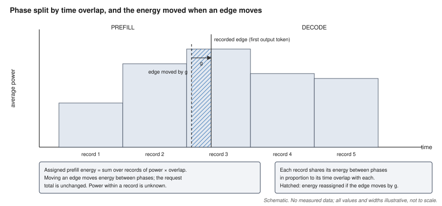
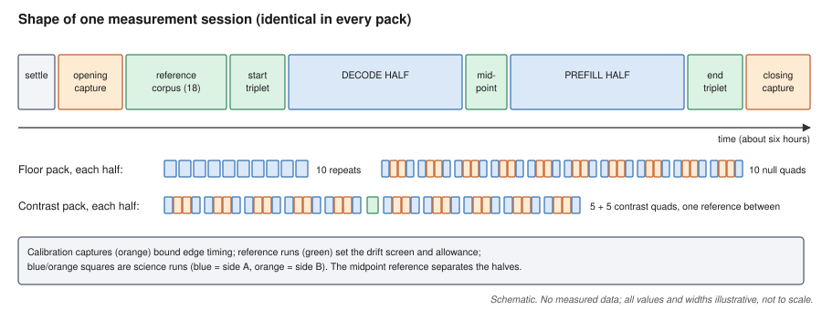
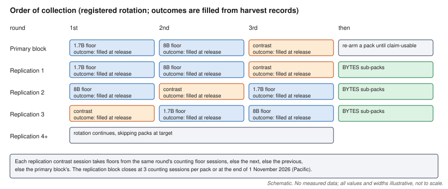
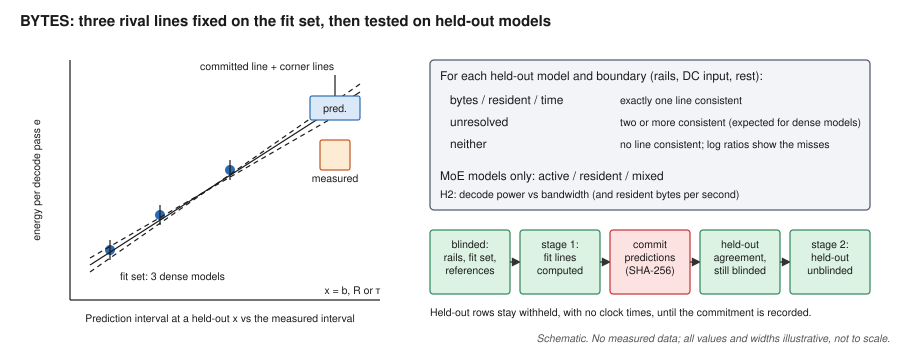
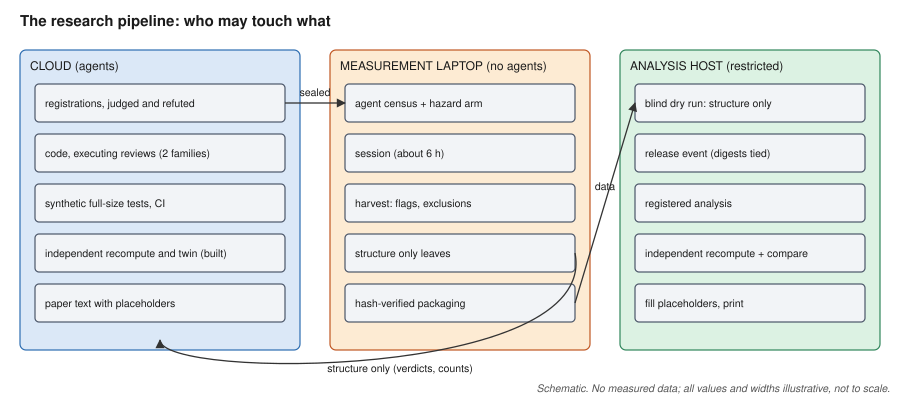

<!--
PAPER 1 — FULL DRAFT WITH PLACEHOLDERS (written 2026-10-27, before any block-5, block-6 or BYTES
result was released or seen by the author).

How to read this file:
- Every measured energy, floor, ratio, outcome word, count derived from collected data, and BYTES
  result is a placeholder {{FILL: <id> | <what it is>}}. Ids are listed in fill_index.md with the
  artifact and field that supply each one.
- Where the text must depend on an outcome, it is written in labelled branches:
  **[BRANCH <id>.<n> — <condition>]** ... **[END BRANCH <id>]**. On fill, keep exactly one branch of
  each group (the one the issued artifact selects) and delete the others. Never choose a branch by
  reading a number; the branch is selected by the artifact's outcome field named in fill_index.md.
- Synthetic worked examples are labelled "synthetic" and are not results.
- Shorter alternative sections for the contingency tiers B-E are in variants/.
- This text changes no registered analysis. If wording here and a registration differ, the
  registration governs and this text is corrected.
-->

# Dividing a Laptop's Inference Energy Between Phases with On-Chip Power Sensors: Detection Floors, Attribution Limits, a Replication, and a Pre-registered Test of Energy per Byte

{{FILL: CP-X02-headline | contingent subtitle, printed only under dominance branch A (every required dominance ratio at least 2): "An attribution-limited measurement"; under branch B no subtitle is printed}}

## Abstract

Language-model inference has two phases: *prefill*, in which the model reads the prompt and computes the first
output token, and *decode*, in which it writes the remaining tokens. We ask how finely a laptop's own power
sensors can divide inference energy between these phases, and we answer with a method whose limits are part of
its output. On one Apple M3 Max laptop running the MLX framework, the operating system's power sampler reports
the average power of the processor package (CPU, GPU and neural engine) over records of roughly a tenth of a
second. We assign each record's energy to a phase in proportion to its time overlap with the phase, and we carry
every source of timing uncertainty into the result: a calibration with commanded GPU pulses before and after
each measurement session, a fitted clock mapping, and a drift screen built from repeated reference requests.
From these we derive four quantities: the reported phase energy with an interval, the *attribution floor* (how
far timing alone can move one request's assigned energy), the *detection floor* (the largest difference the
instrument produces when nothing differs), and the *dominance ratio* (how much timing uncertainty enlarges the
detection floor). We then report a pre-registered, blinded experiment on Qwen3-1.7B and Qwen3-8B (4-bit), with
a 512-token decode workload and a 2,048-token prefill workload, two primary model contrasts with Holm
correction, an independent recomputation of every headline number from the raw records, and a replication in
further sessions on later days. {{FILL: P1-ABS-PART1 | one or two sentences summarising Part 1, assembled from
the issued outcome fields only: the four reported cells' L1 statement with intervals (CP-X05-*), the dominance
branch (CP-X02-abstract / CP-X03-abstract), the decode and prefill contrast outcome words and, only where the
claim gate returns L2, the registered direction (CP-X08-*-abstract), and the replication word per contrast
(P1-B6-REPWORD-decode, P1-B6-REPWORD-prefill)}} In a second part, BYTES, we test whether decode energy per
token on the same laptop follows the bytes the model reads per token, its resident size in memory, or its
decode time: three straight lines are fixed on three dense models and committed before ten held-out models,
including three mixture-of-experts models, are unblinded. {{FILL: P1-ABS-PART2 | one sentence: the H1 verdict
words for the held-out models at the processor-rail and DC-input boundaries (P1-BY-H1-WORDS-*), the
active-or-resident answer (P1-BY-AR-*), and the primary energy-per-bandwidth coefficient with its interval
(P1-BY-H2-*), in the registered wording only}} Every phase energy reported here rests on sampler timing that no
independent instrument checked at phase resolution. The study was run by a pipeline of AI agents under human
direction; we describe the controls that kept the agents from changing what was measured or how, and where
those controls failed.

## 1. Introduction

### 1.1 The question

A large language model (LLM) generates text one *token* at a time; a token is a short piece of text such as a
word, part of a word or a digit. Serving one request has two phases. In **prefill** the model processes the whole
prompt and computes the first output token. In **decode** it produces each later token with one *forward pass*
through the network, reading its weights and the stored keys and values of earlier tokens (the *KV cache*) from
memory. The two phases load the hardware differently: prefill is dominated by arithmetic over many prompt
tokens at once, decode by memory traffic for one token at a time. Their energies therefore answer different
questions, from the cost of long prompts to the cost of long answers.

Measuring phase energy on a laptop is attractive because the sensors are already there. macOS exposes the
processor's power through its `powermetrics` sampler, with no external meter and no special hardware. But a
software sampler reports *averages over records*, not instantaneous power, and its records do not line up with
the phase boundary. A record that begins in prefill and ends in decode reports one average for both. Any split
of that record between the phases is an allocation, and the allocation moves when the boundary moves. The
question this paper asks is therefore not only "how much energy does each phase use?" but first "how finely can
these sensors divide energy between phases at all, and what limits that?"

### 1.2 Approach

We treat the instrument's limits as results. Every reported phase energy carries:

- an interval that combines run-to-run scatter with three recorded bounds: how far the phase edges could sit
  from where they were placed, a (zero, for these traces) interpolation bound, and an allowance for drift over
  the measurement session (Section 3.4);
- an **attribution floor**: the largest amount by which phase-edge timing alone could move the energy assigned
  to one request's phase (Section 3.5);
- a **detection floor**: the largest energy difference the instrument produces between runs that do the same
  thing, and hence the smallest real difference it can resolve (Section 3.6);
- a **dominance ratio**: the factor by which allowing each value to move within its timing uncertainty
  enlarges the detection floor. A ratio of at least 2 means that timing attribution, not ordinary repeatability,
  limits the measurement (Section 3.7).

We fixed every rule (which runs count, which are excluded, every estimator and every sentence that may be
printed under each outcome) in registrations written and sealed before the data existed, kept every energy
hidden from people and agents until a recorded release, and recomputed the headline numbers with independent
code before release (Section 4).

### 1.3 Contributions

1. **A phase-attribution method with explicit limits** for interval-average software power records: an overlap
   rule, timing bounds derived from in-session GPU-pulse calibration and a fitted clock mapping, a detection
   floor with timing-widened corners, an attribution floor, a dominance ratio, a drift allowance from
   reference requests with a labelled scaled sensitivity line, and a whole-machine cross-check at the laptop's
   power input (Section 3).
2. **A pre-registered, blinded measurement and its replication**: reported phase energies for two models, two
   primary model contrasts under a multiplicity correction and a claims ladder that caps what each result may
   say, and a replication in further sessions whose agreement word was defined before any data (Sections 4
   and 5). The outcome is publishable whichever way it falls: a contrast that is not resolvable is a statement
   about the instrument's resolution, and pre-registration is what makes it one.
3. **BYTES, a pre-registered test of what drives decode energy per token** on the same laptop, with rival
   lines committed before held-out models were unblinded and mixture-of-experts models used to separate
   bytes read from bytes held (Section 6).
4. **An account of research run by AI agents** under human direction, with the integrity controls that
   constrained them and the failures those controls did and did not catch (Section 7).

### 1.4 What this paper does not claim

All measurements come from one laptop, one operating-system build per session, one inference framework and
one sampler. The phase split rests on the sampler's own timing; no independent instrument checked where energy
falls within a record or at a phase edge. The decode workload uses one fixed prompt, and the prefill workload
one prompt length. The whole-machine meter measures power entering the laptop after its adapter, not at the
wall. Section 8 lists these and the other limitations in full.

## 2. Background and related work

### 2.1 Software power counters: gain and time

Running Average Power Limit (RAPL) is an energy counter exposed by Intel and AMD processors. Khan et al. and Jay
et al. study the *gain* of such counters: how accurately a software counter reports the magnitude of energy
use against an external wall meter [4] [5]. Khan et al. align lag, model the relationship between RAPL and wall
power, account for temporal correlation and inspect update granularity, sampler overhead, jitter, overflow and
timestamps [4]. Jay et al. find that the disagreement between software meters and wall power changes with load,
and they decline component-level claims that their reference meter cannot test [5]. Agreement of whole-request
totals with a wall meter does not by itself validate how a software trace divides those totals between phases.

The *time* axis is closer to our problem. Hähnel et al. show that RAPL's update interval limits how short a code
path can receive a defensible energy attribution, and they align the start and end of the measured path to the
counter's own update boundaries [19]. Dauner et al. show, across RAPL and the NVIDIA Management Library
counter, that update behaviour and requested sampling frequency can materially change an energy reading [15].
Our method fits GPU pulse edges in the power record and carries the resulting timing allowance into every phase
energy; whether that allowance transfers from pulses to inference is untested (Section 8).

### 2.2 Energy of LLM inference

TokenPowerBench reports prefill and decode energy and groups measurements by context length [6]; its
published method does not specify the boundary events, alignment rule, repetition protocol or validation needed
to reconstruct a phase-attribution error budget. Ruf and Detyniecki isolate prefill by generating one token and
infer decode by subtraction [12]. *The Illusion of Power Capping in LLM Decode* is phase-aware, repeats
configurations and cross-checks sampled-power integrals against the GPU's hardware energy counter [13]; our
setting has no such counter, and our narrower contribution is to carry registered phase-edge perturbations into
the calculation that decides whether a phase contrast may be reported. ML.ENERGY and Intelligence per Watt map
energy across deployed configurations [7] [14], and Benazir and Lin characterise inference on Apple silicon
without energy measurement [10]. These works answer system-selection questions; we ask whether one named
software-counter boundary can support a phase claim at all, and then how decode energy scales across models on
that boundary.

### 2.3 Memory traffic and decode

Decode on a single request is commonly described as memory-bandwidth-bound: each forward pass must read every
weight it uses, while the arithmetic per byte read is small [23] [24]. That picture predicts that decode energy
per token should follow the bytes read per token. A mixture-of-experts (MoE) model, which uses only a few of its
expert weight blocks for each token, reads far fewer bytes per token than it holds in memory, so MoE models can
separate "bytes read" from "bytes resident". Part 2 turns this picture into three rival, pre-registered lines
and tests them on held-out models (Section 6).

### 2.4 Benchmark discipline, metrology and pre-registration

JouleSort established that an energy benchmark needs a fixed workload, a comparison metric and explicit rules
for running the workload and measuring energy, and it named synchronization between meter readings and the run
as a source of error [3]. SPECpower and MLPerf Power require load-specific analyzer uncertainty, fixed ranges,
minimum measurement intervals, invalid-sample accounting, clock synchronization and controlled battery
behaviour [1] [2] [11]. We carry their reject-on-missing-evidence discipline to a consumer software counter:
missing timing evidence refuses a phase claim instead of disappearing into an average.

Georges, Buytaert and Eeckhout make repetition, warm-up, independence and uncertainty part of performance
evaluation [20]; Mytkowicz et al. show that harmless-looking experimental choices can create systematic bias
[21]. Paired minimum-detectable-effect methods let observed variability raise, but not lower, a threshold fixed
before results are seen [16]; we borrow that prospective discipline but treat timing movement over the
registered edge domain as a deterministic allocation sensitivity, never combined with random noise as if
independent. Pre-registration, the public fixing of hypotheses and analyses before data, separates confirmatory
from exploratory results [25]. Blind analysis, in which the analysts cannot see the quantity of interest until
the analysis is fixed, protects against tuning toward an expected answer [22]; Part 2 uses hidden multiplicative
offsets in the manner of that literature, and both parts withhold energies until a recorded release.

### 2.5 Split inference

Split, or disaggregated, inference runs prefill and decode on different devices. Prior work reports whole-run
or GPU-only energy for such deployments [17] [9] [8], and SplitZip makes no energy claim [18]. A phase-resolved
energy measurement with named boundaries is a prerequisite for evaluating such designs, which are outside this
paper's scope.

## 3. Method

This section defines every quantity the results print. Numbers in it are design constants or labelled
synthetic examples; none is a measurement.

### 3.1 The machine, the sampler and the measurement boundary

All measurements use one Apple M3 Max laptop (model identifier Mac15,9, 128 GB of unified memory) on its 140 W
mains adapter, dedicated to this work, with displays asleep and no other user workload. Models run in Apple's
MLX framework on the GPU. The operating-system build is recorded with every session
({{FILL: P1-ID-OS | operating-system build(s) of the primary-block sessions and of each replication session, from the identity pins and per-session records}}).

The power sampler is macOS `powermetrics`, asked for one record every 100 ms. Each **power record** states the
average power of three on-chip rails, the CPU cores, the GPU and the neural engine (ANE), over the record's own
time span, its **support**. The sampler never samples faster than requested, and in practice records arrive
somewhat more slowly ({{FILL: P1-M-RECORD-WIDTH | median record width and its range in the pre-collection probe sessions, from the registration's instrument description}}). Within a record the power is known
only as that average.

The **measurement boundary** of Part 1 is therefore the *processor package rails*: CPU plus GPU plus ANE as the
sampler reports them. It excludes memory chips, storage, fans, power conversion and the display. We never call
this quantity "wall power" or "system energy". A second, wider boundary, the power entering the laptop at its
USB-C input, is measured by an independent meter and used as a cross-check in Part 1 and as a primary boundary in
Part 2 (Section 3.9).

### 3.2 A run and its phases

A **run** is one inference request executed in its own process. Its steps are: an idle baseline, in which the
sampler records the quiet machine for a fixed number of records (576, about 75 s); **idle admission**, a set of
tests that the baseline was quiet; one untimed warm-up generation of the same request, so that the measured
request does not pay first-call costs; the **measured request**; and clean-up. One continuous sampler process,
the **sampler stream**, runs from the start of the baseline to the end of the measured request. Between runs a
**cooldown** waits until a short power reading is at most twice the previous run's baseline power with the
operating system's thermal state nominal, or until 300 s have passed.

The runtime stamps each phase edge. Prefill ends, and decode begins, at the first streamed output token. Decode
ends with the last output token.

**Phase energy by overlap.** Each power record contributes its average power multiplied by the length of the
overlap between its support and the phase. Records wholly inside the phase count in full, a record that
straddles an edge counts in proportion to its overlap, and records outside count zero. No idle power is
subtracted: the energy is **gross**. *Synthetic example:* a phase runs from 10.00 s to 10.25 s; record 1 covers
9.90–10.03 s at 20 W (overlap 0.03 s, 0.60 J); record 2 covers 10.03–10.16 s at 30 W (0.13 s, 3.90 J); record 3
covers 10.16–10.29 s at 30 W (0.09 s, 2.70 J); the phase energy is 7.20 J. Figure 1 illustrates the rule and the
effect of moving an edge.

*Figure 1. Schematic, no measured data. Three power records (grey) straddle a prefill-to-decode edge. Each
record's energy is shared between the phases in proportion to its time overlap with each. Moving the edge by a
timing bound g reassigns a slice of one record's energy (hatched) from one phase to the other; the request total
does not change. Values and widths are illustrative and not to scale.*

This rule, which we call the **held-average reconstruction**, assumes power is constant within each record. It
yields an *assigned* phase energy. It does not bound the physical energy of the phase under arbitrary power
variation inside a record; a record that straddles an edge could, physically, have spent all or none of its
energy on either side.

**Minimum record support.** A phase needs at least three records with positive overlap or the reduction refuses
it. Three allows a phase to cross two boundary records and contain one whole middle record. This is a fixed
cutoff, not a proof of adequate precision. The 42-token prefill of the decode workload lasts a few tens of
milliseconds, shorter than one record, and is registered in advance as not resolvable; it is never reported.
Historical captures on the same laptop showed the cutoff biting on short phases
({{FILL: DG-067 | historical count of short prefill phases that crossed only two records}} of
{{FILL: DG-068 | historical population size}} for a 1.5-billion-parameter model; {{FILL: DG-136 | historical count of identifiable phases for a 7-billion-parameter model}} of
{{FILL: DG-135 | its population size}} passed), which is why the prefill workload uses a 2,048-token prompt.

### 3.3 Where the edges are: calibration, clock mapping and the timing bound

Power records are stamped by the sampler; phase edges are stamped by the program that runs the model. To give
each phase its records, the two time bases must be laid on one timeline. Three bounds limit how well this is
done.

**The fiducial bound b (calibration with commanded pulses).** Before the first run of each session and after
the last, a **calibration capture** drives the GPU through 59 commanded one-second matrix-multiplication pulses
on a fixed schedule of varied gaps, chosen so that pulse edges do not repeatedly align with the sampler's
cadence. For each pulse, an estimator fits the power records with a baseline plus a rectangle whose onset and
offset may be displaced from the commanded times, and returns every displacement consistent with the records
within a fixed loss tolerance. A capture's **fiducial bound** is the largest absolute displacement over all
pulses, plus the uncertainty in placing that capture's trace on the wall clock. If the displacements of the 59
pulses were independent draws from one distribution, their maximum would exceed that distribution's 95th
percentile with probability at least 0.95 (since 1 − 0.95⁵⁹ ≥ 0.95); pulses of one capture are not independent,
so this is a design rationale, not a demonstrated coverage. The two captures form a **bracket**. A pre-registered
**calibration acceptance**, derived from earlier captures, refuses a session whose opening capture exceeds a
screen or whose two captures differ by more than an allowed drift
({{FILL: P1-M-ACCEPT | the registered acceptance constants for each block: pre-capture screen, bracket screen and drift limit, from the acceptance files named in the registrations}}). The session's **operative
timing bound** is

  b = max(opening, closing) + max(|closing − opening|, s_bracket),

where s_bracket is a fixed minimum allowance for movement between the two captures, taken from the acceptance.
*Synthetic example:* opening 40.0 ms, closing 30.0 ms, s_bracket 14.531 ms gives b = 40.0 + 14.531 =
54.531 ms.

**The clock bounds m and s.** Each run's sampler records carry whole-second wall-clock labels; the run's own
events are stamped on both the wall clock and the machine's monotonic clock (a counter that is never corrected to
civil time). A rate-aware fit retains every straight-line mapping between the clocks consistent with the
bracketed readings and the record labels. Its spread gives the run's **effective clock bound** m. The change in
wall-minus-monotonic time over the run's sampler stream is s. Automatic network time correction is disabled
during collection, and a clock step is a physical hazard that refuses the affected data (Section 4.3).

**The edge bound g and the first-kind timing bound.** Each phase edge is uncertain by up to g = b + s, and the
whole trace may shift by up to ±m. A run's **first-kind timing bound** is the largest change in its assigned
phase energy over every independent displacement of the two edges within ±g and every common shift of the trace
within ±m. Because power is never negative, assigned energy cannot rise as the start edge moves later or fall as
the end edge moves later, so the extremes lie at the four edge corners, each evaluated over the trace shift.
*Synthetic example:* b = 45.6 ms and s = 0.4 ms give g = 46 ms; with m = 2 ms, a start-edge record averaging 40 W
and an end-edge record averaging 10 W, moving the start 46 ms early and the end 46 ms late adds
0.046 × (40 + 10) = 2.30 J, and shifting both a further 2 ms early adds 0.002 × (40 − 10) = 0.06 J: the bound is
2.36 J. When a displaced edge crosses into a neighbouring record this closed form is only an approximation; the
registered quantity is the exact maximum.

The pulse calibration measures how the sampler places the edges of long, square GPU work. Inference has a
different sequence of work at the prefill-to-decode transition. Applying the pulse-derived bound to inference
edges is an assumption that this study did not test (Section 8).

### 3.4 Reported phase energy and its interval

A **reported cell** is one energy per model and phase, from that model's runs of one workload in one session:
10 **absolute repeats** (single runs) and 10 **null quads**. A **quad** is four consecutive runs in the order A,
B, B, A; in a null quad A and B are the same model and workload, so any difference between the sides comes only
from the instrument and the machine. A **unit** is what the statistics treat as one independent draw: one repeat
or one whole quad. The repeats and the quads are the two **strata**. Removing any run of a quad removes the whole
quad, so its drift cancellation is never broken. A cell needs at least five kept units in each stratum.

For a cell with n_r kept repeats (energies r) and n_b kept quads (quad means q):

1. **Mean.** m = 0.2 × mean(r) + 0.8 × mean(q). The weights are fixed by design, because 10 of the 50 runs are
   repeats and 40 are quad members; with all units kept this equals the plain mean of the 50 runs.
2. **Variance.** V = 0.04 × s_r² / n_r + 0.64 × s_q² / n_b, with sample standard deviations (divisor n − 1).
3. **Half-width.** h = t(0.975, min(n_r, n_b) − 1) × √V, using the smaller stratum's degrees of freedom.
4. **Recorded bounds.** B is the sum of three stratified averages (0.2 × repeat mean + 0.8 × quad-member mean) of
   per-run bounds: the first-kind timing bound (Section 3.3); an interpolation bound, which is identically zero
   for these interval-support records; and half the session's drift allowance (Section 3.8).
5. **Interval.** [m − h − B, m + h + B], not clamped at zero.
6. **Per-token value.** For decode, m divided by the 512 runtime-observed output tokens ("decode-phase energy per
   output token; 512 output tokens, 511 of them generated in the decode phase"); for prefill, m divided by the
   2,048 prompt tokens.

The interval covers run-to-run and quad-to-quad variation inside one session over the kept units, plus the
recorded bounds. It does not cover variation between sessions or days, nor any bias from which units were
removed. Treating consecutive units as independent is a modelling assumption, since they share slow drifts.
*Synthetic example (all units kept):* repeats with mean 10.0 J and s_r = 0.2 J, quad means with mean 10.2 J and
s_q = 0.18257 J give m = 10.16 J, √V = 0.047889 J, h = 2.262157 × 0.047889 = 0.10833 J; with B = 0.060 J the
interval is [9.9917, 10.3283] J.

### 3.5 The attribution floor

The first-kind timing bound enters each interval only through its average over the cell's runs. But every run of
a session is reduced under the same operative timing bound: if the sampler's edges sit late, they sit late in
every run, so this part of the uncertainty does not shrink when runs are averaged. We therefore print beside
each cell its **attribution floor**: the largest first-kind bound over the cell's kept runs, with the run that
attains it. It is printed and not added to the interval. Each cell carries a fixed sentence: *"Phase-edge timing
alone could move the energy assigned to this phase of a single request by up to X J. The average of that bound
over the kept runs is already inside the interval; X itself is not added. The bound says how far the assigned
energy moves when power is taken as constant within each sampler record; it is not a bound on the physical
energy of the phase."*

### 3.6 The detection floor

The **detection floor** of a model and phase is the largest difference the registered estimator allows between
runs that do the same thing; hence the smallest real difference the instrument can resolve. It has two forms.

- **Absolute form**, from the kept repeats v₁ … v_n: deviations are vᵢ − mean(v); the prediction term is
  t × s × √(1 + 1/n), with s the sample standard deviation of the deviations and t the two-sided 95% Student-t
  value at n − 1 degrees of freedom.
- **Comparative form**, from the kept null-quad differences d = (B₁ + B₂ − A₁ − A₂)/2: deviations are the d
  themselves, not re-centred; the prediction term is |mean(d)| + t × s × √(1 + 1/n).

In both, the **point floor** is max(largest |deviation|, prediction): the first term keeps the largest
displacement already observed, the second is, under an independent-normal model, a two-sided 95% prediction
amount for one further value. It is not a deterministic bound on future errors.

**Corner widening.** Each value may lie anywhere within ± its timing half-width wᵢ. For the absolute form, wᵢ is
the largest distance of the run's phase energy from its unshifted value over the timing movements of Section
3.3. For the comparative form, each phase edge is treated as shared by the quad's four runs and moved by one
common amount within ±b, and each run's remaining local clock uncertainty is added. The **corner-widened floor**
is the largest point floor over every corner of the box of values (2ⁿ corners, enumerated exactly; the program
refuses above 16 units rather than approximate). The point floor is a convex function of the values, so its
maximum over the box lies at a corner. The **operative floor** is max(point floor, corner-widened floor).

**Small-sample guard.** For fewer than ten kept units the operative floor is multiplied by
g(n) = √(9/(n − 1)) (for example 1.0607 at n = 9 and 1.5 at n = 5); the factor is undefined below five, which is
why each stratum needs five kept units.

*Synthetic example:* ten repeats with s = 0.2 J and largest deviation 0.4 J give a prediction of
2.262 × 0.2 × √1.1 = 0.4745 J, the point floor; with wᵢ = 0.05 J on every run the operative floor is 0.5730 J.
Ten null-quad differences with mean 0.04 J and s = 0.0966 J give a point floor of 0.2692 J; with a shared-edge
width of 0.30 J on every quad the operative floor is 1.0349 J.

A **model contrast** (Section 3.10) is judged against a **floor gate**: for each side, the worse of that model's
absolute and comparative operative floors for the phase, and then the larger of the two sides.

### 3.7 The dominance ratio

For each model, phase and floor form we print

  R = (corner-widened floor, unguarded) ÷ (point floor, unguarded).

R ≥ 2 (equality passes) means that letting each value move within its timing box at least doubles the floor:
timing attribution, not run-to-run repeatability, is what limits the measurement. A threshold merely above 1
would let any positive timing width decide the answer, so the registered threshold is a doubling. In the
synthetic examples above, the absolute R is 0.5730 / 0.4745 = 1.21 (fails) and the comparative R is
1.0349 / 0.2692 = 3.84 (passes).

For the comparative form we also print R_cm, a sensitivity replay in which a block-level energy allowance
derived from shared edge movements is applied with *one* sign across all quads, and each quad's own local
uncertainty with its own sign, over every sign combination. R_cm retains one shared sign for scalar energy
allowances; it does not replay one physical time shift in every quad, and passing it licenses no claim of
robustness to a common physical timing error.

Two models, two phases and two forms give eight R values and four R_cm values. They share runs and are
correlated; "independent" in the registered name of R refers to the independent-corner box, not to statistical
independence. **Branch A** holds when every one of the twelve is at least 2, and licenses the sentence that timing
attribution dominates the detection floor and the paper's contingent subtitle. Otherwise **branch B** reports each
ratio that failed. A zero denominator refuses; no infinity is ever printed. Every ratio is printed with its
numerator, denominator and n, and labelled "point diagnostic; no interval".

### 3.8 Drift: reference requests, the drift screen and the scaled sensitivity line

The instrument may read differently at the end of a session than at its start. Each session runs a fixed
**reference workload** (Qwen2.5-1.5B, a 1,024-token prompt, 256 output tokens) at fixed places: a **corpus** of
18 reference runs at the start, then a **start triplet** of three, one **midpoint reference** between the decode
and prefill halves, and an **end triplet** of three. The reference energies are never science measurements.

**Drift bound.** From the clean corpus energies (the first twelve valid corpus runs in committed order; at least
six required), with n_s surviving start references and n_e surviving end references, U_j the mean of the
corpus's j largest values and L_j the mean of its j smallest,

  bound(n_s, n_e) = max( max(U_{n_s} − L_{n_e}, U_{n_e} − L_{n_s}), t × s × √(1/n_s + 1/n_e) ).

The first term is the widest gap two means of those sizes could show if drawn from the corpus itself; the
second is a 95% repeatability bound for a difference of two means when nothing drifts.

**Drift screen.** The session passes when the absolute difference between the end-triplet and start-triplet
means is at most the bound, on gross energies and again on idle-subtracted energies. A session that fails is
excluded; one that cannot compute the screen (too few survivors) cannot count.

**Drift allowance.** A = max(bound, spread), where the spread is the largest minus the smallest of the start
mean, the midpoint energy and the end mean. Each run carries ½A into its cell's B, so a contrast, which differs
two sides, carries it once. A lost midpoint reference leaves the allowance on the start and end references only,
which cannot see an excursion that reverted before the end; this is disclosed with a fixed sentence.

**The scaled sensitivity line.** The allowance is measured on reference requests of a few tens of joules and
added, unscaled, to phases that may be much larger and longer. Whether drift transfers in proportion to energy
or duration is unmeasured. Each replication cell therefore also prints a labelled line with the allowance term
multiplied by max(1, E/E_ref, T/T_ref), where E and T are the cell's mean energy and mean phase duration and
E_ref and T_ref those of the surviving references (for a contrast, the maximum of this factor over both sides).
*Synthetic example:* an allowance term of 0.49 J, E_ref = 37.0 J, T_ref = 4.0 s and a cell of 300 J over 9.0 s
give a factor of max(1, 8.108, 2.25) = 8.108 and a scaled term of 3.97 J. The line changes no registered number.
In Part 2 the same scale is part of the registered estimator (Section 6.3), because no drift-transfer test passed
before BYTES collection.

### 3.9 The whole-machine boundary

An inline USB-C power meter (POWER-Z KM003C) sits in the cable between the 140 W adapter and the laptop and reports
bus voltage and current 50 times a second. It measures the **DC input**: what enters the laptop after the
adapter. The adapter's AC-to-DC conversion loss is not measured, so this is not wall energy. When the laptop
draws more than the adapter supplies, the battery helps; the meter cannot see that energy, so in Part 2 it is
added from the laptop's own battery current and voltage readings (Section 6.3). The meter's clock is mapped to
the laptop's monotonic clock by a fitted envelope, and its sample timing contributes its own edge term.

In Part 1 the meter is a **descriptive cross-check** that never enters a claim: for each run, the rail energy
above the run's idle baseline (ΔE_rail), the machine energy above the same baseline (ΔE_machine) and their ratio
ρ = ΔE_rail / ΔE_machine. A run is physically plausible when 0 < ρ ≤ 1 and ΔE_machine − ΔE_rail ≥ 0, since the
rails are part of the machine. Implausible runs are listed, never removed. The replication block additionally
prints whole-machine energy per phase, gross, with the rails' share per phase. In Part 2 the DC input, and the
**rest** (DC input minus rails, which includes memory, conversion losses, storage and fans), are primary
boundaries.

### 3.10 Model contrasts, outcome words and the claims ladder

A **contrast** compares two models on the same workload in **contrast quads** ordered 1.7B, 8B, 8B, 1.7B. Each
kept quad k gives d_k = (B₁ + B₂)/2 − (A₁ + A₂)/2, with B the 8B side. Over n kept quads (at least five of ten):

1. d̄ = mean(d_k); se = s_d / √n.
2. **Metrology interval**: d̄ ± t* × se, with t* the 0.975 Student-t value at n − 1 degrees of freedom rounded to
   three places. No extra error term is added for phase energies, because each run's random error is already in
   s_d.
3. **Deterministic bound D**: for each recorded bound kind, a quad's bound is the A-side mean of its two runs'
   bounds plus the B-side mean; D sums, over kinds, the mean over kept quads. The **decision interval** is the
   metrology interval widened by D on both sides. Errors common to every run (a timing bias, a drift) are carried
   by D and the attribution floor, never by the statistical interval.
4. **Test**: t = d̄ / se, two-sided. The two primary contrasts (decode and prefill) form one family corrected by
   Holm's method at α = 0.05 [26]; a contrast that cannot be estimated keeps the family size at two.
5. **Floor gate** (Section 3.6).

The outcome is one of four registered words, decided in this order of precedence:

- **not estimable**: a required input is missing or invalid;
- **not resolvable**: there is no floor, or |d̄| does not exceed the floor gate, or the decision interval
  contains zero while the metrology interval does not;
- **unresolved**: the metrology interval contains zero, or Holm's correction does not reject;
- **direction supported**: otherwise; the direction is the sign of d̄.

A **leave-one-quad-out** check recomputes the contrast without each kept quad in turn. If dropping some quad
changes the sign, the floor status, the Holm decision or the outcome, the contrast is *verdict-influential*. If it
moves d̄ by more than a quarter of the floor gate, that is reported.

Beside each contrast two **registered descriptive estimates** are printed and decide nothing: the 8B-to-1.7B
ratio of phase energies, exp(mean of ln(B-side mean / A-side mean)) with its t interval and without the recorded
bounds; and d̄ per token (÷ 512 output tokens for decode, ÷ 2,048 prompt tokens for prefill). Phase energy is
gross, and the 8B phase lasts longer, so part of any difference is baseline power times the extra duration.

**The claims ladder** caps how strong a sentence may be. **L1** (instrument result): on this exact stack and
boundary, this quantity was observed, with its interval. **L2** (comparative result): one condition differed
from another within one boundary, with intervals reported, interleaved order and the effect above the detection
floor. A contrast reaches L2 only when its outcome is *direction supported*, its direction is the registered one
(8B uses more phase energy than 1.7B), it is not verdict-influential under leave-one-quad-out, and it remained
confirmatory (no replacement or extra run was added after the fact). Otherwise it is reported in L1 wording.
Higher levels (a model checked on held-out cells, replication on other machines) are out of reach in Part 1.
The two floor packs' reported cells, collected in separate sessions in a fixed order, are printed side by side
at L1 and are never differenced into a comparison.

## 4. Experimental design

### 4.1 Models, workloads and stack

Part 1 uses two models from the same family, Qwen3-1.7B and Qwen3-8B, both quantized to 4 bits (each weight
stored in 4 bits with a scale and offset per group of weights) and published as MLX checkpoints. Model files,
tokenizer, runtime packages, kernel library, sampler and output policy are pinned by hash for every run
({{FILL: CP-X01-identity | model identities and revisions, runtime and library versions, tokenizer and chat-template digests, from the identity pins and prompt pin}}). Two workloads are registered:

- **Decode workload.** One fixed prompt of 42 tokens, rendered through the model family's chat template with
  its "thinking" mode off. Generation is greedy (the most probable token each time) and forced to exactly 512
  output tokens by suppressing the end-of-sequence token. Its decode phase is reported. Its 42-token prefill is
  registered as not resolvable and never printed.
- **Prefill workload.** One fixed prompt of exactly 2,048 tokens, with 512 output tokens. Its prefill phase is
  reported. The length was chosen in a pre-collection probe as the shortest of 512, 1,024, 2,048 and 4,096 tokens
  at which every probe run of the smaller model overlapped at least five sampler records
  ({{FILL: CP-X01-length | the selection record that fixed the 2,048-token length, with its digest}}).

The four **target cells** are decode and 2,048-token prefill for each model. The results support no statement
about other prompts, other prompt lengths, other models, other machines or another measurement boundary.

### 4.2 Packs and the shape of a session

A **pack** is a frozen, hash-pinned plan for one measurement session. Three packs are registered:

- the **1.7B floor pack** measures Qwen3-1.7B's reported cells and detection floors;
- the **8B floor pack** does the same for Qwen3-8B;
- the **contrast pack** measures the two contrasts, decode and prefill, in contrast quads.

A **session** is one unattended collection of a whole pack on the laptop, of roughly six hours, with no other
workload and no AI agent process on the machine. Its shape is fixed (Figure 2): a 60 s settle; the opening
calibration capture; the 18-run reference corpus; the start triplet; the decode half; the midpoint reference;
the prefill half; the end triplet; and the closing calibration capture. In each floor pack each half holds 10
absolute repeats followed by 10 null quads (50 runs); in the contrast pack each half holds 10 contrast quads (40
runs), with one diagnostic reference run in the middle that enters neither the drift screen nor the allowance.
Quad order in the contrast pack is fixed, 1.7B, 8B, 8B, 1.7B, and not randomized: a linear drift cancels inside
each quad, a curved drift does not.

*Figure 2. Schematic, no measured data. One session, left to right: settle, opening calibration capture,
reference corpus, start triplet, decode half, midpoint reference, prefill half, end triplet, closing capture.
The floor packs fill each half with 10 repeats and 10 null quads; the contrast pack with 10 contrast quads around
one diagnostic reference. Widths are not to scale.*

### 4.3 The primary block

The primary block (registered internally as measurement block 5) collected one analysed session of each pack.
Its registration, analysis plan, flag catalog and an inventory of the SHA-256 digest of every code and
configuration file a session reads were committed together and sealed by an independent judgment before the
first session armed. Every session ran from a separate checkout of the repository at the sealed commit.

**What refuses, and what is only recorded.** A session is *armed*, that is allowed to start, only after direct
measurements show none of the registered physical hazards: a clock step or drift beyond budget, running on battery
or charging, thermal pressure, an outside process drawing power, too little free disk, a sampler that is not
sampling, and an AI agent process alive on the machine (an agent process draws {{FILL: P1-AUTO-AGENTPOWER | range of processor power drawn by an idle AI agent process, from the replication registration's hazard definition}} while nominally idle).
During the session a monitor measures the same hazards. Only a directly measured physical hazard refuses
collection or removes data. Every other condition is written as a **flag**, a recorded code beside the data, and
a registered catalog gives each code exactly one effect: exclude the run, exclude the session, or disclose only.
Battery assist (the battery helping the adapter at peak load) is disclosed, not excluded, because excluding it
would select runs by load; each affected cell also prints a labelled line without the assisted units. Removals
by three load-correlated codes (two thermal-pressure codes and outside-process overlap with a request) are
likewise accompanied by a labelled line computed as if those codes had not applied.

**Attempts.** An *attempt* is one try at a session. An attempt that a physical hazard stopped, or that the drift
screen or another session-level rule excluded, is kept, listed and never analysed; the pack is re-armed. Re-arming
may depend only on structure (verdicts, flag counts, unit counts), never on an energy. The attempt history of every
pack is printed with the results (Section 5.1).

### 4.4 The replication block

A single session says how much a number moves from run to run on one afternoon, and nothing about whether it
holds on another day. The replication block (registered internally as block 6) was designed before any
primary-block number was seen, so that it would be collected whatever the primary block showed. Its rules are:

- **Same experiment.** The same three packs and session shape, with no change inside a run: same models,
  workloads, prompts, token counts, idle baseline, cooldown rule and stage order. The four estimator source files
  are byte-identical to the primary block's.
- **What counts.** A session **counts** when no physical hazard stopped it and it carries no session-excluding
  condition. Those conditions are physical (a power-path change or clock step during calibration, an operative
  timing bound above a pre-set stop line, a stop for sampler loss, disk, heat, deadline or agent pauses); a
  number that would be undefined (missing calibration, too few clean references, fewer than five kept units in a
  target stratum, no science runs); wrong data (model files, runtime stack or number-bearing code differing from
  the registered ones); the drift screen; and structural failure of the collection code. Twenty-five of the
  primary block's 32 session-removing codes became flags only.
- **How many, and when it closes.** The target is 3 counting sessions per pack and the minimum 2. Sessions run in
  rotating rounds (floor packs and contrast pack in the orders 1.7B, 8B, contrast; then 8B, contrast, 1.7B; then
  contrast, 1.7B, 8B), so that slow changes of the machine spread over all packs and each pack's start time moves
  through the day. The block **closes** when every pack has 3 counting sessions or at the end of 1 November 2026,
  Pacific time, whichever is first; a pack with fewer than 3 is printed as **short**.
- **Floor pairing.** Each contrast session is judged against floors from a 1.7B and an 8B floor session: the same
  round's counting session if it exists, otherwise the next counting one, otherwise the previous one, and failing
  all of these the primary block's, labelled "floor from the primary block". Pairing depends only on which sessions
  count, never on an energy.
- **Estimators.** The primary block's four estimators, applied to each counting session separately; nothing is
  pooled across sessions.
- **The one new estimator**, a **between-session summary**: for each printed quantity, each session's value
  (the primary block's analysed session and every counting replication session), their mean and their sample
  standard deviation. No pooled interval, no test, and no claim rests on it.
- **The replication word.** A contrast is **replicated** when every counting replication session gives the same
  outcome word as the primary block's analysed session *and* the same sign of d̄; otherwise it is **not
  replicated**, and each session's word and sign are printed. If the primary contrast is not estimable, the word is
  not used. This definition was fixed before any data and is a description of agreement, not a new test.
- **The flagged-inclusive line.** Beside every registered result, a labelled line adds back the non-counting
  sessions that ran the registered experiment and can be computed, ignoring session-level exclusions. It never
  replaces the registered value and shows what the session-level rules cost.

Figure 3 shows the order of sessions in the collection period.

*Figure 3. Schematic of the registered ordering, with no outcomes. Rows are rounds of the replication block;
cells are the attempts of each pack in the registered rotation, with BYTES sessions interleaved between rounds
(Section 6.2). Which attempts counted is filled from the harvest records
({{FILL: P1-LEDGER | per-attempt verdicts (counting or not, with cause family) for every primary, replication and BYTES attempt, from the harvest verdicts and attempt histories}}).*

### 4.5 Pre-registration and changes after registration

Each registration fixes, before its first session, which data count, every estimator, every printed sentence for
each outcome, and the sizing. The primary block's files were sealed by recording their SHA-256 digests in a seal
record; a session refuses to start if any file it reads differs from the sealed bytes. The replication block's
registration passed an independent judgment and was committed before its first round began; the BYTES
registration likewise before its first session.

Errors found after registration were handled in three ways, each recorded with its date and reason. A
**prospective erratum** changes a rule before any data it governs exist. A **registered deviation** records where
the executed procedure departed from the text. A **disclosed repair** corrects analysis code found, after release,
to differ from the registered arithmetic; the repair restores the registered arithmetic and is reported with the
result. No registered arithmetic was changed after data existed
({{FILL: P1-DEV-LIST | list of every erratum, deviation and disclosed repair with its date and whether it preceded or followed the data it governs, from the seal record, the replication registration's change log and the BYTES addenda}}).

### 4.6 Blinding and release

From each block's first session until its release, no person or AI agent read a measured energy, power, phase
duration, floor, ratio, contrast, outcome word or calibration value. The collection and analysis programs wrote
these into restricted files listed in a custody map; everything released during collection was **structure**
only: verdicts, whether a session counted, flag counts by code, kept-unit counts, hazard measurements, and timing
that is not a phase duration. A unit removed by a restricted code was reported only as "removed (restricted
code)".

Before release, the analysis programs ran end to end over the real archives in a **blind dry run** that wrote out
only structure (exit codes, schema checks, refusal codes). A **release event** then tied the digests of the sealed
documents and the final harvest records together; the registered analysis ran after it, and any analysis not
registered is labelled exploratory. The replication block's numbers were released only after the replication
block had closed *and* the primary block had been released, because replication values estimate the same
quantities and reading them first would have unblinded the primary analysis in all but name. BYTES used a
stronger, two-stage blinding with hidden multiplicative offsets (Section 6.3).

{{FILL: P1-RELEASE | dates of the primary-block release event, the replication-block release and the BYTES stage-1 commitment and stage-2 release, with the digests each record ties, from the seal-record "Release event" section and the release records}}

### 4.7 Independent recomputation

Before a result was printed, the headline numbers were computed a second time from the raw power records by an
**independent recomputation**: code written to the registered definitions that shares no code with the analysis
programs. The registered agreement tolerance is that each run's phase energy agrees within 1 mJ and every printed
quantity, compared unrounded, agrees within half a unit of its last printed digit. The tolerance was set from a
non-claim rehearsal in which an independent overlap sum reproduced every phase energy far inside it, while the
defects it must catch are far larger (a 1 ms edge shift at the powers involved is tens of millijoules; a dropped
record is joules). The observed agreement is printed beside the tolerance and is never used as one. Part 2 uses
an independent **twin** implementation in the same way (Section 6.3).

{{FILL: P1-RECOMPUTE | the comparison table of the independent recomputation against the analysis for every printed Part 1 quantity: tolerance, observed largest difference, and agreement word, per block; checked by one executing reader before printing}}

## 5. Results, Part 1: phase energy, floors and contrasts

<!-- TEMPLATE. Every value below is a placeholder. Fill only from the issued artifacts named in
fill_index.md, after the release event of the block concerned. Keep one branch of each group. -->

Every phase energy in this section rests on sampler timing; phase attribution was not checked by an independent
measuring instrument (Section 8). Every number is conditional on sessions that passed the registered
physical-hazard checks at arm and kept at least five of ten units per stratum after the registered exclusions;
the kept units of each cell are printed beside it.

### 5.1 What was collected

{{FILL: P1-B5-ATTEMPTS | attempt history of each primary-block pack: number of attempts, each with its verdict and cause family, and "collected X of Y planned runs"; the three superseded first-seal attempts listed separately as inputs to no number; from the harvest records and analysis-plan disclosure producer}}

The analysed sessions were {{FILL: P1-B5-ANALYSED | identifiers and dates of the analysed attempt of each pack}}.
Table 1 lists, for each target cell, the kept units and the removed units with the catalog family of the codes
that removed them and their positions in the session, so that a reader can see whether removals clustered.

| Cell | Kept repeats n_r | Kept quads n_b | Removed units (family, position) |
|---|---|---|---|
| 1.7B decode | {{FILL: P1-B5-NR-1p7B-decode \| kept repeats}} | {{FILL: P1-B5-NB-1p7B-decode \| kept null quads}} | {{FILL: P1-B5-RM-1p7B-decode \| removed units}} |
| 1.7B prefill (2,048) | {{FILL: P1-B5-NR-1p7B-prefill \| kept repeats}} | {{FILL: P1-B5-NB-1p7B-prefill \| kept null quads}} | {{FILL: P1-B5-RM-1p7B-prefill \| removed units}} |
| 8B decode | {{FILL: P1-B5-NR-8B-decode \| kept repeats}} | {{FILL: P1-B5-NB-8B-decode \| kept null quads}} | {{FILL: P1-B5-RM-8B-decode \| removed units}} |
| 8B prefill (2,048) | {{FILL: P1-B5-NR-8B-prefill \| kept repeats}} | {{FILL: P1-B5-NB-8B-prefill \| kept null quads}} | {{FILL: P1-B5-RM-8B-prefill \| removed units}} |
| Contrast, decode | — | {{FILL: P1-B5-NQ-decode \| kept contrast quads}} | {{FILL: P1-B5-RM-ctr-decode \| removed quads}} |
| Contrast, prefill (2,048) | — | {{FILL: P1-B5-NQ-prefill \| kept contrast quads}} | {{FILL: P1-B5-RM-ctr-prefill \| removed quads}} |

*Table 1. Kept and removed units per target cell in the primary block.*

**[BRANCH 5.1.a — a pack ended without a claim-usable session]** The {{FILL: P1-B5-NOPACK | name of each pack with no claim-usable session}} pack ended with no session that the registered rules allow to be analysed;
its cells and any contrast that depends on it are printed as unavailable with the reason
{{FILL: P1-B5-NOPACK-REASON | registered refusal or end-state reason}}. **[END BRANCH 5.1]**

{{FILL: P1-B5-HAZARDS | per session: hazard measurements at arm (naming any hazard whose probe returned no reading), counts of each physics-in-span code, battery-assist counts, and the battery-temperature rise per stage, from the disclosure producer}}

### 5.2 Reported phase energies

| Model | Phase | Mean energy (J) | Interval (J) | Per token (J/token) | Attribution floor (J) |
|---|---|---|---|---|---|
| Qwen3-1.7B | decode | {{FILL: E_1p7B_decode_J_per_request \| mean}} | [{{FILL: E_1p7B_decode_lower_J \| lower}}, {{FILL: E_1p7B_decode_upper_J \| upper}}] | {{FILL: E_1p7B_decode_J_per_token \| per output token}} | {{FILL: P1-B5-AF-1p7B-decode \| attribution floor}} |
| Qwen3-1.7B | prefill (2,048) | {{FILL: E_1p7B_prefill_p2048_J_per_request \| mean}} | [{{FILL: E_1p7B_prefill_p2048_lower_J \| lower}}, {{FILL: E_1p7B_prefill_p2048_upper_J \| upper}}] | {{FILL: E_1p7B_prefill_p2048_J_per_token \| per prompt token}} | {{FILL: P1-B5-AF-1p7B-prefill \| attribution floor}} |
| Qwen3-8B | decode | {{FILL: E_8B_decode_J_per_request \| mean}} | [{{FILL: E_8B_decode_lower_J \| lower}}, {{FILL: E_8B_decode_upper_J \| upper}}] | {{FILL: E_8B_decode_J_per_token \| per output token}} | {{FILL: P1-B5-AF-8B-decode \| attribution floor}} |
| Qwen3-8B | prefill (2,048) | {{FILL: E_8B_prefill_p2048_J_per_request \| mean}} | [{{FILL: E_8B_prefill_p2048_lower_J \| lower}}, {{FILL: E_8B_prefill_p2048_upper_J \| upper}}] | {{FILL: E_8B_prefill_p2048_J_per_token \| per prompt token}} | {{FILL: P1-B5-AF-8B-prefill \| attribution floor}} |

*Table 2. Reported gross phase energy per request on the processor-rail boundary (CPU + GPU + ANE as reported by
`powermetrics`), primary block. Interval = m ± (h + B) (Section 3.4). The attribution floor is printed beside the
cell and is not added to the interval. Decode per-token values divide by the 512 runtime-observed output tokens,
511 of them generated in the decode phase. The two models were measured in separate sessions in a fixed order;
their difference is not a comparison. The 42-token prefill of the decode workload is shorter than one power record
and, as registered, is not reported.*

Each row of Table 2 carries the fixed attribution-floor sentence of Section 3.5 with its own value of X, and the
interval's three components: h, and the average first-kind timing bound, interpolation bound and drift term that
make up B ({{FILL: P1-B5-INTERVAL-PARTS | per cell: h, B and its three kind averages, and the run attaining the attribution floor with the smallest first-kind bound over kept runs}}). The share of each interval taken by B rather
than h is {{FILL: P1-B5-B-SHARE | per cell, B ÷ (h + B), derived from the same record}}.

Labelled lines printed beside each cell, none of which replaces it:

- *Without battery-assisted units:* {{FILL: P1-B5-BATT-LINE | per cell: mean and interval over units with no assisted run, with n_r, n_b and the count of assisted runs per stratum; "below the registered minimum of 5 units" where applicable}}
- *Load-correlated exclusions not applied:* {{FILL: P1-B5-LOAD-LINE | per cell where any unit was removed by a thermal-pressure or outside-process code: the same estimator with those units restored, with n_r and n_b; or "no such removal"}}

**[BRANCH 5.2.a — a target cell could not be computed]** The {{FILL: P1-B5-CELL-REFUSED | model and phase of each refused cell}} cell was not computed: {{FILL: P1-B5-CELL-REFUSED-REASON | registered refusal code and its plain-language reason}}. It is printed as unavailable; it is neither zero nor evidence about the phase's energy. **[END BRANCH 5.2]**

### 5.3 Detection floors

| Model | Phase | Absolute floor (J) | Comparative floor (J) | Operative floor (J) | n (abs / cmp) |
|---|---|---|---|---|---|
| Qwen3-1.7B | decode | {{FILL: F_1p7B_decode_abs_J \| absolute operative floor}} | {{FILL: F_1p7B_decode_cmp_J \| comparative operative floor}} | {{FILL: F_1p7B_decode_operative_J \| larger of the two}} | {{FILL: P1-B5-FN-1p7B-decode \| n of each form}} |
| Qwen3-1.7B | prefill (2,048) | {{FILL: F_1p7B_prefill_p2048_abs_J \| absolute}} | {{FILL: F_1p7B_prefill_p2048_cmp_J \| comparative}} | {{FILL: F_1p7B_prefill_p2048_operative_J \| operative}} | {{FILL: P1-B5-FN-1p7B-prefill \| n}} |
| Qwen3-8B | decode | {{FILL: F_8B_decode_abs_J \| absolute}} | {{FILL: F_8B_decode_cmp_J \| comparative}} | {{FILL: F_8B_decode_operative_J \| operative}} | {{FILL: P1-B5-FN-8B-decode \| n}} |
| Qwen3-8B | prefill (2,048) | {{FILL: F_8B_prefill_p2048_abs_J \| absolute}} | {{FILL: F_8B_prefill_p2048_cmp_J \| comparative}} | {{FILL: F_8B_prefill_p2048_operative_J \| operative}} | {{FILL: P1-B5-FN-8B-prefill \| n}} |

*Table 3. Detection floors, primary block, guarded where n < 10 (Section 3.6). The operative floor is the larger
component, never their sum. A floor is a property of this machine, stack, boundary and session; it does not rank
hardware or validate absolute scale.*

### 5.4 Is the floor limited by timing attribution?

| Model | Phase | R, absolute (corner ÷ point, J) | R, comparative (corner ÷ point, J) | R_cm, comparative |
|---|---|---|---|---|
| Qwen3-1.7B | decode | {{FILL: R_1p7B_decode_abs \| ratio}} ({{FILL: TERM_B_1p7B_decode_abs_J \| corner}} ÷ {{FILL: TERM_A_1p7B_decode_abs_J \| point}}) | {{FILL: R_1p7B_decode_cmp \| ratio}} ({{FILL: TERM_B_1p7B_decode_cmp_J \| corner}} ÷ {{FILL: TERM_A_1p7B_decode_cmp_J \| point}}) | {{FILL: R_cm_1p7B_decode_cmp \| shared-sign ratio}} |
| Qwen3-1.7B | prefill (2,048) | {{FILL: R_1p7B_prefill_p2048_abs \| ratio}} ({{FILL: TERM_B_1p7B_prefill_p2048_abs_J \| corner}} ÷ {{FILL: TERM_A_1p7B_prefill_p2048_abs_J \| point}}) | {{FILL: R_1p7B_prefill_p2048_cmp \| ratio}} ({{FILL: TERM_B_1p7B_prefill_p2048_cmp_J \| corner}} ÷ {{FILL: TERM_A_1p7B_prefill_p2048_cmp_J \| point}}) | {{FILL: R_cm_1p7B_prefill_p2048_cmp \| shared-sign ratio}} |
| Qwen3-8B | decode | {{FILL: R_8B_decode_abs \| ratio}} ({{FILL: TERM_B_8B_decode_abs_J \| corner}} ÷ {{FILL: TERM_A_8B_decode_abs_J \| point}}) | {{FILL: R_8B_decode_cmp \| ratio}} ({{FILL: TERM_B_8B_decode_cmp_J \| corner}} ÷ {{FILL: TERM_A_8B_decode_cmp_J \| point}}) | {{FILL: R_cm_8B_decode_cmp \| shared-sign ratio}} |
| Qwen3-8B | prefill (2,048) | {{FILL: R_8B_prefill_p2048_abs \| ratio}} ({{FILL: TERM_B_8B_prefill_p2048_abs_J \| corner}} ÷ {{FILL: TERM_A_8B_prefill_p2048_abs_J \| point}}) | {{FILL: R_8B_prefill_p2048_cmp \| ratio}} ({{FILL: TERM_B_8B_prefill_p2048_cmp_J \| corner}} ÷ {{FILL: TERM_A_8B_prefill_p2048_cmp_J \| point}}) | {{FILL: R_cm_8B_prefill_p2048_cmp \| shared-sign ratio}} |

*Table 4. Dominance ratios, primary block, each over the kept units (n as in Table 3). Point diagnostic; no
interval. "Independent" in the registered name refers to the independent-corner box, not to statistical
independence; the twelve values share runs and are correlated. An absolute R_cm is not defined by the registered
replay.*

**[BRANCH 5.4.A — every one of the eight R and four R_cm is at least 2]** On this stack and boundary, allowing
each value to move within its registered timing uncertainty at least doubles every detection floor, in both forms,
for both models and both phases, and the shared-sign replay does not withdraw that statement. Timing attribution,
not run-to-run repeatability, is what limits these phase-energy measurements. This is a statement about the
registered timing domain under the held-average reconstruction; it does not say that physical phase energy is
uncertain by that amount, and the shared-sign replay does not establish robustness to one common physical timing
error. **[END BRANCH 5.4.A]**

**[BRANCH 5.4.B — at least one of the twelve ratios is below 2]** Timing attribution did not at least double every
detection floor. The components where it did not are {{FILL: P1-B5-DOM-FAILED | list of each ratio below 2, with model, phase, form, value, numerator and denominator}}. For these, repeatability
contributes at least as much to the floor as the registered timing movement does; the paper therefore makes no
claim that the measurement as a whole is attribution-limited, and prints no contingent subtitle. Where a ratio is
at least 2, it is reported as that component's diagnostic only. **[END BRANCH 5.4.B]**

**[BRANCH 5.4.R — a ratio refused (zero denominator or missing input)]** The ratio for {{FILL: P1-B5-DOM-REFUSED | component and refusal code}} was refused and is not printed as a number; branch A therefore does not hold. **[END BRANCH 5.4.R]**

### 5.5 The two model contrasts

| Contrast (8B − 1.7B) | n quads | d̄ (J) | Metrology interval (J) | Decision interval (J) | Floor gate (J) | Holm-adjusted p | Outcome | Claim level |
|---|---|---|---|---|---|---|---|---|
| decode | {{FILL: P1-B5-NQ-decode \| kept contrast quads}} | {{FILL: E_decode_contrast_signed_J_per_request \| signed estimate}} | {{FILL: P1-B5-CTR-decode-METRO \| metrology interval}} | [{{FILL: E_decode_contrast_lower_J \| lower}}, {{FILL: E_decode_contrast_upper_J \| upper}}] | {{FILL: F_claim_decode_armwise_max_J \| floor gate}} | {{FILL: P1-B5-CTR-decode-PADJ \| adjusted p}} | {{FILL: P1-B5-CTR-decode-OUTCOME \| outcome word}} | {{FILL: P1-B5-CTR-decode-LEVEL \| L1 or L2}} |
| prefill (2,048) | {{FILL: P1-B5-NQ-prefill \| kept contrast quads}} | {{FILL: E_prefill_p2048_contrast_signed_J_per_request \| signed estimate}} | {{FILL: P1-B5-CTR-prefill-METRO \| metrology interval}} | [{{FILL: E_prefill_p2048_contrast_lower_J \| lower}}, {{FILL: E_prefill_p2048_contrast_upper_J \| upper}}] | {{FILL: F_claim_prefill_p2048_armwise_max_J \| floor gate}} | {{FILL: P1-B5-CTR-prefill-PADJ \| adjusted p}} | {{FILL: P1-B5-CTR-prefill-OUTCOME \| outcome word}} | {{FILL: P1-B5-CTR-prefill-LEVEL \| L1 or L2}} |

*Table 5. Primary contrasts, Qwen3-8B minus Qwen3-1.7B gross phase energy per request, processor-rail boundary,
one Holm family of two at α = 0.05. Quads ran in the fixed, unrandomized order 1.7B, 8B, 8B, 1.7B; the p-values
assume the quad differences are independent once linear drift has cancelled. The floor gate comes from the
floor packs' sessions, collected separately; its transfer to the contrast session rests on the registered
assumption, quoted in Section 8, that the shared-edge treatment calibrated on floor quads applies unchanged at the
same quad timescale.*

Each contrast is reported in exactly one of the following branches. The decode and prefill contrasts select
their branches independently; write the paragraph once per contrast, substituting its phase.

**[BRANCH 5.5.1 — outcome "direction supported", direction positive (8B uses more), claim gate at L2]** On this
stack and boundary, the 8B model's {{FILL: P1-B5-CTR-PHASE | "decode" or "2,048-token prefill"}} phase used more
gross processor-rail energy per request than the 1.7B model's, by {{FILL: P1-B5-CTR-DBAR | d̄ for this contrast}} J
(decision interval {{FILL: P1-B5-CTR-DI | decision interval for this contrast}} J). The estimate exceeds the floor
gate of {{FILL: P1-B5-CTR-GATE | floor gate for this contrast}} J, both intervals exclude zero, Holm's correction
rejects, and leaving out any one quad changes none of these. This is a comparative (L2) result for this one prompt,
this prompt length and this machine. **[END BRANCH 5.5.1]**

**[BRANCH 5.5.2 — outcome "direction supported", but the claim gate stays at L1]** The contrast's outcome is
*direction supported* with d̄ = {{FILL: P1-B5-CTR-DBAR | d̄}} J, but the claim gate does not license a comparative
statement because {{FILL: P1-B5-CTR-L1-REASON | the failing L2 condition: leave-one-quad-out verdict-influential (name the quad), direction opposite to the registered one, or demotion from confirmatory}}. We
therefore report it at L1: the interval {{FILL: P1-B5-CTR-DI | decision interval}} J was observed on this stack; we
do not state that one model uses more energy in this phase than the other. **[END BRANCH 5.5.2]**

**[BRANCH 5.5.3 — outcome "unresolved"]** The estimate d̄ = {{FILL: P1-B5-CTR-DBAR | d̄}} J exceeds the floor gate,
but {{FILL: P1-B5-CTR-UNRES-REASON | "its metrology interval contains zero" or "Holm's correction does not reject (adjusted p = …)"}}. The direction of the difference is not supported at the registered error rate. This
is not evidence that the two models use equal energy in this phase. **[END BRANCH 5.5.3]**

**[BRANCH 5.5.4 — outcome "not resolvable"]** The instrument cannot resolve this contrast:
{{FILL: P1-B5-CTR-NR-REASON | "|d̄| = … J does not exceed the floor gate of … J", or "the decision interval contains zero while the metrology interval does not, so the recorded timing and drift bounds obscure the direction", or "no floor could be issued"}}. A contrast that is not resolvable is a statement about the
measurement's resolution on this boundary, not about the models: the difference, if any, is smaller than what
these sensors can separate from their own false differences. The registered descriptive estimates below are
printed for completeness and support no comparison. **[END BRANCH 5.5.4]**

**[BRANCH 5.5.5 — outcome "not estimable"]** The contrast could not be estimated:
{{FILL: P1-B5-CTR-NE-REASON | registered not-estimable code and its plain-language reason}}. No estimate is printed.
The Holm family keeps its size of two. **[END BRANCH 5.5.5]**

**Leave-one-quad-out.** {{FILL: P1-B5-CTR-LOO | per contrast: "no single quad changes the verdict", or the verdict-influential quad; and, if raised, the fixed sentence "Leaving out quad k moves the estimate by X J, more than a quarter of the floor; the direction, the floor status and the multiplicity decision are unchanged"}}

**Decision interval against the floor.** {{FILL: P1-B5-CTR-DIFLOOR | per contrast: whether the decision interval's near end lies beyond the floor gate; if not, the fixed sentence "The estimate exceeds the floor, but its decision interval reaches below the floor"}}

**Registered descriptive estimates** (decide nothing). The 8B-to-1.7B ratio of phase energies was
{{FILL: P1-B5-RATIO-decode | decode energy ratio with its t interval, without recorded bounds}} for decode and
{{FILL: P1-B5-RATIO-prefill | prefill energy ratio with its t interval}} for 2,048-token prefill. Per token, the
difference was {{FILL: P1-B5-PERTOK-decode | d̄ ÷ 512 with both intervals ÷ 512}} J per output token and
{{FILL: P1-B5-PERTOK-prefill | d̄ ÷ 2,048 with both intervals ÷ 2,048}} J per prompt token. Phase energy is gross:
it includes the machine's baseline power over the phase, and the 8B phase lasts longer, so part of the difference
is baseline power times the extra duration. *Without quads holding battery-assisted runs:*
{{FILL: P1-B5-CTR-BATT | per contrast: d̄ and metrology interval without such quads, with n and the count of such quads}}.

### 5.6 Consistency checks beside the claims

**Across sessions within the primary block.** For each model and phase, the mean of that model's side over the
contrast session's kept quads is compared with the model's reported cell from its floor session, within their
statistical half-widths (recorded bounds not included). {{FILL: P1-B5-XWIN | per model and phase: "agree within their within-session intervals (difference Δ J)" or "differ by Δ J, more than their within-session intervals cover; the reported intervals understate between-session variation, which includes different interleaving and thermal history"}}

**Reference drift.** {{FILL: P1-B5-NEG8 | per session: drift-screen verdict on both energy families, the corpus size the deciding bound rested on and the corpus runs left out by reason, realised reference counts against the planned (3, 1, 3), each lost reference, each spare used, any lost midpoint with its fixed sentence, and the allowance; the bound's two terms printed with the other energies}}

**Whole-machine cross-check.** {{FILL: P1-B5-METER | per pack and model: median, range and interquartile range of the rails' share ρ; member windows outside the hard plausibility band, each listed with its meter flags; within-model spread; the central band from the first clean session and the count of later member windows inside it; or "no clean session, no central band"}} The boundary of this
cross-check is the DC input at the laptop's USB-C port plus the battery term; the adapter's AC-to-DC loss is not
included. It is never a claim number and removed nothing.

**Monitor cost.** The hazard monitor ran on efficiency cores at background priority during collection and the
whole-machine meter's reader at ordinary priority; their processor time is disclosed and was not subtracted
({{FILL: P1-B5-MONITOR | per session: monitor and meter-reader CPU time, and the number of monitor probes that fell inside target phases}}).

### 5.7 Replication

Table 6 places the primary block's value of every Part 1 quantity beside each counting replication session's
value, under the same estimators, with each session's interval, kept units and flags.

{{FILL: P1-B6-SIDEBYSIDE | Table 6: for each pack and each quantity of Sections 5.2-5.5 (reported means, per-token values, attribution floors, operative floors, dominance ratios, d̄ and energy ratios): the primary value; each counting replication session's value with interval, kept units, flags and its floor pairing (including any "floor from the primary block"); the difference Δ = (mean over counting replication sessions) − (primary value) and each session's own difference; and the between-session summary "between-session summary (n sessions): mean, standard deviation"}}

The rules for which runs and sessions enter differ between the blocks (the replication block turned most record
conditions into flags), and each block's calibration acceptance sets its own operative timing bound; both facts
are printed with the table, and for each replication session the primary block's session-removing codes it would
have triggered are listed ({{FILL: P1-B6-CARRIED | per replication session, the primary-block session-removing codes it carries as flags}}).

**Sessions collected.** {{FILL: P1-B6-COUNT | per pack: counting sessions of the 3 targeted, attempts made, and each non-counting attempt with its cause family; the word "short" for any pack with fewer than 3, and "below the commitment of 2" for any with fewer than 2}}

**The replication word.** For each contrast:

**[BRANCH 5.7.1 — "replicated"]** The {{FILL: P1-B6-REP-PHASE | "decode" or "2,048-token prefill"}} contrast
**replicated**: every one of the {{FILL: P1-B6-REP-N | number of counting replication contrast sessions}}
counting replication sessions gave the same outcome word as the primary block,
*{{FILL: P1-B6-REPWORD-WORD | the shared outcome word}}*, and the same sign of d̄. "Replicated" describes agreement
of outcome words and signs across sessions; it is not a new test and carries no new interval. Any claim level is
still that reached in each session separately. **[END BRANCH 5.7.1]**

**[BRANCH 5.7.2 — "not replicated"]** The {{FILL: P1-B6-REP-PHASE | phase}} contrast was **not replicated**. Its
sessions gave: {{FILL: P1-B6-REP-LIST | primary word and sign, then each counting replication session's word and sign (for example "supported +, supported +, unresolved +")}}. Agreement of signs alone does not make
a contrast replicated under the registered definition. **[END BRANCH 5.7.2]**

**[BRANCH 5.7.3 — the primary contrast was not estimable]** The primary contrast was not estimable, so the word
"replicated" is not used; the replication sessions gave {{FILL: P1-B6-REP-LIST | each session's word and sign}}. **[END BRANCH 5.7.3]**

**[BRANCH 5.7.4 — the contrast pack closed short]** The sentence reads "short: {{FILL: P1-B6-REP-N | k}} counting
replication sessions of the 3 targeted", and the word, whichever it is, rests on that many sessions.
**[END BRANCH 5.7.4]**

The replication words were {{FILL: P1-B6-REPWORD-decode | replication word for decode}} for decode and
{{FILL: P1-B6-REPWORD-prefill | replication word for prefill}} for prefill. Including the sessions that did not
count, the words would have been {{FILL: P1-B6-FLAGINC-WORDS | flagged-inclusive words per contrast, with the added sessions and their flags}}; these do not enter the registered word.

**Dominance across sessions.** {{FILL: P1-B6-DOM | per floor session: the four R per model; per contrast pairing: the branch sentence (A or B) once}}

**Labelled lines in the replication block** (none changes a registered number):

- *Scaled drift allowance* (Section 3.8): {{FILL: P1-B6-SCALED | per cell and contrast: the scaling factor and the interval or decision interval with the scaled allowance term; and, for each contrast, whether its outcome word would differ under the scaled term}}.
- *Single-step reconstruction diagnostic*: where a record straddles a phase edge, power inside it is taken to step once between neighbouring plateau levels at the time that reproduces the record's average, instead of being shared by time; printed as m ± h with no B, computed by the independent recomputation: {{FILL: P1-B6-STEP | per cell: m ± h under single-step reconstruction, beside the overlap value}}.
- *Whole-machine energy per phase*: {{FILL: P1-B6-WM | per floor-pack model and phase: DC-input gross energy per phase with estimator-1 arithmetic and the rails' share; flagged phases where the battery assisted; not given for the contrast pack}}, boundary "DC input at the USB-C port; the adapter's AC-to-DC loss is not included". Its exact definition is {{FILL: P1-B6-WM-DEF | the committed definition of per-phase whole-machine energy, including how the meter's clock-fit residual and alignment bound enter, from the replication registration's open slot for it}}.
- *Contention rule as registered*: the registered exclusion for outside processor work was not applied in the first round because it would have removed a large share of quiet rehearsal runs; its result is printed beside each cell: {{FILL: P1-B6-CONTENTION | per cell: estimate with the registered contention exclusion applied}}.
- *Waited runs*: {{FILL: P1-B6-WAITED | per cell: estimate without runs whose idle admission waited}}.
- *Cross-session consistency*: {{FILL: P1-B6-XSESS | per contrast session, model and phase: "agree within the statistical half-widths; timing bounds B not included" or the printed difference}}.

### 5.8 Agreement of the independent recomputation

{{FILL: P1-RECOMPUTE-SUMMARY | one paragraph: for each block, the number of run phase energies compared, the largest absolute difference against the 1 mJ tolerance, the number of printed quantities compared and the largest difference in units of the last printed digit; and any disclosed repair with its date and effect}}

## 6. Part 2, BYTES: what drives decode energy per token?

### 6.1 The question

During decode, each forward pass reads the weights it uses and the KV cache of earlier tokens from memory. On the
laptop of Part 1, energy per decode pass might follow (i) the **format-derived bytes read per pass**, b: the
stored sizes, including quantization scales and offsets, of every weight used per token plus the KV cache, computed
from the model files; (ii) the **resident size**, R: the bytes of all weights the model holds in memory; or (iii)
the **decode time** per pass, τ. The question, registered before any BYTES energy existed, is: *Does decode energy
per token follow the format-derived bytes the model reads per token, the resident model size, or decode time?*

The hypotheses barely differ on dense models, which read nearly every weight they hold, so their predictions on
dense models differ by only a few per cent. Mixture-of-experts models separate them: such a model uses only k of
its E expert blocks for each token and so reads far fewer bytes per token than it holds. Dense held-out models
therefore test whether a line stays straight over the range of bytes; the MoE models test which hypothesis is
right. This is said wherever dense results are printed.

"Bytes read" here is a count from the model format, never a reading of a memory-controller counter. Whether the
memory system actually moves those bytes, and whether the GPU rail includes the memory controller's energy, are
separate questions (Section 6.6).

### 6.2 Design

**Boundaries.** Each energy is measured at three boundaries: the **processor rails** of Part 1; the **DC input**,
the energy entering the laptop through its USB-C cable after the adapter, from the inline meter, plus the energy
the battery supplies when the laptop draws more than the adapter delivers; and the **rest**, DC input minus rails,
which includes the memory chips, conversion losses, storage and fans. The sampler reports no memory (DRAM) rail,
so the energy of reading memory is split: the chip's share appears in the rails, the memory chips' share only in
the rest.

**Models.** Ten 4-bit or 8-bit MLX checkpoints, pinned by revision (Table 7). The **fit set** is three dense
models, Qwen3-1.7B, Qwen3-4B and Qwen3-8B, through which the rival lines are drawn. The seven **held-out** models
are predicted from those lines: four dense (Qwen3-14B, Qwen3-32B, Llama-3.3-70B-Instruct and Qwen3-8B at 8 bits,
which has the fit-set 8B's architecture and about twice its bytes per token) and three MoE (Qwen3-30B-A3B,
Qwen3-Next-80B-A3B-Instruct and Qwen3.5-122B-A10B). Llama-3.3-70B was chosen to set the upper end of the range of
bytes per token.

| Role | Model | Experts used per token (k of E) | b (GB) | R (GB) |
|---|---|---|---|---|
| fit | Qwen3-1.7B, 4-bit | dense | 1.232 | 0.968 |
| fit | Qwen3-4B, 4-bit | dense | 2.603 | 2.263 |
| fit | Qwen3-8B, 4-bit | dense | 4.597 | 4.608 |
| held out, dense | Qwen3-14B, 4-bit | dense | 8.248 | 8.308 |
| held out, dense | Qwen3-32B, 4-bit | dense | 18.596 | 18.430 |
| held out, dense | Llama-3.3-70B-Instruct, 4-bit | dense | 39.852 | 39.688 |
| held out, dense | Qwen3-8B, 8-bit | dense | 8.381 | 8.703 |
| held out, MoE | Qwen3-30B-A3B, 4-bit | 8 of 128 | 1.938 | 17.175 |
| held out, MoE | Qwen3-Next-80B-A3B-Instruct, 4-bit | 10 of 512, plus shared experts | 2.166 | 44.844 |
| held out, MoE | Qwen3.5-122B-A10B, 4-bit | 8 of 256, plus shared experts | 5.281 | 68.691 |

*Table 7. BYTES roster. b = W + KV, the format-derived bytes per decode pass (weights used per pass, including
one embedding row, the whole output layer, k/E of the routed expert weights and any shared experts, plus the KV
cache averaged over the positions after prefill and after the last decode pass); R = all loaded weight storage.
Both are counted, not estimated, from the model files by a manifest script frozen before the first session
({{FILL: P1-BY-MANIFEST | SHA-256 of the frozen bytes manifest, from the registration}}); 1 GB = 10⁹ bytes. Layers of recurrent or state-space type
have a constant-size state. The roster spans a 32-fold range of b and a 71-fold range of R.*

**Workload.** Every run is the same request: a prompt of exactly 2,048 token ids, then exactly 512 output tokens
chosen greedily with the end-of-sequence token suppressed, after a 4-token warm-up. The runtime dispatches 512
decode forward passes in the measured request, one of which computes a token that is never returned, so all
per-pass arithmetic divides by 512 and every per-token value is labelled "512 decode forward passes, one of which
yields no returned token". Prefill energies are recorded and not analysed.

**Collection.** Each model is measured in a **floor module** of the Part 1 kind: 10 absolute repeats and 10 null
quads (50 runs). The ten models are grouped into six **sub-packs**, one session each: 1.7B with 4B; 8B with
30B-A3B (the cleanest dense and MoE pair share a session); 14B with Next-80B; 32B with 8B-8-bit; Llama-70B; and
Qwen3.5-122B. Each session also runs the shared reference workload of Section 3.8. A **pass** is one session of
every sub-pack. The target is two passes, the minimum one; pass 2 reverses the module order within each sub-pack
and the order of sub-packs. BYTES sessions were interleaved with the replication rounds (Figure 3), never
displacing them. No session could start after {{FILL: P1-BY-END | the registered BYTES collection end (no session start after this time), from the BYTES registration as last amended}}.

**What counts.** BYTES uses the replication block's flag catalog with a few disclose-only additions; any thermal
pressure above zero excludes the run. A run that is excluded, or has no usable record, removes its whole unit, and
a stratum with fewer than five kept units makes that cell unavailable. A run whose DC-input value is unavailable
leaves its rail record eligible. Battery assist during decode is disclosed, not excluded, and each affected cell
prints a labelled line without the assisted units. Beside every primary line a flagged-inclusive line restores
every unit excluded by a catalog code whose runs have a valid energy record.

*Figure 4. Schematic, no measured data. Left: three fit-set models give three points per hypothesis, through
which a line in b, a line in R and a line in τ are drawn and committed. Right: each held-out model's measured
interval is compared with each line's prediction interval; the word is the single hypothesis whose prediction
interval overlaps, or "unresolved" (two or more) or "neither" (none). Bottom: the stages of unblinding.*

### 6.3 Analysis

**Cell estimate.** For one model, pass and boundary, over the kept units, the Part 1 estimator of Section 3.4 is
used unchanged except that the statistical half-width uses the Student-t quantile at 1 − 0.05/(2 × 21), the
Bonferroni level of the 21 primary consistency checks (Section 6.3, "Multiplicity"). The bound B combines, by
boundary:

| Term | Rails | DC input | Rest |
|---|---|---|---|
| Phase-edge timing | the run's first-kind rail timing bound | u + v | rail bound + u + v |
| Interpolation | 0 (required) | 0 | 0 |
| Drift | ½ A_rails × scale | ½ A_DC × scale | ½ A_rest × scale |

- **u, the meter edge term:** u = (P_start + P_end) × (r_max + Δt), where P_edge is the largest meter power among
  the samples adjacent to that decode edge (and any within ±r_max of it), r_max is the largest recorded excess
  latency of the meter's clock fit, and Δt is the meter's 20 ms sample interval.
- **The battery term and v.** At each meter poll (five a second) the laptop's latest published battery current
  and voltage give the battery's power into the machine, positive while discharging. Battery energy over a span is
  the mean of the polls in it times the span's length, and DC-input energy is the meter's energy plus this term.
  The laptop publishes battery readings about once a second, each averaging the second before, and a poll sees
  them up to one poll interval later, so battery energy is reported up to τ_b = 2 s plus the largest poll interval
  late, never early. The edge term v sums, at each decode edge, the absolute battery energy in the polls received
  in the following τ_b.
- **Drift and its scale.** A_β is the session's drift allowance on boundary β (Section 3.8), computed from the
  reference requests' whole-request energies on that boundary. Because the allowance is measured on reference
  requests far smaller and shorter than many BYTES decode phases, and the registered drift-transfer test did not
  establish a pass for any regime before collection, the allowance is multiplied by
  scale = max(1, E/E_ref, T/T_ref) on every boundary.

The largest u + v over a cell's kept runs is printed as its **meter attribution floor**, alongside the rail
attribution floor. A labelled secondary basis subtracts each run's own idle power times its decode duration.

**Per model.** With two computed passes, the model's energy E is the mean of the passes' m, with half-width the
mean of the passes' (h + B); h is not pooled, because B dominates and does not shrink with passes. Each pass's
value, their mean and their difference are printed. A **one-pass fallback**, fixed before any data, uses the
surviving pass, labelled *one pass*, when one pass of a model refuses or its withheld file is missing; a model with
neither pass has no point and no word. From E and the model's mean decode duration T: e = E/512 per decode pass,
τ = T/512, mean decode power P̄ = E/T and effective bandwidth BW = b × 512/T.

**H1: frozen rival lines.** For each hypothesis x ∈ {b, R, τ}, an ordinary least-squares line e = a + s·x is drawn
through the three fit-set points. Its **prediction interval** at a held-out model is the range of the predictions
of the 2³ = 8 lines through every combination of the fit points' interval endpoints. Hypothesis x is
**consistent** for a held-out model when the model's measured interval for e and x's prediction interval overlap.
The **word** per held-out model and boundary is `bytes`, `resident` or `time` when exactly one hypothesis is
consistent, `unresolved` when two or more are, and `neither` when none is. For every model and hypothesis,
ln(e_measured/e_predicted) is printed whatever the word. Over the three MoE models, the answer is **active** if the
resident line is inconsistent on all three with its prediction interval above the measurement each time,
**resident** if the bytes line is inconsistent on all three with its prediction interval below the measurement
each time, and **mixed** otherwise, with each model's misses printed. *Synthetic example (invented energies, not
measurements):* with fit-set energies of 0.030, 0.045 and 0.066 J per pass, ±0.001 J, the bytes line is
e = 0.016966 + 0.010685·b; a held-out model with b = 1.9378 GB and an invented measured e of 0.038 ± 0.001 J gets
prediction intervals of [0.036672, 0.038672] J (bytes), [0.181187, 0.197589] J (resident) and
[0.050714, 0.052714] J (time); only bytes overlaps, so the word is `bytes`.

**H2: power against bandwidth.** Over models, on each boundary and basis, ordinary least-squares fits of
P̄ = P₀ + ε·BW (simple), and P̄ = P₀ + ε·BW + ρ·(R/τ) (resident-extended, whose ε is primary); "resident adds
nothing" when ρ's interval contains zero or ρ ≤ 0. A **tier fit** uses only the six Qwen3 4-bit models, and each
other model (Llama-70B, Next-80B, Qwen3.5-122B, 8B-8-bit) is printed as a signed deviation from the tier line with
an interval that combines the fit's uncertainty and the model's own. On the rest boundary a fit adds P̄_rails as a
regressor; its variance inflation factor is printed, and no conclusion is drawn from its intercept or from λ,
which are not identified. Because errors in P̄ scale with P̄, primary intervals use HC3 heteroscedasticity-robust
standard errors [27] with Student t at n − p degrees of freedom; the ordinary errors are printed beside them. A
fit with fewer than two residual degrees of freedom is refused. In synthetic campaigns of 400 draws per simulated
world, the HC3 intervals' plain 95% coverage was at least 0.9475 in every world and fit, above a pre-set floor of
0.93.

**Meter label-offset alternative.** The meter's clock mapping labels each sample no earlier than it was
digitized, so an unmeasured constant label offset would move every model's DC-input decode window in the same
direction, a coherent error that the per-run term u budgets inside each cell but that H2's coefficient intervals do
not carry. Beside every H2 coefficient at DC input and rest a labelled alternative interval adds a term that
propagates the edge powers and battery edge terms through the fit, and every zero or sign statement at those
boundaries is printed under both intervals.

**Multiplicity.** The family is the H1 consistency checks plus the H2 intervals printed as primary, protected
familywise at 0.05 by Bonferroni within the pack: for H1, 7 held-out models × 3 hypotheses = 21 checks per
boundary; for H2, 9 primary intervals at rails and DC input and 11 at rest. The systematic term B is never widened.

**Blinding in two stages.** At harvest every science energy and power was multiplied by a secret pack factor drawn
once, uniform on [0.8, 1.25], and each model configuration's by a secret factor uniform on [0.97, 1.03], following
the hidden-offset practice of blind analysis [22]. A common factor leaves every H1 word unchanged, but the
configuration factors hide ratios only to about ±6%, while the MoE hypotheses differ by much larger factors; so,
in addition, **held-out models' rows were withheld** from every analysis export until stage 1 was committed, and
rows visible before then carried no clock times, because gaps between reference runs could reveal a withheld
module's duration. The stages were:

1. **Blinded:** rails only, fit set and references, used to check that the analysis and its twin agree.
2. **Stage 1 (fit):** the fit set's and the references' factors are released; the fit points, the rival lines,
   their corner lines and the family sizes are computed and written to a predictions file whose SHA-256 is
   committed to the repository *before any held-out row enters the export*.
3. **Held-out agreement:** both implementations run on the real held-out rows, still blinded. A difference above
   the agreement bar is attributed before any held-out factor is released; a defect fix may restore the registered
   arithmetic but may not change it, and the committed predictions are never edited. If such a fix was needed, a
   second commitment is written and both results are printed, the first as registered.
4. **Stage 2 (held-out):** every held-out factor is released, the predictions file's hash is checked, and the H1
   words, the active-or-resident answer and every H2 fit are computed.

The paper says the predictions were committed before the held-out energies were *unblinded*, not before they were
measured.

**Two implementations.** The analysis and an independent twin, written from the registration alone and sharing no
code with it, compute the same tables. They agree when every word, count, degree of freedom, refusal, label and
exit code matches exactly and every number matches within 1% of its cell's half-width (energies within 1% of
h + B; durations within 1 ms).

### 6.4 Extension models

Two current open-weights models that did not exist when the roster was registered were added on 27 October 2026,
after the first pass had begun and before any BYTES energy had been seen: Qwen3.8-27B (dense, 8-bit), which fills
the gap in bytes per token between Qwen3-32B and Llama-70B, and NVIDIA Nemotron 3.5 Super 120B-A12B (a hybrid
Mamba-Transformer MoE at about 4 bits), added only if a compatible MLX build existed and passed a short
resolvability check. They are predicted by the *committed* registered lines, unchanged, reported in their own
labelled section, never mixed into the registered results or the H2 fits, and protected by their own Bonferroni
family of six checks per boundary (three if Nemotron is dropped). Each has one pass, scheduled after the registered
pass-1 sub-packs, and was the first to be dropped if time ran short.
({{FILL: P1-BYX-STATUS | for each extension model: collected, dropped for time, or (Nemotron) dropped for no compatible build or a failed resolvability check; its b and R from the registered manifest script}})

### 6.5 Results

<!-- TEMPLATE. Fill only from the stage-2 records of the registered analysis (and the extension's own
records) after release. Keep one branch of each group. -->

**Collection.** {{FILL: P1-BY-SESSIONS | per sub-pack and pass: counting or not with cause; per model: pass status (two passes, one pass, no pass) and kept units per stratum and boundary}}

**Per-model quantities.** {{FILL: P1-BY-TABLE | Table 8, per model and boundary (rails, DC input, rest), primary selection, gross basis: each pass's m with interval, the pass mean and difference, e with interval, τ, P̄ with half-width, BW, b, R, the drift scale, the rail and meter attribution floors, the battery term's stratified mean and largest value and count of nonzero runs, the largest v; with the flagged-inclusive and idle-subtracted lines and, where applicable, the without-assisted line}}

**The committed lines.** {{FILL: P1-BY-LINES | the predictions file's SHA-256 and commit, the commitment date relative to the stage-2 release, and for each boundary the three fit lines (intercept, slope) with their corner-line ranges; and, if a second commitment exists, both, labelled}}

**H1 words.** Table 9 gives, for each held-out model and boundary, the word, the three prediction intervals, the
measured interval and the three log ratios.

{{FILL: P1-BY-H1-TABLE | Table 9: per held-out model and boundary: word, measured interval for e, prediction interval for each of b, R, τ, consistency, ln(e_measured/e_predicted) for each; per-pass words as description}}

The words at the processor rails were {{FILL: P1-BY-H1-WORDS-rails | list of held-out model: word, rails}}, at the
DC input {{FILL: P1-BY-H1-WORDS-dc | list, DC input}} and for the rest {{FILL: P1-BY-H1-WORDS-rest | list, rest}}. For each held-out
model and boundary, the word is interpreted by exactly one of the following:

**[BRANCH 6.5.W1 — word `bytes`]** Only the line in bytes read per pass predicts this model's decode energy per
pass within the registered uncertainty; the lines in resident size and in decode time do not. For an MoE model this
is direct evidence, on this machine and boundary, that energy follows the weights a token uses, not those the
model holds. **[END BRANCH 6.5.W1]**

**[BRANCH 6.5.W2 — word `resident`]** Only the line in resident size predicts this model's energy per pass; the
bytes and time lines do not. For an MoE model this indicates that holding unused experts in memory costs decode
energy on this machine, or that more of the model is read per token than the format-derived count implies.
**[END BRANCH 6.5.W2]**

**[BRANCH 6.5.W3 — word `time`]** Only the line in decode time predicts this model's energy per pass. Energy per
pass then tracks how long each pass takes, consistent with a roughly constant power draw across models, more
closely than it tracks either byte count. **[END BRANCH 6.5.W3]**

**[BRANCH 6.5.W4 — word `unresolved`]** Two or more lines predict this model within the registered uncertainty,
so the test cannot tell them apart for this model. For a dense model this is the expected result: dense held-out
models test linearity over the format-derived bytes range; their small rival splits do not identify the
hypothesis. **[END BRANCH 6.5.W4]**

**[BRANCH 6.5.W5 — word `neither`]** No registered line predicts this model's energy per pass. The log ratios
({{FILL: P1-BY-LOGR | for this model and boundary, ln(measured/predicted) under each line}}) say by how much and in which
direction each line misses. A `neither` is informative: it says that something other than the three registered
quantities, for example a model-specific kernel efficiency, quantization format or architecture, moves energy per
pass for this model, and the paper does not name which. **[END BRANCH 6.5.W5]**

**[BRANCH 6.5.W6 — no word: the model has no point]** The model has no word because {{FILL: P1-BY-NOWORD | both passes refused or were missing, with the reason}}. **[END BRANCH 6.5.W6]**

**Active or resident.** {{FILL: P1-BY-AR-rails | the active-or-resident answer at the rails, with each MoE model's misses}} at the rails;
{{FILL: P1-BY-AR-dc | the answer at DC input, with misses}} at the DC input.

**[BRANCH 6.5.A1 — `active`]** On all three MoE models, the resident-size line overpredicts the measured energy
per pass beyond the registered uncertainty: decode energy on this machine follows the experts a token activates,
not the experts held. **[END BRANCH 6.5.A1]**

**[BRANCH 6.5.A2 — `resident`]** On all three MoE models, the bytes line underpredicts the measured energy per pass
beyond the registered uncertainty: holding a model's full set of experts raises decode energy beyond what the
active bytes alone predict. **[END BRANCH 6.5.A2]**

**[BRANCH 6.5.A3 — `mixed`]** The three MoE models do not agree on either pattern; each model's misses are
printed, and no general statement about active versus resident bytes is made. **[END BRANCH 6.5.A3]**

**H2.** {{FILL: P1-BY-H2-TABLE | Table 10, per boundary and basis: each fit's n, p, df, status and k; ε (simple), ε and ρ (resident-extended), tier ε and ρ, with HC3 primary intervals and OLS errors; tier deviations of each non-tier model with both parts of their intervals; the rest fit with λ, ε_rest, VIF and r; leave-one-out predictions as description; at DC input and rest the label-offset alternative interval and dβ/dδ in J/GB per ms}}

The primary energy per byte of bandwidth was ε = {{FILL: P1-BY-H2-EPS-rails | resident-extended ε at rails with HC3 interval, J/GB}} at
the rails and {{FILL: P1-BY-H2-EPS-dc | resident-extended ε at DC input with HC3 interval and the label-offset alternative}} at the DC input.

**[BRANCH 6.5.H1 — "resident adds nothing" on a boundary]** On the {{FILL: P1-BY-H2-BOUNDARY | boundary or boundaries}}
boundary, ρ's interval contains zero or ρ ≤ 0: once bandwidth is accounted for, resident bytes per second add
nothing measurable to decode power. **[END BRANCH 6.5.H1]**

**[BRANCH 6.5.H2 — ρ positive and its interval excludes zero]** On the {{FILL: P1-BY-H2-BOUNDARY | boundary}} boundary,
resident bytes per second add to decode power beyond bandwidth, by ρ = {{FILL: P1-BY-H2-RHO | ρ with interval}}. **[END BRANCH 6.5.H2]**

**[BRANCH 6.5.H3 — the two intervals disagree at DC input or rest]** Under the registered interval the statement
is {{FILL: P1-BY-H2-REG | decision under the registered interval}}; under the label-offset alternative it is
{{FILL: P1-BY-H2-ALT | decision under the alternative}}. The meter's label offset has not been measured, so we
report both and choose neither. **[END BRANCH 6.5.H3]**

**[BRANCH 6.5.H4 — a fit refused]** The {{FILL: P1-BY-H2-REFUSED | fit and boundary}} fit was refused because it had
fewer than two residual degrees of freedom; it has no primary interval, and a refused tier fit refuses its
deviations. **[END BRANCH 6.5.H4]**

**One pass.** **[BRANCH 6.5.P1 — the one-pass fallback applied to any model]** {{FILL: P1-BY-ONEPASS | models labelled one pass and why}} carry the label *one pass*; H2 is also printed over the
models with two passes as a labelled sensitivity line ({{FILL: P1-BY-H2-TWOPASS | that line}}). **[END BRANCH 6.5.P1]**

**Commitment record.** {{FILL: P1-BY-COMMIT | the stage-2 record's commitment SHA-256, committed and evaluating module digests, any module-changed or not-rebuilt flags with field names; and, if a post-agreement fix produced a second commitment, both results with every differing word reported}}

**Agreement of the two implementations.** {{FILL: P1-BY-TWIN | per stage: counts of printed fields compared and of differences under and above the bar; attribution and ruling of any difference above the bar}}

**Extension models.** {{FILL: P1-BYX-RESULTS | for each extension model and boundary: the word under the committed registered lines, ln(measured/predicted) for each line, with the extension's own Bonferroni family; printed in a separate labelled table and never in the registered family}} These models were added after the roster was
registered and after pass 1 began, but before any BYTES energy was seen; their results are a separately labelled
addition to the registered test.

### 6.6 The known-bytes stream test

Whether the GPU rail includes the energy of the memory controller decides how the rails-versus-rest split of
memory energy should be read. A registered **known-bytes stream test**, a GPU workload streaming a known number of
bytes, was scheduled after pass-1 collection and before stage-1 unblinding, from its own non-claim checkout.

**[BRANCH 6.6.1 — the test ran and the rail responded as registered]** {{FILL: P1-BY-KB | outcome of the known-bytes stream test with its record}} The rail and rest boundaries are read as registered.
**[END BRANCH 6.6.1]**

**[BRANCH 6.6.2 — the test ran and a boundary did not respond as registered]** {{FILL: P1-BY-KB | outcome}} That
outcome is printed beside every claim line of the boundary concerned. **[END BRANCH 6.6.2]**

**[BRANCH 6.6.3 — the test did not run]** The test did not run in its slot; the split of memory energy between rails
and rest is reported as not measured, and every rails and rest statement carries that caveat. **[END BRANCH 6.6.3]**

## 7. Research automation: an agent-driven pipeline and its controls

### 7.1 How the work was done

This study was designed, implemented, collected, reviewed and written by AI agents working under one human
researcher. The researcher set the research direction, the methodological requirements (raw evidence kept for
every run, gross energy as the headline basis, a named measurement boundary on every number, no claim that cannot
be audited) and the process policy, and decided every question that changed what was measured or claimed. One
**lead** agent session decomposed the work, assigned it, adjudicated design questions, checked every change before
it merged and kept the project's record. **Worker** sessions, drawn from two model families from different vendors
({{FILL: P1-AUTO-MODELS | the model families and versions used for lead, implementation, review and judgment roles over the study period}}), implemented code against written specifications, reviewed each other's work, wrote
tests and drafted text. An **independent judge** session, one with no prior involvement in the work, checked each
registration before it bound, and a **refuter** session was asked to show the judge wrong.

The work ran on three kinds of machine (Figure 5). The **measurement laptop** ran only the collection loop: plain
scheduled programs that ran each session, its pre-session checks and its desk steps, with no agent process alive.
A second laptop held the restricted data for analysis under an account no agent used. Cloud machines ran all code
development, reviews, synthetic tests and continuous integration, and never held real or blinded data.

*Figure 5. Schematic of the pipeline. Agents work only in the cloud zone and on documents; the measurement laptop
runs scheduled programs only; restricted data move only from the measurement laptop to the analysis host, by
hash-verified transfer. Arrows show the order from registration through collection, blind processing, release,
independent recomputation and printing.*

### 7.2 Integrity controls

An agent can change a result in ways a human might not notice: by editing an analysis after seeing its output, by
choosing which runs to keep, or by perturbing the machine it measures. The controls below were designed against
these failure modes; each is mechanical, recorded, or both.

1. **Registration before data, by hash.** Every registration, analysis plan and flag catalog was committed, and
   for the primary block every code and configuration file a session reads was listed with its SHA-256 digest in
   a sealed inventory, before the first session. A session refuses to start, and the harvest faults, if any file it
   reads differs from the sealed bytes. Changes after registration go only through a dated erratum, a registered
   deviation or a disclosed repair (Section 4.5).
2. **Blinding enforced by custody.** Energies and every derived quantity were written to restricted paths listed
   in a custody map; everything released during collection was structure only, and analysis code was written and
   repaired by sessions that had read no restricted value (Section 4.6). BYTES added hidden multiplicative offsets
   and withheld held-out rows until its predictions were committed (Section 6.3).
3. **Physics refuses; everything else is recorded.** Only a directly measured physical hazard can stop collection
   or remove data, and the presence of an AI agent process on the measurement laptop is one of those hazards: the
   arm refuses and a running session pauses while one is alive. Every other condition is a flag with one
   registered effect. This removes the discretion through which an agent could select data.
4. **Executing review of number-bearing code.** Code that can compute, select or exclude a published number is
   reviewed by two sessions from different model families, launched together and instructed to run and mutate the
   code on production-shaped inputs rather than only read it, together with a regression test and a demonstration
   that the test fails without the change.
5. **Independent recomputation and a twin.** Every headline number is computed a second time by code that shares
   nothing with the analysis (Sections 4.7, 6.3), against a tolerance fixed in advance.
6. **Fail-closed refusals with reasons.** A missing fingerprint, a malformed record or an undefined estimator
   input produces a named refusal, never a default value; a refused cell is printed as unavailable with its reason,
   never as zero.
7. **Pre-written outcome text.** Every sentence the paper may print under each outcome is fixed in the
   registrations, and the claims ladder caps the strength of each (Section 3.10). This draft was written with every
   result as a placeholder before any result was released.

### 7.3 Failures and lessons

The controls did not prevent every failure. We report those that cost data or time, or could have affected a
number, with what each taught.

- **Agents perturbed the instrument they were studying.** An AI agent process is not idle: it draws several watts
  even when waiting. During collection, agent processes on the measurement laptop (interactive sessions, a
  headless supervisory session, and a daemon left behind by a software update) were caught by the agent census, and
  each catch cost a session or held the loop ({{FILL: P1-AUTO-LOST | estimated quiet-machine hours lost to agent presence during collection, and the sessions affected, from the pipeline audit's outcomes ledger}}). Every catch was a real contaminant; none corrupted a kept number,
  because the census refused or paused. The remedy was structural: no agent ever runs on the measurement laptop, the
  agent applications were removed from it, and a shell guard refuses agent commands while a session is active.
- **Reviews that executed code caught the defects that mattered.** Over the study period, the defects that could
  have changed a number were found by reviewers that ran the code on realistic inputs, or by running the pipeline
  itself: a reference run silently dropped when a file failed to read; a reference request's energy integrated over
  the wrong span; the twin implementation diverging from the analysis on compressed input. Reviews of documents and
  bookkeeping, serial re-reviews and multi-model councils on process questions added days and caught little
  ({{FILL: P1-AUTO-CATCHES | counts of review catches by review type (executing, reading-only, council) and by severity, from the gate-policy evidence and the outcomes ledger}}). Late review rounds mostly found defects in the previous round's fixes, but some
  were real, so a hard cap on rounds would have been unsafe. The project therefore kept two parallel executing
  reviews from different model families for number-bearing code and reduced everything else to continuous
  integration and the change's own tests.
- **Rules must be replayed on real non-claim data before they bind.** Several registered lines, written from first
  principles, proved wrong when replayed on rehearsal sessions: a drift bar that every session failed by
  construction, because its widened difference is always at least the mean width of its two ranges; and an
  exclusion for outside processor work that would have removed a large fraction of quiet rehearsal runs
  ({{FILL: P1-AUTO-REPLAY | the replay counts for these two rules, from the replication registration's derivations}}). Both were changed, before any claim data existed, to disclosures with the registered
  rule's result printed beside the registered value.
- **An instrument assumption can be silently false.** An early clock mapping assumed that the wall clock and the
  monotonic clock advance at the same rate; that assumption could move every fitted edge in the same direction. It
  was replaced by the rate-aware mapping of Section 3.3, and the energies of captures reduced under the old mapping
  were voided for claim use.
- **A leaked test process changes the machine.** An orphaned monitoring process left running by a test raised the
  quiet machine's measured background processor load. Each session now ends with a census of orphaned processes.
- **Process overhead was the critical path.** Collection rarely limited progress; serial review and gating did.
  The project's gate policy was rewritten during the study, before any result was seen, to fit the depth of review
  to whether a change can alter a number (Section 7.2, item 4).

{{FILL: P1-AUTO-BLINDCHECK | result of the check whether any held-out BYTES model's per-request duration or other timing was read before the stage-1 commitment (a process audit ran harvest readers on a held-out model's session); either "no held-out duration was read" with its evidence, or a disclosure of what was read, when, and that it could not change the committed lines}}

The lesson we draw is that agents can run a measurement study with the rigour such a study needs only if the
rigour is mechanical. Digests, custody maps, physical refusals and independent recomputation held whatever an
individual agent believed; reviews and judgments helped most when they ran the code.

## 8. Limitations

**Phase attribution was not checked by an independent instrument.** Every phase energy rests on the sampler's own
records and on the held-average reconstruction. No external instrument measured where energy falls within a
record or at a phase edge. The attribution floor bounds how far the *assigned* energy moves under the registered
timing domain; it is not a bound on the physical energy of a phase.

**Pulse-to-inference transfer is untested.** The timing bound comes from long, square GPU pulses. Inference has a
different sequence of work at the prefill-to-decode transition, which could make the bound too narrow or
unnecessarily wide. A registered inserted-gap experiment, which would pause between prefill and decode and compare
independently stamped edges with the power record, was not run.

**Calibration coverage is a design rationale.** The 59-pulse maximum is a 95/95 bound only if pulse displacements
are independent and identically distributed; pulses of one capture are not, and empirical coverage was not
established.

**One machine, one stack, one boundary.** All results come from one Apple M3 Max laptop, its recorded operating
system build(s), one MLX runtime and one sampler configuration. A different chip, firmware, operating system,
runtime or sampler could change the edge response, the power scale or both, by an unquantified amount. The
replication is across sessions and days on the same machine, not across machines.

**Counter gain.** The rail energies are on the sampler's own scale, whose gain was not checked against an external
instrument at the rail boundary. The whole-machine meter checks plausibility at a wider boundary; it neither
validates the rail gain nor the phase split, and it excludes the adapter's conversion loss.

**Workload.** One fixed decode prompt, one prefill length of 2,048 tokens and greedy generation of exactly 512
tokens. No claim is made about other prompts, lengths, sampling settings, batch sizes or concurrent requests.

**Statistical model.** Repeats and quads are modelled as independent units; consecutive units share slow drifts,
so independence is an assumption. Each Part 1 interval covers variation within one session; the replication
reports between-session variation descriptively and pools nothing. Contrast quads ran in a fixed, unrandomized
order; a curved drift does not cancel within a quad.

**Floor transfer.** Contrasts are judged against floors measured in separate sessions, under the registered
assumption that "the shared onset and offset edge treatment calibrated on floor blocks transfers unchanged to the
consuming contrast at the same block timescale"; the historical evidence for it records bounds, not realized
run-level boundary errors.

**Drift transfer.** The drift allowance is measured on reference requests of a few tens of joules. The scaled
sensitivity line (Section 3.8) shows how the replication results would change if drift scaled with energy or
duration; which is right was not measured.

**Gross energy.** Phase energies include the machine's baseline power over the phase. A longer phase therefore
carries more baseline energy, and part of any model difference is duration times baseline power.

**Excluded units.** The intervals do not cover bias from which units were removed. Labelled lines show the effect
of the load-correlated and battery-assist rules; no line can show the effect of physical-hazard removals, which are
required.

**BYTES.** Bytes per token are format-derived counts, not measured memory traffic. Dense held-out models cannot
discriminate between the hypotheses. The split of memory energy between rails and rest depends on whether the GPU
rail includes the memory controller (Section 6.6). The meter's label offset was not measured; DC-input and rest
statements are printed under both the registered and the alternative interval. No drift-transfer test passed, so
the drift allowance is scaled by a registered rule rather than measured transfer. The extension models were added
after the first pass had begun. The KV cache size is averaged over the 512 decode passes of one prompt length.

**Automation.** The agents that ran the study also wrote much of this paper. The controls of Section 7.2 constrain
what an agent could change in the data and the analysis; they do not make the prose neutral, which is why every
outcome sentence was fixed in the registrations before the data existed.

## 9. Conclusion

A laptop's own power sampler can divide inference energy between prefill and decode, but only within limits that
the measurement must report: an attribution floor from phase-edge timing, a detection floor from false
differences between identical runs, and the dominance ratio that says which of the two limits the result. We
measured these quantities for two models on one Apple M3 Max laptop under pre-registration, blinding and
independent recomputation, and repeated the measurement in further sessions.

**[BRANCH 9.D — dominance branch]** {{FILL: CP-X02-conclusion | under branch A: "On this stack, timing attribution, not repeatability, limits phase-energy measurement: allowing each value to move within its registered timing uncertainty at least doubled every detection floor." Under branch B: "Timing attribution at least doubled the detection floor for some components and not others ({{list}}), so neither timing nor repeatability alone limits these measurements."}} **[END BRANCH 9.D]**

**[BRANCH 9.C — contrasts]** {{FILL: CP-X08-decode-a-conclusion | one sentence per contrast in the registered wording for its outcome and claim level (Section 5.5 branch), with the replication word (Section 5.7)}} A contrast that
is not resolvable is a finding about the resolution of a software power sampler at the phase boundary, and the
pre-registration is what makes it a finding rather than a failed comparison. **[END BRANCH 9.C]**

**[BRANCH 9.B — BYTES]** {{FILL: P1-BY-CONCLUSION | one sentence: the H1 words for the MoE models and the active-or-resident answer at rails and DC input, and the primary ε, in the registered wording; with the dense-model sentence}} **[END BRANCH 9.B]**

The methods (timing bounds carried into every phase energy, floors that refuse rather than average away missing
evidence, and outcome text fixed before data) transfer to any software power counter with interval-average
records. So does the lesson of the automation: agents could run this study because the rules that protected it
were mechanical.
