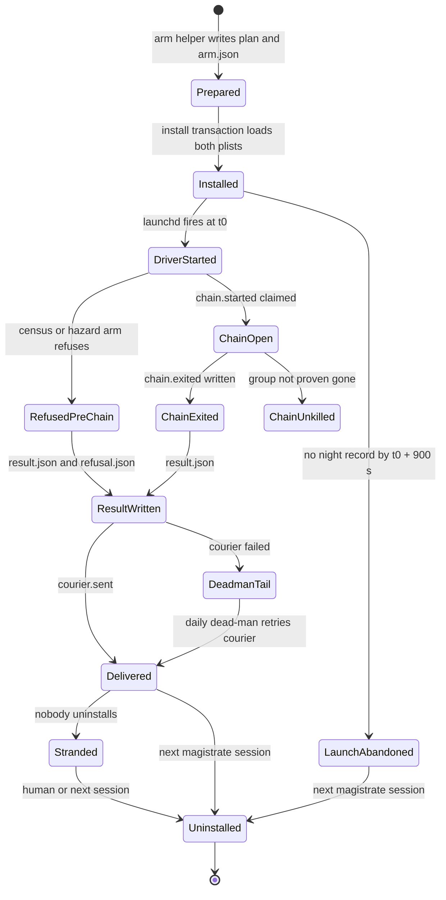
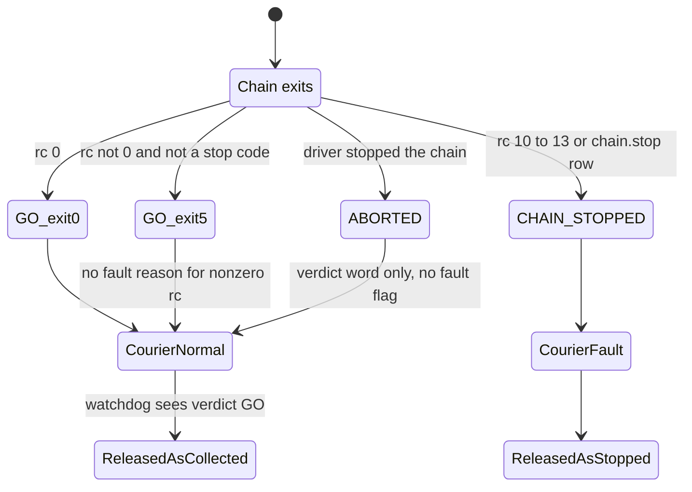
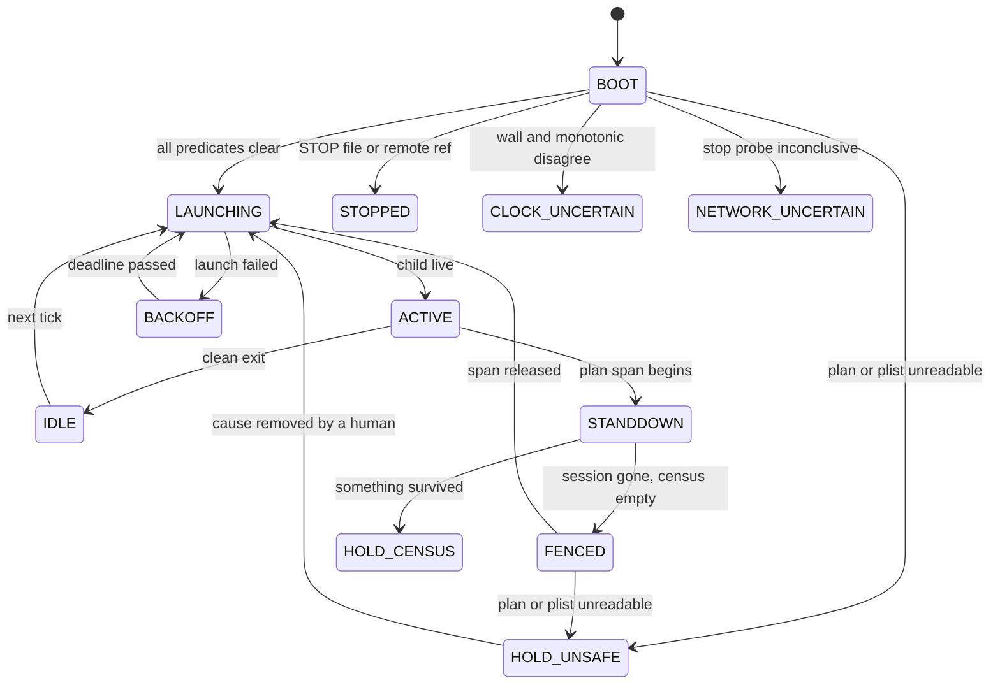
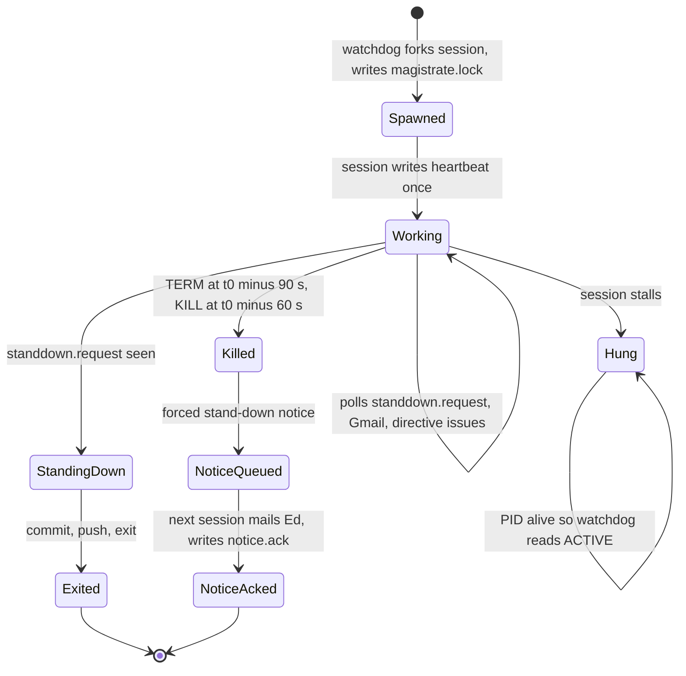
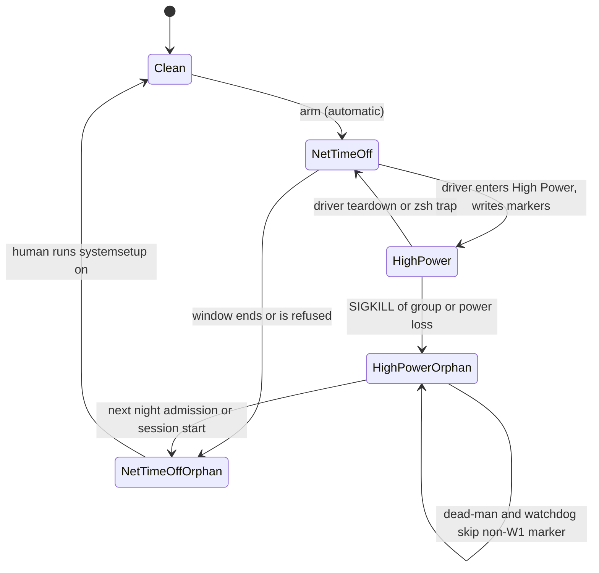
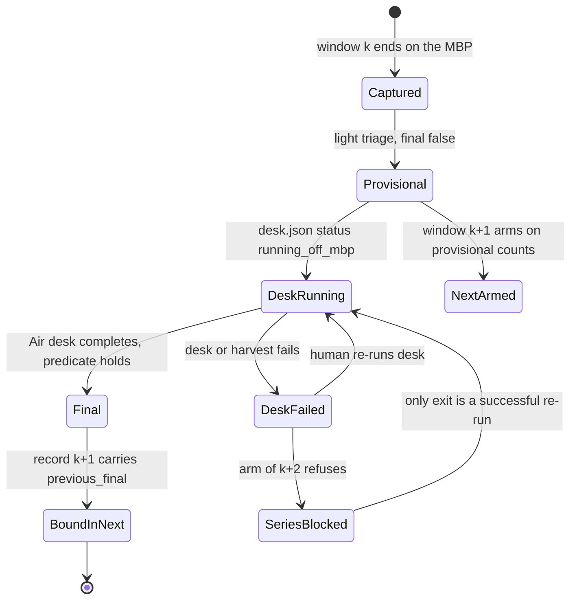
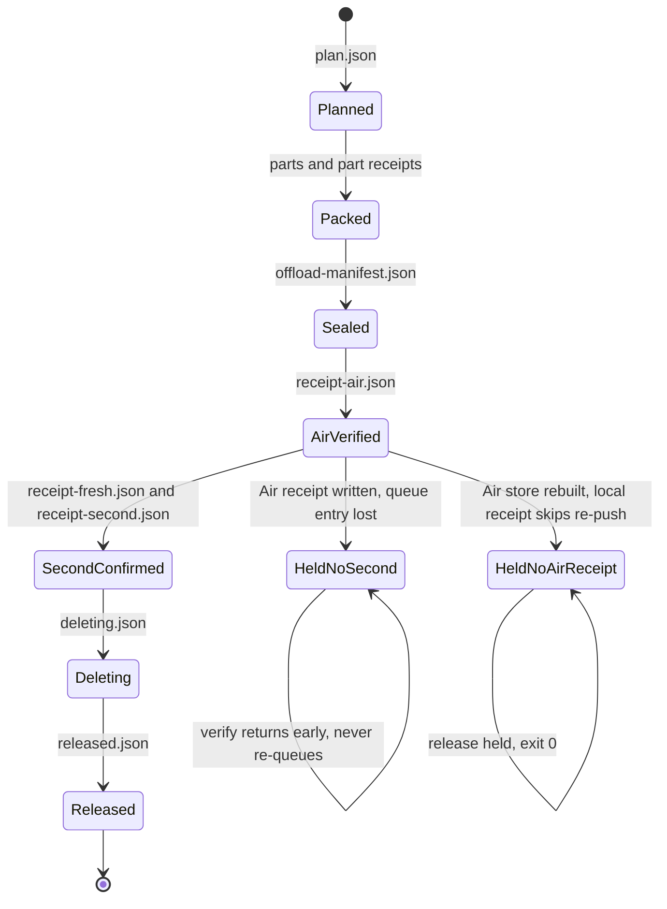
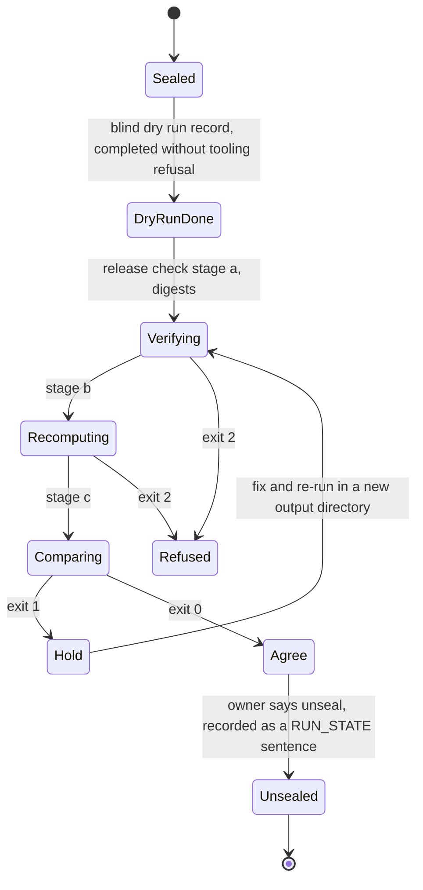

# Implicit state machines in JouleWise: inventory, failure analysis and improvement plan

Independent audit, Fable 5.2, 2026-11-10 (written 17:00-18:00 PST). Audit only: no code was changed.

## 0. Read this first: the R1 window re-armed today is not measuring

This was found while tracing the window lifecycle. It is the same class of failure this audit was asked about, and it is live.

- **What the published record says (verified, read from the remote-tracking ref `origin/night-results/align-r1-20261110T2146Z` in this clone; two commits, 13:50:32 and 13:50:37 PST).**
  - `result.json`: `verdict: REFUSED`, `aborted_reason: night_refused_hazard`, `chain_exit_code: null`, started 13:46:00 PST, ended 13:49:42 PST.
  - `refusal.json`: `hazard arm did not return GO; non-PASS: clock=REFUSE; clock REFUSE: measured rate gate: 58.5029 ms > 5.0 ms`. The other five hazard modules read PASS.
  - No `chain.started` and no `chain.exited` were published: the chain never started. Nothing was measured.
  - `network_time_off.action.json`: the arm ran `systemsetup -setusingnetworktime off` at 13:46:01, return code 0.
  - `courier.json`: `sent: true`. That does not mean mail was sent (see below).
- **What follows from the code (inferred; I did not and may not connect to the MBP).**
  - **Nobody was mailed.** R1's courier is `scripts/b6_courier.sh`, which writes a file record with `"mail_sent": false` and touches `courier.sent` (`20e9edbc4:scripts/b6_courier.sh:20-26`; `docs/align/r1_arm_runbook.md:174-175` says "starts no agent and sends no email").
  - **Network time is still OFF.** The armed code has a command to turn it off and none to turn it on (`20e9edbc4:joulewise/b5/driver.py:100`); the restore is a manual runbook step.
  - **The magistrate will not relaunch.** Item 249 says the installed watchdog cannot parse this plan's `ac_powermode` key and will hold in `HOLD_UNSAFE` while the two night plists are installed. Nothing uninstalls them.
  - **The pointer's wait condition can never come true.** RUN_STATE item 249 says to act "after `chain.exited`". A window refused before its chain writes no `chain.exited`.
  - **The named recovery tool refuses this case.** `post_window_unstrand.sh` requires `night/chain.exited` and says "a window refused before its chain started is not covered" (`origin/ops/2026-11-10-watchdog-v5-installed:scripts/post_window_unstrand.sh:11,33-38`).
  - **The Air's link monitor would report "armed".** Its armed test is "a `com.joulewise.night` label is loaded" (`ops/2026-11-10-hostlink:scripts/hostlink/mbp_link_monitor.sh:18`).
- **Net.** If nothing has intervened, the MBP has been idle since 13:50 PST with network time off, and every automatic observer reads the state as "armed until Wed 19:03".
- **Possible cause (hypothesis, not checked).** Item 249 turned network time back ON at about 13:21 after 2.5 days off, then armed with t0 25 minutes later. A clock still being disciplined would fail a 5 ms rate gate. The clock module's record in custody would confirm or refute this.
- **Manual recovery needed, in this order:** read `result.json` (REFUSED), uninstall both night plists, turn network time ON, check `pmset -g custom` and the two High Power markers, fix item 249's pointer, then decide the re-arm (with a settle time after the network-time restore).

## 1. Summary verdict

**The project has about 45 lifecycles. About ten are explicit or close to it, almost all on the analysis and calibration side. The operational ones on the MBP are implicit, and they all fail the same way: a state that means "nothing is happening and nobody knows" is indistinguishable from "armed and running".**

- **The 2.5-day loss of 11-08 and today's stranding trace to four specific defects, all verified in code:**
  1. `verdict: GO` describes the arm, not the collection. A chain that exits 3 still gets GO, and a nonzero chain exit is not a fault reason (`joulewise/b5/driver.py:2614-2615`, fault list at 2625-2640 on `main`; same at `20e9edbc4:2755-2756, 2767-2782`).
  2. `HOLD_UNSAFE` has no notice and no exit. The watchdog queues a notice only for `CLOCK_UNCERTAIN`, `NETWORK_UNCERTAIN`, `HOLD_CENSUS`, plan conflicts and corrupt locks (`scripts/magistrate_watchdog.py:3079-3082`), and a notice is only ever delivered by the next session, which `HOLD_UNSAFE` forbids.
  3. Magistrate liveness is a PID. The session writes a `heartbeat` file (`docs/process/MAGISTRATE_RELAUNCH_PROMPT.md` line 2) and no code reads it.
  4. Host side effects have an automated "set" and a manual "clear": network time, AC power mode, the night plists.
- **The fix shipped today does not close defect 2.** `ops/2026-11-10-watchdog-v5-installed` makes the plan parser accept `ac_powermode` and does not touch `scripts/magistrate_watchdog.py`. The next unknown plan key strands the MBP the same way.
- **The good patterns already exist in the repo** and should be copied: the night-agent installer (`joulewise/night_agent_install.py:352-365`, a real `Enum` with rollback), the R0 desk fence (deadline plus PID, stale removal with a notice), and the offload journal with sealed receipts.
- **The largest single improvement costs nothing on the MBP.** The driver already pushes `night-results/<plan_id>` within a minute of any terminal state. An Air-side watcher on those refs would have flagged the 11-08 refusal at 01:26 and today's at 13:50. No such watcher is in the repository.

## 2. Scope, method and what "verified" means

- **Marks.** **[V]** I read the cited lines. **[D]** a delegated Opus reader read the lines and I did not re-read them. **[D+]** delegated, and I spot-checked the cited lines. **[I]** inferred from code or documents, not observed.
- **Where the code lives.** Most of the live arm stack is not on `main`. I read it through `git show <ref>:<path>` from this worktree, with no checkout:

| Ref | What | Cited as |
|---|---|---|
| `main` `bfe0f4c78` | night driver, watchdog, block-5 analysis, state kernel | bare paths |
| `lane/2026-11-08-r1-arm-fixes` `20e9edbc4` | the code armed for R1 | `20e9edbc4:` |
| `origin/ops/2026-11-10-watchdog-v5-installed` `df5311456` | parser fix, unstrand helper | `wdv5:` |
| `ops/2026-11-10-hostlink` `f3d2d7882` | Air to MBP link monitor | `hostlink:` |
| `origin/align/2026-11-08-v4-r11` `9abe6095f` | v4 arm stack, series, PREQUAL | `r11:` |
| `ops/2026-11-08-air-offload-merged` `b5af05e12` | offload | `offload:` |
| `align/2026-11-08-harvest-off-fix` `d5dc1198c` | harvest off the MBP | `hoff:` |
| `origin/align/2026-11-08-v4-release-tools` `b2c0681cd` | v4 release | `rel:` |

- **Results branches.** I read file names and commit times of the two `night-results/align-r1-*` branches, and from today's branch only the structural fields quoted in section 0. Nothing was measured in that window, so there is no outcome content in it. I read no `records/*` branch.
- **Not done.** No MBP connection, no measurement, no pipeline run, no unit tests (none were needed to settle a claim). I did not read restricted directories. Pruned material was skipped as instructed.
- **A dependency worth knowing.** The "retired CA-42 chain" modules are load-bearing for the live path. `NightPlan` and the plan schema live in `joulewise/night_gate.py`; the watchdog imports `night_gate` and `arm_retry` (`scripts/magistrate_watchdog.py:41-52`); `run_night.py` imports `arm_readiness`, `arm_readiness_evidence_t0`, `night_gate`, `t0_rehearsal`, `network_time_off` and `v5_qualification` (`scripts/run_night.py:49-56, 746`) and uses them at about 100 call sites, including the results-branch push. Today's watchdog fix edits `night_gate.py` and `arm_retry.py`. Pruning that chain would break arming. [V]

## 3. Inventory

"Explicit" means a declared state type, one transition function and a persisted journal. Risk is for the v4 window campaign over the next weeks.

| # | Machine | State store | States | Explicit? | Risk |
|---|---|---|---|---|---|
| 1 | Night window lifecycle | files under `<custody>/night/`, two launchd plists | ~12 | No | **High** |
| 2 | Outcome stack (arm verdict, chain exit, payload status, driver exit) | `result.json`, `hazard_result.json`, `chain.exited`, `r1_result.json`, process exit codes | 5 + 5 + 4 + 6 | No | **High** |
| 3 | Magistrate watchdog | `state.json`, `events.jsonl` | ~16 | Partly (strings, one `transition()`, journal; no legal-transition table) | **High** |
| 4 | Magistrate activation, notices, liveness | `magistrate.lock`, `heartbeat`, `notice_pending`, `notice.ack`, `standdown.request`, `STOP`, remote `ops/stop*` refs, Gmail unread, `directive` issues | ~8 | No | **High** |
| 5 | Host side effects | network-time setting, AC power mode, two High Power markers, `night.lock`, plists, SIGSTOPped Spotlight, keep-awake agent | 2 each | No | **High** |
| 6 | "Armed" predicate (five definitions) | plan span arithmetic; plist loaded; plist file prefix; `armed_until` file; RUN_STATE prose | 2 | No | **High** |
| 7 | Work-selection pointer | RUN_STATE "Next activation" prose; `state_kernel.json`; TASK_QUEUE; `WINDOW_STATUS.md` | n/a | Kernel yes, pointer no | **High** |
| 8 | Plan schema and code-version skew | `night_plan.json` keys; canonical-root HEAD; measurement-root HEAD | n/a | No | Medium-high |
| 9 | Harvest-off finality (provisional, final, k+2) | record k `sources`, record k+1 `previous_final`, series history `status` | 4 | No | Medium-high |
| 10 | Offload custody, MBP side | receipt files in `<state_root>/<W>/`, `offload-journal.jsonl` | 8 | Mostly (journal, sealed receipts) | Medium |
| 11 | Offload custody, Air store | `inbox/`, `windows/`, `queue/`, `second/` | 5 | No | Medium |
| 12 | v4 series progression (C1-C14, T1-T3) | replay of hash-chained records | 3 per slot | Derived, deterministic | Medium |
| 13 | Analysis release (verify, recompute, compare, unseal) | `verdict.json`, exit 2 > 1 > 0; unseal is a RUN_STATE sentence | 4 | Stages yes, unseal no | Medium |
| 14 | R1 driver record and segment retries | `r1_result.json` `status`; `.rejectedN`, `.g0_timeout1` renames | 4 + 3 | No | Medium |
| 15 | Courier delivery | `courier.lock`, `.heartbeat`, `.sent`, `.json` | 5 | No | Medium |
| 16 | Dead-man | daily calendar plist; `courier.sent`; completion epoch | 4 | No | Medium |
| 17 | Hostlink monitor | one-line `status` file, `armed_until` | 3 | No | Medium |
| 18 | Stop switch | local `STOP` file, remote `refs/heads/ops/stop*` | 3 | No | Low-medium |
| 19 | Night-agent install transaction | in-memory `State` enum, `.plist.prior` sidecars | 13 | **Yes** | Low |
| 20 | R0 desk fence | `desk_fence.json` (purpose, pid, deadline) | 3 | **Yes in effect** | Low |
| 21 | Evidence-night preparation | `state.json` `steps` list | 6 | **Yes** (step journal) | Low |
| 22 | State kernel task status | `docs/process/state_kernel.json` | 5 | **Yes**, and stale | Medium (see 7) |
| 23 | PREQUAL report | `prequal-*.json` PASS, FAIL, INCOMPLETE | 3 | Mostly | Low |
| 24 | Hazard arm decision | `arm_decision.json` per-module PASS, REFUSE, UNMEASURED, NOT_EVALUATED | 4 per module | Mostly | Low |
| 25 | Block-5 chain exit contract | exit 0, 10-13, 64, 75; `chain-stages.jsonl` | 7 | Partly | Low now (block 5 closed) |

| 26 | Block-5 harvest verdict | `harvest.json` `verdict`, `claim_usable`, `release_blocked` | 4 | No | **High** for the next block (fails open) |
| 27 | Three verdicts per window (driver, harvest, whole-window row) | three files | 4 + 4 + 2 | No | Medium |
| 28 | Block-5 analysis step record | record `steps[].status` | 5 | Mostly (closed tuple, validator) | Low |
| 29 | Analysis run directory and resume | directory and checkpoint existence | ~5 | No | Medium |
| 30 | Analysis version as refs | tags, a constant in a test, record field, CLI argument | n/a | No | Medium |
| 31 | Calibration ledger (dispositions, sessions, pin relation) | hash-chained JSONL; git-committed pin file | 5 + 3 + 4 | **Yes** for dispositions and pin relation | Medium (stale pin on `main`; manual-only exit from an open session) |
| 32 | PR gate ledger | PR body rows | 4 per row | No, self-attested | Medium |
| 33 | CI docs-only short-circuit | job output | 2 | Mostly | Low |
| 34 | Pin registry | `configs/pins/registry.json` | 2 kinds | Mostly | Low-medium |
| 35 | Quiet guard | state and event files, `TRANSITION_TABLE` | 4 | **Yes** | Low |
| 36 | Suite item and run status | `ItemStatus`, `RunStatus` enums | 6, 3 | **Yes** | Low |
| 37 | Equivalence verdict marker | `BLINDED-VERDICT.txt` | 4 | Mostly | Low |
| 38 | `B5-ARM-RELEASED` line | two lines in RUN_STATE | free text | No, and no reader | Low |

Rows 26-38 are described in section 6.

## 4. The top eight machines

Sections 4.1 to 4.5 and 4.8 carry state diagrams; 4.6 and 4.7 are comparisons of competing definitions and are given as tables. Two more diagrams (offload custody, analysis release) are in section 5.

### 4.1 Night window lifecycle (machine 1)

**Where the state lives.** Presence of write-once files in `<custody>/night/` (`scripts/run_night.py:133-156`), plus whether the two plists are on disk and loaded.

**Transitions and who triggers them.**
- Chain claim: `os.open(O_CREAT|O_EXCL)` on `chain.started` (`run_night.py:602-611`). [V]
- Chain exit: `_record_chain_exit` (`run_night.py:481-498`); the dead-man writes it with `reaped_by: dead-man` if the group is gone (`4534-4572`). [V]
- Any existing write-once record turns a later fire into a rerun refusal (`2216-2225`, `4000-4011`). [V]
- Launch abandoned: watchdog, `_launch_liveness_candidate` (`magistrate_watchdog.py:1003-1013`), HAZARD_PACK only. [V]
- Uninstall: only a person or a magistrate session. "Uninstalled" is recorded nowhere. [D]

**Stuck states with no automatic exit.**
- **Stranded.** Result written, plists still loaded. The dead-man calendar has no month or day, so it fires daily forever and logs "skipped" [D]. The labels are global, so every later install is refused `night_agent_already_loaded` until someone uninstalls [D]. This is the state the MBP was in from 11-08 01:26 to 11-10 13:21, and by inference is in now.
- **ChainOpen with a live or unprovable group.** The watchdog extends the span "without a clock limit" (`magistrate_watchdog.py:1277-1281`; `docs/process/MAGISTRATE_WATCHDOG.md` rule 4). The dead-man refuses `chain_alive` each day. [V]
- **ChainUnkilled.** The courier is suppressed (`run_night.py:4403-4414`), so the only report is the dead-man's.

**Representable but illegal.** `chain.exited` without `chain.started` (the release rule checks for it, `joulewise/arm_retry.py:301`); `result.json` with `verdict: GO` and no `chain.started`; `courier.sent` without `result.json`. None is asserted at write time.

**Who observes.** Only the watchdog's release logic, which needs a parseable plan. No alarm on dwell time in any state.

### 4.2 Outcome stack (machine 2)

Five fields describe "how did the window go", written by four programs, and no code compares any two of them.

| Field | Values | Writer | What it actually describes |
|---|---|---|---|
| `result.json` `verdict` | `GO`, `REFUSED`, `ABORTED`, `CHAIN_STOPPED`, `REHEARSAL_ONLY` | `run_night._write_result` (`2026-2064`) | whether the **arm** was admitted and the chain was not aborted |
| `result.json` `chain_exit_code` | integer or null | same | the chain's exit status |
| driver process exit | 0 GO, 3 refused, 4 aborted, 5 chain failed, 6 courier failed (`127-131`) | `run_night` | read only by launchd; not persisted [D] |
| `hazard_result.json` `verdict`, `faults.reasons` | as above plus fault list | `joulewise/b5/driver.py:2645-2648` | arm verdict again, plus block-5 yield faults |
| `r1_result.json` `status` | `complete`, `refused`, `aborted` (`running` only in memory) | `20e9edbc4:scripts/align_r1_rehearsal.py:1583, 1828-1835` | whether R1 measured |

**The 11-08 failure, step by step.**
1. The R1 driver could not create `/Users/Shared/JouleWise/host-power` and raised `Refusal("powermode.host_lock_unavailable")`; status `refused`, exit 3 (`20e9edbc4:scripts/align_r1_rehearsal.py:1622-1625, 1833-1835`; `joulewise/align/apple/powermode.py:210-211`). [D+]
2. The hazard driver recognises only the block-5 stop codes (`20e9edbc4:joulewise/b5/chain.py:115-125`). Exit 3 fell to the last branch: `verdict = "GO"  # it describes the arm; the yield says what was collected`, with only the process exit set to 5 (`20e9edbc4:joulewise/b5/driver.py:2755-2756`). [V]
3. `fault_reasons` covers yield, `CHAIN_STOPPED`, monitor crash loop, supervision, post bracket and bound derivation. A nonzero chain exit is not in it (`2767-2782`). R1 plans no campaign stages, so yield is `UNKNOWN`, not `EMPTY`. [D+]
4. Nothing in the driver, watchdog or release rule reads `r1_result.json`. It is not in `HAZARD_ARTIFACTS`, so it is not on the results branch either. [D]
5. The watchdog's release rule accepts any known terminal verdict as `collected_window` (`joulewise/arm_retry.py:296-300`). [V]

**Root cause in one line.** A vocabulary built for the block-5 chain (stop codes 10-13, yield per stage) was reused for a chain with a different exit contract (0, 3, 4, 65, 130, 1), and the unmapped codes default to GO.

**Other exits that become GO** [D]: 65 (chain SHA mismatch), 130 (signal), 1 (missing sudo rule under `set -e`, before the driver runs and with no `r1_result.json` at all), and the R1 runtime's own 0/2/3/128+n, which all collapse into driver `refused`.

**Exit 0 without a full measurement** [D]: `complete` is reachable with `inconclusive` or `skipped` segments and `x_g.status: not_run`; these are recorded, not refused.

### 4.3 Magistrate watchdog (machine 3)

This is the most explicit of the operational machines: documented states, one `transition()` that appends exactly one event per change (`magistrate_watchdog.py:1764-1802`), a persisted `state.json`. Its gaps are specific.

**Verified gaps.**
- **`HOLD_UNSAFE` is one name for seven causes** with different exits: unreadable plan, malformed plan, unreadable installed plist, plan conflict, process table unavailable, corrupt lock, lock that cannot be cleared (`magistrate_watchdog.py:613, 618, 2051, 2055, 2080, 2162, 2170, 2174, 2184, 2238`). [V]
- **No notice for most of them.** `tick()` sets a notice for three states and two reason prefixes (`3079-3082`). An unreadable installed plist gets none. [V]
- **Notices cannot leave the machine.** A notice is a list entry rendered into the next session's prompt (`2259-2275`); the session mails it and writes `notice.ack`. In `HOLD_UNSAFE` no session launches, so a notice queued there would still reach nobody. The watchdog has no channel of its own. [V]
- **No dwell limit.** `transition()` returns early when the state is unchanged (`1773-1774`), so 2.5 days in `HOLD_UNSAFE` is one journal line. [V]
- **Strict parsing turns version skew into a hold.** `NightPlan.from_mapping` requires the exact key set (`joulewise/night_gate.py:444-470`). The watchdog runs from the canonical root's working tree (`configs/launchd/com.joulewise.magistrate.plist.template`; `scripts/install_magistrate_watchdog.sh:37, 72-73`); the plan is written by the measurement root at a lane head. A lane that adds a plan key strands the machine unless the canonical root already has the reader. The fence arithmetic needs only `t0_epoch_s`, `window_max_s`, `custody_root` and `plan_id`. [V]
- **Today's fix is the parser only.** `wdv5` changes `night_gate.py`, `night_plan_writer.py`, `night_agent_install.py`, `arm_retry.py` and `run_night.py`, not the watchdog. [V]
- **The v4 line adds hold timing receipts, not alarms.** `r11:scripts/magistrate_watchdog.py` `_hold_boundaries` records start and end of each hold span in `events.jsonl`. Useful after the fact; still silent. [V]
- **A tick that raises is invisible.** `main()` returns 0; an uncaught exception goes to `launchd.err`, which nothing reads. [I]

**What already works and should be kept:** the one-way release latches, the PID-plus-start-time lock identity, reboot-bound backoff, the launch-liveness release with its marker that the driver honours.

### 4.4 Magistrate activation, notices and liveness (machine 4)

- **Liveness is the PID.** `ACTIVE` means the PID and start time in `magistrate.lock` are live (`magistrate_watchdog.py:1422-1432, 2226-2227`). The `heartbeat` file is written once at launch by instruction and read by no code; the watchdog has no check of stream or file modification time. A hung session is `ACTIVE` indefinitely. [V]
- **Silence is not a state.** "No session has run for N hours outside a plan span" is not computed anywhere. The Air's monitor counts `claude` processes (`hostlink:mbp_link_monitor.sh:18`), which a hung process satisfies, and it skips the probe entirely while it believes the MBP is armed. [D+]
- **`notice.ack` clears the whole queue,** including a notice queued while the acknowledging session was starting (the prompt says so). A notice can be acknowledged without having been in the mail. [V]
- **Two owner channels with different semantics:** unread Gmail from one address (read at each slice) and GitHub issues labelled `directive`. Neither has an "acted on" state the other can see; marking mail read is the only acknowledgement. [V]
- **The magistrate's own record of state is prose.** It resumes from "the top/current pointer in `RUN_STATE.md`" (machine 7).

### 4.5 Host side effects (machine 5)

Each is one bit of machine state with a different owner for "set" and "clear".

| Side effect | Set by | Cleared by | If the owner dies |
|---|---|---|---|
| Network time OFF | hazard arm, automatically (`20e9edbc4:joulewise/b5/driver.py:100, 1933-1957`) | a person or magistrate, runbook section 4 | stays OFF. No code in the armed tree turns it on. [V] |
| AC power mode 2 (High Power) | R1 driver, under `night.lock` | driver teardown; zsh `EXIT` and signal traps (`20e9edbc4:scripts/night_chains/align_r1_rehearsal.zsh:6-18`) | SIGKILL of the whole group: nothing restores until another night or session runs. The dead-man and watchdog restore only W1-tagged markers (`powermode.py:178-186`), so an R1 crash marker is never theirs. [D+] |
| High Power markers (two files) | driver, before the mode change | driver, after a read-back of 0 | the chain's startup restore resets the mode and never deletes the markers [D] |
| Host night lock | `flock` on `host-power/night.lock` | kernel, on process death | safe |
| Night plists loaded | install transaction | uninstall | loaded forever; block every later install [D] |
| Spotlight daemons SIGSTOPped | R0 launcher | launcher's trapped exit | stay stopped; the watchdog queues a `desk_fence_stale` notice for the next session (`magistrate_watchdog.py:1973-1986`) [V] |
| Keep-awake agent | loaded 2026-10-10, "left loaded for good" (RUN_STATE item 19) | never | a standing assumption checked by hand before each arm |

**Further points.**
- **Two restorers disagree.** The driver defers the restore when it cannot retake the lock or cannot prove a child gone (`20e9edbc4:scripts/align_r1_rehearsal.py:392-432`); the zsh traps run `pmset -c powermode 0` unconditionally. The traps undo the deferral. [D]
- **The production state directory is never exercised before the real run.** `JOULEWISE_HOST_STATE_DIR` redirects it; `tests/align/__init__.py:11` sets it for every test process; `mark_production_entry` only refuses an override and never probes the default path (`powermode.py:87-109`). No step of `prepare`, `install` or admission creates or locks the production directory. With no marker present, admission only calls `os.path.lexists`, which returns False on a permission error. [D+]
- **Leaked state breaks the next arm.** Network time left off by the stranded 11-08 window, then restored 25 minutes before today's t0, is the leading hypothesis for today's clock refusal. [I]

### 4.6 The "armed" predicate (machine 6)

Five definitions are in use. They agree only by convention.

| Who asks | Definition | Anchor |
|---|---|---|
| Watchdog | plan span arithmetic over parsed plans, extended by an open chain, shortened by a latched release | `magistrate_watchdog.py:1268-1315` [V] |
| Hostlink monitor | a label matching `com.joulewise.night$` is loaded, checked after the SSH connection is made | `hostlink:mbp_link_monitor.sh:18, 29-30` [D+] |
| Hostlink monitor, local gate | an epoch in `armed_until`, written by hand; no code writes it | `hostlink:mbp_link_monitor.sh:19-27` [D+] |
| Offload | plist files with prefixes `night`, `align-`, `b6` | `offload:scripts/offload_window.py:104, 911` [D] |
| People and sessions | "ARMED" in a RUN_STATE item until its stated latest end | RUN_STATE item 249 |

**Consequences.**
- A stranded window is "armed" to the monitor and to offload, "span over" to the watchdog once the plan parses, and "armed until Wed 19:03" to anyone reading RUN_STATE.
- Without the hand-written file the monitor connects during an armed span, which is what the SSH rule forbids. [D+]
- A non-numeric `armed_until` is reduced to digits by `tr -cd 0-9`; a stray long digit string is a permanent silent skip. [D+]
- RUN_STATE item 231 recorded "ALIGN v4 (R1 is measuring)" at 11:17 on 11-08, ten hours after R1 had refused.

### 4.7 Work-selection pointer (machine 7)

Four artifacts claim to say what happens next. Only one is maintained.

| Artifact | Claim | Actual state |
|---|---|---|
| RUN_STATE "Next activation" under the top numbered item | the live pointer | maintained; prose; the top item is at line 1045 of 9,659 |
| `docs/process/state_kernel.json` | `"authority": "AUTHORITATIVE_WORK_SELECTION_STATE"` | `updated: 2026-09-25`; 283 tasks; no ALIGN v4, R1 or W1 task [V] |
| TASK_QUEUE generated region, RUN_STATE "Restart By Machine-State Lane" | "Source of truth for work selection" | generated from the stale kernel; `gen_state.py --check` passes in CI because the kernel is self-consistent [V] |
| `WINDOW_STATUS.md` | machine state for Ed's phone | last changed 2026-09-04; reads "BETWEEN RUNS" [V] |

- **The pointer is a linked list in prose.** Each "Next activation" says which earlier pointers it replaces and which "hold" (for example item 227: "replaces item 223's pointer; items 202-204, 207, 209, 210, 212-222, 224-226 hold"). Finding the current instruction set means walking that list by hand. [V]
- **Wait conditions are not checked for reachability.** Item 249's "until `chain.exited`" is unreachable for a pre-chain refusal (section 0).
- **Two entry-point documents disagree about where to look.** `CANONICAL.md` and the RUN_STATE header say the top numbered item; `AGENTS.md` lines 42-47 say the `ACTIVE_STOP_CARD`, "Current Project Status" and "What Is Next" sections and the TASK_QUEUE Current Queue. [V]
- **The kernel has no terminal state.** Statuses are `queued`, `active`, `partial`, `blocked`, `shelved`; completion is deletion, so "done" and "never existed" are the same. [V]
- **One machine-read line sits in the prose:** `B5-ARM-RELEASED: beta gamma` near the top of RUN_STATE, kept unchanged after block 5 closed "because a program reads it".

### 4.8 Harvest-off finality and the series (machines 9 and 12)

- **Two encodings of "final".** `is_final()` over a record's sources, and `status == 'final'` in the series history; the k+2 rule is enforced in both `hoff:scripts/align_v4_next_arm_packet.py:801-810` and `align_v4_series.py:541-545`. They agree because production rebuilds the history from the record chain. [D]
- **Deadlock with no escape.** If window k's desk fails, k+1 is already measured on provisional counts and k+2 cannot arm. There is no timeout and no lead release for this case (`RULING_RESETS` holds only `zero_capture_escalation`, `v4_cadence.py:92`). [D]
- **Runbook and code disagree.** The runbook says a later record may carry `previous_final`; `bind_final` accepts only the immediate successor (`align_v4_next_arm_packet.py:258-267, 799-800`). Following the runbook's wording can make window k permanently non-final. [D]
- **A late exclusion has no repair path.** If the final desk excludes a member that is already in the series pool, the k+2 arm refuses (`820-823`). [D]
- **Series slots** (`r11:scripts/align_v4_series.py:448-552`): each slot is absent, `counted` or `barred`; a zero capture re-arms the same slot once, a second zero bars it; more than six bars is `escalate_to_lead`, resumed only by a signed `lead_release`. State is the replay of git records, which is sound. The docstring says "up to two" reserves; the code allows six. [D]
- **PREQUAL covers `r1` and `w1` only.** Nothing mechanically requires a PREQUAL pass before a C or T window arms. [D]

## 5. Other operational machines

**Offload, MBP side (machine 10).** [D, three findings D+]
- States by file: `plan.json`, packed parts, `offload-manifest.json`, `receipt-air.json`, `receipt-fresh.json` and `receipt-second.json`, `deleting.json`, `released.json`. Atomic writes, self-sealed receipts, an append-only journal. "Deleted with one verified copy" is not reachable through the code.
- **Stale local receipt blocks re-push.** If the Air store is rebuilt, the MBP's own `receipt-air.json` skips push and verify; release then holds as `no_air_receipt` with exit 0, forever.
- **Wrong exit code in the end receipt.** `_supervised` catches only `Refusal` and `OSError`; any other exception exits 1 while the `finally` block writes a span with `rc: 0` (`offload:scripts/offload_window.py:1775-1799`).
- **An older window can starve the current one.** `release_older` runs before pack and push and re-raises a deadline stop.
- **The harvest pack has two unrecoverable crash states.** `MANIFEST.json` is written last and not atomically; after a hard kill the output directory exists without it, adopt refuses, and re-pack refuses on `mkdir(exist_ok=False)`.

**Offload, Air store (machine 11).** [D+]
- **Receipt without queue entry.** `verify` writes the Air receipt at line 2294 and the queue file at 2295. A crash between them leaves a receipt that a later `verify` returns early on (2207-2210) and never queues. No second copy is made; the MBP release holds forever as `second_copy_not_confirmed`; nothing alarms.
- **Head-of-line block.** One digest mismatch in the iCloud worker aborts the pass for every queued window on every interval; the only trace is `second/errors.jsonl`. [D]
- **"Two verified copies" is one fresh re-hash plus one historical receipt.** The second copy's current existence is not re-checked at release. [D]

**Analysis release (machine 13).**

- Block 5: stages (a) digests, (b) recompute, (c) comparator in one process; exit precedence 2 > 1 > 0 (`scripts/release_b5.py:38`). [V]
- v4: same shape; output directory must not exist; comparator exit must equal its printed verdict (`rel:scripts/release_v4.py:392-395, 435-458`). [D]
- **Unseal has no code state.** "Sealed" and "unsealed" are a sentence in RUN_STATE (item 231) plus Ed's words. Nothing mechanical separates "release check agreed" from "outcomes may be read"; the restricted output is mode 0700 under the same user. [V for block 5 docstring, D for v4]
- **The v4 comparator overwrites an existing restricted output.** `Refused("output_exists")` is caught and execution falls through to `out.write_text`; the guard meant to stop it is in the wrong `except` branch and refers to an unbound name (`rel:scripts/compare_v4_recompute.py:2217-2230`). Harmless under `release_v4` (fresh directory); destroys evidence on a manual re-run. [D+]
- **Exit 1 can mean a crash.** In `release_v4.py` the final write of `verdict.json` is outside the `try`; an `OSError` there exits 1, which reads as "hold". [D]
- **A killed run is known only by absence** of `verdict.json`. [D]

**R1 driver and segment retries (machine 14).** [D]
- `r1_slots.json` exists only if `status == "complete"`. An exception inside the `finally` that commits it can leave `complete` with no slots file and exit 1.
- Absence of `r1_result.json` is ambiguous: early refusal, SIGKILL, or a rerun into an existing directory.
- Rejected attempts are renamed `<segment>.rejectedN`; a pure G0 timeout is `inconclusive`, renamed `.g0_timeout1` and retried once. The retry count lives in the directory names.
- `bookends/{pre,post}.json` and `r1_wrapper.jsonl` carry failure flags, always return 0, and nothing reads them.

**Courier and dead-man (machines 15, 16).**
- `courier.sent` is the release condition for the watchdog (`joulewise/arm_retry.py:285-286`) and the skip condition for the dead-man (`run_night.py:4495-4498`). With the file-only courier it is always set, so both conditions are vacuous for R1. [V]
- The courier lock is "live" only if younger than `COURIER_LOCK_FRESH_S` and its PID exists (`run_night.py:1691-1705`). Sound.
- The results-branch push is best effort; a failure is a diagnostic string in the courier prompt and the custody log (`1457-1543`, `2303-2308`). With a file-only courier nobody reads either. [V]

**Stop switch (machine 18).** A local `STOP` file or any remote branch matching `refs/heads/ops/stop*` on the GitHub remote (`magistrate_watchdog.py:78-80`). The probe is skipped during a plan or desk span. A stop branch left behind stops all launches until someone deletes it; `STOPPED` gets no notice. [V]

**The three good examples (machines 19-21).**
- **Install transaction:** `State` enum PARSED through SUCCESS with REFUSED, ROLLED_BACK and RETAINED; liveness is a typed outcome that cannot be used as a boolean (`night_agent_install.py:44-66, 352-365`). One human-only state: a retained `.plist.prior` refuses later installs until `--uninstall` (`179-180`). [V]
- **Desk fence:** `desk_fence.json` holds purpose, PID and deadline; it is inactive when the deadline passes or the PID dies; the watchdog removes a stale one and queues a notice (`magistrate_watchdog.py:1933-1987`); capped at 12 hours (`scripts/launch_align_r0.py:27`). This is the liveness-plus-timeout shape the other fences lack. [V]
- **Evidence-night preparation:** an ordered `STEPS` list checkpointed to `state.json`; resume skips completed steps (`joulewise/evidence_night.py:196-203, 459-461, 623`). [V]

## 6. Analysis-side machines

These were read by a delegated Opus reader on `main`; I re-read the lines for the items marked [D+].

**Block-5 harvest verdict fails open (machine 26).** [D+]
- `verdict` is one of `COLLECTED`, `NULL`, `HARVEST_FAULT`, `NO_COLLECTION` (`joulewise/b5/harvest.py:153-156`).
- The deciding line is `collected = run.step("collection", run.collection_presence, fault=False) is not False` (`harvest.py:8365`). `step()` returns `None` when the function raises (`4090-4096`), and `collection_presence` returns `True` when the stage journal is missing (`7934-7937`). So an exception or an absent journal yields `COLLECTED`.
- This is the same shape as the GO default in section 4.2: the unrecognised case maps to the success word.
- A crash after `archive.mkdir` leaves a root with no `harvest.json`; a rerun refuses `archive_root_exists`. The way out is the `-r2` directory suffix, which no code parses, plus a hand edit of `superseded_archive_roots`. [D]
- Exit 3 prints `verdict=HARVEST_FAULT` and writes no `harvest.json`, so the printed verdict and the file can disagree. [D]

**Three verdicts per window (machine 27).** [D]
- Driver `result.json` `verdict`; harvest `harvest.json` `verdict`; whole-window row `status` (`passed`, `failed`) with `admitted`.
- Only the harvest verdict is cross-checked (against the window index, and `claim_usable` requires `COLLECTED`). Nothing requires driver GO for an analysed window. The harvest decides from whether `chain.started` exists, not from the driver's verdict.
- Two readers of the same marker disagree: the harvest treats an unreadable process-group id in `chain.started` as "not alive" and proceeds (`harvest.py:4006-4012`); `measurement_liveness` raises on it (`joulewise/measurement_liveness.py:276-279`).

**Analysis step record and exits (machine 28).** [D+ for the two definitions]
- `STATUSES = ('ok', 'tooling_refusal', 'outcome_class', 'unclassified_refusal', 'not_run')` (`joulewise/b5_analysis/dry_run.py:235`); a validator re-checks closure (ok implies exit 0, `not_run` implies stopped). This is close to explicit.
- Exit precedence is 2 > 3 > 0 here (`dry_run.py:1956-1958`) and 2 > 1 > 0 in the release check (`scripts/release_b5.py:38`). Exit 2 also covers "no record was written at all". Three tools, three exit vocabularies.
- A step with no code and exit status `None` classifies as `ok` (`steps.py:135-152`). [D]

**Run directory and resume (machine 29).** [D] State is which of the run directory, `resume/checkpoint.json` and the record exist. A crashed directory whose checkpoint does not match the binding has no exit except a new custody root. A checkpoint write failure is swallowed as `checkpoint_skipped`.

**Release and unseal (machine 13, continued).**
- Three things are called "release" and nothing reconciles them: the heavy pipeline's `B5-RELEASE-RECORD.json` (still runnable), the lean check's `verdict.json`, and the human release event. [D]
- `check_checkout` requires a clean tree and returns HEAD; it never relates HEAD to `--pinned-commit` (`scripts/release_b5.py:169-174`). The commit of the comparator and recompute programs is a free variable; only the bar set is hash-pinned. [D+]
- No tracked file names the canonical dry-run custody or the record's digest; `--custody` is a free argument. [D]
- `harvest.py:21-27` says `derived/` "may leave custody"; RUN_STATE forbids opening three files in it. The blinding boundary is written in two places that disagree. [D]

**Analysis version held in refs (machine 30): the tag-versus-branch calibration example.**
- Four notions of "the analysis commit": the constant `B5_ANALYSIS_COMMIT = b13a510dc` in `tests/b5_analysis/test_frozen_files.py:18`; the tag `b5/analysis-r4` (peels to `ab1e0098d`); the record's `analysis_commit`; the `--pinned-commit` argument. Nothing asserts they agree. [D; tag peel V]
- A test resolves a **moving remote branch by name**: `R1_FIX_BRANCH = 'origin/lane/b5-r1-9b-fix'` (`tests/b5_analysis/test_result_equivalence.py:1054`), next to `R1_TAG = 'b5/analysis-r1'` (`:1052`). Today the branch equals the tag `b5/analysis-r1-9bfix-ref`; nothing keeps it so. [D+]
- `archive/pre-prune-2026-11-06` is both a tag and a branch on `origin` (same commit today). `docs/ARCHIVE.md` tells readers to retrieve by that name. [V]
- The v4 engine is pinned by branch name in `CANONICAL.md` (`engine-r23j` @ `50f4958b6`), and RUN_STATE item 242 is a correction to "engine FROZEN at r23h". A branch name that has moved through r23h to r23n is being used as a freeze label. [V from the documents]
- `digest_pin_census.py:397-399` accepts a 7-hex "commit" through `rev-parse`, which a ref name can shadow. [D]

**Calibration ledger (machine 31).** [D; pin value D+]
- Observation disposition `pending` to `valid`, `systematic-invalid`, `ordinary-invalid`, `abandoned`, with a closed, digest-pinned decision table: explicit.
- Bracket session state is derived from the event log: `open`, `finalized`, `aborted`. **`open` has one exit, a manual `recover_calibration_ledger.py abort-session`.** It is at least surfaced as a named blocking reason.
- `PinRelation` is a real enum (`EXACT`, `PHYSICAL_AHEAD`, `PHYSICAL_BEHIND`, `DIVERGENT`).
- **The pin on `main` is stale.** `configs/calibration/calibration_ledger_head.json` on `main` says sequence 402; RUN_STATE item 31 says the measurement clone's pin-only commit is at sequence 498, and that commit is not in this repository. Any tool run from a `main` checkout defaults to the stale pin.
- `advance_b5_ledger_pin.py --no-commit` reports `ADVANCED` for a state that is advanced but uncommitted.
- Freshness uses two keys for one idea: `decision: fresh|stale` for NEG-8 and `freshness.status: fresh|stale` for the acceptance.

**PR gate ledger and CI (machines 32, 33).** [D]
- Rows are `NOT-RUN`, `RUN <path or sha>` or an exact N/A string. Rows 1, 2 and 5 accept any tracked file or known commit; the checker never looks at the diff; "docs only", "light" and "non-author review" are self-attested. Draft PRs skip the check.
- CI's docs-only path reports the required job as success without running tests. The classifier runs from the base commit and fails closed, which is sound; nothing ties the ledger's "N/A (docs only)" to that classifier's answer.

**Pins and freezes (machine 34).** [D; exclusion D+]
- The registry holds 23,594 Kind-P literals; about 7,700 are unresolved and never re-verified.
- `joulewise/whole_window.py` is in harvest pin 4 and is explicitly excluded from the frozen-bytes test (`tests/b5_analysis/test_frozen_files.py:43-44`).

**`B5-ARM-RELEASED` (machine 38).** [D+] The line appears twice in RUN_STATE with different values (line 21 `beta gamma`, line 2914 `alpha beta gamma`). The text says "a program reads it"; no file under `joulewise`, `scripts`, `tools`, `tests` or `.github` contains the string.

**Explicit machines worth copying (35, 36).** [D]
- Quiet guard: `STATES`, `ACTORS`, one `TRANSITION_TABLE`, `transition_rule()` and an event journal (`joulewise/quiet_guard.py:75-107, 466, 645-648`). The fullest example in the repository.
- `ItemStatus` with assignability sets (`joulewise/suite.py:138-157`); `RunStatus` with a failure-reason map (`joulewise/schemas.py:233`); `TerminalResult` (`joulewise/calibration_exits.py:113-117`); identity-pin receipts where PASS holds exactly when there are no reasons.

**Smaller items.** [D]
- `doctor`: quiet-machine findings, including "probe unknown" and "not on AC", are warnings, and a warning exits 0.
- `scripts/backup_runs.sh` has no notion of a block in progress or of blinding.
- `JOULEWISE_B5_VDL` with a malformed value silently becomes `off` on real data.
- More live imports of the retired chain: `arm_readiness` from `whole_window.py`, `analysis_engine/inputs.py`, `bundle.py`, `detection_floor.py`, `run_campaign.py` and `controller.py`; `night_gate` from `b5/plan.py`, `b5/driver.py` and `quiet_admission.py`.

## 7. Cross-machine consistency gaps

Places where two machines must agree and nothing checks it. Ordered by cost so far.

1. **Arm verdict versus chain exit versus payload status** (machines 1, 2, 14). `verdict: GO` with `chain_exit_code: 3` is written into one file without complaint. Cost: 2.5 days.
2. **`courier.sent` versus "a person was told"** (15, 4). True for the claude courier, false for `b6_courier.sh`. The watchdog release, the dead-man skip and RUN_STATE item 249's own narrative ("the courier sent normally") all read it as delivery.
3. **Plan writer version versus watchdog reader version** (8, 3). No arm-time step asks the installed watchdog whether it can read the plan it is about to be governed by. `magistrate_watchdog.py --dry-run` prints `decision=<STATE> reason=...` (`3229-3231`) and would have answered in one command.
4. **Five "armed" predicates** (6).
5. **RUN_STATE pointer versus machine state** (7, 1). The pointer names a wait condition; nothing evaluates it.
6. **Test seam versus production store** (5). Every rehearsal passed with `JOULEWISE_HOST_STATE_DIR` set; the production path's first use was the real arm.
7. **Restore ownership** (5). Driver deferral versus unconditional zsh trap; dead-man and watchdog restore only W1 markers.
8. **Finality: record sources versus series history; runbook versus `bind_final`** (9, 12).
9. **Offload release versus harvest finality versus record pushed** (10, 9). Release is gated on copies only. [D]
10. **Air receipt versus queue versus second-copy receipt** (11).
11. **State kernel versus RUN_STATE** (7, 22). The file marked authoritative does not know the project's main goal.
12. **Stranded plists versus the next window's tools** (1, 10, 19). A stranded window makes offload refuse `window_armed` and every install refuse `night_agent_already_loaded`. [D]
13. **Unseal: verdict file versus permission to read** (13).
14. **Stop exits per chain type** (2, 25). The hazard driver's stop table belongs to the block-5 chain; each new chain needs its own mapping or a common contract.
15. **Driver verdict versus harvest verdict versus whole-window row** (27). Only one of the three pairs is checked.
16. **Four notions of the analysis commit; release HEAD versus pinned commit** (30, 13).
17. **Ledger pin on `main` versus the measurement clone's pin** (31).
18. **Gate-ledger "docs only" versus CI's docs-only classifier** (32, 33).
19. **Exit-code vocabularies.** 0/3/4/5/6 (night driver), 0/3/4 (R1 driver), 0/2/3/128+n (R1 runtime), 0/10-13/64/75 (block-5 chain), 2 > 3 > 0 (dry run), 2 > 1 > 0 (release), 0/2/3/4/6 (harvest), 0/2/3/4/5/6 (offload), 0/1/3/2 (PREQUAL). The number 3 means "refused", "outcome class", "unresolvable input", "report to lead" and "incomplete" in five of them.

## 8. Improvement plan

**Constraints honoured.** Nothing below touches the MBP while a window is armed. Changes to `scripts/run_night.py`, `joulewise/b5/driver.py`, `joulewise/night_gate.py` and `scripts/magistrate_watchdog.py` are changes to code under the block-5 seal (RUN_STATE item 167: the seal covers 150 of 167 `joulewise/` files). Block 5 collection and its release are finished, and none of these changes alters a number, a threshold or a harvest input, so each can be a cited in-place rebind; each is marked **[rebind]**. Install on the MBP only when no night label is loaded and no night plist is on disk.

### 8.1 Quick wins (hours each)

| # | Change | Where it runs | Would have caught |
|---|---|---|---|
| Q1 | **Results-branch watcher.** Poll `refs/remotes/origin/night-results/*`. Alarm when a branch for the armed plan appears before `t0 + minimum expected duration`, or `result.json` has `verdict != GO`, or `chain_exit_code` is not 0, or `chain.started` is absent. | Air | 11-08 at 01:26; today at 13:50 |
| Q2 | **One outcome function.** `window_outcome(night_dir) -> MEASURED_OK, MEASURED_WITH_FLAGS, CHAIN_FAILED, REFUSED_PRE_CHAIN, ABORTED, UNKNOWN`, computed from the existing files, used by Q1, the unstrand helper and every desk runbook. Read-only; new module. | Air and MBP | the GO misreading |
| Q3 | **Nonzero chain exit is a fault.** In `joulewise/b5/driver.py` after the fault list is built: if the chain started and `exit_code not in (0, None)`, append `chain_exit_nonzero:<rc>`. The verdict stays GO, so block-5 readers are unaffected. **[rebind]** | MBP, next install | 11-08 |
| Q4 | **Watchdog acceptance at arm.** After install, run the installed watchdog with `--dry-run` and require `decision` in `FENCED`, `STANDDOWN_*` or `ACTIVE`; on `HOLD_UNSAFE` uninstall and refuse the arm. Runbook step first, then code in the arm helper. | MBP, at arm | the 2.5-day hold; today's |
| Q5 | **Production-store preflight.** At `prepare` and `install`, with the override unset: create, lock and release `night.lock` as the job's user; check the two `sudo -n` rules; check network-time permission. | MBP, at arm | 11-08 Errno 13 |
| Q6 | **Unstrand covers pre-chain refusals and restores the host.** Accept `result.json` with `REFUSED` and no `chain.*`; add a separate, explicit restore step for network time and power mode (it needs sudo; keep it a distinct flag). | MBP, post-window | today |
| Q7 | **Pointer rule.** Every "Next activation" states its wait as an observable with a deadline and a refusal branch: "until `result.json` exists or the latest end; if the results branch appears early, read `verdict` first". | docs | today |
| Q8 | **Retire or regenerate stale status files.** Delete `WINDOW_STATUS.md` or regenerate it from Q2. Either add the v4 tasks to the state kernel or change its `authority` string and the TASK_QUEUE header to say RUN_STATE's top item governs. Align `AGENTS.md` lines 42-47 with `CANONICAL.md`. | docs | misdirection of fresh sessions |
| Q9 | **Hostlink monitor.** Write `armed_until` from the arm helper; refuse a value that is not a plausible epoch; add `watchdog_state` and its age (from `state.json`, two fields) to the status line; alarm on any `HOLD_*` older than 15 minutes and on `armed` past `armed_until`. | Air | both strandings |
| Q10 | **Offload and release fixes.** Re-queue in `verify`'s early return; re-push when the Air has no receipt; set a nonzero rc before `finally` in `_supervised`; move the `output_exists` guard in `compare_v4_recompute.py` so it returns before the write; make `bind_final` and the harvest-off runbook say the same thing. | branches, before merge | latent |
| Q11 | **Real mail or an honest name.** Either the R1/W1 courier sends mail, or `b6_courier.sh` stops touching `courier.sent` and writes `courier.recorded`, and the release rule accepts that name for file-only plans. **[rebind]** for the release rule. | MBP, next install | "courier sent normally" |
| Q12 | **Analysis-side hygiene.** Replace `R1_FIX_BRANCH` with the tag; add a CI test that the four analysis-commit notions agree; have `release_b5` record and check HEAD against the pinned commit; delete one `B5-ARM-RELEASED` line and the "a program reads it" sentence; mark the ledger pin on `main` non-authoritative; rename one of the two `archive/pre-prune-2026-11-06` refs. | `main` | latent |

### 8.2 Structural changes (days each)

1. **Make the window lifecycle explicit (machines 1, 2, 6, 15, 16 merge into one).**
   - A `WindowState` enum and a pure `derive_window_state(custody, plists, now)` first, in shadow mode: it reads today's marker files and returns one state plus a list of violated invariants. No writer changes.
   - Use it everywhere a predicate is hand-rolled today: watchdog span logic, unstrand, offload's armed check, the monitor, the courier text.
   - Then add `night/window.journal.jsonl` with a single `transition(from, to, cause)` that the driver, dead-man and uninstall call, and record `uninstalled` as a state. **[rebind]** for the driver.
   - Split the result schema at its next version: `arm_verdict`, `chain_exit_code`, `payload_status`, and a derived `outcome`. Keep `verdict` for block-5 readers.
2. **Give the watchdog dwell limits, distinct holds and a voice (machines 3, 4 merge).** **[rebind]**
   - A declared state enum and a legal-transition table; `transition()` refuses an undeclared edge.
   - Split `HOLD_UNSAFE` into `HOLD_PLAN_UNREADABLE`, `HOLD_PLIST_UNREADABLE`, `HOLD_CONFLICT`, `HOLD_LOCK`, `HOLD_PROCESS_TABLE`, each with its own exit rule.
   - A tolerant reader for fence arithmetic (four fields), separate from the strict admission parser, so an unknown key fences correctly and does not hold.
   - A maximum dwell per state. On expiry: a `STRANDED` state and an alarm that does not need a session. The simplest channel is a status file the Air monitor already reads (Q9); a second is a tiny mail-only LaunchAgent.
   - Session liveness from heartbeat or stream modification time: `ACTIVE` older than N minutes without progress becomes `STALLED`, with a notice and the existing stand-down ladder.
   - An explicit silence alarm: no session start for N hours while no plan span is active.
3. **A host side-effect ledger (machine 5).**
   - One file under the host state directory listing each effect with owner, plan, set time and a deadline.
   - One idempotent `restore_owed()` for all effects, called from the driver's every terminal path (including pre-chain refusal), the dead-man, the watchdog's release and the unstrand helper. The v4 line's `powermode.restore_owed` is the starting point; extend it to non-W1 markers and to network time.
   - One restorer per effect: remove the unconditional zsh trap or make it honour the lock.
4. **One head pointer (machines 7, 22 merge).** A small generated `CURRENT.json` (top item number, armed plan id, t0, latest end, expected next observable, owner) checked in CI against RUN_STATE's top item; the state kernel either gains the live tasks or is demoted to a backlog.
5. **Finality as one field (machines 9, 12).** One `finality` value per window record, written by one function, with a `desk_failed` state and a lead-signed release for the k+2 deadlock, mirroring `zero_capture_escalation`.
6. **A chain exit contract (machines 2, 25).** Every chain declares its exit codes in its plan (`exit_contract: {0: complete, 3: refused, ...}`); the driver maps through the declaration and treats any undeclared code as `CHAIN_FAILED`, never GO.
7. **Unseal as a recorded transition (machine 13).** A signed `unseal.json` beside the verdict (who, when, which verdict digest), and tools that display outcomes refuse without it.
8. **Fail-closed harvest for the next block (machine 26).** A missing or unreadable stage journal, or an exception in the collection step, must not read as `COLLECTED`. This one is **not** a neutral rebind: `harvest.py` is under harvest pin 4 and the change can alter a verdict. Leave block 5's pinned harvest as it is; make the change in the harvest that the next block registers, with a new pin.
9. **One exit-code contract.** A shared table (0 success, one code for refused, one for failed, one for usage) adopted by new tools; existing sealed tools keep theirs and are mapped through Q2's outcome function.

### 8.3 Invariants to assert (cheap, each one line)

- `verdict == GO` implies `chain.started` exists.
- `chain.exited` implies `chain.started`.
- `chain_exit_code not in (0, None)` implies `fault` is true.
- Payload record `status == complete` if and only if chain exit is 0 if and only if the slots file exists.
- `courier.sent` implies a mail message id is recorded, or the plan declares a file-only courier.
- A night label loaded later than `completion epoch + 1 h` with `result.json` present is `STRANDED`.
- Network time is ON whenever no plan span is active.
- AC power mode is 0 whenever no process holds `night.lock`.
- The installed watchdog's dry-run decision for a newly installed plan is not `HOLD_*`.
- An Air receipt implies a queue entry or a second-copy receipt.
- Record k non-final and k+1 armed raises a visible flag; record k non-final blocks k+2 with a named, releasable reason.
- Harvest `COLLECTED` implies a readable stage journal containing a collection stage.
- Every analysed attempt has driver `GO`, harvest `COLLECTED` and an admitted whole-window row.
- The tag, the test constant, the record field and the pinned-commit argument name the same analysis commit; no test resolves a branch by name.
- The state kernel's `updated` is no older than the newest RUN_STATE item by more than N days, or CI says so.

### 8.4 Order of work

1. **Now:** recover the MBP by hand (section 0), fix item 249's pointer.
2. **Before the next arm:** Q1, Q2, Q4, Q5, Q7 (all Air-side, docs, or arm-time checks); Q6 on the watchdog branch before it is installed.
3. **With the next install on the MBP:** Q3, Q11, and the watchdog-v5 parser fix together.
4. **Before W1:** structural 2 (watchdog dwell and voice) and 3 (side-effect ledger); Q10 before the offload and release branches merge.
5. **During the C windows:** structural 1 in shadow mode, then 5 and 6; 4 and 7 as documentation work.

## 9. Limits of this audit

- I could not observe the MBP. Everything about its present state beyond the published results branch is inference from code and from RUN_STATE item 249.
- The remote-tracking refs in this clone are as of its last fetch; I did not fetch.
- Lane watchers that live outside the repository (on the Air) were not visible to me. "No watcher exists" means "none is in the repository".
- Delegated findings marked [D] were read by an Opus reader with line citations; I re-read the ones marked [D+] and found no discrepancy in those.
- I did not review test coverage of any machine.
